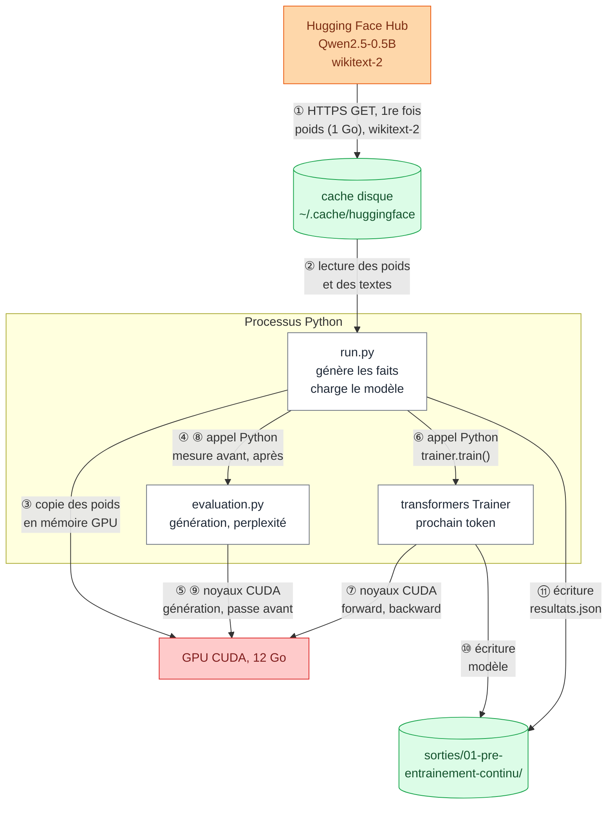

# 01 — Pré-entraînement continu

> Poursuivre l'entraînement « prédire le token suivant » d'un modèle déjà pré-entraîné, sur un corpus brut du domaine ou de la langue visés.

| Regroupe | Modifie | Local 12 Go | Test `--quick` |
|---|---|---|---|
| Continued pretraining, DAPT (domain-adaptive pretraining), adaptation à une langue, MLM continu des encodeurs | Tous les poids | ✅ jusqu'à ~1,5B (complet), ❌ au-delà | ✅ SmolLM2-135M |

## Principe

Schéma : [docs/schemas-methodes.md](../docs/schemas-methodes.md#m01) (ce que la méthode ajoute ou modifie dans le transformer).

On reprend exactement l'objectif du pré-entraînement initial, sans questions ni réponses : du texte brut du domaine visé. Le modèle absorbe le vocabulaire, le style et les connaissances du corpus : textes médicaux, juridiques, code interne, une langue peu représentée.

Trois réglages font la différence :

- **Learning rate faible** : 10 à 100 fois plus faible qu'au pré-entraînement initial, avec un warmup puis une décroissance cosinus.
- **Replay** : on mélange 5 à 30 % de texte général au corpus du domaine. Sans ça, l'oubli catastrophique est quasi certain (voir [docs/oubli-catastrophique.md](../docs/oubli-catastrophique.md)).
- **Diversité des formulations** : un fait vu sous une seule formulation est mémorisé mais rarement réutilisable en question-réponse. D'où plusieurs paraphrases par fait dans l'exemple.

Le pré-entraînement continu est en général suivi d'un SFT ([DATA02](../02-fine-tuning-supervise)) pour récupérer le comportement d'assistant.

## Modèles concernés

| Type de modèle | Exemples de modèles | Applicable | Remarques |
|---|---|---|---|
| LLM décodeur de base | LLaMA, Qwen, Mistral, Gemma, Phi, GPT-2, SmolLM | ✅ cas principal | `run.py`, tout `AutoModelForCausalLM` |
| LLM instruct / chat | Llama-3.1-8B-Instruct, Qwen2.5-7B-Instruct, Mistral-7B-Instruct | ⚠️ | Fonctionne, mais le format de chat se dégrade. Préférer : base -> pré-entraînement continu -> SFT, ou fusionner ensuite avec l'instruct ([EDIT08](../08-fusion-modeles)) |
| Encodeur | BERT, RoBERTa, DeBERTa, CamemBERT | ✅ | [`variantes/mlm-encodeur`](variantes/mlm-encodeur) : objectif MLM |
| Encodeur-décodeur | T5, BART | ✅ | Même idée avec l'objectif de débruitage d'origine (span corruption) |
| Vision / audio | ViT, DINOv2, wav2vec2 | ✅ | Objectifs auto-supervisés d'origine (MAE, DINO, contrastif) sur images ou sons du domaine |
| Diffusion | Stable Diffusion, SDXL, Flux | ⚠️ | Équivaut à un fine-tuning complet sur les images du domaine (voir [03 variante diffusion](../03-peft/variantes/diffusion-lora)) |
| Modèle fermé via API | GPT-4o, Claude, Gemini | ❌ | Pas d'accès aux poids |

## Quand l'utiliser

- ✅ Le domaine a un vocabulaire et une distribution de texte très différents du web (biomédical, juridique, langue rare, code propriétaire).
- ✅ Vous avez beaucoup de texte brut non annoté : de 10 M à plusieurs dizaines de milliards de tokens.
- ❌ Pour des connaissances qui changent souvent ou doivent être citées : préférer le RAG ([EXEC18](../18-rag)).
- ❌ Pour changer un format ou un comportement : préférer le SFT ([DATA02](../02-fine-tuning-supervise)) ou LoRA ([DATA03](../03-peft)).

## Composants de l'exemple



`make run EX=DATA01` vérifie les prérequis (modules, GPU), puis lance `run.py` dans l'environnement `.venv`. Le script lit `config.yaml` (modèle de base, données, réglages) et génère en mémoire, sans téléchargement, une base de 40 personnages fictifs décrits chacun par 4 phrases de formulations différentes : 3 servent à l'entraînement, la 4e est gardée pour mesurer la perplexité du domaine. Le texte général (paragraphes Wikipédia de wikitext-2) vient du Hub.

- **① Téléchargement.** Au premier lancement, transformers télécharge les poids de Qwen2.5-0.5B (environ 1 Go, safetensors) et `datasets` télécharge wikitext-2 (7,5 Mo, fichiers parquet), depuis le Hugging Face Hub, par HTTPS.
- **② Lecture.** Poids et textes sont rangés dans le cache `~/.cache/huggingface` ; les lancements suivants les relisent sur le disque, sans réseau.
- **③ Copie sur le GPU.** Les poids sont copiés en fp32 dans la mémoire du GPU (`dtype: float32`), où ils restent jusqu'à la fin : ce sont les poids maîtres de l'entraînement complet.
- **④ Mesure avant.** `run.py` appelle `commun/evaluation.py` pour trois mesures : 80 questions sur les personnages (réponse juste si elle contient l'attribut attendu), perplexité sur les 40 formulations mises de côté, perplexité sur 50 paragraphes du split `test` de wikitext-2 (connaissances générales).
- **⑤ Calcul sur le GPU.** Les questions sont posées en génération, jusqu'à 24 tokens par réponse. Les perplexités ne demandent qu'une passe avant sur chaque texte, sans génération.
- **⑥ Entraînement.** `run.py` répète 15 fois les 120 phrases d'entraînement, y ajoute 20 % (en caractères) de paragraphes neufs du split `train` de wikitext-2 contre l'oubli, mélange le tout et le découpe en blocs de 256 tokens, puis le confie au `Trainer` de transformers. Tous les poids du modèle sont entraînés, sur la perte « prochain token ».
- **⑦ Forward et backward sur le GPU.** Chaque pas traite un lot effectif de 8 blocs (2 blocs, 4 accumulations) : passe avant, perte sur tous les tokens, passe arrière, mise à jour de tous les poids. Taux d'apprentissage 5e-5, calcul en bf16, gradient checkpointing actif.
- **⑧ Mesure après.** Les mêmes questions et les mêmes textes sont soumis au modèle entraîné.
- **⑨ Calcul sur le GPU**, avec le même décodage et les mêmes textes qu'en ⑤.
- **⑩ Écriture du modèle** complet dans `sorties/01-pre-entrainement-continu/modele/`.
- **⑪ Écriture du rapport** dans `sorties/01-pre-entrainement-continu/resultats.json`, avec le même tableau affiché dans le terminal.

**Ce que fait le GPU.** Le processus Python ne calcule presque rien lui-même : PyTorch envoie au GPU des « noyaux CUDA », de petits programmes qui font les multiplications de matrices et l'attention sur les poids et les activations déjà présents dans sa mémoire. En génération (⑤, ⑨), il y a une passe avant par token produit, accélérée par un cache des clés et des valeurs déjà calculées ; une perplexité ne demande qu'une passe avant par lot de textes. En entraînement (⑦), chaque pas fait une passe avant, une passe arrière qui calcule les gradients de tous les poids, puis leur mise à jour par l'optimiseur AdamW, dont l'état couvre l'ensemble du modèle. Les logits sur le vocabulaire de 152 000 tokens occupent une grande part de la mémoire, d'où les lots de 2 blocs. Le pic mesuré est d'environ 9 Go de mémoire GPU.

**Ce qui est écrit.**

| Fichier | Contenu |
|---|---|
| `modele/model.safetensors` | Tous les poids du modèle entraîné (2,0 Go, en fp32) |
| `modele/config.json`, `generation_config.json` | Architecture et réglages de génération, pour recharger le modèle avec `AutoModelForCausalLM.from_pretrained` |
| `modele/tokenizer.json`, `tokenizer_config.json`, `chat_template.jinja` | Le tokenizer et le format de conversation, copiés pour que le dossier se suffise à lui-même |
| `modele/training_args.bin` | Les réglages d'entraînement utilisés |
| `resultats.json` | Avant et après : exactitude sur les questions, perplexité du domaine, perplexité générale, nombre de questions, durée de l'évaluation, trois réponses d'exemple |
| `config_effective.yaml` | La configuration réellement utilisée, surcharges `SET` comprises |

Avec `SET="sauvegarder=false"`, seul le rapport est écrit, sans le dossier `modele/`.

## Utilisation

```bash
python run.py --quick                                  # quelques secondes, SmolLM2-135M
python run.py                                          # Qwen2.5-0.5B, 40 personnages fictifs, ~5 min sur GPU 12 Go
python run.py --set donnees.replay_ratio=0             # sans replay : observer la hausse de perplexite_generale
python run.py --set modele.nom=Qwen/Qwen2.5-1.5B --set entrainement.gradient_checkpointing=true
python variantes/mlm-encodeur/run.py --quick           # encodeur RoBERTa
```

## Ce que fait l'exemple

1. Génère une base de 40 personnages fictifs (4 formulations par personnage) que le modèle ne peut pas connaître.
2. Mesure avant l'entraînement : la perplexité sur la 4e formulation jamais vue, l'exactitude en question-réponse sur ces personnages et la perplexité wikitext (connaissances générales).
3. Entraîne sur les 3 autres formulations, avec 20 % de replay wikitext.
4. Refait les mesures. Attendu : la perplexité du domaine chute, l'exactitude QA monte et la perplexité générale reste stable.

## Paramètres principaux (`config.yaml`)

| Clé | Rôle |
|---|---|
| `modele.nom` | N'importe quel modèle causal HF |
| `donnees.source` | `faits` (exemple fictif) ou `hf` (corpus réel : `nom`, `config`, `colonne`) |
| `donnees.replay_ratio` | Part de texte général mélangé |
| `entrainement.longueur_bloc` | Taille des séquences concaténées |
| `entrainement.lr`, `epochs` | Voir *Principe* |

## Grosse infra

Pré-entraînement continu impossible en local au-delà de ~1,5B de paramètres en entraînement complet. Adam en bf16 demande ~16 octets par paramètre, sans compter les activations.

- [`infra/config.yaml`](infra/config.yaml) : Llama-3.1-8B, français (FineWeb-2), séquences de 8k, FSDP2.
- [`infra/lancer.sh`](infra/lancer.sh) : 1 nœud de 8 GPU ; multi-nœuds via [`commun/infra/slurm_multinoeud.sbatch`](../commun/infra/slurm_multinoeud.sbatch).
- Ordres de grandeur : 8B sur 8×H100 ≈ 8 000 tokens/s/GPU, soit ~1,5 jour pour 10 Md de tokens. 70B demande 4 à 8 nœuds.
- Au-delà de quelques milliards de tokens, charger le corpus en mémoire n'est plus possible. On passe à un pipeline dédié :
  - [torchtitan](https://github.com/pytorch/torchtitan) ou [Nanotron](https://github.com/huggingface/nanotron) : FSDP2 + parallélisme tensoriel et pipeline, données tokenisées à l'avance, en streaming ;
  - [NeMo / Megatron-LM](https://github.com/NVIDIA/NeMo) sur cluster NVIDIA.

  Les réglages (lr, replay, warmup) restent ceux de cet exemple.

## Pièges

- **Oubli catastrophique** : suivre `perplexite_generale`, garder du replay.
- **Tokenizer inadapté** : une langue ou un domaine mal découpés en tokens coûtent cher et apprennent mal. Voir l'extension de vocabulaire ([FORM13](../13-extension-vocabulaire)).
- **Re-warmup** : repartir avec le lr maximal provoque un pic de perte. Un warmup court suffit.
- **Qualité des données** : dédupliquer et filtrer le corpus compte plus que sa taille.

## Références

- Gururangan et al., *Don't Stop Pretraining* (2020) : DAPT/TAPT.
- Ibrahim et al., *Simple and Scalable Strategies to Continually Pre-train LLMs* (2024) : re-warming et replay.
- Allen-Zhu & Li, *Physics of Language Models 3.1* (2023) : augmentation par paraphrases pour l'extraction de connaissances.
