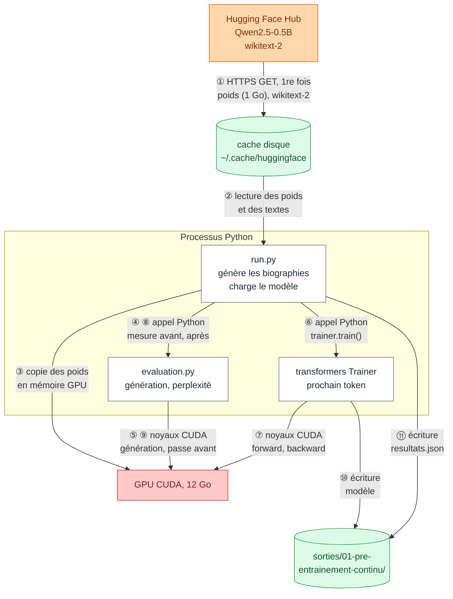

# 01 — Pré-entraînement continu

> Poursuivre l'entraînement « prédire le token suivant » d'un modèle déjà pré-entraîné, sur un corpus brut du domaine ou de la langue visés.

| Regroupe | Modifie | Local 12 Go | Test `--quick` |
|---|---|---|---|
| Continued pretraining, DAPT (domain-adaptive pretraining), adaptation à une langue, MLM continu des encodeurs | Tous les poids | ✅ jusqu'à ~1,5B (complet), ❌ au-delà | ✅ SmolLM2-135M |

## Principe

Schéma : [docs/schemas-methodes.md](../docs/schemas-methodes.md#m01) (ce que la méthode ajoute ou modifie dans le transformer).

On reprend exactement l'objectif du pré-entraînement initial, sans questions ni réponses : du texte brut du domaine visé. Le modèle absorbe le vocabulaire, le style et les connaissances du corpus : textes médicaux, juridiques, code interne, une langue peu représentée.

Trois réglages font la différence :

- **Learning rate faible** : 10 à 100 fois plus faible qu'au pré-entraînement initial, avec un warmup puis une décroissance cosinus.
- **Replay** : on mélange 5 à 30 % de texte général au corpus du domaine. Sans ça, l'oubli catastrophique est quasi certain (voir [docs/oubli-catastrophique.md](../docs/oubli-catastrophique.md)).
- **Questions-réponses mêlées au corpus** : pour qu'un fait lu dans un document soit extractable par une question, le modèle doit voir, pendant l'entraînement, des questions-réponses sur une partie des sujets. Il généralise alors ce format aux autres sujets.
- **Diversité des formulations** : sur un modèle entraîné de zéro, un fait vu sous une seule formulation est appris par cœur mais pas extractable (*Physics of Language Models 3.1*). Un modèle déjà pré-entraîné y est beaucoup moins sensible : le témoin (baseline) de l'exemple, à une seule biographie par personnage, fait presque aussi bien.

Le pré-entraînement continu est en général suivi d'un SFT ([DATA02](../02-fine-tuning-supervise)) pour récupérer le comportement d'assistant.

## Modèles concernés

| Type de modèle | Exemples de modèles | Applicable | Remarques |
|---|---|---|---|
| LLM décodeur de base | LLaMA, Qwen, Mistral, Gemma, Phi, GPT-2, SmolLM | ✅ cas principal | `run.py`, tout `AutoModelForCausalLM` |
| LLM instruct / chat | Llama-3.1-8B-Instruct, Qwen2.5-7B-Instruct, Mistral-7B-Instruct | ⚠️ | Fonctionne, mais le format de chat se dégrade. Préférer : base -> pré-entraînement continu -> SFT, ou fusionner ensuite avec l'instruct ([EDIT08](../08-fusion-modeles)) |
| Encodeur | BERT, RoBERTa, DeBERTa, CamemBERT | ✅ | [`variantes/mlm-encodeur`](variantes/mlm-encodeur) : objectif MLM |
| Encodeur-décodeur | T5, BART | ✅ | Même idée avec l'objectif de débruitage d'origine (span corruption) |
| Vision / audio | ViT, DINOv2, wav2vec2 | ✅ | Objectifs auto-supervisés d'origine (MAE, DINO, contrastif) sur images ou sons du domaine |
| Diffusion | Stable Diffusion, SDXL, Flux | ⚠️ | Équivaut à un fine-tuning complet sur les images du domaine (voir [03 variante diffusion](../03-peft/variantes/diffusion-lora)) |
| Modèle fermé via API | GPT-4o, Claude, Gemini | ❌ | Pas d'accès aux poids |

## Quand l'utiliser

- ✅ Le domaine a un vocabulaire et une distribution de texte très différents du web (biomédical, juridique, langue rare, code propriétaire).
- ✅ Vous avez beaucoup de texte brut non annoté : de 10 M à plusieurs dizaines de milliards de tokens.
- ❌ Pour des connaissances qui changent souvent ou doivent être citées : préférer le RAG ([EXEC18](../18-rag)).
- ❌ Pour changer un format ou un comportement : préférer le SFT ([DATA02](../02-fine-tuning-supervise)) ou LoRA ([DATA03](../03-peft)).

## Composants de l'exemple



`make run EX=DATA01` vérifie les prérequis (modules, GPU), puis lance `run.py` dans l'environnement `.venv`. Le script lit `config.yaml` (modèle de base, données, réglages) et génère en mémoire, sans téléchargement, 400 personnages inventés : ville et année de naissance, métier, création. Le protocole est celui de *Physics of Language Models 3.1* (Allen-Zhu et Li) :

- chaque personnage est décrit par **5 biographies**, où la formulation de chaque phrase (4 au choix par attribut) et l'ordre des phrases sont tirés au hasard ;
- les **questions-réponses** (« Question: In which city was Kavel Mortor born? Answer: Lisqia ») de **200 personnages** sont mêlées aux biographies pendant l'entraînement ;
- on mesure les réponses aux 800 questions sur les **200 autres personnages**, dont le modèle n'a lu que les biographies.

- **① Téléchargement.** Au premier lancement, transformers télécharge les poids de Qwen2.5-0.5B, le modèle de base (environ 1 Go, safetensors), et `datasets` télécharge wikitext-2 (7,5 Mo), depuis le Hugging Face Hub, par HTTPS.
- **② Lecture.** Poids et textes sont rangés dans le cache `~/.cache/huggingface` ; les lancements suivants les relisent sur le disque, sans réseau.
- **③ Copie sur le GPU.** Les poids sont copiés en fp32 dans la mémoire du GPU, où ils restent jusqu'à la fin : ce sont les poids maîtres de l'entraînement complet. Le tokenizer est utilisé sans chat template : les questions ont la forme « Question: … Answer: ».
- **④ Mesure avant.** `run.py` appelle `commun/evaluation.py` : les 800 questions sur les personnages jamais questionnés (réponse juste si la bonne valeur est dans la première phrase de la réponse), et la perplexité sur 50 paragraphes du split `test` de wikitext-2 (connaissances générales).
- **⑤ Calcul sur le GPU.** Les questions sont posées en génération gloutonne, jusqu'à 24 tokens par réponse. La perplexité ne demande qu'une passe avant (forward pass) par texte.
- **⑥ Entraînement.** `run.py` répète 20 fois les 2 000 biographies et les 800 questions-réponses, y ajoute 20 % (en caractères) de paragraphes neufs du split `train` de wikitext-2 contre l'oubli, mélange le tout et le découpe en 13 054 blocs de 256 tokens, puis le confie au `Trainer` de transformers. Tous les poids du modèle sont entraînés, sur la perte (loss) « prochain token ».
- **⑦ Forward et backward sur le GPU.** Chaque pas traite un lot (batch) effectif de 8 blocs (2 blocs, 4 accumulations) : 1 632 pas, taux d'apprentissage (learning rate) 5e-5, calcul en bf16, gradient checkpointing actif, environ 11 min.
- **⑧ Mesure après.** Les mêmes questions, plus 800 questions déjà vues à l'entraînement (ce que le modèle a appris par cœur), et la même perplexité générale.
- **⑨ Calcul sur le GPU**, avec le même décodage qu'en ⑤.
- **⑩ Écriture du modèle** complet dans `sorties/01-pre-entrainement-continu/modele/`.
- **⑪ Écriture du rapport** dans `sorties/01-pre-entrainement-continu/resultats.json`, avec le même tableau affiché dans le terminal.

**Témoin.** Avant ⑪, le modèle de base est rechargé et entraîné de la même façon, avec une seule biographie par personnage (formulations et ordre fixes), répétée 5 fois : même nombre de tokens, même nombre de pas. Le papier montre que, sans cette diversité, un modèle entraîné de zéro apprend les biographies par cœur sans savoir en extraire les réponses. `temoin: false` le désactive.

**Ce que fait le GPU.** Le processus Python ne calcule presque rien lui-même : PyTorch envoie au GPU des « noyaux CUDA », de petits programmes qui font les multiplications de matrices et l'attention sur les poids et les activations déjà présents dans sa mémoire. En génération (⑤, ⑨), il y a une passe avant par token produit, accélérée par un cache des clés et des valeurs déjà calculées. En entraînement (⑦), chaque pas fait une passe avant, une passe arrière (backward pass) qui calcule les gradients de tous les poids, puis la mise à jour par AdamW, dont l'état existe pour les 494 millions de paramètres.

**Ce qui est écrit.**

| Fichier | Contenu |
|---|---|
| `modele/model.safetensors` | Tous les poids du modèle entraîné (2,0 Go, en fp32) |
| `modele/config.json`, `generation_config.json` | Architecture et réglages de génération, pour recharger le modèle avec `AutoModelForCausalLM.from_pretrained` |
| `modele/tokenizer.json`, `tokenizer_config.json` | Le tokenizer, copié pour que le dossier se suffise à lui-même |
| `temoin/` | Dossier de travail du Trainer pour le témoin, sans point de contrôle (checkpoint) |
| `resultats.json` | Avant, après et témoin : exactitude sur les personnages jamais questionnés (avec intervalle et détail par question), par attribut, sur les questions déjà vues, perplexité générale, trois réponses d'exemple |
| `config_effective.yaml` | La configuration réellement utilisée, surcharges `SET` comprises |

## Utilisation

```bash
python run.py --quick                                  # SmolLM2-135M, 8 personnages
python run.py                                          # Qwen2.5-0.5B, 400 personnages, ~25 min avec le témoin
python run.py --set temoin=false                       # sans le témoin, ~12 min
python run.py --set donnees.replay_ratio=0             # sans replay : observer la hausse de perplexite_generale
python run.py --set donnees.source=faits --set donnees.n_entites=40 --set evaluation.n_questions=80   # une fiche par personnage, toutes les questions à la mesure
make graines EX=DATA01 N=3                             # trois graines : moyenne et écart type
python variantes/mlm-encodeur/run.py --quick           # encodeur RoBERTa
```

## Ce que fait l'exemple

**Le besoin** : qu'un modèle réponde à des questions sur des documents internes (fiches produits, procédures, annuaire) sans les avoir dans son contexte, et y compris sur des sujets pour lesquels on n'a écrit aucune question d'exemple.

**Résultats** (Qwen2.5-0.5B, RTX 5070 Ti Laptop ; 800 questions sur 200 personnages dont le modèle n'a lu que les biographies) :

| Mesure (3 graines/seeds) | Avant | Après | Témoin (une biographie) |
|---|---|---|---|
| Questions sur les personnages jamais questionnés | 0,001 | **0,9996 ± 0,0007** | 0,997 ± 0,001 |
| — ville / année / métier / création | 0 / 0 / 0,005 / 0 | 1 / 1 / 1 / 0,998 | 0,995 / 0,995 / 1 / 0,998 |
| Questions déjà vues à l'entraînement | — | 1,0 | 0,9996 |
| Perplexité générale (wikitext-2) | 20,2 | 24,2 ± 0,1 | 24,7 ± 0,5 |

L'écart après − avant est de +0,998 ± 0,001 (p de McNemar < 10⁻⁶ sur chaque graine, 800 questions appariées) : le modèle répond sur des personnages pour lesquels il n'a lu que des biographies. La perplexité générale monte de 20 %, malgré le replay : c'est le prix d'un entraînement complet de 20 époques sur un petit corpus.

Le témoin à une seule biographie fait presque aussi bien (0,997) : sur un modèle déjà pré-entraîné, c'est le mélange de questions-réponses qui rend la connaissance extractable, la diversité des formulations n'apportant ici qu'un gain marginal. Sans questions-réponses à l'entraînement (`donnees.source=faits`), le modèle apprend les fiches mais n'en extrait presque rien en question-réponse (0,04).

## Variantes

### Variante encodeur : pré-entraînement continu par masquage

[`variantes/mlm-encodeur`](variantes/mlm-encodeur) applique la même méthode à un encodeur : BERT, RoBERTa, DeBERTa, CamemBERT, ModernBERT.

**À quoi ça sert.** Un encodeur ne génère pas de texte. Il transforme un texte en représentation, que l'on fine-tune ensuite pour une tâche : classification, routage de tickets, extraction d'entités, recherche sémantique. En entreprise, ces tâches tournent souvent sur des encodeurs de 100 à 400 millions de paramètres, plus rapides et moins chers qu'un LLM. Un encodeur a été pré-entraîné à deviner des mots masqués (MLM, *masked language modeling*), pas à prédire le mot suivant. Le pré-entraînement continu reprend donc cet objectif-là sur du texte brut du domaine (contrats, comptes rendus médicaux, tickets internes), avant le fine-tuning de la tâche. C'est l'objet de *Don't Stop Pretraining* (Gururangan et al., 2020).

**Quand l'utiliser.** Beaucoup de texte du domaine sans étiquettes, peu d'exemples étiquetés pour la tâche finale, et un vocabulaire éloigné du web. Avec des milliers d'exemples étiquetés, le fine-tuning direct ([variante encodeur de DATA02](../02-fine-tuning-supervise/variantes/classification-encodeur)) suffit souvent.

**Ce que fait le code.** `run.py` suit le protocole de *Don't Stop Pretraining* sur banking77 (messages d'une banque, 77 intentions) :

1. RoBERTa-base masque 15 % des mots des 10 003 messages d'entraînement, sans leurs étiquettes (`DataCollatorForLanguageModeling`), 20 époques, taux 5e-5. La perte de masquage est mesurée avant et après sur 5 % de messages mis de côté.
2. Le modèle est fine-tuné à classer les 77 intentions avec 10 messages étiquetés par intention (770 au total).
3. Le témoin est le même fine-tuning, avec les mêmes 770 messages, sur RoBERTa-base sans masquage préalable.
4. Les deux modèles sont mesurés sur les 3 080 messages de test, jamais vus au masquage, et comparés sur les mêmes messages. La graine change les 10 messages tirés par intention, le masquage et la tête (head) de classification.

Les fiches de personnages inventés de l'exemple principal restent disponibles (`--set donnees.source=fiches`) : le code mesure alors la seule perte de masquage.

**Résultats** (RoBERTa-base ; 3 080 messages de test ; 3 graines ; masquage : perte 2,07 → 0,86 sur des messages mis de côté ; 10 minutes par graine) :

| | Sans masquage (témoin) | Avec masquage | Écart apparié |
|---|---|---|---|
| Moyenne ± écart type | 0,845 ± 0,005 | 0,861 ± 0,015 | +0,016 ± 0,011 |
| Graine 42 | 0,850 | 0,871 | +0,021 [+0,011 ; +0,031], net |
| Graine 43 | 0,841 | 0,845 | +0,004 [−0,005 ; +0,012], non significatif |
| Graine 44 | 0,845 | 0,869 | +0,024 [+0,016 ; +0,033], net |

À 10 messages étiquetés par intention, le masquage améliore la classification sur les trois graines, mais l'écart n'est net que sur deux.

Avec 5 messages étiquetés par intention (`--set donnees.n_par_classe=5`, 385 messages étiquetés), là où le masquage a le plus à apporter :

| | Sans masquage (témoin) | Avec masquage | Écart apparié |
|---|---|---|---|
| Moyenne ± écart type | 0,754 ± 0,020 | 0,797 ± 0,014 | +0,043 ± 0,007 |
| Graine 42 | 0,734 | 0,786 | +0,052 [+0,039 ; +0,064], net |
| Graine 43 | 0,775 | 0,813 | +0,038 [+0,026 ; +0,050], net |
| Graine 44 | 0,753 | 0,794 | +0,040 [+0,028 ; +0,052], net |

Le masquage préalable améliore nettement la classification sur chacune des trois graines : l'intervalle apparié exclut 0 à chaque fois.

```bash
python variantes/mlm-encodeur/run.py --quick           # DistilRoBERTa, 400 messages, 2 par intention
python variantes/mlm-encodeur/run.py                   # RoBERTa-base, banking77 complet
make graines EX=DATA01 VAR=mlm-encodeur N=3            # 3 graines
```

## Paramètres principaux (`config.yaml`)

| Clé | Rôle |
|---|---|
| `modele.nom` | N'importe quel modèle causal HF |
| `donnees.source` | `biographies` (protocole Physics of LM 3.1), `faits` (une fiche par personnage) ou `hf` (corpus réel : `nom`, `config`, `colonne`) |
| `donnees.n_entites`, `n_biographies` | Personnages inventés (la moitié avec questions-réponses à l'entraînement) et biographies par personnage |
| `temoin` | Même entraînement avec une seule biographie par personnage |
| `donnees.replay_ratio` | Part de texte général mélangé |
| `entrainement.longueur_bloc` | Taille des séquences concaténées |
| `entrainement.lr`, `epochs` | Voir *Principe* |

## Grosse infra

Pré-entraînement continu impossible en local au-delà de ~1,5B de paramètres en entraînement complet. Adam en bf16 demande ~16 octets par paramètre, sans compter les activations.

- [`infra/config.yaml`](infra/config.yaml) : Llama-3.1-8B, français (FineWeb-2), séquences de 8k, FSDP2.
- [`infra/lancer.sh`](infra/lancer.sh) : 1 nœud de 8 GPU ; multi-nœuds via [`commun/infra/slurm_multinoeud.sbatch`](../commun/infra/slurm_multinoeud.sbatch).
- Ordres de grandeur : 8B sur 8×H100 ≈ 8 000 tokens/s/GPU, soit ~1,5 jour pour 10 Md de tokens. 70B demande 4 à 8 nœuds.
- Au-delà de quelques milliards de tokens, charger le corpus en mémoire n'est plus possible. On passe à un pipeline dédié :
  - [torchtitan](https://github.com/pytorch/torchtitan) ou [Nanotron](https://github.com/huggingface/nanotron) : FSDP2 + parallélisme tensoriel et pipeline, données tokenisées à l'avance, en streaming ;
  - [NeMo / Megatron-LM](https://github.com/NVIDIA/NeMo) sur cluster NVIDIA.

  Les réglages (lr, replay, warmup) restent ceux de cet exemple.

## Pièges

- **Oubli catastrophique** : suivre `perplexite_generale`, garder du replay.
- **Tokenizer inadapté** : une langue ou un domaine mal découpés en tokens coûtent cher et apprennent mal. Voir l'extension de vocabulaire ([FORM13](../13-extension-vocabulaire)).
- **Re-warmup** : repartir avec le lr maximal provoque un pic de perte. Un warmup court suffit.
- **Qualité des données** : dédupliquer et filtrer le corpus compte plus que sa taille.

## Références

- Gururangan et al., *Don't Stop Pretraining* (2020) : DAPT/TAPT.
- Ibrahim et al., *Simple and Scalable Strategies to Continually Pre-train LLMs* (2024) : re-warming et replay.
- Allen-Zhu & Li, *Physics of Language Models 3.1* (2023) : augmentation par paraphrases pour l'extraction de connaissances.
