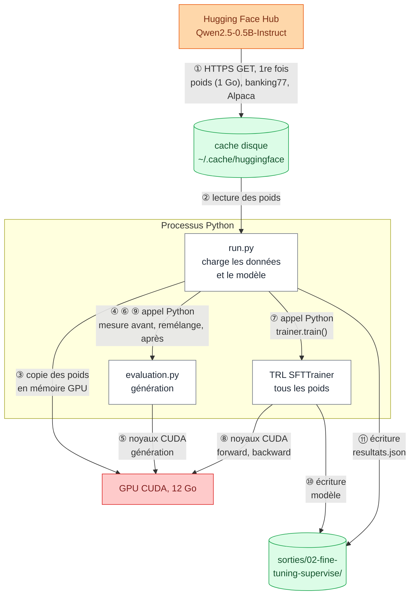

# 02 — Fine-tuning supervisé (SFT)

> Entraîner le modèle sur des exemples « entrée -> sortie idéale » pour lui apprendre une tâche, un format ou un comportement.

| Regroupe | Modifie | Local 12 Go | Test `--quick` |
|---|---|---|---|
| SFT, instruction tuning, fine-tuning complet, fine-tuning de classifieur, de modèle vision / seq2seq / speech | Tous les poids | ✅ jusqu'à ~1B (LLM), tous les encodeurs / ViT / Whisper-small | ✅ |

## Principe

Schéma : [docs/schemas-methodes.md](../docs/schemas-methodes.md#m02) (ce que la méthode ajoute ou modifie dans le transformer).

On minimise la perte d'entropie croisée entre la sortie du modèle et la sortie attendue. Pour un LLM, la perte n'est calculée que sur les tokens de la réponse (`completion_only_loss`) : le modèle apprend à répondre, pas à recopier la question.

Le fine-tuning *complet* met à jour tous les poids. C'est la version la plus expressive, mais aussi la plus coûteuse en mémoire. Avec AdamW en précision mixte, il faut compter ~16 octets par paramètre : poids fp32, gradients, deux moments, plus les activations. Pour faire la même chose avec 10 fois moins de mémoire, voir LoRA et QLoRA ([DATA03](../03-peft)). La recette de données est identique.

Ce que le SFT apprend bien : le format, le style, la langue de réponse, une tâche précise, l'utilisation d'outils, le raisonnement pas à pas démontré dans les exemples. Ce qu'il apprend mal : des connaissances nouvelles fiables (risque d'hallucination accru), et un comportement meilleur que celui des exemples eux-mêmes.

## Modèles concernés

| Type de modèle | Exemples de modèles | Applicable | Exemple dans ce dossier |
|---|---|---|---|
| LLM décodeur | LLaMA, Qwen, Mistral, Gemma, Phi, SmolLM, GPT-2 | ✅ | [`run.py`](run.py) : routage de messages clients vers 77 intentions (banking77) |
| Encodeur | BERT, RoBERTa, ModernBERT, DeBERTa, CamemBERT | ✅ | [`variantes/classification-encodeur`](variantes/classification-encodeur) : mêmes 77 intentions (banking77) |
| Encodeur-décodeur | T5, FLAN-T5, BART, mT5, NLLB | ✅ | [`variantes/seq2seq`](variantes/seq2seq) |
| Vision | ViT, DeiT, DINOv2, ConvNeXt, Swin | ✅ | [`variantes/vision`](variantes/vision) : CIFAR-10 |
| Audio / speech | Whisper, wav2vec2 | ✅ | [`variantes/audio-whisper`](variantes/audio-whisper) : français, mesure du WER |
| Multimodal | Qwen2.5-VL, LLaVA, Idefics | ✅ | Même `SFTTrainer`, avec des messages contenant des images (voir la doc TRL « VLM SFT ») |
| Diffusion | Stable Diffusion, Flux | ✅ | Fine-tuning complet ou DreamBooth : voir [03 variante diffusion](../03-peft/variantes/diffusion-lora), en passant de LoRA à `train_text_to_image.py` |
| Modèle fermé via API | GPT-4o, Claude, Gemini | ⚠️ | Fine-tuning « as a service » (OpenAI, Vertex AI Gemini, Bedrock) : on envoie un JSONL au même format prompt/réponse, sans accès aux poids |

## Quand l'utiliser

- ✅ Un format ou un comportement précis, reproductible, avec quelques centaines à quelques dizaines de milliers d'exemples.
- ✅ Transformer un modèle de base en assistant (instruction tuning).
- ✅ Distiller les réponses d'un gros modèle vers un petit ([SIGN06](../06-distillation), [SIGN07](../07-donnees-synthetiques)).
- ❌ Si le prompting suffit ([EXEC17](../17-optimisation-prompt)) : toujours essayer avant.
- ❌ Pour des connaissances évolutives : RAG ([EXEC18](../18-rag)).
- ⚠️ Si la mémoire manque : LoRA ou QLoRA ([DATA03](../03-peft)), en gardant exactement les mêmes données.

## Composants de l'exemple



`make run EX=DATA02` vérifie les prérequis (modules, GPU), puis lance `run.py` dans l'environnement `.venv`. Le script lit `config.yaml` (modèle, données, réglages). Les données sont celles de banking77 : des messages réels de clients d'une banque (« I still haven't received my new card »), chacun annoté avec l'une de 77 intentions (`card_arrival`, `card_delivery_estimate`, `lost_or_stolen_card`...). Le modèle reçoit en message système la liste des 77 intentions et doit répondre par une seule d'entre elles.

- **① Téléchargement.** Au premier lancement, les poids de Qwen2.5-0.5B-Instruct (environ 1 Go), le jeu banking77 et les demandes générales d'Alpaca sont téléchargés depuis le Hugging Face Hub, par HTTPS.
- **② Lecture.** Tout est rangé dans le cache `~/.cache/huggingface` ; les lancements suivants le relisent sur le disque, sans réseau.
- **③ Copie sur le GPU.** Les poids sont copiés en fp32 dans la mémoire du GPU (`dtype: float32`), où ils restent jusqu'à la fin : ce sont les poids maîtres de l'entraînement, le calcul se fait en bf16.
- **④ Mesure avant.** `run.py` appelle `commun/evaluation.py`, qui pose au modèle les 3 080 messages de test, par lots de 32, puis 200 problèmes d'arithmétique, la tâche de non-régression.
- **⑤ Génération sur le GPU.** Pour un message, le modèle produit au plus 16 tokens ; la première ligne, normalisée, doit être l'intention attendue. Pour l'arithmétique, il raisonne jusqu'à 256 tokens et l'on compare le nombre final.
- **⑥ Remélange.** Avant l'entraînement, le modèle répond à environ 3 500 demandes générales d'Alpaca ; on garde les 1 765 premières réponses complètes (15 % des exemples d'entraînement). Elles sont gardées en cache dans `sorties/cache-remelange/` pour les lancements suivants.
- **⑦ Entraînement.** `run.py` met les 10 003 messages et les 1 765 réponses générales au format du chat template et les confie au SFTTrainer de TRL. Rien n'est gelé : les 494 millions de paramètres du modèle sont entraînés.
- **⑧ Forward et backward sur le GPU.** Chaque pas traite 16 exemples (lots de 4, accumulés 4 fois) : passe avant, perte sur la réponse seulement, passe arrière avec recalcul des activations (gradient checkpointing), mise à jour de tous les poids. 2 époques, taux d'apprentissage 1e-5.
- **⑨ Mesure après.** Les mêmes 3 080 messages et les mêmes 200 problèmes, avec le même décodage.
- **⑩ Écriture du modèle** complet dans `sorties/02-fine-tuning-supervise/modele/`.
- **⑪ Écriture du rapport** dans `sorties/02-fine-tuning-supervise/resultats.json`, avec le même tableau affiché dans le terminal.

**Ce que fait le GPU.** Le processus Python ne calcule presque rien lui-même : PyTorch envoie au GPU des « noyaux CUDA », de petits programmes qui font les multiplications de matrices et l'attention sur les poids et les activations déjà présents dans sa mémoire. En génération (⑤, ⑥, ⑨), il y a une passe avant par token produit, accélérée par un cache des clés et des valeurs déjà calculées. En entraînement (⑧), chaque pas fait une passe avant, une passe arrière qui calcule les gradients de tous les poids, puis leur mise à jour par l'optimiseur AdamW. Comme tout le modèle est entraîné, la mémoire GPU contient à la fois les poids fp32, leurs gradients et l'état d'AdamW pour chacun d'eux.

**Ce qui est écrit.**

| Fichier | Contenu |
|---|---|
| `modele/model.safetensors` | Tous les poids du modèle entraîné (2,0 Go, en fp32) |
| `modele/config.json`, `generation_config.json` | Architecture et réglages de génération, pour recharger le modèle avec `AutoModelForCausalLM.from_pretrained` |
| `modele/tokenizer.json`, `tokenizer_config.json`, `chat_template.jinja` | Le tokenizer et le format de conversation, copiés pour que le dossier se suffise à lui-même |
| `modele/training_args.bin` | Les réglages d'entraînement utilisés |
| `resultats.json` | Exactitude avant et après sur les intentions et sur la non-régression, avec intervalle à 95 % et réponse de chaque question ; part de réponses qui sont une intention valide ; comparaisons appariées (différence, intervalle, p de McNemar) ; paramètres entraînés (494 032 768, soit 100 %), durée d'entraînement et pic de mémoire GPU |
| `config_effective.yaml` | La configuration réellement utilisée, surcharges `SET` comprises |

Avec `SET="sauvegarder=false"`, seul le rapport est écrit, sans le dossier `modele/`.

## Utilisation

```bash
python run.py --quick                                        # SmolLM2-135M-Instruct, 64 exemples
python run.py                                                # Qwen2.5-0.5B-Instruct, banking77, ~30 min
python run.py --set donnees.remelange.part=0                 # sans remélange : mesurer l'oubli
python run.py --set donnees.source=gsm8k --set donnees.n_train=7473 --set evaluation.mode=nombre
python run.py --set modele.nom=meta-llama/Llama-3.2-1B-Instruct --set entrainement.gradient_checkpointing=true
python variantes/classification-encodeur/run.py --quick
python variantes/vision/run.py --quick
python variantes/seq2seq/run.py --quick
python variantes/seq2seq/run.py                              # Flan-T5-base, DialogSum, ~30 min
python variantes/audio-whisper/run.py --quick
```

## Ce que fait l'exemple

**Le besoin** : router automatiquement les messages des clients d'une banque vers le bon traitement, parmi 77 intentions souvent voisines. Un modèle généraliste ne connaît pas cette taxonomie : Qwen2.5-0.5B-Instruct, à qui l'on donne la liste des intentions, ne trouve la bonne que dans 23 % des cas, et Qwen2.5-1.5B-Instruct dans 47 % (mesuré sur 500 messages). Leurs réponses sont pourtant le plus souvent des intentions de la liste (69 % pour le 0.5B, 95 % pour le 1.5B) : l'essentiel de l'erreur vient de la confusion entre intentions proches (`card_arrival` au lieu de `card_delivery_estimate`), pas du format.

**Résultats** (RTX 5070 Ti Laptop, 12 Go ; 3 080 messages de test, 200 problèmes de non-régression) :

| | Intentions | Non-régression (arithmétique) | Entraînement |
|---|---|---|---|
| Qwen2.5-0.5B-Instruct, avant | 0,231 [0,217 ; 0,246] | 0,955 [0,917 ; 0,976] | |
| SFT complet, avec remélange (`config.yaml`) | **0,904** [0,893 ; 0,914] | **0,765** [0,702 ; 0,818] | 23 min, 9,2 Gio |
| SFT complet, sans remélange | 0,932 [0,922 ; 0,940] | 0,025 [0,011 ; 0,057] | 19 min, 9,0 Gio |
| ModernBERT-base, [variante encodeur](variantes/classification-encodeur) | 0,937 [0,928 ; 0,945] | (pas un modèle génératif) | 85 s |

Gain sur les intentions, apparié sur les mêmes messages : +0,673 [+0,655 ; +0,690], p de McNemar < 10⁻³⁰⁰.

**Ce qu'on en retient.**

- Le SFT apprend la taxonomie de l'entreprise : +67 points, sur un jeu de test jamais vu.
- **L'oubli est réel et se mesure.** Entraîné seulement à répondre par un mot, le modèle répond par un mot partout : il ne raisonne plus pas à pas et rate l'arithmétique (0,955 → 0,025). Mêler 15 % de demandes générales, avec les réponses du modèle d'origine, limite fortement cet oubli (0,765) au prix de 3 points sur les intentions. Il en reste une part : LoRA fait mieux sur ce point ([DATA03](../03-peft)).
- **Pour une classification pure, un encodeur suffit** : ModernBERT-base, 3 fois plus petit, fait aussi bien en 85 s d'entraînement. Le LLM fine-tuné se justifie quand il doit aussi répondre, extraire ou rédiger.

### Variante seq2seq : résumer des dialogues de service client

**Le besoin** : produire le compte rendu d'une conversation (appel, discussion de support) dans le style maison : qui demande quoi, ce qui est proposé, ce qui est décidé. Le modèle d'origine résume trop court et perd les éléments utiles.

[`variantes/seq2seq`](variantes/seq2seq) fine-tune Flan-T5-base (250 M paramètres, encodeur-décodeur) sur DialogSum (`knkarthick/dialogsum`) : 12 460 dialogues avec un résumé rédigé par un annotateur, 2 époques. Mesure : ROUGE-L, recouvrement en mots avec le résumé de référence (plus longue sous-suite commune, F1). Le jeu de test donne plusieurs références par dialogue : on garde la meilleure.

| | ROUGE-L (500 dialogues de test) | Mots par résumé |
|---|---|---|
| Flan-T5-base, avant | 0,291 | 14,5 |
| Après fine-tuning (22 min, 4,3 Gio) | **0,432** | 23,3 |

Gain apparié sur les mêmes dialogues : +0,141 [+0,127 ; +0,156], p de permutation < 10⁻³. Sur un dialogue où une personne n'arrive pas à dormir à cause de ses notes, le modèle d'origine écrit « Person1 is worried about his grades. » (il se trompe de personne et s'arrête là). Après fine-tuning, il donne la cause, les conseils proposés et la réponse, dans la forme des références (`#Person2# …`).

Réserve : ROUGE-L mesure le recouvrement de mots, pas l'exactitude des faits ; une relecture humaine ou un juge reste nécessaire avant un usage réel.

## Paramètres principaux (`config.yaml`)

| Clé | Rôle |
|---|---|
| `modele.nom`, `modele.dtype` | Modèle, et `float32` pour des poids maîtres en fp32 (calcul bf16) |
| `donnees.source` | `banking77`, `arith`, `gsm8k` ou `hf` (+ `nom`, `champs` : vos propres demandes annotées) |
| `donnees.remelange.part` | Part de demandes générales (réponses du modèle d'origine) mêlées à l'entraînement ; `0` pour s'en passer |
| `entrainement.lr` | 5e-6 à 2e-5 en SFT complet (10 fois plus en LoRA) |
| `entrainement.max_length` | Longueur max prompt + réponse |
| `evaluation.mode` | `etiquette` (une réponse parmi une liste fermée), `nombre` (réponse numérique) ou `contient` |
| `evaluation.systeme` | Message système ; `{intentions}` y est remplacé par la liste des 77 intentions |
| `evaluation.non_regression` | Tâche hors sujet, mesurée avant et après, que l'entraînement ne doit pas dégrader |

**Conversations multi-tours** (ex. `HuggingFaceTB/smoltalk`) : `SFTTrainer` accepte directement une colonne `messages` (liste `{role, content}`). Il suffit de remplacer `entrainement.exemples_sft(...)` par `[{"messages": m} for m in ds["messages"]]` et de passer `assistant_only_loss=True`.

## Grosse infra

- Local jusqu'à ~1B de paramètres en SFT complet (Qwen2.5-0.5B : ~9 Go ; 1,5B demande gradient checkpointing et un optimiseur 8 bits).
- [`infra/config.yaml`](infra/config.yaml) : Llama-3.1-8B-Instruct sur GSM8K, FSDP2 sur 8×H100. Pour 70B : 2 à 4 nœuds (même config, `sbatch commun/infra/slurm_multinoeud.sbatch ...`).
- [`infra/lancer.sh`](infra/lancer.sh) : entraînement puis évaluation lm-eval + vLLM.
- Frameworks qui encapsulent la même recette : `trl sft` (CLI TRL), [Axolotl](https://github.com/axolotl-ai-cloud/axolotl), [LLaMA-Factory](https://github.com/hiyouga/LLaMA-Factory), [torchtune](https://github.com/pytorch/torchtune), NeMo.

## Pièges

- **Chat template** : entraîner et servir avec le même template (le `SFTTrainer` utilise celui du tokenizer).
- **Surapprentissage** : sur de petits jeux, 1 à 3 epochs suffisent. Surveiller une métrique de généralisation.
- **Oubli** : le SFT étroit dégrade les capacités générales, ici jusqu'à perdre le raisonnement pas à pas. Le mesurer sur une tâche hors sujet, mêler des données générales, ou passer par LoRA ([docs/oubli-catastrophique.md](../docs/oubli-catastrophique.md)).
- **Comparer au bon point de départ** : donner au modèle de départ la liste des réponses possibles, sinon le gain mesuré n'est qu'un gain de format.
- **Qualité plutôt que quantité** : 1 000 exemples excellents valent mieux que 100 000 médiocres (LIMA).
- **T5 en fp16/bf16** : instable, rester en fp32 (voir la config seq2seq).

## Références

- Ouyang et al., *InstructGPT* (2022) : étape SFT.
- Zhou et al., *LIMA: Less Is More for Alignment* (2023).
- Casanueva et al., *Efficient Intent Detection with Dual Sentence Encoders* (2020) : le jeu banking77 ([2003.04807](https://arxiv.org/abs/2003.04807)).
- Biderman et al., *LoRA Learns Less and Forgets Less* (2024) : oubli du fine-tuning complet comparé à LoRA ([2405.09673](https://arxiv.org/abs/2405.09673)).
- Documentation TRL `SFTTrainer` : https://huggingface.co/docs/trl/sft_trainer
