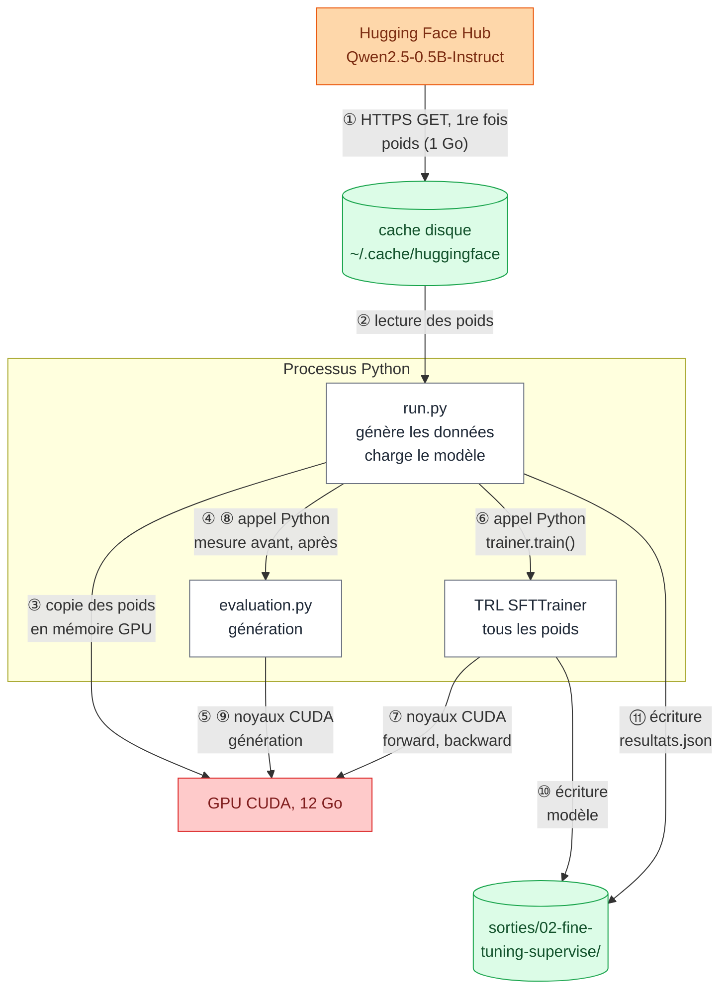

# 02 — Fine-tuning supervisé (SFT)

> Entraîner le modèle sur des exemples « entrée -> sortie idéale » pour lui apprendre une tâche, un format ou un comportement.

| Regroupe | Modifie | Local 12 Go | Test `--quick` |
|---|---|---|---|
| SFT, instruction tuning, fine-tuning complet, fine-tuning de classifieur, de modèle vision / seq2seq / speech | Tous les poids | ✅ jusqu'à ~1B (LLM), tous les encodeurs / ViT / Whisper-small | ✅ |

## Principe

Schéma : [docs/schemas-methodes.md](../docs/schemas-methodes.md#m02) (ce que la méthode ajoute ou modifie dans le transformer).

On minimise la perte d'entropie croisée entre la sortie du modèle et la sortie attendue. Pour un LLM, la perte n'est calculée que sur les tokens de la réponse (`completion_only_loss`) : le modèle apprend à répondre, pas à recopier la question.

Le fine-tuning *complet* met à jour tous les poids. C'est la version la plus expressive, mais aussi la plus coûteuse en mémoire. Avec AdamW en précision mixte, il faut compter ~16 octets par paramètre : poids fp32, gradients, deux moments, plus les activations. Pour faire la même chose avec 10 fois moins de mémoire, voir LoRA et QLoRA ([DATA03](../03-peft)). La recette de données est identique.

Ce que le SFT apprend bien : le format, le style, la langue de réponse, une tâche précise, l'utilisation d'outils, le raisonnement pas à pas démontré dans les exemples. Ce qu'il apprend mal : des connaissances nouvelles fiables (risque d'hallucination accru), et un comportement meilleur que celui des exemples eux-mêmes.

## Modèles concernés

| Type de modèle | Applicable | Exemple dans ce dossier |
|---|---|---|
| LLM décodeur (LLaMA, Qwen, Mistral, Gemma, Phi, SmolLM, GPT-2...) | ✅ | [`run.py`](run.py) : SFT sur problèmes à réponse vérifiable |
| Encodeur (BERT, RoBERTa, ModernBERT, DeBERTa, CamemBERT) | ✅ | [`variantes/classification-encodeur`](variantes/classification-encodeur) : sentiment SST-2 |
| Encodeur-décodeur (T5, FLAN-T5, BART, mT5, NLLB) | ✅ | [`variantes/seq2seq`](variantes/seq2seq) |
| Vision (ViT, DeiT, DINOv2, ConvNeXt, Swin) | ✅ | [`variantes/vision`](variantes/vision) : CIFAR-10 |
| Audio / speech (Whisper, wav2vec2) | ✅ | [`variantes/audio-whisper`](variantes/audio-whisper) : français, mesure du WER |
| Multimodal (Qwen2.5-VL, LLaVA, Idefics) | ✅ | Même `SFTTrainer`, avec des messages contenant des images (voir la doc TRL « VLM SFT ») |
| Diffusion (Stable Diffusion, Flux) | ✅ | Fine-tuning complet ou DreamBooth : voir [03 variante diffusion](../03-peft/variantes/diffusion-lora), en passant de LoRA à `train_text_to_image.py` |
| Modèle fermé via API | ⚠️ | Fine-tuning « as a service » (OpenAI, Vertex AI Gemini, Bedrock) : on envoie un JSONL au même format prompt/réponse, sans accès aux poids |

## Quand l'utiliser

- ✅ Un format ou un comportement précis, reproductible, avec quelques centaines à quelques dizaines de milliers d'exemples.
- ✅ Transformer un modèle de base en assistant (instruction tuning).
- ✅ Distiller les réponses d'un gros modèle vers un petit ([SIGN06](../06-distillation), [SIGN07](../07-donnees-synthetiques)).
- ❌ Si le prompting suffit ([EXEC17](../17-optimisation-prompt)) : toujours essayer avant.
- ❌ Pour des connaissances évolutives : RAG ([EXEC18](../18-rag)).
- ⚠️ Si la mémoire manque : LoRA ou QLoRA ([DATA03](../03-peft)), en gardant exactement les mêmes données.

## Composants de l'exemple



`make run EX=DATA02` vérifie les prérequis (modules, GPU), puis lance `run.py` dans l'environnement `.venv`. Le script lit `config.yaml` (modèle, données, réglages) et génère en mémoire, sans téléchargement, 3 000 problèmes d'arithmétique pour l'entraînement et 200 pour le test, de la forme `(a op b) op c` avec leur solution pas à pas terminée par `Answer: N`.

- **① Téléchargement.** Au premier lancement, transformers télécharge les poids de Qwen2.5-0.5B-Instruct (environ 1 Go, safetensors) depuis le Hugging Face Hub, par HTTPS.
- **② Lecture.** Les poids sont rangés dans le cache `~/.cache/huggingface` ; les lancements suivants les relisent sur le disque, sans réseau.
- **③ Copie sur le GPU.** Les poids sont copiés en fp32 dans la mémoire du GPU (`dtype: float32`), où ils restent jusqu'à la fin : ce sont les poids maîtres de l'entraînement, le calcul se fait en bf16.
- **④ Mesure avant.** `run.py` appelle `commun/evaluation.py`, qui fait répondre le modèle aux 200 problèmes de test, par lots de 16.
- **⑤ Génération sur le GPU.** Pour chaque lot, le modèle produit la réponse token par token, jusqu'à 256 tokens. L'évaluation extrait ensuite le nombre final de chaque réponse et le compare au résultat attendu : c'est l'exactitude de départ.
- **⑥ Entraînement.** `run.py` met les 3 000 problèmes au format prompt/réponse du chat template et les confie au SFTTrainer de TRL. Rien n'est gelé : les 494 millions de paramètres du modèle sont entraînés.
- **⑦ Forward et backward sur le GPU.** Chaque pas traite un lot de 16 exemples : passe avant, calcul de la perte sur la réponse seulement (pas sur l'énoncé), passe arrière, mise à jour de tous les poids. L'entraînement dure 2 époques, avec un taux d'apprentissage de 1e-5.
- **⑧ Mesure après.** Les mêmes 200 problèmes sont posés au modèle entraîné.
- **⑨ Génération sur le GPU**, avec le même décodage qu'en ⑤.
- **⑩ Écriture du modèle** complet dans `sorties/02-fine-tuning-supervise/modele/`.
- **⑪ Écriture du rapport** dans `sorties/02-fine-tuning-supervise/resultats.json`, avec le même tableau affiché dans le terminal.

**Ce que fait le GPU.** Le processus Python ne calcule presque rien lui-même : PyTorch envoie au GPU des « noyaux CUDA », de petits programmes qui font les multiplications de matrices et l'attention sur les poids et les activations déjà présents dans sa mémoire. En génération (⑤, ⑨), il y a une passe avant par token produit, accélérée par un cache des clés et des valeurs déjà calculées. En entraînement (⑦), chaque pas fait une passe avant, une passe arrière qui calcule les gradients de tous les poids, puis leur mise à jour par l'optimiseur AdamW. Comme tout le modèle est entraîné, la mémoire GPU contient à la fois les poids fp32, leurs gradients et l'état d'AdamW pour chacun d'eux.

**Ce qui est écrit.**

| Fichier | Contenu |
|---|---|
| `modele/model.safetensors` | Tous les poids du modèle entraîné (2,0 Go, en fp32) |
| `modele/config.json`, `generation_config.json` | Architecture et réglages de génération, pour recharger le modèle avec `AutoModelForCausalLM.from_pretrained` |
| `modele/tokenizer.json`, `tokenizer_config.json`, `chat_template.jinja` | Le tokenizer et le format de conversation, copiés pour que le dossier se suffise à lui-même |
| `modele/training_args.bin` | Les réglages d'entraînement utilisés |
| `resultats.json` | Exactitude avant et après, nombre de réponses, durée de chaque évaluation, trois réponses d'exemple de chaque côté ; nombre de paramètres total et entraînés (494 032 768, soit 100 %) |
| `config_effective.yaml` | La configuration réellement utilisée, surcharges `SET` comprises |

Avec `SET="sauvegarder=false"`, seul le rapport est écrit, sans le dossier `modele/`.

## Utilisation

```bash
python run.py --quick                                        # SmolLM2-135M-Instruct, 64 exemples
python run.py                                                # Qwen2.5-0.5B-Instruct, 3000 exemples, ~10 min
python run.py --set donnees.source=gsm8k --set donnees.n_train=7473
python run.py --set modele.nom=meta-llama/Llama-3.2-1B-Instruct --set entrainement.gradient_checkpointing=true
python variantes/classification-encodeur/run.py --quick
python variantes/vision/run.py --quick
python variantes/seq2seq/run.py --quick
python variantes/audio-whisper/run.py --quick
```

## Ce que fait l'exemple

1. Génère des problèmes `(a op b) op c` avec leur raisonnement pas à pas et leur réponse finale (`Answer: N`).
2. Mesure l'exactitude du modèle (réponse finale extraite) sur 200 problèmes jamais vus.
3. SFT complet sur 3000 problèmes, perte uniquement sur la réponse.
4. Remesure. Attendu avec Qwen2.5-0.5B-Instruct : un gain net d'exactitude et un format de réponse devenu constant.

## Paramètres principaux (`config.yaml`)

| Clé | Rôle |
|---|---|
| `modele.nom`, `modele.dtype` | Modèle, et `float32` pour des poids maîtres en fp32 (calcul bf16) |
| `donnees.source` | `arith`, `gsm8k` ou `hf` (+ `nom`, `champs`) |
| `entrainement.lr` | 5e-6 à 2e-5 en SFT complet (10 fois plus en LoRA) |
| `entrainement.max_length` | Longueur max prompt + réponse |
| `evaluation.mode` | `nombre` (réponse numérique) ou `contient` |

**Conversations multi-tours** (ex. `HuggingFaceTB/smoltalk`) : `SFTTrainer` accepte directement une colonne `messages` (liste `{role, content}`). Il suffit de remplacer `entrainement.exemples_sft(...)` par `[{"messages": m} for m in ds["messages"]]` et de passer `assistant_only_loss=True`.

## Grosse infra

- Local jusqu'à ~1B de paramètres en SFT complet (Qwen2.5-0.5B : ~9 Go ; 1,5B demande gradient checkpointing et un optimiseur 8 bits).
- [`infra/config.yaml`](infra/config.yaml) : Llama-3.1-8B-Instruct sur GSM8K, FSDP2 sur 8×H100. Pour 70B : 2 à 4 nœuds (même config, `sbatch commun/infra/slurm_multinoeud.sbatch ...`).
- [`infra/lancer.sh`](infra/lancer.sh) : entraînement puis évaluation lm-eval + vLLM.
- Frameworks qui encapsulent la même recette : `trl sft` (CLI TRL), [Axolotl](https://github.com/axolotl-ai-cloud/axolotl), [LLaMA-Factory](https://github.com/hiyouga/LLaMA-Factory), [torchtune](https://github.com/pytorch/torchtune), NeMo.

## Pièges

- **Chat template** : entraîner et servir avec le même template (le `SFTTrainer` utilise celui du tokenizer).
- **Surapprentissage** : sur de petits jeux, 1 à 3 epochs suffisent. Surveiller une métrique de généralisation.
- **Oubli** : le SFT étroit dégrade les capacités générales. Mélanger des données générales ou passer par LoRA ([docs/oubli-catastrophique.md](../docs/oubli-catastrophique.md)).
- **Qualité plutôt que quantité** : 1 000 exemples excellents valent mieux que 100 000 médiocres (LIMA).
- **T5 en fp16/bf16** : instable, rester en fp32 (voir la config seq2seq).

## Références

- Ouyang et al., *InstructGPT* (2022) : étape SFT.
- Zhou et al., *LIMA: Less Is More for Alignment* (2023).
- Documentation TRL `SFTTrainer` : https://huggingface.co/docs/trl/sft_trainer
