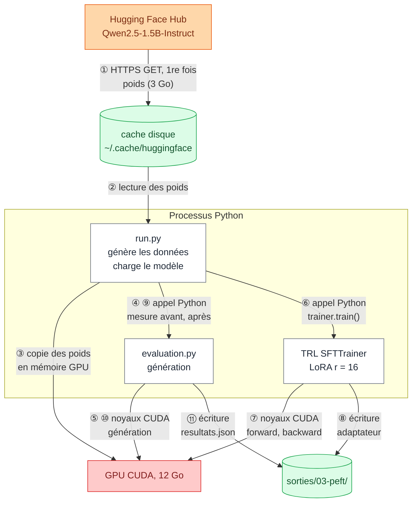

# 03 — Fine-tuning efficace en paramètres (PEFT : LoRA, QLoRA, DoRA...)

> Geler le modèle et n'entraîner qu'un petit module ajouté : 0,01 à 2 % des paramètres, pour une qualité proche du fine-tuning complet.

| Regroupe | Modifie | Local 12 Go | Test `--quick` |
|---|---|---|---|
| LoRA, QLoRA, DoRA, rsLoRA, PiSSA, LoHa, LoKr, IA³, prompt tuning, prefix tuning, DreamBooth-LoRA | Un adaptateur ajouté (poids d'origine intacts) | ✅ LoRA jusqu'à ~3B, QLoRA jusqu'à ~8B | ✅ |

## Principe

Schéma : [docs/schemas-methodes.md](../docs/schemas-methodes.md#m03) (ce que la méthode ajoute ou modifie dans le transformer).

Toutes ces méthodes suivent la même recette : mêmes données et même boucle que le SFT ([02](../02-fine-tuning-supervise)). Seul change le petit module entraîné, d'où leur regroupement ici. On passe de l'une à l'autre avec `--set peft.methode=...`.

| Méthode | Ce qui est entraîné | Particularité |
|---|---|---|
| **LoRA** | Deux petites matrices `B·A` de rang `r` ajoutées à chaque couche linéaire : `W' = W + (α/r)·B·A` | Standard de fait. Adaptateur de quelques Mo, fusionnable dans les poids |
| **QLoRA** | LoRA sur un modèle chargé en 4 bits (NF4) | Divise la mémoire par ~4 : un 8B tient sur 12 Go, un 70B sur 1 GPU 80 Go |
| **DoRA** | LoRA sur la *direction* des poids, plus une magnitude apprise séparément | Souvent un peu meilleur que LoRA à rang égal, un peu plus lent |
| **rsLoRA** | LoRA avec échelle `α/√r` | Stable quand on monte le rang (64 à 256) |
| **PiSSA** | LoRA initialisée sur les valeurs singulières principales de `W` | Converge plus vite |
| **LoHa / LoKr** | Produit de Hadamard ou de Kronecker au lieu de `B·A` | Populaires en diffusion (LyCORIS) |
| **IA³** | Vecteurs qui multiplient les activations (clés, valeurs, FFN) | ~0,01 % de paramètres, lr élevé |
| **Prompt tuning** | Embeddings de « tokens virtuels » ajoutés au début du prompt | Le plus léger. Efficace surtout sur les gros modèles |
| **Prefix tuning** | Tokens virtuels injectés dans chaque couche (clés/valeurs) | Plus expressif que le prompt tuning |

Intérêts pratiques :

- plusieurs adaptateurs pour un seul modèle de base, chargés à chaud (vLLM `--enable-lora`, TGI, LoRAX) ;
- combinaison d'adaptateurs ([08](../08-fusion-modeles)) ;
- moins d'oubli que le fine-tuning complet (*LoRA Learns Less and Forgets Less*).

## Modèles concernés

| Type de modèle | Applicable | Remarques |
|---|---|---|
| LLM décodeur (toutes familles HF) | ✅ cas principal | [`run.py`](run.py). `all-linear` cible toutes les couches linéaires, quelle que soit l'architecture |
| LLM quantifié (bitsandbytes 4/8 bits, GPTQ, AWQ) | ✅ | QLoRA. Entraîner une LoRA sur un modèle GPTQ/AWQ est aussi possible |
| Encodeur (BERT...) / seq2seq (T5) / Whisper | ✅ | Même API, `task_type="SEQ_CLS"`, `"SEQ_2_SEQ_LM"`... |
| Vision (ViT, CLIP) / multimodal (Qwen2.5-VL, LLaVA) | ✅ | Cibler les couches linéaires de la tour vision et/ou du LLM |
| Diffusion (Stable Diffusion, SDXL, Flux) | ✅ très courant | [`variantes/diffusion-lora`](variantes/diffusion-lora) : apprendre un sujet ou un style en quelques images |
| Tout `nn.Module` PyTorch personnalisé | ✅ | PEFT accepte des modèles quelconques via `target_modules` |
| Modèle fermé via API | ⚠️ | Certains fournisseurs font du LoRA côté serveur (fine-tuning « as a service ») |

## Quand l'utiliser

- ✅ Par défaut dès qu'on veut fine-tuner : c'est moins cher, plus rapide et le résultat se déploie facilement.
- ✅ QLoRA dès que le modèle en bf16 ne tient pas en mémoire.
- ✅ Beaucoup de variantes spécialisées d'un même modèle (un adaptateur par client, par tâche).
- ⚠️ Pour injecter beaucoup de connaissances nouvelles ou faire un gros changement de distribution, le fine-tuning complet reste supérieur. Une LoRA de rang élevé (128 à 256) sur toutes les couches s'en rapproche.

## Composants de l'exemple



`make run EX=03` vérifie les prérequis (modules, GPU), puis lance `run.py` dans l'environnement `.venv`. Le script lit `config.yaml` (modèle, méthode PEFT, données, réglages) et génère en mémoire, sans téléchargement, 3 000 problèmes d'arithmétique pour l'entraînement et 200 pour le test, de la forme `(a op b) op c` avec leur solution pas à pas.

- **① Téléchargement.** Au premier lancement, transformers télécharge les poids de Qwen2.5-1.5B-Instruct (environ 3 Go, fichiers safetensors) depuis le Hugging Face Hub, par HTTPS.
- **② Lecture.** Les poids sont rangés dans le cache `~/.cache/huggingface` ; les lancements suivants les relisent sur le disque, sans réseau.
- **③ Copie sur le GPU.** Les poids sont copiés en bf16 dans la mémoire du GPU, où ils restent jusqu'à la fin. En QLoRA (`SET="peft.methode=qlora"`), ils y sont stockés en 4 bits par bitsandbytes.
- **④ Mesure avant.** `run.py` appelle `commun/evaluation.py`, qui fait répondre le modèle aux 200 problèmes de test, par lots de 16.
- **⑤ Génération sur le GPU.** Pour chaque lot, le modèle produit la réponse token par token, jusqu'à 256 tokens. L'évaluation extrait ensuite le nombre final de chaque réponse et le compare au résultat attendu : c'est l'exactitude de départ.
- **⑥ Entraînement.** `run.py` confie le modèle et la configuration LoRA au SFTTrainer de TRL. PEFT ajoute deux petites matrices de rang 16 à chaque couche linéaire et gèle tout le reste : 18,5 millions de paramètres entraînés sur 1,56 milliard (1,2 %).
- **⑦ Forward et backward sur le GPU.** Chaque pas d'entraînement traite un lot de 16 exemples : passe avant, calcul de la perte sur la réponse seulement (pas sur l'énoncé), passe arrière, mise à jour des seules matrices LoRA. L'entraînement dure 2 époques, avec un taux d'apprentissage de 2e-4.
- **⑧ Écriture de l'adaptateur** dans `sorties/03-peft/adaptateur-lora/`.
- **⑨ Mesure après.** Les mêmes 200 problèmes sont posés au modèle muni de son adaptateur.
- **⑩ Génération sur le GPU**, avec le même décodage qu'en ⑤.
- **⑪ Écriture du rapport** dans `sorties/03-peft/resultats.json`, avec le même tableau affiché dans le terminal.

**Ce que fait le GPU.** Le processus Python ne calcule presque rien lui-même : PyTorch envoie au GPU des « noyaux CUDA », de petits programmes qui font les multiplications de matrices et l'attention sur les poids et les activations déjà présents dans sa mémoire. En génération (⑤, ⑩), il y a une passe avant par token produit, accélérée par un cache des clés et des valeurs déjà calculées. En entraînement (⑦), chaque pas fait une passe avant, une passe arrière qui calcule les gradients, puis la mise à jour des paramètres LoRA par l'optimiseur AdamW, dont l'état n'existe que pour ces paramètres. Le pic mesuré est d'environ 8 Go de mémoire GPU.

**Ce qui est écrit.**

| Fichier | Contenu |
|---|---|
| `adaptateur-lora/adapter_model.safetensors` | Les matrices LoRA entraînées (74 Mo, en fp32), seules à être sauvegardées : le modèle de base reste celui du Hub |
| `adaptateur-lora/adapter_config.json` | Rang, alpha, couches ciblées (`q_proj`, `k_proj`, `v_proj`, `o_proj`, `gate_proj`, `up_proj`, `down_proj`) et nom du modèle de base, pour recharger l'adaptateur avec `PeftModel.from_pretrained` |
| `adaptateur-lora/tokenizer.json`, `tokenizer_config.json`, `chat_template.jinja` | Le tokenizer et le format de conversation, copiés pour que le dossier se suffise à lui-même |
| `adaptateur-lora/training_args.bin` | Les réglages d'entraînement utilisés |
| `resultats.json` | Exactitude avant et après, nombre de réponses, durée de chaque évaluation, trois réponses d'exemple de chaque côté ; nombre de paramètres entraînés et taille de l'adaptateur |
| `config_effective.yaml` | La configuration réellement utilisée, surcharges `SET` comprises |

Avec `SET="peft.fusionner=true"`, le dossier `modele-fusionne/` contient en plus le modèle complet avec l'adaptateur intégré, prêt à servir sans PEFT.

## Utilisation

```bash
python run.py --quick                                        # LoRA sur SmolLM2-135M
python run.py                                                # LoRA r=16 sur Qwen2.5-1.5B-Instruct
python run.py --set peft.methode=qlora --set modele.nom=Qwen/Qwen2.5-7B-Instruct --set entrainement.gradient_checkpointing=true
python run.py --set peft.methode=dora
python run.py --set peft.methode=prompt_tuning
python run.py --set peft.fusionner=true                      # écrit aussi le modèle fusionné
for m in lora dora rslora pissa loha lokr ia3 prompt_tuning prefix_tuning; do python run.py --quick --set peft.methode=$m; done
python variantes/diffusion-lora/run.py --quick               # pipeline SD miniature
python variantes/diffusion-lora/run.py                       # SD 1.5, 5 photos de chien, ~10 min
```

## Ce que fait l'exemple

Même tâche et même évaluation que [02](../02-fine-tuning-supervise), pour comparer directement les deux. Le rapport ajoute le nombre et le pourcentage de paramètres entraînés, ainsi que la taille de l'adaptateur sauvegardé.

## Paramètres principaux (`config.yaml`)

| Clé | Rôle |
|---|---|
| `peft.methode` | Voir le tableau ci-dessus |
| `peft.r`, `peft.alpha` | Rang et échelle LoRA (`alpha = 2r` est un bon départ) |
| `peft.modules` | `all-linear` (recommandé) ou une liste de noms de couches |
| `entrainement.lr` / `lr_par_methode` | LoRA ~1e-4 à 2e-4 ; IA³ et prompt tuning beaucoup plus haut |
| `peft.fusionner` | `merge_and_unload()` puis sauvegarde du modèle complet |

## Grosse infra

- En local : LoRA bf16 jusqu'à ~3B, QLoRA jusqu'à ~8B sur 12 Go.
- [`infra/config.yaml`](infra/config.yaml) : **QLoRA sur Llama-3.3-70B**, FSDP sur 2 à 8 GPU 80 Go. Le 4 bits est découpé grâce à `bnb_4bit_quant_storage`, réglé automatiquement dans `commun/modeles.py`.
- [`infra/lancer.sh`](infra/lancer.sh) : entraînement, puis service de plusieurs adaptateurs sur une même base avec vLLM (`--enable-lora --lora-modules`).
- Diffusion à grande échelle : scripts officiels diffusers `train_dreambooth_lora_sdxl.py`, `train_dreambooth_lora_flux.py` (Flux.1-dev : 24 à 40 Go).

## Pièges

- **lr** : un lr de fine-tuning complet (1e-5) fait stagner la LoRA ; un lr de LoRA (2e-4) fait diverger le fine-tuning complet.
- **Modules ciblés** : une LoRA sur l'attention seule est nettement moins bonne que `all-linear`.
- **QLoRA et fusion** : ne pas fusionner dans le modèle 4 bits. Recharger la base en bf16, fusionner, puis requantifier si besoin.
- **Prompt et prefix tuning** : faibles sur les petits modèles (< 1B). C'est attendu, pas un bug.
- **Prefix tuning et gradient checkpointing** : incompatibles (le checkpointing retire le cache où sont injectés les préfixes). `run.py` le désactive pour `prefix_tuning`.
- **Diffusion** : trop de pas donne un surapprentissage (toutes les images se ressemblent). Régulariser avec des « images de classe » (prior preservation).

## Références

- Hu et al., *LoRA* (2021) · Dettmers et al., *QLoRA* (2023) · Liu et al., *DoRA* (2024) · Kalajdzievski, *rsLoRA* (2023) · Meng et al., *PiSSA* (2024)
- Liu et al., *IA³ / T-Few* (2022) · Lester et al., *Prompt Tuning* (2021) · Li & Liang, *Prefix-Tuning* (2021)
- Biderman et al., *LoRA Learns Less and Forgets Less* (2024) · Ruiz et al., *DreamBooth* (2022)
- https://huggingface.co/docs/peft
