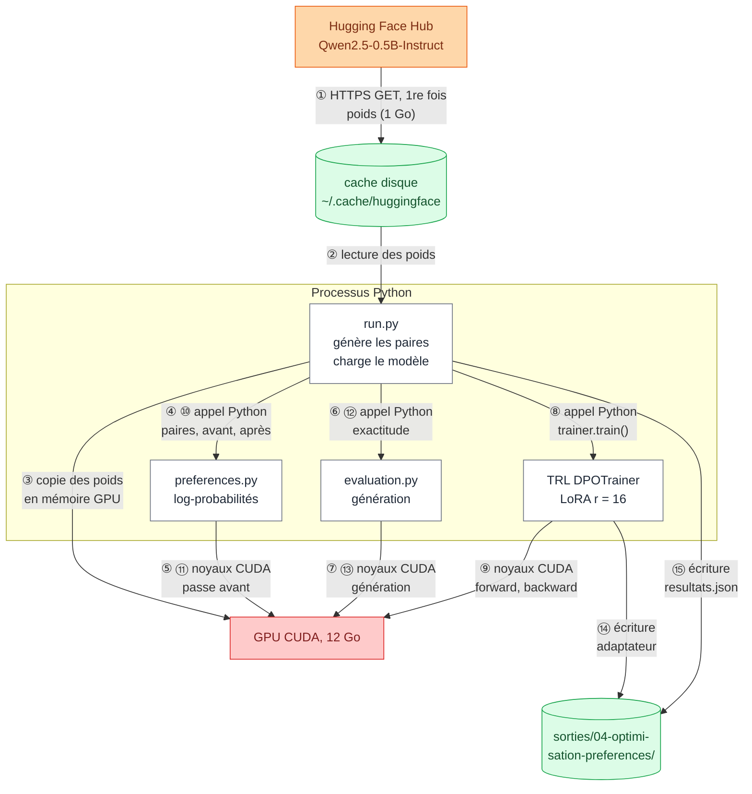

# 04 — Optimisation des préférences (DPO et famille)

> Montrer au modèle des paires « réponse préférée / réponse rejetée » et le pousser vers la préférée, sans modèle de récompense ni boucle de RL.

| Regroupe | Modifie | Local 12 Go | Test `--quick` |
|---|---|---|---|
| DPO, DPO normalisé, IPO, rDPO, SLiC, APO, NCA, BCO, SPPO, EXO, AOT, DiscoPOP, ORPO, SimPO, CPO, KTO, DPO itératif / on-policy | Tous les poids (ou LoRA) | ✅ jusqu'à ~0,5B en complet (le modèle de référence double la mémoire), ~3B en LoRA | ✅ |

## Principe

Schéma : [docs/schemas-methodes.md](../docs/schemas-methodes.md#m04) (ce que la méthode ajoute ou modifie dans le transformer).

Le RLHF classique entraîne d'abord un modèle de récompense, puis optimise la politique avec PPO ([05](../05-rl-en-ligne)). **DPO** montre que le même objectif (maximiser la préférence sans trop s'éloigner du modèle de référence) se ramène à une simple perte de classification sur les paires :

```
perte = -log σ( β · [ (log π(préférée) - log π_ref(préférée)) - (log π(rejetée) - log π_ref(rejetée)) ] )
```

Toutes les méthodes regroupées ici utilisent **les mêmes données** (prompt, préférée, rejetée) et la même boucle. Elles ne diffèrent que par la perte, d'où leur regroupement. On choisit avec `--set algo=...` :

| Algo | Idée | Référence nécessaire |
|---|---|---|
| `dpo` | Perte sigmoïde de DPO | oui |
| `dpo_norm` | DPO normalisé par la longueur (Tülu 3), limite la dérive vers les réponses longues | oui |
| `ipo` | Perte quadratique, moins de surapprentissage quand les préférences sont tranchées | oui |
| `rdpo` | Robuste aux paires mal étiquetées (`label_smoothing` = taux de bruit) | oui |
| `slic` | Perte hinge (SLiC-HF) | oui |
| `apo_zero` / `apo_down` | Ancrage : pousser la préférée vers le haut ou la rejetée vers le bas selon la qualité des données | oui |
| `nca`, `bco`, `sppo`, `exo`, `aot`, `discopop` | Autres formulations (probabiliste, classifieur, jeu, transport optimal, perte découverte par LLM) | oui |
| `orpo` | SFT + terme de ratio de cotes, en une seule étape | **non** |
| `simpo` | Récompense = log-prob moyenne, avec une marge γ | **non** |
| `cpo` | DPO sans référence + terme de vraisemblance (traduction) | **non** |
| `kto` | Pas de paires : chaque réponse est seulement « bonne » ou « mauvaise » (feedback 👍/👎) | oui |

Le **DPO itératif / on-policy** ([`variantes/dpo-iteratif`](variantes/dpo-iteratif)) fait générer les paires par le modèle lui-même à chaque tour. Un juge les classe : vérificateur, modèle de récompense ou LLM juge. Les paires restent ainsi dans la distribution du modèle, ce qui marche nettement mieux que des paires figées écrites par d'autres.

## Modèles concernés

| Type de modèle | Applicable | Remarques |
|---|---|---|
| LLM décodeur, idéalement après un SFT | ✅ cas principal | [`run.py`](run.py) |
| LLM instruct du commerce (Qwen-Instruct, Llama-Instruct...) | ✅ | Déjà SFT, on peut appliquer DPO directement |
| Modèle de base (sans SFT) | ⚠️ | Préférer ORPO, qui combine SFT et préférences, ou faire un SFT d'abord |
| Multimodal (Qwen2.5-VL, LLaVA, Idefics) | ✅ | `DPOTrainer` gère les images dans les prompts (réduction des hallucinations visuelles) |
| Diffusion (SD, SDXL) | ✅ | Diffusion-DPO : même idée appliquée à la perte de débruitage (scripts diffusers `train_diffusion_dpo`) |
| Encodeur (BERT) / classifieur | ❌ | Pas de génération, rien à préférer |
| Modèle fermé via API | ⚠️ | OpenAI propose un « preference fine-tuning » (DPO) sur ses modèles |

## Quand l'utiliser

- ✅ Après un SFT, pour aligner le ton, l'utilité, la sécurité, la concision.
- ✅ Vous avez ou pouvez produire des comparaisons : annotateurs, 👍/👎 des utilisateurs (KTO), LLM juge, vérificateur.
- ✅ Alternative bien plus simple et stable que PPO pour les préférences « subjectives ».
- ⚠️ Pour le raisonnement vérifiable (maths, code), le RL en ligne avec récompense vérifiable ([05](../05-rl-en-ligne)) va plus loin. Le DPO itératif est un intermédiaire.

## Composants de l'exemple



`make run EX=04` vérifie les prérequis (modules, GPU), puis lance `run.py` dans l'environnement `.venv`. Le script lit `config.yaml` (modèle, algorithme `dpo`, `beta`, LoRA, données, réglages) et génère en mémoire, sans téléchargement, 2 000 paires de préférence pour l'entraînement et 100 pour le test : pour un même problème `(a op b) op c`, la réponse préférée est le raisonnement juste, la réponse rejetée le même raisonnement avec une erreur de calcul. 200 problèmes de test servent en plus à mesurer l'exactitude en génération.

- **① Téléchargement.** Au premier lancement, transformers télécharge les poids de Qwen2.5-0.5B-Instruct (environ 1 Go, safetensors) depuis le Hugging Face Hub, par HTTPS.
- **② Lecture.** Les poids sont rangés dans le cache `~/.cache/huggingface` ; les lancements suivants les relisent sur le disque, sans réseau.
- **③ Copie sur le GPU.** Les poids sont copiés en fp32 dans la mémoire du GPU (`dtype: float32`), où ils restent jusqu'à la fin.
- **④ Mesure des préférences avant.** `run.py` appelle `preferences.py`, qui calcule pour chacune des 100 paires de test la log-probabilité moyenne par token de la réponse préférée et de la réponse rejetée.
- **⑤ Passe avant sur le GPU.** Une passe avant par réponse, sans génération. La part des paires où la réponse préférée l'emporte donne `exactitude_preferences`, l'écart moyen donne `marge_moyenne`.
- **⑥ Mesure de l'exactitude avant.** `run.py` appelle `commun/evaluation.py`, qui fait répondre le modèle aux 200 problèmes de test, par lots de 16.
- **⑦ Génération sur le GPU.** Le modèle produit chaque réponse token par token, jusqu'à 256 tokens ; le nombre final est comparé au résultat attendu.
- **⑧ Entraînement.** `preferences.py` construit le DPOTrainer de TRL (perte `sigmoid`, `beta` = 0,1) avec la configuration LoRA ; `run.py` lance `trainer.train()`. PEFT ajoute deux petites matrices de rang 16 à chaque couche linéaire et gèle tout le reste.
- **⑨ Forward et backward sur le GPU.** Chaque pas traite un lot effectif de 16 paires (2 paires, 8 accumulations) : passe avant sur la réponse préférée et la réponse rejetée avec l'adaptateur, puis avec l'adaptateur désactivé pour obtenir le modèle de référence, calcul de la perte DPO, passe arrière, mise à jour des seules matrices LoRA. Une époque, taux d'apprentissage 5e-6, gradient checkpointing actif.
- **⑩ Mesure des préférences après**, sur les mêmes 100 paires.
- **⑪ Passe avant sur le GPU**, comme en ⑤.
- **⑫ Mesure de l'exactitude après**, sur les mêmes 200 problèmes.
- **⑬ Génération sur le GPU**, avec le même décodage qu'en ⑦.
- **⑭ Écriture de l'adaptateur** dans `sorties/04-optimisation-preferences/modele-dpo/`.
- **⑮ Écriture du rapport** dans `sorties/04-optimisation-preferences/resultats.json`, avec le même tableau affiché dans le terminal.

**Ce que fait le GPU.** Le processus Python ne calcule presque rien lui-même : PyTorch envoie au GPU des « noyaux CUDA », de petits programmes qui font les multiplications de matrices et l'attention sur les poids et les activations déjà présents dans sa mémoire. Les mesures de préférence (⑤, ⑪) ne demandent qu'une passe avant par réponse. En génération (⑦, ⑬), il y a une passe avant par token produit, accélérée par un cache des clés et des valeurs déjà calculées. En entraînement (⑨), DPO a besoin des log-probabilités d'un modèle de référence figé : avec LoRA, c'est le même modèle, adaptateur désactivé, donc aucune seconde copie des poids n'occupe la mémoire. Chaque pas fait les passes avant du modèle entraîné et de la référence, une passe arrière, puis la mise à jour des paramètres LoRA par l'optimiseur AdamW, dont l'état n'existe que pour ces paramètres.

**Ce qui est écrit.**

| Fichier | Contenu |
|---|---|
| `modele-dpo/adapter_model.safetensors` | Les matrices LoRA entraînées (35 Mo, en fp32), seules à être sauvegardées : le modèle de base reste celui du Hub |
| `modele-dpo/adapter_config.json` | Rang, alpha, couches ciblées (`q_proj`, `k_proj`, `v_proj`, `o_proj`, `gate_proj`, `up_proj`, `down_proj`) et nom du modèle de base, pour recharger l'adaptateur avec `PeftModel.from_pretrained` |
| `modele-dpo/README.md` | La fiche de modèle générée par PEFT et TRL (modèle de base, étiquettes `dpo`, `lora`) |
| `modele-dpo/tokenizer.json`, `tokenizer_config.json`, `chat_template.jinja` | Le tokenizer et le format de conversation, copiés pour que le dossier se suffise à lui-même |
| `modele-dpo/training_args.bin` | Les réglages d'entraînement utilisés |
| `resultats.json` | Avant et après : `exactitude_preferences`, `marge_moyenne`, exactitude en génération, nombre de réponses, durée de l'évaluation, trois réponses d'exemple ; algorithme utilisé |
| `config_effective.yaml` | La configuration réellement utilisée, surcharges `SET` comprises |

Le dossier de sortie prend le nom de l'algorithme : avec `SET="algo=kto"`, il s'appelle `modele-kto/`. Avec `SET="peft.activer=false"`, il contient le modèle complet au lieu de l'adaptateur.

## Utilisation

```bash
python run.py --quick
python run.py                                               # DPO complet Qwen2.5-0.5B-Instruct sur paires arithmétiques
python run.py --set algo=ipo --set beta=0.01
python run.py --set algo=simpo --set beta=2.0 --set entrainement.lr=1e-6
python run.py --set algo=kto
python run.py --set peft.activer=true --set entrainement.lr=5e-6 --set modele.nom=Qwen/Qwen2.5-3B-Instruct
python run.py --set donnees.source=hf --set donnees.nom=trl-lib/ultrafeedback_binarized --set donnees.split_train=train --set donnees.split_test=test
for a in dpo ipo rdpo slic apo_zero nca bco sppo orpo simpo cpo kto; do python run.py --quick --set algo=$a; done
python variantes/dpo-iteratif/run.py --quick
```

## Ce que fait l'exemple

- **Données** : pour chaque problème, `chosen` est le raisonnement juste et `rejected` le même raisonnement avec une erreur de calcul. C'est le cas le plus difficile à distinguer, et le plus utile.
- **Mesures** :
  - `exactitude_preferences` : part des paires test où le modèle préfère la bonne réponse (log-prob moyenne) ;
  - `marge_moyenne` ;
  - exactitude en génération.
- **Attendu** : `exactitude_preferences` monte nettement et la génération suit, plus modestement.

## Paramètres principaux (`config.yaml`)

| Clé | Rôle |
|---|---|
| `algo` | Voir le tableau |
| `beta` | Écart autorisé par rapport à la référence. Plus petit = le modèle s'éloigne davantage |
| `entrainement.lr` | **Très faible** en complet (5e-7). Un lr de SFT détruit le modèle |
| `peft.activer` | LoRA : la référence est la base sans adaptateur, ce qui évite de charger une deuxième copie |

## Grosse infra

- [`infra/config.yaml`](infra/config.yaml) : recette **Tülu 3** (DPO normalisé en longueur, β=5, mélange de 272k préférences) sur Llama-3.1-8B-SFT, DeepSpeed ZeRO-3 sur 8×H100. Pour 70B : 2 à 4 nœuds via Slurm.
- `precompute_ref_log_probs: true` (dans `entrainement.autres`) : les log-probs de la référence sont calculées une fois, puis la référence est déchargée.
- Frameworks : [open-instruct](https://github.com/allenai/open-instruct), [OpenRLHF](https://github.com/OpenRLHF/OpenRLHF), LLaMA-Factory.
- Préférences on-policy à grande échelle : générer avec vLLM (n=8 à 16 par prompt), noter avec un modèle de récompense (Skywork-Reward) ou un LLM juge, puis DPO.

## Pièges

- **lr trop élevé** : c'est la première cause d'échec. Commencer à 5e-7 en complet.
- **Dérive de longueur** : DPO favorise les réponses longues. Utiliser `dpo_norm` ou `simpo`, surveiller la longueur moyenne.
- **Paires off-policy** : des paires écrites par un autre modèle apprennent moins. Préférer le DPO itératif.
- **« Déplacement de vraisemblance »** : la log-prob de la réponse préférée peut *baisser* pendant l'entraînement, seule la marge compte. Ajouter un peu de SFT (`loss_type: [sigmoid, sft]`) si ça dégrade la génération.
- **Chat template** : le même qu'au SFT.

## Références

- Rafailov et al., *DPO* (2023) · Azar et al., *IPO* (2023) · Ethayarajh et al., *KTO* (2024) · Hong et al., *ORPO* (2024) · Meng et al., *SimPO* (2024)
- Xu et al., *CPO* (2024) · D'Oosterlinck et al., *APO* (2024) · Chowdhury et al., *Robust DPO* (2024)
- Lambert et al., *Tülu 3* (2024) · Yuan et al., *Self-Rewarding Language Models* (2024) · Xiong et al., *Iterative Preference Learning* (2024)
