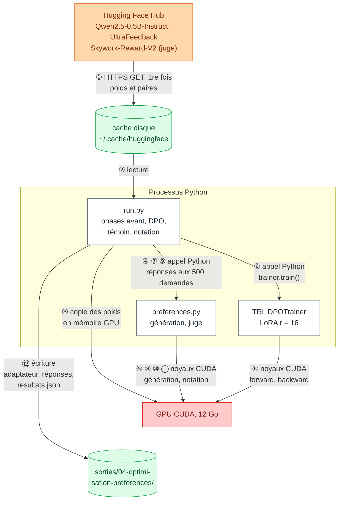

# 04 — Optimisation des préférences (DPO et famille)

> Montrer au modèle des paires « réponse préférée / réponse rejetée » et le pousser vers la préférée, sans modèle de récompense ni boucle de RL.

| Regroupe | Modifie | Local 12 Go | Test `--quick` |
|---|---|---|---|
| DPO, DPO normalisé, IPO, rDPO, SLiC, APO, NCA, BCO, SPPO, EXO, AOT, DiscoPOP, ORPO, SimPO, CPO, KTO, DPO itératif / on-policy | Tous les poids (ou LoRA) | ✅ jusqu'à ~0,5B en complet (le modèle de référence double la mémoire), ~3B en LoRA | ✅ |

## Principe

Schéma : [docs/schemas-methodes.md](../docs/schemas-methodes.md#m04) (ce que la méthode ajoute ou modifie dans le transformer).

Le RLHF classique entraîne d'abord un modèle de récompense, puis optimise la politique avec PPO ([SIGN05](../05-rl-en-ligne)). **DPO** montre que le même objectif (maximiser la préférence sans trop s'éloigner du modèle de référence) se ramène à une simple perte de classification sur les paires :

```
perte = -log σ( β · [ (log π(préférée) - log π_ref(préférée)) - (log π(rejetée) - log π_ref(rejetée)) ] )
```

Toutes les méthodes regroupées ici utilisent **les mêmes données** (prompt, préférée, rejetée) et la même boucle. Elles ne diffèrent que par la perte, d'où leur regroupement. On choisit avec `--set algo=...` :

| Algo | Idée | Référence nécessaire |
|---|---|---|
| `dpo` | Perte sigmoïde de DPO | oui |
| `dpo_norm` | DPO normalisé par la longueur (Tülu 3), limite la dérive vers les réponses longues | oui |
| `ipo` | Perte quadratique, moins de surapprentissage quand les préférences sont tranchées | oui |
| `rdpo` | Robuste aux paires mal étiquetées (`label_smoothing` = taux de bruit) | oui |
| `slic` | Perte hinge (SLiC-HF) | oui |
| `apo_zero` / `apo_down` | Ancrage : pousser la préférée vers le haut ou la rejetée vers le bas selon la qualité des données | oui |
| `nca`, `bco`, `sppo`, `exo`, `aot`, `discopop` | Autres formulations (probabiliste, classifieur, jeu, transport optimal, perte découverte par LLM) | oui |
| `orpo` | SFT + terme de ratio de cotes, en une seule étape | **non** |
| `simpo` | Récompense = log-prob moyenne, avec une marge γ | **non** |
| `cpo` | DPO sans référence + terme de vraisemblance (traduction) | **non** |
| `kto` | Pas de paires : chaque réponse est seulement « bonne » ou « mauvaise » (feedback 👍/👎) | oui |

Le **DPO itératif / on-policy** ([`variantes/dpo-iteratif`](variantes/dpo-iteratif)) fait générer les paires par le modèle lui-même à chaque tour. Un juge les classe : vérificateur, modèle de récompense ou LLM juge. Les paires restent ainsi dans la distribution du modèle, ce qui marche nettement mieux que des paires figées écrites par d'autres (mesuré ici : 0,616 de victoires contre 0,552).

## Modèles concernés

| Type de modèle | Exemples de modèles | Applicable | Remarques |
|---|---|---|---|
| LLM décodeur, idéalement après un SFT | Llama 3, Qwen2.5, Mistral 7B, Gemma 2 | ✅ cas principal | [`run.py`](run.py) |
| LLM instruct du commerce | Qwen2.5-7B-Instruct, Llama-3.1-8B-Instruct | ✅ | Déjà SFT, on peut appliquer DPO directement |
| Modèle de base (sans SFT) | Llama-3.1-8B, Qwen2.5-7B (versions de base) | ⚠️ | Préférer ORPO, qui combine SFT et préférences, ou faire un SFT d'abord |
| Multimodal | Qwen2.5-VL, LLaVA, Idefics | ✅ | `DPOTrainer` gère les images dans les prompts (réduction des hallucinations visuelles) |
| Diffusion | Stable Diffusion, SDXL | ✅ | Diffusion-DPO : même idée appliquée à la perte de débruitage (scripts diffusers `train_diffusion_dpo`) |
| Encodeur / classifieur | BERT | ❌ | Pas de génération, rien à préférer |
| Modèle fermé via API | GPT-4o, Claude, Gemini | ⚠️ | OpenAI propose un « preference fine-tuning » (DPO) sur ses modèles |

## Quand l'utiliser

- ✅ Après un SFT, pour aligner le ton, l'utilité, la sécurité, la concision.
- ✅ Vous avez ou pouvez produire des comparaisons : annotateurs, 👍/👎 des utilisateurs (KTO), LLM juge, vérificateur.
- ✅ Alternative bien plus simple et stable que PPO pour les préférences « subjectives ».
- ⚠️ Pour le raisonnement vérifiable (maths, code), le RL en ligne avec récompense vérifiable ([SIGN05](../05-rl-en-ligne)) va plus loin. Le DPO itératif est un intermédiaire.

## Composants de l'exemple



`make run EX=SIGN04` vérifie les prérequis (modules, GPU), puis lance `run.py` dans l'environnement `.venv`. Le script lit `config.yaml` (modèle, algorithme `dpo`, `beta`, LoRA, données, juge, témoin). Les paires viennent d'UltraFeedback binarisé (`trl-lib/ultrafeedback_binarized`) : des demandes variées (rédaction, code, conseils, raisonnement), chacune avec la réponse la mieux notée et une moins bien notée parmi celles de 17 modèles. 16 000 paires du split `train` servent à l'entraînement ; le split `test` fournit 300 paires pour mesurer les préférences et 500 demandes (de 2 000 caractères au plus) pour mesurer les réponses.

- **① Téléchargement.** Au premier lancement : les poids de Qwen2.5-0.5B-Instruct (environ 1 Go), UltraFeedback (environ 250 Mo) et le juge Skywork-Reward-V2-Qwen3-1.7B (3,4 Go), depuis le Hugging Face Hub, par HTTPS.
- **② Lecture.** Tout est rangé dans le cache `~/.cache/huggingface` ; les lancements suivants le relisent sans réseau.
- **③ Copie sur le GPU.** Les poids du modèle sont copiés en fp32 dans la mémoire du GPU.
- **④ Phase « avant ».** `run.py` mesure, sur le modèle de départ : la part des 300 paires de test où il donne une log-probabilité moyenne plus haute à la réponse préférée ; l'exactitude sur 200 problèmes d'arithmétique (non-régression : une tâche qu'il réussit et qui ne doit pas se dégrader) ; ses réponses aux 500 demandes de test.
- **⑤ Génération sur le GPU.** Décodage glouton, jusqu'à 512 tokens par réponse, par lots de 32 : la même demande donne toujours la même réponse.
- **⑥ Entraînement DPO.** `preferences.py` construit le DPOTrainer de TRL (perte `sigmoid`, `beta` = 0,1) avec LoRA de rang 16 sur toutes les couches linéaires. Chaque pas traite 16 paires (lots de 1, accumulation sur 16), tronquées à 1 024 tokens : passe avant sur la réponse préférée et la rejetée avec l'adaptateur, puis sans lui (le modèle de référence), perte DPO, passe arrière, mise à jour des seules matrices LoRA. Une époque, 1 000 pas, taux d'apprentissage 5e-5.
- **⑦ Phase « après ».** Mêmes mesures qu'en ④ sur le modèle entraîné, puis écriture de l'adaptateur.
- **⑧ Génération sur le GPU**, comme en ⑤.
- **⑨ Témoin SFT.** Le modèle de départ est rechargé et entraîné en SFT, avec la même LoRA, sur la seule réponse préférée de chacune des mêmes paires (taux d'apprentissage 1e-4, celui d'un SFT LoRA). Il sépare deux effets : apprendre ce qui rend une réponse meilleure qu'une autre, ou imiter des réponses écrites par des modèles plus forts.
- **⑩ Génération sur le GPU**, comme en ⑤, puis mêmes mesures qu'en ④.
- **⑪ Notation par le juge.** Le modèle entraîné quitte le GPU ; le juge Skywork-Reward-V2 (modèle de récompense de 1,7 milliard de paramètres, en bf16) note chaque couple (demande, réponse) des trois jeux de réponses. Le taux de victoire est la part des demandes où la réponse du modèle entraîné a une meilleure note que celle du modèle de départ : 0,5 veut dire aussi bien.
- **⑫ Écriture** des 500 demandes avec les trois réponses et leurs notes dans `reponses.json`, et du rapport dans `resultats.json`, avec le même tableau dans le terminal.

**Ce que fait le GPU.** Le processus Python ne calcule presque rien lui-même : PyTorch envoie au GPU des « noyaux CUDA », de petits programmes qui font les multiplications de matrices et l'attention sur les poids et les activations déjà présents dans sa mémoire. DPO a besoin des log-probabilités d'un modèle de référence figé : avec LoRA, c'est le même modèle, adaptateur désactivé, donc aucune seconde copie des poids n'occupe la mémoire. Pic mesuré pendant le DPO : 6,2 Gio ; pendant le témoin SFT : 3,0 Gio. Chaque phase terminée est gardée dans `reprise/` : un calcul interrompu et relancé repart de la phase suivante, et l'entraînement en cours reprend de son dernier point de contrôle (`commun/reprise.py`).

**Ce qui est écrit.**

| Fichier | Contenu |
|---|---|
| `modele-dpo/adapter_model.safetensors`, `adapter_config.json` | Les matrices LoRA entraînées (35 Mo, en fp32) et leur configuration, pour recharger l'adaptateur avec `PeftModel.from_pretrained` sur le modèle de base du Hub |
| `modele-dpo/tokenizer.json`, `tokenizer_config.json`, `chat_template.jinja` | Le tokenizer et le format de conversation |
| `temoin-sft/` | Dossier de travail du Trainer pour le témoin, sans point de contrôle |
| `reponses.json` | Les 500 demandes de test, avec la réponse et la note de chaque modèle : de quoi relire ce que le juge préfère |
| `resultats.json` | Pour avant, après et le témoin : préférences, non-régression, note moyenne, mots par réponse, durée et mémoire d'entraînement ; taux de victoire avec intervalle à 95 % ; écart de note apparié |
| `config_effective.yaml` | La configuration réellement utilisée, surcharges `SET` comprises |

Le dossier de sortie prend le nom de l'algorithme : avec `SET="algo=kto"`, il s'appelle `modele-kto/`. Avec `SET="peft.activer=false"`, il contient le modèle complet au lieu de l'adaptateur.

## Utilisation

```bash
python run.py --quick
python run.py                                               # DPO LoRA Qwen2.5-0.5B-Instruct sur 16 000 paires UltraFeedback, ~2 h avec le témoin
python run.py --set temoin_sft.activer=false                # sans le témoin SFT, ~1 h 20
python run.py --set algo=ipo --set beta=0.01
python run.py --set algo=simpo --set beta=2.0
python run.py --set algo=kto
python run.py --set donnees.source=arith --set evaluation.n_paires=100   # paires arithmétiques générées (calcul juste contre erreur)
for a in dpo ipo rdpo slic apo_zero nca bco sppo orpo simpo cpo kto; do python run.py --quick --set algo=$a; done
python variantes/dpo-iteratif/run.py --quick
python variantes/dpo-iteratif/run.py                        # 3 tours on-policy sur des demandes UltraFeedback, ~1 h 40
```

## Ce que fait l'exemple

**Le besoin** : rendre les réponses d'un assistant plus utiles sur des demandes variées, à partir de jugements « cette réponse est meilleure que celle-ci », sans réécrire les réponses soi-même.

**Résultats** (Qwen2.5-0.5B-Instruct, RTX 5070 Ti Laptop ; 500 demandes de test ; graine 42 sauf mention). Le juge est un modèle de récompense externe, qui n'a vu ni le modèle entraîné ni ses réponses :

| | Victoires contre le départ | Note moyenne du juge | Mots par réponse | Non-régression (arithmétique) | Entraînement |
|---|---|---|---|---|---|
| Qwen2.5-0.5B-Instruct, départ | | −0,07 | 193 | 0,955 | |
| DPO, 16 000 paires | **0,552** [0,508 ; 0,595] | +0,33 | 203 | 0,975 | 65 min, 6,2 Gio |
| Témoin SFT sur les réponses préférées | 0,380 [0,339 ; 0,423] | −1,08 | 178 | 0,860 | 34 min, 3,0 Gio |
| DPO, 4 000 paires, taux 2e-5 | 0,506 [0,462 ; 0,550] | +0,12 | 203 | 0,955 | 16 min |
| DPO, 16 000 paires, graines 42, 43, 44 | 0,533 ± 0,032 (0,552 ; 0,496 ; 0,550) | +0,27 ± 0,16 | 205 | 0,963 | |

- **Le DPO gagne, de peu et pas à chaque fois.** Sur la graine 42, le juge préfère sa réponse à celle du modèle de départ dans 55 % des cas ; la note moyenne monte de +0,40 (p = 0,005, permutation appariée). Sur trois graines, le gain est net deux fois (0,552 et 0,550) et nul une fois (0,496 [0,452 ; 0,540]). Les réponses ne s'allongent que de 5 % : le gain ne vient pas d'abord de la longueur, à laquelle les juges sont sensibles.
- **Imiter les réponses préférées dégrade le modèle**, alors qu'apprendre la préférence l'améliore : le DPO bat le témoin SFT dans 67 % des cas. Les réponses d'UltraFeedback viennent de modèles plus forts ; un modèle de 0,5B les imite mal et perd une partie de ce qu'il savait (non-régression 0,955 → 0,860).
- **Il faut assez de paires.** Avec 4 000 paires et un taux plus faible, pas de gain mesurable.
- **Non démontré.** Le gain dépend de la graine. Qwen2.5-Instruct a déjà été aligné sur des préférences par ses auteurs : la marge restante est faible. Le juge peut partager des biais avec les annotations d'UltraFeedback.

### Variante DPO itératif : le modèle fabrique ses propres paires

[`variantes/dpo-iteratif`](variantes/dpo-iteratif) part du même modèle et des mêmes demandes de test, mais n'utilise aucune réponse d'UltraFeedback. À chaque tour :

- le modèle répond 4 fois (température 0,8) à 500 demandes neuves du split d'entraînement ;
- un petit modèle de récompense, Skywork-Reward-V2-Qwen3-0.6B, note les 4 réponses : la mieux notée devient la réponse préférée, la moins bien notée la réponse rejetée ;
- un tour de DPO LoRA (2 époques) est fusionné dans le modèle, qui devient le point de départ et la référence du tour suivant.

La mesure reste celle de l'exemple principal : le juge Skywork-Reward-V2-Qwen3-1.7B, qui n'a pas servi à fabriquer les paires, compare les réponses gloutonnes aux 500 demandes de test.

| | Victoires contre le départ | Note moyenne du juge | Mots par réponse | Non-régression (arithmétique) |
|---|---|---|---|---|
| Départ | | −0,07 | 193 | 0,955 |
| Tour 1 (489 paires) | 0,532 [0,488 ; 0,575] | +0,54 | 176 | 0,965 |
| Tour 2 (494 paires) | 0,602 [0,558 ; 0,644] | +1,03 | 177 | 0,970 |
| Tour 3 (494 paires) | **0,616** [0,573 ; 0,658] | +0,92 | 184 | 0,935 |

Chaque tour dure environ 30 minutes, dont 3 min 30 d'entraînement (6,2 Gio de mémoire). L'écart de note avec le départ est de +0,98 après 3 tours (p < 0,001, permutation appariée).

- **Moins de 1 500 paires produites par le modèle valent mieux que 16 000 paires figées** : 0,616 contre 0,552. Les paires restent dans la distribution du modèle, et chaque tour repart du modèle amélioré.
- **Le gain ne vient pas de la longueur** : les réponses raccourcissent un peu (193 → 184 mots).
- **Réserves.** Une graine pour l'instant. Les deux modèles de récompense sont de la même famille et peuvent partager des biais : le gain mesuré est en partie un gain aux yeux de ce juge. Le tour 3 n'améliore plus la note moyenne : deux ou trois tours suffisent ici.

## Paramètres principaux (`config.yaml`)

| Clé | Rôle |
|---|---|
| `algo` | Voir le tableau |
| `beta` | Écart autorisé par rapport à la référence. Plus petit = le modèle s'éloigne davantage |
| `entrainement.lr` | LoRA : 5e-6 à 5e-5. **Très faible** en complet (5e-7) : un lr de SFT détruit le modèle |
| `juge.nom` | Modèle de récompense externe qui note les réponses aux demandes de test |
| `temoin_sft` | SFT sur les seules réponses préférées des mêmes paires, pour comparaison |
| `peft.activer` | LoRA : la référence est la base sans adaptateur, ce qui évite de charger une deuxième copie |

## Grosse infra

- [`infra/config.yaml`](infra/config.yaml) : recette **Tülu 3** (DPO normalisé en longueur, β=5, mélange de 272k préférences) sur Llama-3.1-8B-SFT, DeepSpeed ZeRO-3 sur 8×H100. Pour 70B : 2 à 4 nœuds via Slurm.
- `precompute_ref_log_probs: true` (dans `entrainement.autres`) : les log-probs de la référence sont calculées une fois, puis la référence est déchargée.
- Frameworks : [open-instruct](https://github.com/allenai/open-instruct), [OpenRLHF](https://github.com/OpenRLHF/OpenRLHF), LLaMA-Factory.
- Préférences on-policy à grande échelle : générer avec vLLM (n=8 à 16 par prompt), noter avec un modèle de récompense (Skywork-Reward) ou un LLM juge, puis DPO.

## Pièges

- **lr trop élevé** : c'est la première cause d'échec. Commencer à 5e-7 en complet.
- **Dérive de longueur** : DPO favorise les réponses longues. Utiliser `dpo_norm` ou `simpo`, surveiller la longueur moyenne.
- **Paires off-policy** : des paires écrites par un autre modèle apprennent moins. Préférer le DPO itératif.
- **« Déplacement de vraisemblance »** : la log-prob de la réponse préférée peut *baisser* pendant l'entraînement, seule la marge compte. Ajouter un peu de SFT (`loss_type: [sigmoid, sft]`) si ça dégrade la génération.
- **Chat template** : le même qu'au SFT.

## Références

- Rafailov et al., *DPO* (2023) · Azar et al., *IPO* (2023) · Ethayarajh et al., *KTO* (2024) · Hong et al., *ORPO* (2024) · Meng et al., *SimPO* (2024)
- Xu et al., *CPO* (2024) · D'Oosterlinck et al., *APO* (2024) · Chowdhury et al., *Robust DPO* (2024)
- Lambert et al., *Tülu 3* (2024) · Yuan et al., *Self-Rewarding Language Models* (2024) · Xiong et al., *Iterative Preference Learning* (2024)
