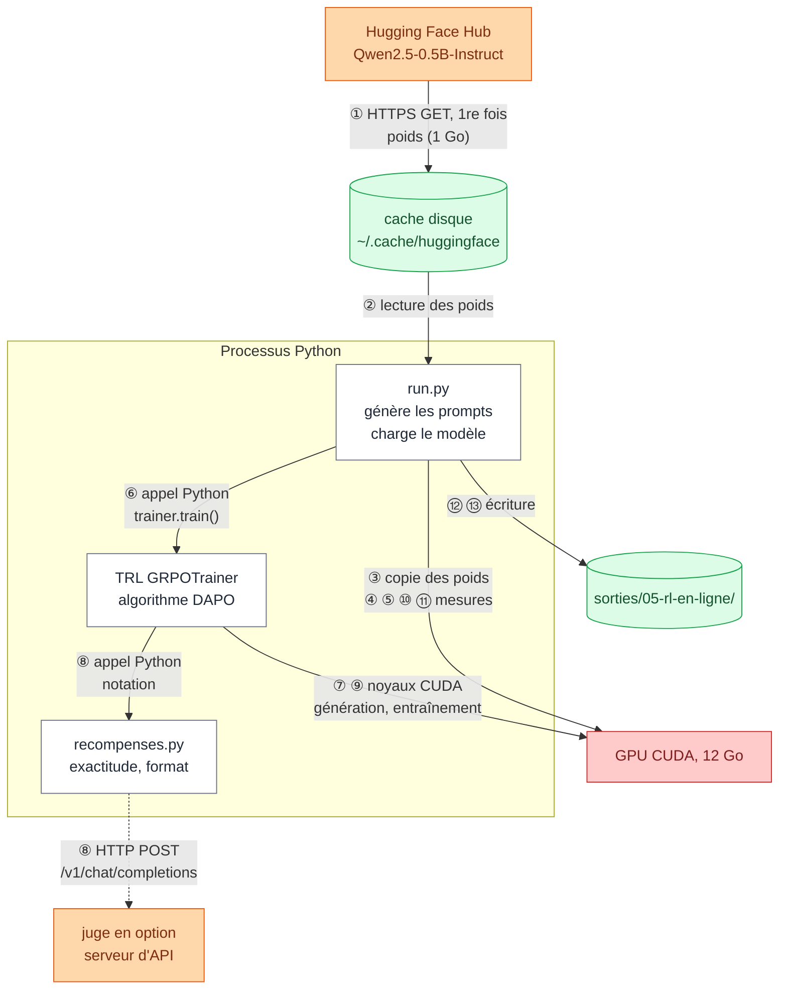

# 05 — RL en ligne (RLHF, RLAIF, RLVR : GRPO, DAPO, GSPO, RLOO...)

> Le modèle génère plusieurs réponses, une récompense les note, et on renforce celles qui ont mieux marché que la moyenne du groupe.

| Regroupe | Modifie | Local 12 Go | Test `--quick` |
|---|---|---|---|
| RLHF (modèle de récompense), RLAIF / Constitutional AI (LLM juge), RLVR (récompense vérifiable) ; GRPO, Dr.GRPO, DAPO, GSPO, CISPO, RLOO ; PPO en infra | Tous les poids (ou LoRA) | ✅ jusqu'à ~1,5B (lent : la génération domine) | ✅ |

## Principe

Schéma : [docs/schemas-methodes.md](../docs/schemas-methodes.md#m05) (ce que la méthode ajoute ou modifie dans le transformer).

À chaque pas :

1. On tire un lot de prompts.
2. Le modèle génère **G réponses par prompt** (échantillonnage à température 1).
3. Chaque réponse reçoit une **récompense**.
4. L'**avantage** de chaque réponse est sa récompense moins la moyenne de son groupe (éventuellement divisée par l'écart-type). On n'a donc pas besoin d'un réseau critique comme dans PPO.
5. Mise à jour de type « policy gradient » avec clipping, et éventuellement une pénalité KL vers le modèle initial.

Contrairement au DPO ([SIGN04](../04-optimisation-preferences)), les données sont **générées par le modèle lui-même** pendant l'entraînement (on-policy). Le modèle peut ainsi découvrir des stratégies meilleures que celles des données d'origine. C'est ce qui a produit les modèles de raisonnement (o1, DeepSeek-R1).

**La boucle est la même dans tous les cas, seule la source de récompense change**, d'où le regroupement :

| `recompense.source` | Nom usuel | Récompense | Idéal pour |
|---|---|---|---|
| `regles` | **RLVR** | Programme vérificateur : réponse exacte, tests unitaires qui passent, format respecté | Maths, code, extraction structurée, tout ce qui se vérifie |
| `modele` | **RLHF** | Modèle de récompense entraîné sur des préférences humaines ([`variantes/modele-recompense`](variantes/modele-recompense)) | Utilité, ton, sécurité : ce qui ne se vérifie pas |
| `juge` | **RLAIF** / Constitutional AI | Un LLM note la réponse selon une consigne ou des principes écrits | Idem, sans annotateurs humains |

Et les variantes d'algorithme (`--set algo=...`) :

| Algo | Différence |
|---|---|
| `grpo` | Formulation DeepSeekMath : avantages normalisés par groupe, KL β=0,04 |
| `dr_grpo` | Supprime les biais de longueur et de difficulté (pas de division par l'écart-type) |
| `dapo` | Clipping asymétrique (clip-higher), normalisation par token, masque des réponses tronquées. Défaut TRL |
| `gspo` | Ratio d'importance au niveau de la séquence : plus stable, surtout pour les MoE (Qwen3) |
| `cispo` | Clipping des poids d'importance plutôt que des mises à jour (MiniMax-M1) |
| `rloo` | REINFORCE leave-one-out : baseline = moyenne des autres réponses |
| PPO | Avec critique appris. Plus coûteux, encore utilisé à grande échelle : voir l'infra (verl, OpenRLHF) |

## Modèles concernés

| Type de modèle | Applicable | Remarques |
|---|---|---|
| LLM décodeur instruct ou après SFT | ✅ cas principal | Le modèle doit déjà réussir *parfois* : une récompense toujours nulle ne donne aucun signal |
| LLM de base | ⚠️ | Possible (R1-Zero) mais demande un modèle ≥ 7B et un format simple |
| Multimodal (Qwen2.5-VL...) | ✅ | `GRPOTrainer` accepte les images. RLVR sur des questions visuelles vérifiables |
| Agents / usage d'outils | ✅ | `GRPOTrainer(tools=..., environment_factory=...)` : récompense sur la réussite de la tâche multi-tours |
| Diffusion | ✅ | DDPO, Flow-GRPO : récompense esthétique ou d'alignement texte-image (bibliothèques dédiées) |
| Encodeur / classifieur | ❌ | Pas de génération |
| Modèle fermé via API | ⚠️ | OpenAI « Reinforcement Fine-Tuning » : on fournit des prompts et un grader |

## Quand l'utiliser

- ✅ Tâche **vérifiable** (maths, code, SQL, JSON valide, jeu) : RLVR, c'est le cas où le RL apporte le plus.
- ✅ Après SFT et/ou DPO, pour dépasser le niveau des démonstrations.
- ⚠️ Récompense apprise ou juge : risque de **reward hacking** (le modèle exploite les failles du juge). Garder la KL, surveiller les sorties.
- ❌ Si le modèle ne réussit jamais la tâche (récompense toujours 0) : d'abord SFT, ou une tâche plus facile (curriculum).

## Composants de l'exemple



`make run EX=SIGN05` vérifie les prérequis (modules, GPU), puis lance `run.py` dans l'environnement `.venv`. Le script lit `config.yaml` (modèle, algorithme `dapo`, source de récompense `regles`, génération, données, réglages) et génère en mémoire, sans téléchargement, 800 prompts d'arithmétique pour l'entraînement et 200 problèmes pour le test, de la forme `(a op b) op c`. Seul le résultat attendu sert pendant le RL : le modèle n'est jamais entraîné sur une solution écrite.

- **① Téléchargement.** Au premier lancement, transformers télécharge les poids de Qwen2.5-0.5B-Instruct (environ 1 Go, safetensors) depuis le Hugging Face Hub, par HTTPS.
- **② Lecture.** Les poids sont rangés dans le cache `~/.cache/huggingface` ; les lancements suivants les relisent sur le disque, sans réseau.
- **③ Copie sur le GPU.** Les poids sont copiés en fp32 dans la mémoire du GPU (`dtype: float32`), où ils restent jusqu'à la fin.
- **④ Mesure avant.** `run.py` appelle `commun/evaluation.py`, qui fait répondre le modèle aux 200 problèmes de test, par lots de 16.
- **⑤ Génération sur le GPU.** Pour chaque lot, le modèle produit la réponse token par token, jusqu'à 256 tokens, en décodage glouton. L'évaluation extrait ensuite le nombre final de chaque réponse et le compare au résultat attendu : c'est l'exactitude de départ.
- **⑥ Entraînement.** `run.py` confie le modèle, les prompts et les fonctions de récompense au GRPOTrainer de TRL, réglé pour DAPO (perte `dapo`, `epsilon_high` = 0,28, `beta` = 0, réponses tronquées ignorées). Rien n'est gelé : tous les poids du modèle sont entraînés.
- **⑦ Génération sur le GPU.** À chaque pas, le modèle lui-même produit 8 réponses par prompt, par échantillonnage à température 1,0, jusqu'à 128 tokens chacune.
- **⑧ Notation.** TRL passe les réponses à `recompenses.py` : 1 si le nombre final est juste, plus 0,2 si la réponse se termine par `Answer: N`. Ce calcul se fait en Python, sans GPU. Avec `SET="recompense.source=juge recompense.api_base=http://localhost:11434/v1"`, la note vient d'un LLM juge interrogé par HTTP sur une API compatible OpenAI (flèche pointillée).
- **⑨ Forward et backward sur le GPU.** Chaque réponse reçoit un avantage : l'écart de sa récompense à la moyenne de son groupe de 8, divisé par l'écart type du groupe. Chaque pas traite 16 réponses (8 par lot, 2 accumulations) : passe avant pour les log-probabilités des tokens générés, perte DAPO, passe arrière, mise à jour de tous les poids. Taux d'apprentissage 1e-6, gradient checkpointing actif.
- **⑩ Mesure après.** Les mêmes 200 problèmes sont posés au modèle entraîné.
- **⑪ Génération sur le GPU**, avec le même décodage qu'en ⑤.
- **⑫ Écriture du modèle** complet dans `sorties/05-rl-en-ligne/modele-dapo/`.
- **⑬ Écriture du rapport** dans `sorties/05-rl-en-ligne/resultats.json`, avec le même tableau affiché dans le terminal.

**Ce que fait le GPU.** Le processus Python ne calcule presque rien lui-même : PyTorch envoie au GPU des « noyaux CUDA », de petits programmes qui font les multiplications de matrices et l'attention sur les poids et les activations déjà présents dans sa mémoire. En génération (⑤, ⑦, ⑪), il y a une passe avant par token produit, accélérée par un cache des clés et des valeurs déjà calculées ; pendant l'entraînement, cette génération occupe l'essentiel du temps. En entraînement (⑨), chaque pas fait une passe avant, une passe arrière qui calcule les gradients de tous les poids, puis leur mise à jour par l'optimiseur AdamW. Avec `beta` = 0, aucun modèle de référence n'est chargé, et la récompense par règles ne demande aucun modèle : un seul modèle occupe la mémoire GPU. Le pic mesuré est d'environ 9,6 Go de mémoire GPU.

**Ce qui est écrit.**

| Fichier | Contenu |
|---|---|
| `modele-dapo/model.safetensors` | Tous les poids du modèle entraîné (2,0 Go, en fp32) |
| `modele-dapo/config.json`, `generation_config.json` | Architecture et réglages de génération, pour recharger le modèle avec `AutoModelForCausalLM.from_pretrained` |
| `modele-dapo/tokenizer.json`, `tokenizer_config.json`, `chat_template.jinja` | Le tokenizer et le format de conversation, copiés pour que le dossier se suffise à lui-même |
| `modele-dapo/training_args.bin` | Les réglages d'entraînement utilisés |
| `resultats.json` | Exactitude avant et après, nombre de réponses, durée de chaque évaluation, trois réponses d'exemple de chaque côté ; récompense moyenne en début et en fin d'entraînement ; algorithme et source de récompense |
| `config_effective.yaml` | La configuration réellement utilisée, surcharges `SET` comprises |

Le dossier de sortie prend le nom de l'algorithme : avec `SET="algo=grpo"`, il s'appelle `modele-grpo/`.

## Utilisation

```bash
python run.py --quick
python run.py                                                           # DAPO + récompense vérifiable, Qwen2.5-0.5B
python run.py --set algo=gspo
python run.py --set algo=rloo
python variantes/modele-recompense/run.py                               # 1) entraîner un modèle de récompense
python run.py --set recompense.source=modele \
  --set recompense.modele=sorties/05-rl-en-ligne--variantes--modele-recompense/modele   # 2) RLHF avec ce modèle
python run.py --set recompense.source=juge --set recompense.juge=Qwen/Qwen2.5-1.5B-Instruct       # RLAIF, juge local
python run.py --set recompense.source=juge --set recompense.api_base=http://localhost:11434/v1 --set recompense.juge=qwen3:8b   # juge servi par Ollama
python run.py --set peft.activer=true --set entrainement.lr=1e-5 --set modele.nom=Qwen/Qwen2.5-1.5B-Instruct
```

## Ce que fait l'exemple

1. Mesure l'exactitude du modèle sur 200 problèmes jamais vus.
2. RL sur 800 prompts, 8 réponses par prompt. Récompense = 1 si la réponse est juste, plus 0,2 si le format `Answer: N` est respecté.
3. Remesure. Le rapport ajoute la récompense moyenne en début et en fin d'entraînement.

## Paramètres principaux (`config.yaml`)

| Clé | Rôle |
|---|---|
| `algo`, `beta` | Variante et pénalité KL (0 = pas de modèle de référence en mémoire) |
| `recompense.*` | Source de la récompense |
| `generation.num_generations` | Taille du groupe (4 à 16 en local, 16 à 64 à grande échelle) |
| `generation.max_completion_length` | Longueur de raisonnement autorisée |
| `generation.vllm` | Génération rapide (indispensable au-delà de quelques centaines de pas) |
| `entrainement.batch` | Multiple de `num_generations` |

## Grosse infra

- En local : faisable jusqu'à ~1,5B, mais la génération avec transformers est lente. C'est vLLM qui rend le RL praticable.
- [`infra/config.yaml`](infra/config.yaml) : DAPO sur Qwen2.5-7B, 16 réponses par prompt jusqu'à 4k tokens, vLLM colocalisé, ZeRO-3, 1 nœud 8×H100.
- [`infra/lancer.sh`](infra/lancer.sh) documente trois montages :
  - A : TRL + vLLM colocalisé ;
  - B : TRL + serveur vLLM dédié (`trl vllm-serve`) pour les modèles de 32B et plus ;
  - C : **verl** ou **OpenRLHF** (Ray, multi-nœuds, PPO avec critique, 70B+). Exemple de commande verl fourni.
- Ordres de grandeur : RLVR 7B sur maths, ~1 000 pas en 1 à 3 jours sur 8×H100. DeepSeek-R1 et Qwen3 : des milliers de GPU.

## Pièges

- **Récompense nulle partout** : aucun gradient. Vérifier `reward` dès les premiers pas, simplifier la tâche.
- **Reward hacking** : réponses vides mais bien formatées, répétition de ce qui plaît au juge… Lire des générations régulièrement.
- **Longueur** : la réponse peut s'allonger ou raccourcir sans raison. `dr_grpo` et `dapo` corrigent les biais connus.
- **Effondrement de l'entropie** : toutes les réponses d'un groupe deviennent identiques, avantage nul. Température ≥ 1, `epsilon_high` (DAPO).
- **Mémoire** : politique + référence (si β > 0) + génération. β=0 et LoRA réduisent l'empreinte.

## Références

- Ouyang et al., *InstructGPT* (2022) : RLHF avec PPO · Bai et al., *Constitutional AI* (2022) : RLAIF
- Shao et al., *DeepSeekMath / GRPO* (2024) · DeepSeek-AI, *DeepSeek-R1* (2025) · Lambert et al., *Tülu 3 : RLVR* (2024)
- Liu et al., *Dr. GRPO* (2025) · Yu et al., *DAPO* (2025) · Zheng et al., *GSPO* (2025) · Ahmadian et al., *Back to Basics: RLOO* (2024)
- verl : https://github.com/volcengine/verl · OpenRLHF : https://github.com/OpenRLHF/OpenRLHF
