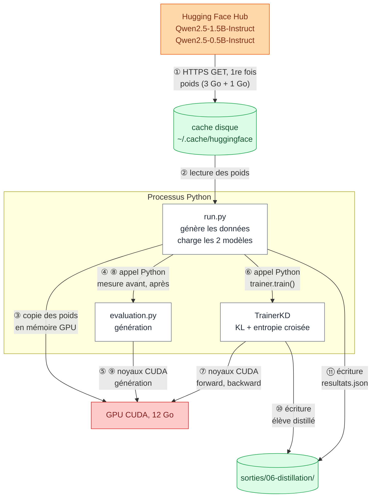

# 06 — Distillation (logits, séquences, on-policy)

> Un gros modèle « enseignant » transmet son comportement à un petit modèle « élève », plus rapide et moins cher à servir.

| Regroupe | Modifie | Local 12 Go | Test `--quick` |
|---|---|---|---|
| Distillation de logits (KD, Hinton), distillation de séquences (SeqKD, « R1-Distill »), distillation on-policy (GKD), distillation de classifieurs (DistilBERT, TinyBERT) | Tous les poids de l'élève | ✅ petits couples (1,5B → 0,5B) · ☁️ 70B → 8B | ✅ |

## Principe

Schéma : [docs/schemas-methodes.md](../docs/schemas-methodes.md#m06) (ce que la méthode ajoute ou modifie dans le transformer).

L'élève n'apprend plus seulement la bonne réponse (un token cible), mais **ce que l'enseignant sait** de toutes les réponses possibles. Trois modes (`--set mode=...`), du plus simple au plus fidèle :

| `mode` | Ce que l'élève imite | Même tokenizer ? | Coût |
|---|---|---|---|
| `sequence` | Les réponses **rédigées** par l'enseignant, filtrées quand elles sont vérifiables, puis SFT classique | non | Génération par l'enseignant, puis un SFT |
| `logits` | La **distribution complète** de l'enseignant à chaque token (KL à température T), sur des réponses fixes | **oui** | Enseignant et élève en mémoire en même temps |
| `on_policy` | La distribution de l'enseignant **sur les propres réponses de l'élève** (GKD, JSD généralisée) | **oui** | Génération par l'élève à chaque pas |

Perte du mode `logits` :

```
perte = α · T² · KL(softmax(z_enseignant / T) ‖ softmax(z_élève / T))  +  (1 - α) · CE(élève, réponse)
```

La température T > 1 adoucit les distributions : l'élève apprend aussi quelles *mauvaises* réponses sont presque bonnes (« dark knowledge »). Le mode `on_policy` corrige le principal défaut des deux autres : l'élève, entraîné sur des préfixes écrits par l'enseignant, ne sait pas se rattraper quand il dérive de lui-même à la génération.

Lien avec les données synthétiques ([SIGN07](../07-donnees-synthetiques)) : le mode `sequence` est une génération filtrée dont le générateur est un modèle plus fort.

## Modèles concernés

| Type de modèle | Applicable | Remarques |
|---|---|---|
| LLM décodeur, enseignant et élève de la **même famille** | ✅ cas principal | [`run.py`](run.py) : tous les modes (Qwen2.5-1.5B → 0.5B, Llama-3.1-8B → 3.2-1B) |
| LLM de familles différentes | ⚠️ | Mode `sequence` seulement ; les modes à logits demandent le même vocabulaire (ou un alignement de tokenizers, ULD) |
| Encodeurs / classifieurs (BERT, RoBERTa) | ✅ | [`variantes/encodeur-classification`](variantes/encodeur-classification) : KD sur les logits de classes, tokenizers différents possibles |
| Vision (ViT, CNN) | ✅ | Même perte sur les logits de classes (DeiT ajoute un token de distillation) |
| Diffusion | ✅ | Distillation de pas d'échantillonnage (LCM, SDXL-Turbo, consistency models) : moins de pas plutôt que moins de paramètres |
| Modèle fermé via API | ✅ comme enseignant | Mode `sequence` uniquement (pas de logits), en respectant les conditions d'utilisation du fournisseur |

## Quand l'utiliser

- ✅ Servir un modèle plus petit avec une qualité proche d'un grand, sur une tâche donnée.
- ✅ Après un élagage ([FORM16](../16-elagage)) : la distillation est la meilleure cicatrisation.
- ✅ Transférer un comportement coûteux à obtenir (raisonnement long, format) d'un modèle entraîné par RL vers un petit modèle.
- ⚠️ L'élève plafonne sous l'enseignant. Un écart de taille trop grand (×20 et plus) apprend moins bien qu'un enseignant intermédiaire.
- ❌ Si la quantification ([FORM15](../15-quantification)) suffit à faire tenir le modèle : elle ne demande aucun entraînement.

## Composants de l'exemple



`make run EX=SIGN06` vérifie les prérequis (modules, GPU), puis lance `run.py` dans l'environnement `.venv`. Le script lit `config.yaml` (enseignant, élève, mode `logits`, réglages de la distillation) et génère en mémoire, sans téléchargement, 2 000 problèmes d'arithmétique pour l'entraînement et 200 pour le test, de la forme `(a op b) op c` avec leur solution pas à pas. L'enseignant et l'élève sont de la même famille : même tokenizer, donc mêmes tokens à comparer un par un.

- **① Téléchargement.** Au premier lancement, transformers télécharge depuis le Hugging Face Hub, par HTTPS, les poids de l'enseignant Qwen2.5-1.5B-Instruct (environ 3 Go) et de l'élève Qwen2.5-0.5B-Instruct (environ 1 Go).
- **② Lecture.** Les poids sont rangés dans le cache `~/.cache/huggingface` ; les lancements suivants les relisent sur le disque, sans réseau.
- **③ Copie sur le GPU.** Les deux modèles sont copiés dans la mémoire du GPU et y restent jusqu'à la fin : l'élève en float32, parce que c'est lui qu'on entraîne, l'enseignant en bf16, figé (aucun gradient).
- **④ Mesure avant.** `run.py` appelle `commun/evaluation.py`, qui fait répondre l'enseignant, puis l'élève, aux 200 problèmes de test, par lots de 16.
- **⑤ Génération sur le GPU.** Pour chaque lot, le modèle produit la réponse token par token, jusqu'à 256 tokens. L'évaluation extrait le nombre final de chaque réponse et le compare au résultat attendu : c'est l'exactitude de l'enseignant (le plafond visé) et celle de l'élève au départ.
- **⑥ Distillation.** `run.py` confie l'élève, l'enseignant et les 2 000 problèmes au `TrainerKD`, un `Trainer` de transformers dont la perte est réécrite : 0,7 × divergence KL entre les distributions de l'enseignant et de l'élève, adoucies à la température 2, plus 0,3 × entropie croisée sur la solution de référence. Les deux termes ne portent que sur les tokens de la réponse.
- **⑦ Forward et backward sur le GPU.** Chaque pas traite un lot de 2 exemples, avec 8 lots accumulés avant chaque mise à jour (16 exemples), pendant 1 époque, au taux d'apprentissage de 1e-5.
- **⑧ Mesure après.** Les mêmes 200 problèmes sont posés à l'élève distillé.
- **⑨ Génération sur le GPU**, avec le même décodage qu'en ⑤.
- **⑩ Écriture de l'élève** complet dans `sorties/06-distillation/eleve-logits/`.
- **⑪ Écriture du rapport** dans `sorties/06-distillation/resultats.json`, avec le même tableau affiché dans le terminal.

**Ce que fait le GPU.** Le processus Python ne calcule presque rien lui-même : PyTorch envoie au GPU des « noyaux CUDA », de petits programmes qui font les multiplications de matrices et l'attention sur les poids et les activations déjà présents dans sa mémoire. En génération (⑤, ⑨), il y a une passe avant par token produit, accélérée par un cache des clés et des valeurs déjà calculées. En distillation (⑦), chaque pas fait deux passes avant sur le même lot : celle de l'enseignant, sans gradient, qui fournit ses logits sur tout le vocabulaire, puis celle de l'élève ; la perte compare les deux, la passe arrière calcule les gradients de l'élève seul, puis l'optimiseur AdamW 8 bits de bitsandbytes met à jour tous ses poids. Les logits des deux modèles, sur un vocabulaire d'environ 152 000 tokens, sont ce qui pèse le plus : d'où le lot de 2, le gradient checkpointing (activations recalculées pendant la passe arrière au lieu d'être gardées) et l'optimiseur 8 bits. Un lancement de calibrage de cette configuration, réduit à 4 pas, a culminé à environ 9,3 Go de mémoire GPU.

**Ce qui est écrit.**

| Fichier | Contenu |
|---|---|
| `eleve-logits/model.safetensors` | Tous les poids de l'élève distillé (1,98 Go, en float32) |
| `eleve-logits/config.json`, `generation_config.json` | Architecture Qwen2 et réglages de génération, pour recharger l'élève avec `AutoModelForCausalLM.from_pretrained` |
| `eleve-logits/tokenizer.json`, `tokenizer_config.json`, `chat_template.jinja` | Le tokenizer et le format de conversation, copiés pour que le dossier se suffise à lui-même |
| `eleve-logits/training_args.bin` | Les réglages d'entraînement utilisés |
| `resultats.json` | Exactitude de l'enseignant, de l'élève avant et après, nombre de réponses, durée de chaque évaluation, trois réponses d'exemple pour chacun ; mode de distillation |
| `config_effective.yaml` | La configuration réellement utilisée, surcharges `SET` comprises |

Avec `SET="mode=sequence"` ou `SET="mode=on_policy"`, l'élève est écrit dans `eleve-sequence/` ou `eleve-on_policy/`.

## Utilisation

```bash
python run.py --quick                                           # SmolLM2-360M -> 135M
python run.py                                                   # logits, Qwen2.5-1.5B-Instruct -> 0.5B-Instruct
python run.py --set mode=sequence                               # l'enseignant rédige, l'élève fait un SFT
python run.py --set mode=on_policy                              # GKD : l'élève génère, l'enseignant corrige
python run.py --set kd.temperature=1.0 --set kd.alpha=0.5
python variantes/encodeur-classification/run.py --quick         # DistilBERT SST-2 -> BERT-tiny
python variantes/encodeur-classification/run.py                 # RoBERTa-base SST-2 -> BERT-mini, avec et sans enseignant
```

## Ce que fait l'exemple

1. Mesure l'exactitude de l'enseignant et de l'élève sur 200 problèmes arithmétiques jamais vus.
2. Distille sur 2 000 problèmes selon le mode choisi.
3. Remesure l'élève. Attendu : l'élève se rapproche de l'enseignant.

La variante encodeur entraîne le même élève deux fois, sans enseignant (`alpha=0`) puis avec : l'écart entre les deux isole l'apport de la distillation.

## Paramètres principaux (`config.yaml`)

| Clé | Rôle |
|---|---|
| `enseignant.nom`, `eleve.nom` | Même famille pour `logits` et `on_policy` |
| `mode` | `sequence`, `logits` ou `on_policy` |
| `kd.temperature`, `kd.alpha` | Adoucissement des distributions, poids de la KL face à l'entropie croisée |
| `kd.beta_jsd` | `on_policy` : 0 = KL directe, 1 = KL inverse, entre les deux = JSD généralisée |
| `generation.filtrer` | `sequence` : ne garder que les réponses justes de l'enseignant |
| `entrainement.batch` | Petit en mode `logits` : les logits de deux modèles sur un vocabulaire de 152k pèsent lourd |

## Grosse infra

- [`infra/config.yaml`](infra/config.yaml) : logits Llama-3.1-8B-Instruct → Llama-3.2-1B-Instruct sur GSM8K, 1 nœud 8×H100 (l'enseignant est répliqué sur chaque GPU, élève en ZeRO-2).
- [`infra/lancer.sh`](infra/lancer.sh) documente deux montages :
  - `logits` : `accelerate launch` de `run.py` ;
  - `sequence` : génération par un enseignant 70B avec vLLM ([`infra/generer_vllm.py`](infra/generer_vllm.py), rejection sampling inclus), puis SFT de l'élève avec l'infra du [DATA02](../02-fine-tuning-supervise/infra). C'est la recette des modèles « DeepSeek-R1-Distill ».
- Enseignant trop gros pour un GPU : pré-calculer les top-k logits hors ligne ([DistillKit](https://github.com/arcee-ai/DistillKit)) ou passer au mode `sequence`.
- Distillation massive (Minitron, Gemma 2) : NeMo, torchtitan, sur des dizaines à des centaines de milliards de tokens.

## Pièges

- **Tokenizers différents** : les modes `logits` et `on_policy` n'ont de sens qu'avec le même vocabulaire. Deux modèles d'une même famille peuvent avoir des tailles de matrice arrondies différemment : seules les entrées communes sont comparées.
- **Mémoire** : en mode `logits`, les logits `batch × longueur × vocabulaire` des deux modèles dominent. Réduire le batch, pas la longueur.
- **Filtrer les séquences** : un enseignant qui se trompe transmet ses erreurs. Vérifier quand c'est possible.
- **Écart de capacité** : un élève trop petit n'absorbe pas la distribution de l'enseignant ; un enseignant intermédiaire aide.
- **Conditions d'utilisation** : certains fournisseurs interdisent d'entraîner un modèle concurrent sur leurs sorties.

## Références

- Hinton et al., *Distilling the Knowledge in a Neural Network* (2015) · Kim & Rush, *Sequence-Level Knowledge Distillation* (2016)
- Sanh et al., *DistilBERT* (2019) · Jiao et al., *TinyBERT* (2020) · Touvron et al., *DeiT* (2021)
- Agarwal et al., *On-Policy Distillation of Language Models (GKD)* (2024) · Gu et al., *MiniLLM* (2024)
- DeepSeek-AI, *DeepSeek-R1* (2025) : modèles R1-Distill · Muralidharan et al., *Minitron* (2024)
