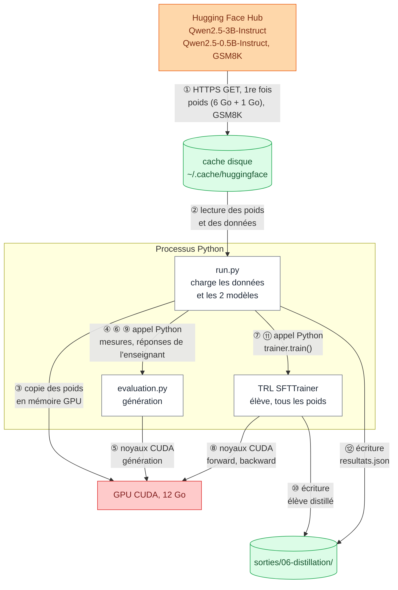

# 06 — Distillation (logits, séquences, on-policy)

> Un gros modèle « enseignant » (teacher) transmet son comportement à un petit modèle « élève » (student), plus rapide et moins cher à servir.

| Regroupe | Modifie | Local 12 Go | Test `--quick` |
|---|---|---|---|
| Distillation de logits (KD, Hinton), distillation de séquences (SeqKD, « R1-Distill »), distillation on-policy (GKD), distillation de classifieurs (DistilBERT, TinyBERT) | Tous les poids de l'élève | ✅ petits couples (1,5B → 0,5B) · ☁️ 70B → 8B | ✅ |

## Principe

Schéma : [docs/schemas-methodes.md](../docs/schemas-methodes.md#m06) (ce que la méthode ajoute ou modifie dans le transformer).

L'élève n'apprend plus seulement la bonne réponse (un token cible), mais **ce que l'enseignant sait** de toutes les réponses possibles. Trois modes (`--set mode=...`), du plus simple au plus fidèle :

| `mode` | Ce que l'élève imite | Même tokenizer ? | Coût |
|---|---|---|---|
| `sequence` | Les réponses **rédigées** par l'enseignant, filtrées quand elles sont vérifiables, puis SFT classique | non | Génération par l'enseignant, puis un SFT |
| `logits` | La **distribution complète** de l'enseignant à chaque token (KL à température T), sur des réponses fixes | **oui** | Enseignant et élève en mémoire en même temps |
| `on_policy` | La distribution de l'enseignant **sur les propres réponses de l'élève** (GKD, JSD généralisée) | **oui** | Génération par l'élève à chaque pas |

Perte (loss) du mode `logits` :

```
perte = α · T² · KL(softmax(z_enseignant / T) ‖ softmax(z_élève / T))  +  (1 - α) · CE(élève, réponse)
```

La température T > 1 adoucit les distributions : l'élève apprend aussi quelles *mauvaises* réponses sont presque bonnes (« dark knowledge »). Le mode `on_policy` corrige le principal défaut des deux autres : l'élève, entraîné sur des préfixes écrits par l'enseignant, ne sait pas se rattraper quand il dérive de lui-même à la génération.

Lien avec les données synthétiques ([SIGN07](../07-donnees-synthetiques)) : le mode `sequence` est une génération filtrée dont le générateur est un modèle plus fort.

## Modèles concernés

| Type de modèle | Exemples de modèles | Applicable | Remarques |
|---|---|---|---|
| LLM décodeur, enseignant et élève de la **même famille** | Llama 3, Qwen2.5, Mistral 7B, Gemma 2 | ✅ cas principal | [`run.py`](run.py) : tous les modes (Qwen2.5-1.5B → 0.5B, Llama-3.1-8B → 3.2-1B) |
| LLM de familles différentes | Llama 3 → Qwen2.5 | ⚠️ | Mode `sequence` seulement ; les modes à logits demandent le même vocabulaire (ou un alignement de tokenizers, ULD) |
| Encodeurs / classifieurs | BERT, RoBERTa | ✅ | [`variantes/encodeur-classification`](variantes/encodeur-classification) : KD sur les logits de classes, tokenizers différents possibles |
| Vision | ViT, CNN | ✅ | Même perte sur les logits de classes (DeiT ajoute un token de distillation) |
| Diffusion | Stable Diffusion, SDXL, Flux | ✅ | Distillation de pas d'échantillonnage (LCM, SDXL-Turbo, consistency models) : moins de pas plutôt que moins de paramètres |
| Modèle fermé via API | GPT-4o, Claude, Gemini | ✅ comme enseignant | Mode `sequence` uniquement (pas de logits), en respectant les conditions d'utilisation du fournisseur |

## Quand l'utiliser

- ✅ Servir un modèle plus petit avec une qualité proche d'un grand, sur une tâche donnée.
- ✅ Après un élagage ([FORM16](../16-elagage)) : la distillation est la meilleure cicatrisation (healing).
- ✅ Transférer un comportement coûteux à obtenir (raisonnement long, format) d'un modèle entraîné par RL vers un petit modèle.
- ⚠️ L'élève plafonne sous l'enseignant. Un écart de taille trop grand (×20 et plus) apprend moins bien qu'un enseignant intermédiaire.
- ❌ Si la quantification ([FORM15](../15-quantification)) suffit à faire tenir le modèle : elle ne demande aucun entraînement.

## Composants de l'exemple



`make run EX=SIGN06` vérifie les prérequis (modules, GPU), puis lance `run.py` dans l'environnement `.venv`. Le script lit `config.yaml` (enseignant, élève, mode `sequence`, réglages) et charge GSM8K : des problèmes de mathématiques rédigés, avec la solution écrite par les auteurs du jeu. 3 000 problèmes d'entraînement servent de questions à l'enseignant ; les 1 319 problèmes de test servent à mesurer. L'enseignant, Qwen2.5-3B-Instruct, est nettement meilleur que l'élève, Qwen2.5-0.5B-Instruct, sur ces problèmes.

- **① Téléchargement.** Au premier lancement, les poids de l'enseignant (environ 6 Go) et de l'élève (environ 1 Go), et le jeu `openai/gsm8k`, sont téléchargés depuis le Hugging Face Hub, par HTTPS.
- **② Lecture.** Tout est rangé dans le cache `~/.cache/huggingface` ; les lancements suivants le relisent sur le disque, sans réseau.
- **③ Copie sur le GPU.** L'élève est copié en float32, parce que c'est lui qu'on entraîne ; l'enseignant en bf16, figé.
- **④ Mesures avant.** `run.py` appelle `commun/evaluation.py`, qui pose les 1 319 problèmes de test à l'enseignant puis à l'élève, ainsi que 200 problèmes d'arithmétique de non-régression.
- **⑤ Génération sur le GPU.** Par lots (batches) de 32, chaque modèle raisonne jusqu'à 512 tokens ; le nombre final de chaque réponse est comparé au résultat attendu.
- **⑥ L'enseignant rédige.** Il résout les 3 000 problèmes d'entraînement ; seules ses réponses justes sont gardées (2 488, soit 83 %). Il quitte ensuite le GPU.
- **⑦ Entraînement de l'élève.** Les 2 488 couples problème → solution de l'enseignant sont confiés au SFTTrainer de TRL, qui entraîne tous les poids de l'élève, la perte portant sur la réponse seulement.
- **⑧ Forward et backward sur le GPU.** Lots de 4, accumulés 4 fois (16 exemples par pas), 2 époques, taux d'apprentissage (learning rate) 1e-5, gradient checkpointing, AdamW 8 bits.
- **⑨ Mesure après**, sur les mêmes problèmes, avec le même décodage.
- **⑩ Écriture de l'élève** complet dans `sorties/06-distillation/eleve-sequence/`.
- **⑪ Témoin (baseline).** L'élève d'origine est rechargé et entraîné exactement de la même façon, sur les mêmes 2 488 problèmes, mais avec les solutions écrites par les auteurs de GSM8K ; il est mesuré comme en ⑨. L'écart avec l'élève distillé isole ce qu'apporte l'enseignant.
- **⑫ Écriture du rapport** dans `sorties/06-distillation/resultats.json`, avec le même tableau affiché dans le terminal.

**Ce que fait le GPU.** Le processus Python ne calcule presque rien lui-même : PyTorch envoie au GPU des « noyaux CUDA », de petits programmes qui font les multiplications de matrices et l'attention sur les poids et les activations déjà présents dans sa mémoire. En génération (⑤, ⑥, ⑨), il y a une passe avant (forward pass) par token produit, accélérée par un cache des clés et des valeurs déjà calculées : c'est l'essentiel de la durée (environ 1 h sur 1 h 30), l'enseignant générant 4 300 raisonnements. En entraînement (⑧), chaque pas fait une passe avant, une passe arrière (backward pass) qui calcule les gradients de l'élève, puis la mise à jour de tous ses poids. En modes `logits` et `on_policy`, l'enseignant reste sur le GPU pendant l'entraînement et fait une passe avant sur chaque lot : ses logits, sur un vocabulaire de 152 000 tokens, pèsent lourd, d'où les lots de 2 et l'optimiseur 8 bits.

**Ce qui est écrit.**

| Fichier | Contenu |
|---|---|
| `eleve-sequence/model.safetensors` | Tous les poids de l'élève distillé (1,98 Go, en float32) |
| `eleve-sequence/config.json`, `generation_config.json` | Architecture Qwen2 et réglages de génération, pour recharger l'élève avec `AutoModelForCausalLM.from_pretrained` |
| `eleve-sequence/tokenizer.json`, `tokenizer_config.json`, `chat_template.jinja` | Le tokenizer et le format de conversation, copiés pour que le dossier se suffise à lui-même |
| `eleve-sequence/training_args.bin` | Les réglages d'entraînement utilisés |
| `resultats.json` | Exactitude de l'élève avant, distillé et témoin, et de l'enseignant, sur GSM8K et sur la non-régression, avec intervalle à 95 % et réponse de chaque question ; comparaisons appariées, dont `distille_contre_temoin` ; nombre de réponses de l'enseignant conservées |
| `config_effective.yaml` | La configuration réellement utilisée, surcharges `SET` comprises |

Avec `SET="mode=logits"` ou `SET="mode=on_policy"`, l'élève est écrit dans `eleve-logits/` ou `eleve-on_policy/` (sans témoin).

## Utilisation

```bash
python run.py --quick                                           # SmolLM2-360M -> 135M
python run.py                                                   # sequence, Qwen2.5-3B-Instruct -> 0.5B-Instruct, GSM8K, ~1 h 30
python run.py --set mode=logits --set entrainement.batch=2 --set entrainement.accumulation=8 --set enseignant.nom=Qwen/Qwen2.5-1.5B-Instruct
python run.py --set mode=on_policy                              # GKD : l'élève génère, l'enseignant corrige
python run.py --set kd.temperature=1.0 --set kd.alpha=0.5
python variantes/encodeur-classification/run.py --quick         # DistilBERT SST-2 -> BERT-tiny
python variantes/encodeur-classification/run.py                 # RoBERTa-base SST-2 -> BERT-mini, avec et sans enseignant
```

## Ce que fait l'exemple

**Le besoin** : un petit modèle, rapide et peu coûteux à servir, qui raisonne mieux sur des problèmes rédigés. On dispose d'un modèle plus gros et meilleur, et de questions, mais pas forcément de bonnes solutions rédigées.

**Résultats** (RTX 5070 Ti Laptop ; 1 319 problèmes de test de GSM8K, 200 problèmes de non-régression) :

| | GSM8K | Non-régression (arithmétique) |
|---|---|---|
| Enseignant Qwen2.5-3B-Instruct | 0,760 [0,736 ; 0,782] | 0,985 |
| Élève Qwen2.5-0.5B-Instruct, avant | 0,411 [0,385 ; 0,438] | 0,955 |
| **Élève distillé** (2 488 solutions justes de l'enseignant) | **0,451** [0,424 ; 0,478] | 0,915 |
| Témoin : même entraînement, solutions écrites par les auteurs du jeu | 0,302 [0,278 ; 0,327] | 0,855 |

Écarts appariés sur les mêmes problèmes : distillé − avant +0,040 [+0,014 ; +0,067], p = 0,004 ; distillé − témoin +0,149 [+0,119 ; +0,180] ; non-régression du distillé −0,04, non significatif (p = 0,08).

**Ce qu'on en retient.**

- **La distillation fait progresser l'élève** de 4 points, un écart net mais modeste : l'élève reste loin de l'enseignant (0,76). Un modèle 6 fois plus petit n'absorbe pas tout le raisonnement d'un plus gros en 2 488 exemples.
- **Qui rédige les solutions compte plus que leur justesse** : les solutions humaines de GSM8K sont justes mais très courtes (« Ben's iPhone is 2 * 1 year = 2 years old… »). L'élève qui les imite cesse de raisonner pas à pas et chute à 0,30. Les solutions de l'enseignant, détaillées dans le style des modèles Qwen, le font progresser : +15 points par rapport au témoin.
- C'est la recette des petits modèles de raisonnement (DeepSeek-R1-Distill, Qwen2.5-Math) : faire rédiger un modèle fort, garder ce qui est vérifié juste, entraîner le petit dessus.

## Variantes

### Variante encodeur : distiller un classifieur

**Le besoin** : un classifieur de texte (sentiment, modération, routage) qui tourne sur CPU ou à fort débit, alors que le bon modèle est un gros encodeur. On a peu d'exemples étiquetés, mais beaucoup de textes sans étiquette.

[`variantes/encodeur-classification`](variantes/encodeur-classification) distille RoBERTa-base fine-tuné sur SST-2 (125 M paramètres) vers BERT-mini (11 M), la recette DistilBERT / TinyBERT. L'élève apprend les probabilités de classes de l'enseignant (température 3) ; les deux modèles tokenisent chacun le texte, leurs tokenizers peuvent différer. Trois élèves sont comparés, avec le même BERT-mini de départ : sans enseignant (2 000 phrases étiquetées seulement), pseudo-étiqueté (pseudo-labeling : les mêmes 2 000 phrases plus 18 000 phrases sans étiquette annotées par l'enseignant, avec ses étiquettes dures) et distillé (mêmes 20 000 phrases, perte KL sur les probabilités de l'enseignant à température 3). La mesure porte sur les 872 phrases de validation de SST-2, sur 3 graines (`make graines EX=SIGN06 VAR=encodeur-classification N=3`).

| | Exactitude (872 phrases, 3 graines) | Paramètres |
|---|---|---|
| Enseignant RoBERTa-base | 0,940 | 125 M |
| Élève, avant | 0,509 ± 0,018 | 11 M |
| Sans enseignant | 0,768 ± 0,020 | 11 M |
| Pseudo-étiqueté (étiquettes dures de l'enseignant) | 0,827 ± 0,002 | 11 M |
| Distillé (probabilités de l'enseignant) | 0,829 ± 0,006 | 11 M |

Écarts appariés sur les mêmes phrases : pseudo-étiqueté contre sans enseignant +0,060 (de +0,039 à +0,070 selon la graine, net sur chacune) ; distillé contre pseudo-étiqueté +0,002 (de −0,001 à +0,007, non significatif sur chaque graine).

Le gain vient des 18 000 phrases sans étiquette annotées par l'enseignant, pas de la distillation par probabilités : annoter ces phrases avec les étiquettes dures de l'enseignant donne le même résultat. Sur 2 classes, la probabilité de l'enseignant n'ajoute presque rien à son étiquette ; la distillation par probabilités a plus à transmettre quand il y a beaucoup de classes proches. L'élève reste à 11 points de l'enseignant ; un élève plus grand (DistilBERT, 66 M) réduit l'écart.

**Le même protocole sur 77 classes** (banking77 : messages de clients d'une banque vers 77 intentions ; enseignant : ModernBERT-base fine-tuné de l'exemple [DATA02](../02-fine-tuning-supervise), 0,937 ; élève : BERT-mini, 11 M ; 770 messages étiquetés, soit environ 10 par intention, et 9 000 messages sans étiquette annotés par l'enseignant ; 10 époques pour les trois élèves ; 3 080 messages de test ; 3 graines) :

| Élève | Exactitude |
|---|---|
| Sans enseignant (770 messages étiquetés) | 0,421 ± 0,010 |
| Pseudo-étiqueté (étiquettes dures de l'enseignant) | **0,9015 ± 0,0007** |
| Distillé (probabilités, température 3, `alpha` 0,9) | 0,878 ± 0,014 |

Écarts appariés : pseudo-étiqueté contre sans enseignant +0,481 (de +0,473 à +0,492 selon la graine), net sur chacune ; distillé contre pseudo-étiqueté −0,023 (−0,035, −0,026, −0,009), net sur chacune.

**Réglage de la température et d'`alpha`** : 4 combinaisons choisies sur les graines 42 à 44, la meilleure mesurée sur 3 graines neuves (45 à 47).

| Température | `alpha` | Distillé, graines 42 à 44 | Distillé contre pseudo-étiqueté |
|---|---|---|---|
| 1 | 0,5 | 0,848 ± 0,005 | −0,054, net |
| 2 | 0,5 | 0,857 ± 0,011 | −0,044, net |
| 2 | 0,9 | 0,882 ± 0,009 | −0,020, net |
| **1** | **0,9** | **0,898 ± 0,005** | −0,003, non significatif |
| 1 | 0,9, graines neuves 45 à 47 | **0,901 ± 0,004** | −0,001 (+0,003, −0,003, −0,002), non significatif sur chaque graine |

L'enseignant fait passer l'élève de 0,42 à 0,90 en annotant des messages sans étiquette. Mais les probabilités de l'enseignant ne font pas mieux que ses étiquettes dures : sur 2 classes, la perte KL ne change rien (+0,002, non significatif) ; sur 77 classes, le meilleur réglage (température 1, `alpha` 0,9) la ramène à égalité avec le pseudo-étiquetage, sans le dépasser, et les réglages plus « doux » (température plus haute, moins de poids sur la KL) font moins bien. Avec 9 000 messages annotés, l'étiquette dure de l'enseignant transmet déjà l'essentiel.

**Avec un jeu de transfert réduit** (température 1 ou 2, `alpha` 0,9), là où les probabilités de l'enseignant devraient apporter le plus par exemple : avec 2 700 messages sans étiquette, distillé et pseudo-étiqueté sont à égalité (0,798 contre 0,797 à température 1) ; avec 900, la distillation à température 1 semblait meilleure sur les graines de réglage (0,606 contre 0,591, +0,016, net sur chacune), mais sur les graines neuves 45 à 47 l'écart change de signe d'une graine à l'autre (−0,007, +0,017, −0,017 ; moyenne −0,002). À température 2, la distillation fait toujours nettement moins bien (−0,05 à 900 messages, −0,09 à 2 700). Le gain démontré est celui du jeu de transfert annoté par l'enseignant, pas celui de la perte KL. Commande : `make graines EX=06 VAR=encodeur-classification N=3` avec `--set enseignant.nom=<modèle fine-tuné> --set donnees.nom=PolyAI/banking77 --set donnees.split_test=test --set donnees.colonne_texte=text --set donnees.colonne_label=label --set donnees.n_train=770 --set donnees.n_sans_etiquette=9000 --set entrainement.epochs=10`.

## Paramètres principaux (`config.yaml`)

| Clé | Rôle |
|---|---|
| `enseignant.nom`, `eleve.nom` | Même famille pour `logits` et `on_policy` |
| `mode` | `sequence`, `logits` ou `on_policy` |
| `kd.temperature`, `kd.alpha` | Adoucissement des distributions, poids de la KL face à l'entropie croisée |
| `kd.beta_jsd` | `on_policy` : 0 = KL directe, 1 = KL inverse, entre les deux = JSD généralisée |
| `generation.filtrer` | `sequence` : ne garder que les réponses justes de l'enseignant |
| `temoin` | `sequence` : entraîner aussi l'élève sur les solutions humaines des mêmes questions, pour isoler l'apport de l'enseignant |
| `evaluation.non_regression` | Tâche hors sujet mesurée avant et après |
| `entrainement.batch` | Petit en mode `logits` : les logits de deux modèles sur un vocabulaire de 152k pèsent lourd |

## Grosse infra

- [`infra/config.yaml`](infra/config.yaml) : logits Llama-3.1-8B-Instruct → Llama-3.2-1B-Instruct sur GSM8K, 1 nœud 8×H100 (l'enseignant est répliqué sur chaque GPU, élève en ZeRO-2).
- [`infra/lancer.sh`](infra/lancer.sh) documente deux montages :
  - `logits` : `accelerate launch` de `run.py` ;
  - `sequence` : génération par un enseignant 70B avec vLLM ([`infra/generer_vllm.py`](infra/generer_vllm.py), rejection sampling inclus), puis SFT de l'élève avec l'infra du [DATA02](../02-fine-tuning-supervise/infra). C'est la recette des modèles « DeepSeek-R1-Distill ».
- Enseignant trop gros pour un GPU : pré-calculer les top-k logits hors ligne ([DistillKit](https://github.com/arcee-ai/DistillKit)) ou passer au mode `sequence`.
- Distillation massive (Minitron, Gemma 2) : NeMo, torchtitan, sur des dizaines à des centaines de milliards de tokens.

## Pièges

- **Tokenizers différents** : les modes `logits` et `on_policy` n'ont de sens qu'avec le même vocabulaire. Deux modèles d'une même famille peuvent avoir des tailles de matrice arrondies différemment : seules les entrées communes sont comparées.
- **Mémoire** : en mode `logits`, les logits `batch × longueur × vocabulaire` des deux modèles dominent. Réduire le batch, pas la longueur.
- **Filtrer les séquences** : un enseignant qui se trompe transmet ses erreurs. Vérifier quand c'est possible.
- **Style des réponses** : entraîner un petit modèle sur des solutions justes mais laconiques lui fait perdre son raisonnement pas à pas (témoin à 0,30 contre 0,41 au départ). Des solutions rédigées par un modèle de la même famille gardent son style.
- **Écart de capacité** : un élève trop petit n'absorbe pas la distribution de l'enseignant ; un enseignant intermédiaire aide.
- **Conditions d'utilisation** : certains fournisseurs interdisent d'entraîner un modèle concurrent sur leurs sorties.

## Références

- Hinton et al., *Distilling the Knowledge in a Neural Network* (2015) · Kim & Rush, *Sequence-Level Knowledge Distillation* (2016)
- Sanh et al., *DistilBERT* (2019) · Jiao et al., *TinyBERT* (2020) · Touvron et al., *DeiT* (2021)
- Agarwal et al., *On-Policy Distillation of Language Models (GKD)* (2024) · Gu et al., *MiniLLM* (2024)
- DeepSeek-AI, *DeepSeek-R1* (2025) : modèles R1-Distill · Muralidharan et al., *Minitron* (2024)
