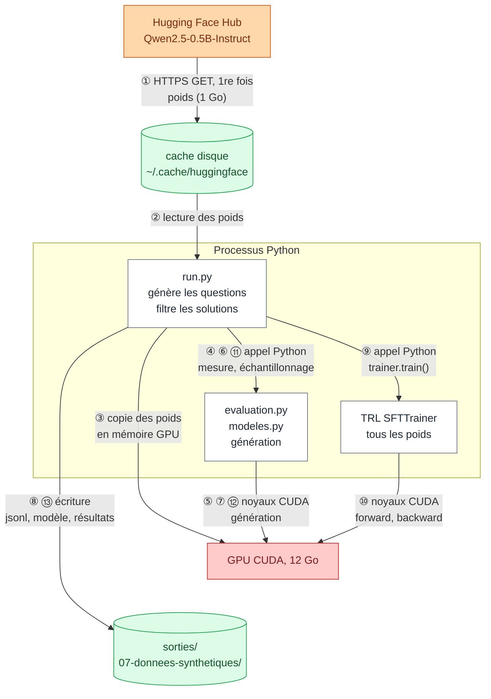

# 07 — Données synthétiques et auto-amélioration

> Faire produire les données d'entraînement par un modèle (lui-même ou un autre), les **filtrer**, puis entraîner dessus.

| Regroupe | Modifie | Local 12 Go | Test `--quick` |
|---|---|---|---|
| Rejection sampling fine-tuning (RFT), STaR / auto-apprentissage, Self-Instruct / Evol-Instruct, critique-révision (phase supervisée de Constitutional AI), best-of-N distillé | Tous les poids (SFT final) | ✅ jusqu'à ~1B | ✅ |

## Principe

Schéma : [docs/schemas-methodes.md](../docs/schemas-methodes.md#m07) (ce que la méthode ajoute ou modifie dans le transformer).

Toutes les stratégies suivent le même pipeline en trois temps. Seule l'étape de génération change (`--set strategie=...`) :

```
générer  ->  filtrer / noter  ->  SFT (dossier 02, ou LoRA 03)
```

| `strategie` | Génération | Filtre |
|---|---|---|
| `rejet` (RFT / STaR) | Le modèle lui-même produit k solutions par question | On garde les solutions **vérifiées justes** |
| `self_instruct` | Un modèle générateur invente de **nouvelles questions** à partir d'exemples, puis y répond | Réponse vérifiable, déduplication, format valide |
| `critique_revision` | Le modèle répond, se critique selon un **principe écrit**, puis réécrit sa réponse | On garde la révision (entraînement sur « réponse révisée ») |

La clé est **le filtre**. Un modèle qui s'entraîne sur ses propres sorties non filtrées stagne ou se dégrade (model collapse). Filtrer par un vérificateur, un juge ou un modèle de récompense ne garde que ses meilleures sorties : le modèle s'améliore ainsi « par lui-même ». C'est le même ressort que le RL en ligne ([SIGN05](../05-rl-en-ligne)), en version hors ligne, plus simple et plus stable.

Lien avec la distillation ([SIGN06](../06-distillation)) : si le générateur est un modèle plus fort que l'élève, `self_instruct` et `rejet` deviennent de la distillation de séquences.

## Modèles concernés

| Type de modèle | Exemples de modèles | Applicable | Remarques |
|---|---|---|---|
| LLM décodeur instruct | Llama 3, Qwen2.5, Mistral 7B, Gemma 2 | ✅ cas principal | Le modèle doit réussir la tâche au moins de temps en temps (`rejet`), ou savoir suivre des consignes (`critique_revision`) |
| LLM de base | Llama-3.1-8B, Qwen2.5-7B, Mistral-7B (versions de base) | ⚠️ | Utiliser un générateur instruct distinct (`generateur.nom`) |
| Encodeur / classifieur | BERT, RoBERTa, ModernBERT | ✅ | Un LLM génère des textes étiquetés pour entraîner un petit classifieur (variante courante de `self_instruct`, voir *Grosse infra*) |
| Vision / multimodal | Qwen2.5-VL, LLaVA, Idefics | ✅ | Légendes générées par un VLM et filtrées par CLIP-score (recette de nombreux jeux image-texte) |
| Diffusion | Stable Diffusion, SDXL, Flux | ✅ | Prompts réécrits par un LLM (légendes synthétiques détaillées, recette DALL-E 3) |
| Modèle fermé via API | GPT-4o, Claude, Gemini | ✅ comme générateur | Générer avec GPT/Claude/Gemini pour entraîner un modèle ouvert, en respectant leurs conditions d'utilisation |

## Quand l'utiliser

- ✅ Peu ou pas de données annotées, mais une **tâche vérifiable** ou un bon générateur disponible.
- ✅ Spécialiser un petit modèle bon marché à partir d'un gros (souvent la méthode la plus rentable en production).
- ✅ Aligner sur des principes écrits sans annotateurs (`critique_revision`).
- ❌ Sans filtre fiable : le risque de dégradation l'emporte.

## Composants de l'exemple



`make run EX=SIGN07` vérifie les prérequis (modules, GPU), puis lance `run.py` dans l'environnement `.venv`. Le script lit `config.yaml` (modèle, stratégie `rejet`, 2 tours, réglages de génération et d'entraînement) et génère en mémoire, sans téléchargement, des problèmes d'arithmétique de la forme `(a op b) op c` : 200 pour le test, et 1 000 nouvelles questions à chaque tour. Les données d'entraînement ne sont pas fournies : c'est le modèle lui-même qui écrit les solutions, et seules les justes sont gardées.

- **① Téléchargement.** Au premier lancement, transformers télécharge les poids de Qwen2.5-0.5B-Instruct (environ 1 Go) depuis le Hugging Face Hub, par HTTPS.
- **② Lecture.** Les poids sont rangés dans le cache `~/.cache/huggingface` ; les lancements suivants les relisent sur le disque, sans réseau.
- **③ Copie sur le GPU.** Les poids sont copiés en float32 dans la mémoire du GPU, où ils restent jusqu'à la fin. Le même modèle sert de générateur et d'élève (`generateur.nom: null`).
- **④ Mesure de départ (tour 0).** `run.py` appelle `commun/evaluation.py`, qui fait répondre le modèle aux 200 problèmes de test, par lots de 16.
- **⑤ Génération sur le GPU.** Le modèle produit chaque réponse token par token, jusqu'à 256 tokens, en décodage glouton. L'évaluation compare le nombre final au résultat attendu (exactitude) et vérifie si la réponse se termine par `Answer: <nombre>` (taux de format).
- **⑥ Échantillonnage.** `run.py` demande 4 solutions par question pour les 1 000 questions du tour, par lots de 32 questions.
- **⑦ Génération sur le GPU**, cette fois par tirage aléatoire à la température 0,8 : les 4 solutions d'une même question diffèrent.
- **⑧ Filtrage et écriture.** Pour chaque question, `run.py` garde au hasard une des solutions dont le nombre final est juste, et écarte la question si aucune ne l'est. Le corpus retenu est écrit dans `donnees-tour-N.jsonl`.
- **⑨ Entraînement.** `run.py` confie le modèle et le corpus au SFTTrainer de TRL : fine-tuning complet, perte calculée sur la réponse seulement.
- **⑩ Forward et backward sur le GPU.** Chaque pas traite un lot de 4 exemples, avec 4 lots accumulés avant chaque mise à jour (16 exemples), pendant 1 époque, au taux d'apprentissage de 1e-5.
- **⑪ Remesure.** Les mêmes 200 problèmes de test sont posés au modèle entraîné.
- **⑫ Génération sur le GPU**, avec le même décodage qu'en ⑤.
- **⑬ Écriture du modèle et du rapport.** Après le dernier tour, le modèle complet est écrit dans `sorties/07-donnees-synthetiques/modele/`, puis `resultats.json`, avec le même tableau affiché dans le terminal.

Les étapes ⑥ à ⑫ forment un tour. Le tour 2 reprend avec 1 000 nouvelles questions et échantillonne avec le modèle déjà entraîné au tour 1 : c'est l'auto-amélioration itérée (STaR, ReST-EM).

**Ce que fait le GPU.** Le processus Python ne calcule presque rien lui-même : PyTorch envoie au GPU des « noyaux CUDA », de petits programmes qui font les multiplications de matrices et l'attention sur les poids et les activations déjà présents dans sa mémoire. En génération (⑤, ⑦, ⑫), il y a une passe avant par token produit, accélérée par un cache des clés et des valeurs déjà calculées ; à l'échantillonnage (⑦), chaque lot de 32 questions donne 128 suites produites en parallèle. En entraînement (⑩), chaque pas fait une passe avant, une passe arrière qui calcule les gradients de tous les poids, puis leur mise à jour par l'optimiseur AdamW, dont l'état couvre tous les poids ; le gradient checkpointing recalcule les activations pendant la passe arrière au lieu de les garder. Le filtrage (⑧) se fait sur CPU, en Python. Un lancement de calibrage de cette configuration, réduit à 1 tour de 64 questions, a culminé à environ 9,0 Go de mémoire GPU.

**Ce qui est écrit.**

| Fichier | Contenu |
|---|---|
| `donnees-tour-1.jsonl`, `donnees-tour-2.jsonl` | Le corpus synthétique de chaque tour, une ligne `{"question", "reponse", "cible"}` par question résolue : 993 lignes (410 Ko) au tour 1, 962 (404 Ko) au tour 2. Réutilisable par 02 ou 03 |
| `modele/model.safetensors` | Tous les poids du modèle après le dernier tour (1,98 Go, en float32) |
| `modele/config.json`, `generation_config.json` | Architecture Qwen2 et réglages de génération, pour recharger le modèle avec `AutoModelForCausalLM.from_pretrained` |
| `modele/tokenizer.json`, `tokenizer_config.json`, `chat_template.jinja` | Le tokenizer et le format de conversation, copiés pour que le dossier se suffise à lui-même |
| `tour-1/`, `tour-2/` | Dossiers de travail du trainer, vides : aucun point de contrôle intermédiaire n'est sauvegardé |
| `resultats.json` | Pour les tours 0, 1 et 2 : exactitude, nombre de réponses, durée de l'évaluation, trois réponses d'exemple, taux de format ; pour les tours 1 et 2, part des questions résolues à l'échantillonnage |
| `config_effective.yaml` | La configuration réellement utilisée, surcharges `SET` comprises |

## Utilisation

```bash
python run.py --quick
python run.py                                                  # rejection sampling, Qwen2.5-0.5B s'auto-entraîne
python run.py --set strategie=self_instruct --set generateur.nom=Qwen/Qwen2.5-1.5B-Instruct
python run.py --set strategie=critique_revision
python run.py --set tours=3                                    # itérer (STaR / ReST-EM)
```

Le jeu généré est sauvegardé dans `sorties/.../donnees-tour-N.jsonl`, réutilisable par [DATA02](../02-fine-tuning-supervise) ou [DATA03](../03-peft) (`donnees.source=hf`, `donnees.nom=json`, `donnees.fichiers=...`).

## Ce que fait l'exemple

- **`rejet`** (par défaut) :
  1. Pour 1 000 questions, le modèle produit 4 solutions échantillonnées.
  2. On garde une solution juste par question résolue.
  3. SFT du modèle sur ces solutions.
  4. Remesure.

  Le rapport donne le taux de questions résolues à chaque tour : il monte d'un tour à l'autre.
- **`self_instruct`** : le générateur écrit de nouveaux problèmes du même style. On ne garde que ceux dont l'expression se calcule, et la réponse vient du calcul lui-même, donc elle est garantie juste.
- **`critique_revision`** : un principe (« être concis et donner le résultat final sous la forme Answer: N ») guide la critique puis la réécriture.

## Paramètres principaux (`config.yaml`)

| Clé | Rôle |
|---|---|
| `strategie` | `rejet`, `self_instruct` ou `critique_revision` |
| `generateur.nom` | `null` = le modèle entraîné lui-même (auto-amélioration) ; sinon un modèle plus fort |
| `generation.k`, `temperature` | Diversité des candidats |
| `tours` | Nombre d'itérations générer / filtrer / entraîner |
| `principes` | Liste de principes pour `critique_revision` |

## Grosse infra

- La génération domine le coût : **vLLM** sur un nœud (script [`../06-distillation/infra/generer_vllm.py`](../06-distillation/infra/generer_vllm.py), rejection sampling inclus), puis SFT FSDP ([02 infra](../02-fine-tuning-supervise/infra)).
- [`infra/lancer.sh`](infra/lancer.sh) : boucle STaR / ReST-EM à grande échelle (génération vLLM, filtre, SFT, et on recommence), plus les outils de génération de données dédiés : [distilabel](https://github.com/argilla-io/distilabel), [DataDreamer](https://github.com/datadreamer-dev/DataDreamer), NVIDIA NeMo Curator / Nemotron-4-340B pour la génération et la notation.
- Ordres de grandeur : les jeux synthétiques récents (OpenMathInstruct-2, 14 M solutions ; Tülu 3 SFT mix) demandent des milliers d'heures GPU de génération.

## Pièges

- **Model collapse** : jamais sans filtre. Garder une part de données réelles.
- **Faux positifs du vérificateur** : bonne réponse obtenue par un raisonnement faux. Préférer plusieurs solutions justes et diverses.
- **Diversité** : Self-Instruct converge vite vers les mêmes questions. Dédupliquer (n-grammes, embeddings), varier les exemples d'amorce.
- **Contamination** : vérifier que les données générées ne recopient pas le jeu de test.
- **Licences** : les conditions de certains fournisseurs interdisent d'entraîner un modèle concurrent sur leurs sorties.

## Références

- Zelikman et al., *STaR* (2022) · Yuan et al., *Scaling Relationship… RFT* (2023) · Singh et al., *ReST-EM* (2023)
- Wang et al., *Self-Instruct* (2022) · Xu et al., *WizardLM / Evol-Instruct* (2023)
- Bai et al., *Constitutional AI* (2022) : phase critique-révision · Shumailov et al., *Model collapse* (2024)
