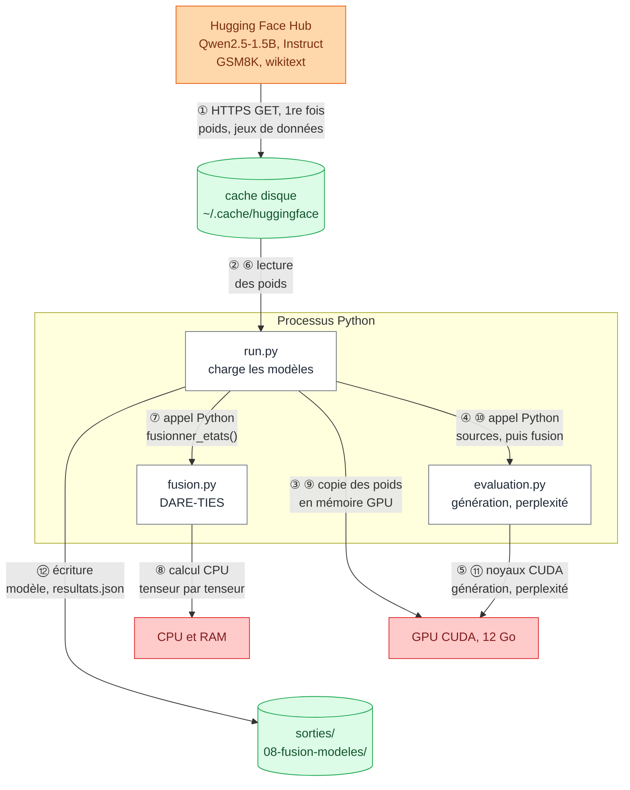

# 08 — Fusion de modèles (model merging)

> Additionner intelligemment les poids de plusieurs fine-tunes d'un même modèle pour obtenir un modèle qui cumule leurs compétences, **sans entraînement ni GPU**.

| Regroupe | Modifie | Local 12 Go | Test `--quick` |
|---|---|---|---|
| Model soups (moyenne), SLERP, task arithmetic, TIES, DARE (+TIES), fusion évolutionnaire | Tous les poids (combinaison) | ✅ fusion sur CPU/RAM, jusqu'à ~7B avec 64 Go de RAM, 70B+ avec mergekit en mode lazy | ✅ |

## Principe

Schéma : [docs/schemas-methodes.md](../docs/schemas-methodes.md#m08) (ce que la méthode ajoute ou modifie dans le transformer).

Deux fine-tunes d'un même modèle de base restent dans le même « bassin » de l'espace des poids. Leur combinaison donne souvent un modèle qui fonctionne, et qui hérite des deux.

On appelle **vecteur de tâche** la différence `τ_i = θ_i - θ_base` : ce que le fine-tuning i a ajouté.

| `methode` | Formule / idée | Base requise |
|---|---|---|
| `lineaire` | Moyenne pondérée des poids (model soup). Idéal pour des variantes d'un même entraînement | non |
| `slerp` | Interpolation sphérique entre **deux** modèles. Garde mieux la norme des poids | non |
| `arithmetique_taches` | `θ = base + Σ λ_i · τ_i`. On peut aussi *soustraire* une tâche (λ < 0) pour retirer un comportement | oui |
| `ties` | 1) garder les coordonnées de plus forte magnitude de chaque `τ_i` ; 2) élire un signe par coordonnée ; 3) moyenner seulement les valeurs d'accord. Réduit les interférences | oui |
| `dare_ties` | Comme TIES, mais on abandonne les coordonnées **au hasard** et on rééchelonne (`1/densité`) | oui |
| `dare_lineaire` | DARE puis arithmétique des tâches | oui |
| évolutionnaire | Un algorithme évolutionnaire cherche les poids et densités par couche qui maximisent un score (voir l'infra) | oui |

Les implémentations sont dans [`fusion.py`](fusion.py) : environ 100 lignes lisibles, en PyTorch pur, applicables tenseur par tenseur à n'importe quelle architecture.

## Modèles concernés

| Type de modèle | Applicable | Remarques |
|---|---|---|
| LLM décodeur : fine-tunes d'un **même** modèle de base | ✅ cas principal | Mêmes formes de tenseurs. Les fusions entre familles différentes (Llama + Qwen) ne marchent pas |
| Adaptateurs LoRA d'une même base | ✅ | `peft` : `model.add_weighted_adapter([...], weights, combination_type="ties")` |
| Encodeurs, ViT, CLIP, Whisper | ✅ | Model soups sur CLIP/ViT (papier d'origine), WiSE-FT (fusion modèle fine-tuné / zéro-shot) |
| Diffusion (SD, SDXL) | ✅ très courant | Fusion de checkpoints et de LoRA de style (outils : Automatic1111, ComfyUI, `sd-mecha`) |
| Modèles de tailles ou d'architectures différentes | ❌ | Il faut passer par la distillation ([SIGN06](../06-distillation)) |
| Modèle fermé via API | ❌ | Pas d'accès aux poids |

## Quand l'utiliser

- ✅ Plusieurs fine-tunes spécialisés et un seul modèle à déployer : combiner code, maths et instruction.
- ✅ Récupérer des capacités générales perdues pendant un fine-tuning : fusionner le modèle spécialisé avec l'instruct d'origine (WiSE-FT, contre l'oubli).
- ✅ Retirer un comportement : soustraire un vecteur de tâche.
- ✅ Budget GPU nul : quelques minutes de CPU.
- ⚠️ Toujours évaluer : une fusion peut dégrader silencieusement une compétence.

## Composants de l'exemple



`make run EX=EDIT08` vérifie les prérequis (modules, GPU), puis lance `run.py` dans l'environnement `.venv`. Le script lit `config.yaml` : méthode `dare_ties`, base commune Qwen2.5-1.5B, un modèle source Qwen2.5-1.5B-Instruct de poids 1,0, densité 0,3. Il n'y a aucun entraînement : les données ne servent qu'à mesurer, sur 100 problèmes de GSM8K (split `test`) et sur la perplexité de 50 paragraphes Wikipédia (wikitext-2, split `test`).

- **① Téléchargement.** Au premier lancement, transformers et datasets téléchargent depuis le Hugging Face Hub, par HTTPS, les poids de Qwen2.5-1.5B et de Qwen2.5-1.5B-Instruct (environ 3 Go chacun), le tokenizer de l'Instruct et les jeux GSM8K et wikitext-2.
- **② Lecture.** Tout est rangé dans le cache `~/.cache/huggingface` ; les lancements suivants le relisent sur le disque, sans réseau. Chaque modèle à mesurer est lu à son tour.
- **③ Copie sur le GPU.** Le modèle mesuré est copié en bf16 dans la mémoire du GPU, puis renvoyé en RAM une fois mesuré : il n'y en a qu'un à la fois sur la carte.
- **④ Mesure des sources.** `run.py` appelle `commun/evaluation.py` pour la base, puis pour l'Instruct.
- **⑤ Génération et perplexité sur le GPU.** Chaque modèle répond aux 100 problèmes GSM8K, par lots de 16, jusqu'à 384 tokens ; l'évaluation compare le nombre final au résultat attendu. L'évaluation calcule aussi la perplexité sur les 50 paragraphes wikitext, qui détecte une dégradation générale du modèle.
- **⑥ Lecture des poids pour la fusion.** Les poids de la base et de l'Instruct sont relus et gardés en RAM, en bf16, sous forme de dictionnaires de tenseurs.
- **⑦ Fusion.** `run.py` appelle `fusion.py`, écrit en PyTorch pur, sans bibliothèque de fusion.
- **⑧ Calcul sur le CPU.** `fusion.py` mesure d'abord l'écart relatif de l'Instruct à la base (1,2 % ici : c'est bien un fine-tune de cette base). Puis, pour chaque tenseur, il calcule le vecteur de tâche (Instruct − base), en garde 30 % des coordonnées tirées au hasard, multiplie celles-ci par 1/0,3 (DARE), applique l'élection de signe de TIES et ajoute le résultat à la base. Avec une seule source, l'élection de signe ne retire rien.
- **⑨ Copie du modèle fusionné sur le GPU.** Les tenseurs fusionnés sont chargés dans un modèle de même architecture, puis copiés en mémoire GPU.
- **⑩ Mesure du modèle fusionné**, par le même appel qu'en ④.
- **⑪ Génération et perplexité sur le GPU**, avec le même décodage qu'en ⑤.
- **⑫ Écriture du modèle et du rapport.** Le modèle fusionné complet est écrit dans `sorties/08-fusion-modeles/modele-dare_ties/`, puis `resultats.json`, avec le même tableau affiché dans le terminal.

**Ce que fait le GPU.** Le GPU ne sert qu'à mesurer (⑤, ⑪) : PyTorch y envoie des « noyaux CUDA », de petits programmes qui font les multiplications de matrices et l'attention sur les poids déjà présents dans sa mémoire. En génération, il y a une passe avant par token produit, accélérée par un cache des clés et des valeurs déjà calculées ; pour la perplexité, une seule passe avant par lot de 4 paragraphes, sans génération. La fusion elle-même (⑧) n'a ni passe avant ni gradient : c'est de l'arithmétique sur les poids (soustraction, masque aléatoire, addition), faite sur CPU, tenseur par tenseur, en float32 pour chaque tenseur traité. Elle demande surtout de la RAM : la base et l'Instruct y tiennent ensemble en bf16, avec le résultat de la fusion.

**Ce qui est écrit.**

| Fichier | Contenu |
|---|---|
| `modele-dare_ties/model.safetensors` | Tous les poids du modèle fusionné (3,09 Go, en bf16), utilisable comme n'importe quel modèle Hugging Face |
| `modele-dare_ties/config.json`, `generation_config.json` | Architecture Qwen2 et réglages de génération, repris de l'Instruct |
| `modele-dare_ties/tokenizer.json`, `tokenizer_config.json`, `chat_template.jinja` | Le tokenizer et le format de conversation de l'Instruct |
| `resultats.json` | Pour la base, l'Instruct et le modèle fusionné : exactitude GSM8K, nombre de réponses, durée, trois réponses d'exemple, perplexité wikitext ; écart relatif de l'Instruct à la base |
| `config_effective.yaml` | La configuration réellement utilisée, surcharges `SET` comprises |

Avec `SET="methode=..."`, le modèle fusionné est écrit dans `modele-<methode>/`.

## Utilisation

```bash
python run.py --quick                                                  # moyenne SmolLM2 base + instruct
python run.py                                                          # DARE-TIES (densité 0,3) : Qwen2.5-1.5B + vecteur de tâche de l'Instruct
python run.py --set methode=ties
python run.py --set methode=slerp --set base=null --set t_slerp=0.3
python run.py --set methode=arithmetique_taches
```

## Ce que fait l'exemple

1. Évalue chaque modèle source sur GSM8K (100 questions) et sur la perplexité générale.
2. Fusionne avec la méthode choisie (DARE-TIES par défaut) le vecteur de tâche de Qwen2.5-1.5B-Instruct, par rapport à la base commune Qwen2.5-1.5B : seules 30 % de ses coordonnées sont gardées, puis rééchelonnées.
3. Évalue le modèle fusionné. L'exemple montre le mécanisme : le modèle garde l'essentiel du gain de l'Instruct malgré 70 % des coordonnées abandonnées. Réunir plusieurs compétences demande d'ajouter d'autres fine-tunes de la même base dans `modeles`.

## Paramètres principaux (`config.yaml`)

| Clé | Rôle |
|---|---|
| `methode` | Voir le tableau |
| `base` | Modèle d'origine commun (`null` pour `lineaire` et `slerp`) |
| `modeles[].poids` | λ de chaque source. Une somme > 1 est courante avec TIES et DARE |
| `densite` | TIES/DARE : part conservée de chaque vecteur de tâche (0,2 à 0,7) |
| `t_slerp` | Position entre les deux modèles |

## Grosse infra

- Pas besoin de cluster pour **fusionner** : [mergekit](https://github.com/arcee-ai/mergekit) fusionne un 70B avec ~32 Go de RAM en chargeant les tenseurs un par un (`--lazy-unpickle`).
- [`infra/ties_70b.yml`](infra/ties_70b.yml) : TIES entre trois fine-tunes de Llama-3.1-70B.
- [`infra/slerp_par_couche.yml`](infra/slerp_par_couche.yml) : SLERP dont le coefficient varie par couche et par type (attention / MLP).
- [`infra/evolve.yml`](infra/evolve.yml) + `mergekit-evolve` : **fusion évolutionnaire**. Des centaines de candidats, chacun évalué : c'est là que les GPU sont nécessaires (vLLM, plusieurs nœuds via Ray).
- [`infra/config.yaml`](infra/config.yaml) : `run.py` sur trois modèles 7B (DARE-TIES).

## Pièges

- **Base commune obligatoire** pour les méthodes à vecteurs de tâche : vérifier l'ascendance des modèles. Le nom ne suffit pas : Qwen2.5-Math-1.5B-Instruct et Qwen2.5-Coder-1.5B-Instruct viennent de Qwen2.5-1.5B, mais après des centaines de milliards de tokens de pré-entraînement continu (et un `rope_theta` différent pour Math). Leurs poids sont à 100 % et 61 % de la base, contre 0,8 % pour Qwen2.5-1.5B-Instruct : leur fusion avec l'Instruct détruit le modèle. `run.py` affiche cet écart relatif pour chaque source (`ecart_relatif_a_la_base`).
- **Vocabulaire étendu** : les embeddings de tailles différentes ne se fusionnent pas. Ici, ceux du premier modèle sont conservés.
- **Chat templates différents** : choisir explicitement le tokenizer (`tokenizer`).
- **Contamination** des classements : beaucoup de fusions « record » surapprennent les benchmarks. Évaluer sur ses propres tâches.

## Références

- Wortsman et al., *Model Soups* (2022) · Ilharco et al., *Editing Models with Task Arithmetic* (2023)
- Yadav et al., *TIES-Merging* (2023) · Yu et al., *DARE: Language Models are Super Mario* (2024)
- Akiba et al., *Evolutionary Optimization of Model Merging Recipes* (Sakana AI, 2024) · Goddard et al., *mergekit* (2024)
