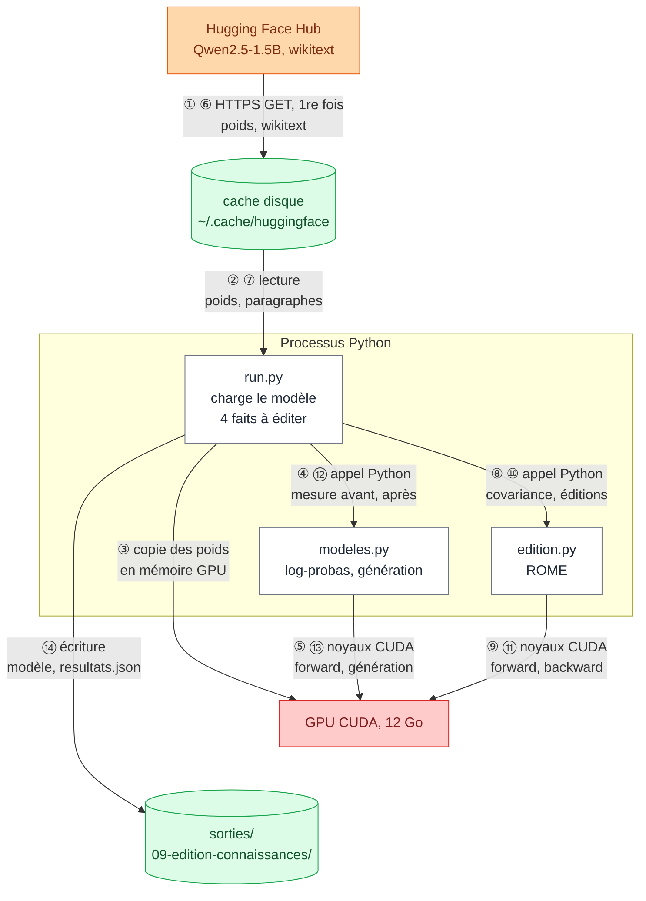

# 09 — Édition de connaissances (ROME, MEMIT, FT-L)

> Corriger ou modifier **un fait précis** stocké dans les poids (« la tour Eiffel est à Paris » → « … à Rome »), en touchant une seule matrice, sans réentraîner.

| Regroupe | Modifie | Local 12 Go | Test `--quick` |
|---|---|---|---|
| ROME, MEMIT (en infra), AlphaEdit, FT-L (fine-tuning contraint). Mentions : MEND, GRACE, WISE | Une matrice MLP (rang 1 par fait) | ✅ jusqu'à ~3B (ROME en fp32) | ✅ |

## Principe

Schéma : [docs/schemas-methodes.md](../docs/schemas-methodes.md#m09) (ce que la méthode ajoute ou modifie dans le transformer).

Les travaux de *causal tracing* montrent que les faits « sujet → objet » sont en grande partie stockés dans les **MLP des premières couches intermédiaires**. La matrice de sortie d'un MLP (`down_proj`) agit comme une mémoire associative clé → valeur.

**ROME** ([`edition.py`](edition.py)) :

1. **Clé** `k*` : l'activation d'entrée de `down_proj` au dernier token du sujet, moyennée sur plusieurs contextes.
2. **Valeur** `v*` : on optimise un petit vecteur ajouté à la sortie du MLP, pour que le modèle prédise le nouvel objet. Une régularisation KL préserve le « sens » du sujet (« The Eiffel Tower is a… » ne doit pas changer).
3. **Mise à jour de rang 1** : `W' = W + (v* - W k*)(C⁻¹k*)ᵀ / ((C⁻¹k*)ᵀk*)`. La covariance `C` des clés sur du texte générique garantit que les *autres* clés sont le moins perturbées possible.

**MEMIT** généralise à des milliers de faits répartis sur plusieurs couches (infra). **AlphaEdit** projette la mise à jour dans l'espace qui ne touche pas les connaissances à préserver, ce qui améliore l'édition séquentielle. **FT-L** (`methode: ft_contraint`) fine-tune seulement cette matrice avec une contrainte de norme. C'est la référence simple, souvent moins spécifique.

Les métriques sont celles de CounterFact :

| Métrique | Question posée |
|---|---|
| **efficacité** | Le prompt édité donne-t-il le nouvel objet ? |
| **généralisation** | Les paraphrases aussi ? |
| **spécificité** | Les faits voisins (Louvre → Paris) sont-ils intacts ? |

## Modèles concernés

| Type de modèle | Exemples de modèles | Applicable | Remarques |
|---|---|---|---|
| LLM décodeur | GPT-2, GPT-J, LLaMA, Qwen, Mistral | ✅ cas principal | Indiquer le module (`edition.module`) : `model.layers.{}.mlp.down_proj` pour LLaMA/Qwen/Mistral |
| GPT-2 (couches `Conv1D`) | GPT-2 | ⚠️ | Poids transposés : adapter `rome()` (`W.T`) ou utiliser EasyEdit |
| MoE | Mixtral, Qwen-MoE | ⚠️ | Le fait peut être réparti entre experts. Méthodes spécifiques ou mémoire externe (GRACE) |
| Encodeur, seq2seq | BERT, T5 | ⚠️ | MEND et KE ont été proposés pour ces architectures, moins courant |
| Multimodal | BLIP-2, LLaVA | ⚠️ | EasyEdit propose l'édition multimodale (MMEdit) |
| Diffusion | Stable Diffusion, SDXL, Flux | ✅ | Même principe sur le cross-attention (TIME, UCE : « changer ce que signifie un mot ») |
| Modèle fermé via API | GPT-4o, Claude, Gemini | ❌ | Seul le RAG ([EXEC18](../18-rag)) permet de corriger un fait |

## Quand l'utiliser

- ✅ Quelques faits erronés ou obsolètes à corriger rapidement, sans pipeline d'entraînement.
- ✅ Recherche et interprétabilité : comprendre où et comment un fait est stocké.
- ⚠️ Des centaines d'éditions séquentielles dégradent le modèle : MEMIT/AlphaEdit en lot, ou mémoire externe.
- ❌ Les éditions **généralisent mal au raisonnement multi-sauts** (« la tour Eiffel est à Rome », donc « le pays de la tour Eiffel est » → souvent encore « France »). Pour des connaissances évolutives, préférer le RAG ([EXEC18](../18-rag)).

## Composants de l'exemple



`make run EX=EDIT09` vérifie les prérequis (modules, GPU), puis lance `run.py` dans l'environnement `.venv`. Le script lit `config.yaml` (modèle, méthode `rome`, couche et module édités, réglages de l'optimisation) et prend les 4 faits à modifier dans `commun/donnees.py` : la tour Eiffel passe à Rome, la Joconde à Picasso, l'Everest aux Alpes, Python à Linus. Chaque fait vient avec 2 paraphrases (le changement doit s'y retrouver) et 2 faits voisins (ils ne doivent pas changer). Il n'y a pas de jeu d'entraînement : seuls 200 paragraphes Wikipédia servent, à estimer la statistique des activations.

- **① Téléchargement du modèle.** Au premier lancement, transformers télécharge les poids de Qwen2.5-1.5B (environ 3 Go), un modèle de base et non instruct, puisque les prompts sont des débuts de phrase à compléter.
- **② Lecture.** Les poids sont rangés dans le cache `~/.cache/huggingface` ; les lancements suivants les relisent sur le disque, sans réseau.
- **③ Copie sur le GPU.** Les poids sont copiés en float32 dans la mémoire du GPU, où ils restent jusqu'à la fin, tous figés. L'édition porte sur le module `mlp.down_proj` de la couche 5 (`couche_relative: 0.2` × 28 couches, numérotées à partir de 0).
- **④ Mesure avant.** `run.py` compare, pour chaque fait, la probabilité de l'ancien et du nouvel objet après le prompt (efficacité), après les paraphrases (généralisation), et celle de la bonne réponse face au nouvel objet sur les faits voisins (spécificité).
- **⑤ Calcul sur le GPU.** Chaque comparaison est une passe avant (forward pass) qui donne la log-probabilité de la suite ; le prompt principal de chaque fait est aussi complété par 8 tokens en décodage glouton, pour lire la réponse du modèle.
- **⑥ Téléchargement de wikitext-2**, au premier lancement, par datasets.
- **⑦ Lecture** de 200 paragraphes du split `train`.
- **⑧ Covariance.** `run.py` appelle `edition.py`, qui accroche une fonction à l'entrée du module édité pour recueillir ses activations, les « clés ».
- **⑨ Passes avant sur le GPU.** Les 200 paragraphes traversent le modèle ; la matrice de covariance C des clés (8 960 × 8 960) s'accumule, puis est inversée.
- **⑩ Éditions.** `run.py` appelle `edition.rome` pour chaque fait, l'un après l'autre, sur le même modèle.
- **⑪ Calcul sur le GPU.** Pour chaque fait, `edition.py` calcule la clé k* (activation au dernier token du sujet, moyennée sur 5 contextes), puis cherche la valeur v* qui fait prédire le nouvel objet : au plus 40 pas d'Adam sur un seul vecteur de 1 536 nombres, ajouté à la sortie du module, avec une pénalité qui préserve le sens général du sujet. Il écrit enfin l'association dans la matrice du module par une mise à jour de rang 1.
- **⑫ Mesure après.** Les mêmes comparaisons qu'en ④.
- **⑬ Calcul sur le GPU**, identique à ⑤.
- **⑭ Écriture du modèle et du rapport.** Le modèle complet édité est écrit dans `sorties/09-edition-connaissances/modele-rome/`, puis `resultats.json`, avec le même tableau affiché dans le terminal.

**Ce que fait le GPU.** Le processus Python ne calcule presque rien lui-même : PyTorch envoie au GPU des « noyaux CUDA », de petits programmes qui font les multiplications de matrices et l'attention sur les poids déjà présents dans sa mémoire. Les mesures (⑤, ⑬) sont des passes avant, plus une courte génération par prompt. La covariance (⑨) n'est qu'une suite de passes avant, dont on garde les entrées d'un seul module. L'optimisation de v* (⑪) fait des passes avant et arrière sur 6 courtes phrases, mais le gradient ne sert qu'au vecteur de 1 536 nombres : aucun poids du modèle n'est entraîné. La seule modification des poids est la mise à jour de rang 1 de la matrice `down_proj` de la couche 5, W ← W + (v* − W k*)(C⁻¹ k*)ᵀ / ((C⁻¹ k*)ᵀ k*), un produit extérieur de deux vecteurs ajouté en une opération. La pondération par C⁻¹ choisit, parmi les mises à jour qui associent k* à v*, celle qui change le moins la sortie du module pour les clés du texte générique.

**Ce qui est écrit.**

| Fichier | Contenu |
|---|---|
| `modele-rome/model.safetensors` | Tous les poids du modèle après les 4 éditions (6,17 Go, en float32) ; seule une matrice de la couche 5 diffère de Qwen2.5-1.5B |
| `modele-rome/config.json`, `generation_config.json` | Architecture Qwen2 et réglages de génération, pour recharger le modèle avec `AutoModelForCausalLM.from_pretrained` |
| `modele-rome/tokenizer.json`, `tokenizer_config.json`, `chat_template.jinja` | Le tokenizer, copié pour que le dossier se suffise à lui-même |
| `resultats.json` | Avant et après : efficacité, généralisation, spécificité, et la complétion de chaque prompt (« The Eiffel Tower is located in the city of » → « Rome, Italy. It is the largest » après édition) ; norme de chaque mise à jour de rang 1 |
| `config_effective.yaml` | La configuration réellement utilisée, surcharges `SET` comprises |

Avec `SET="edition.methode=ft_contraint"`, le modèle est écrit dans `modele-ft_contraint/`.

## Utilisation

```bash
python run.py --quick
python run.py                                         # ROME, 100 faits CounterFact édités un par un, Qwen2.5-1.5B
python run.py --set edition.methode=ft_contraint      # comparaison FT-L
python run.py --set edition.couche=12                 # éditer plus haut : spécificité et généralisation changent
python run.py --set modele.nom=meta-llama/Llama-3.2-1B
```

## Ce que fait l'exemple

1. Tire 100 faits du jeu CounterFact (`azhx/counterfact`) selon la graine : chacun a une réécriture (vrai objet → faux objet), des paraphrases du prompt et des faits voisins dont la réponse ne doit pas changer.
2. Mesure, pour chaque fait, avant l'édition : **efficacité** (le nouvel objet est plus probable que l'ancien sur le prompt d'origine), **généralisation** (même mesure sur 2 paraphrases par fait, 200 mesures) et **spécificité** (la réponse des faits voisins ne change pas, 1 000 mesures).
3. Calcule `C` sur 200 paragraphes wikitext, puis édite chaque fait par ROME seul, mode `independant` : le poids édité est restauré avant le fait suivant. Les éditions ne s'accumulent pas (`--set mode=sequentiel` les accumule).
4. Remesure. Les écarts avant/après sont appariés sur les mêmes faits, avec leur intervalle à 95 % (3 graines : `make graines EX=EDIT09 N=3`).

**Résultats** (Qwen2.5-1.5B, 100 faits par graine, 3 graines) :

| | Avant | Après ROME | Écart apparié |
|---|---|---|---|
| Efficacité | 0,170 ± 0,020 | **0,990** ± 0,010 | +0,820 (de +0,790 à +0,840) |
| Généralisation (paraphrases) | 0,200 ± 0,044 | **0,932** ± 0,006 | +0,732 (de +0,700 à +0,785) |
| Spécificité (faits voisins) | 0,830 ± 0,018 | 0,818 ± 0,018 | −0,012 (de −0,014 à −0,009) |

Sur chaque graine, l'intervalle apparié exclut 0 pour l'efficacité et la généralisation. La spécificité baisse de 1,2 point : l'écart est net mais petit.

Réserve : chaque fait est édité seul, sur un modèle restauré à chaque fois. Les 100 éditions ne sont pas cumulées : la dégradation d'un modèle qui reçoit beaucoup d'éditions successives (point faible connu de ROME, que MEMIT traite) n'est pas mesurée.

## Paramètres principaux (`config.yaml`)

| Clé | Rôle |
|---|---|
| `edition.methode` | `rome` ou `ft_contraint` |
| `edition.module`, `couche` / `couche_relative` | Matrice éditée |
| `pas_valeur`, `lr_valeur`, `poids_kl`, `norme_max` | Optimisation de `v*` |
| `amortissement` | Stabilise l'inversion de `C` |

## Grosse infra

- ROME sur 7-8B : 1 GPU 40-80 Go ([`infra/config.yaml`](infra/config.yaml)).
- **MEMIT** sur 1 000 faits CounterFact avec [EasyEdit](https://github.com/zjunlp/EasyEdit) : [`infra/memit_easyedit.py`](infra/memit_easyedit.py) + [`infra/memit_llama3-8b.yaml`](infra/memit_llama3-8b.yaml). Le coût dominant est le calcul unique des statistiques de covariance (~100k échantillons Wikipédia).
- [`infra/lancer.sh`](infra/lancer.sh) : édition puis contrôle de non-régression (MMLU, HellaSwag).
- Pas besoin de multi-nœuds : l'édition reste une opération légère. Les modèles 70B demandent un nœud multi-GPU (`model_parallel: true`).

## Pièges

- **Mauvais module ou mauvaise couche** : l'édition « prend » sur le prompt exact mais ne généralise pas. Explorer 20 à 40 % de la profondeur.
- **Tokenisation de l'objet** : espace initial (`" Rome"`), objets de plusieurs tokens.
- **Éditions successives** : la norme cumulée des mises à jour explose au-delà de quelques dizaines. Surveiller la perplexité générale.
- **Évaluation trop indulgente** : toujours mesurer la spécificité et les paraphrases, pas seulement le prompt édité.

## Références

- Meng et al., *Locating and Editing Factual Associations in GPT (ROME)* (2022) · Meng et al., *MEMIT* (2023)
- Fang et al., *AlphaEdit* (2025) · Mitchell et al., *MEND* (2022) · Hartvigsen et al., *GRACE* (2023)
- Wang et al., *EasyEdit* (2024) · Cohen et al., *Evaluating the Ripple Effects of Knowledge Editing* (2024)
