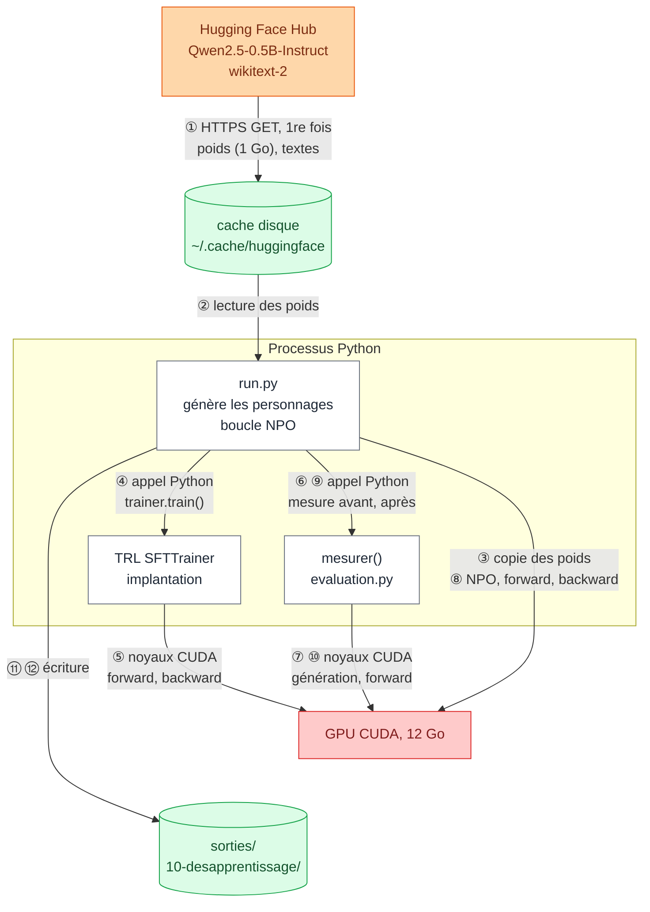

# 10 — Désapprentissage (machine unlearning)

> Faire **oublier** au modèle un ensemble précis de connaissances (données personnelles, contenu sous copyright, savoir dangereux), sans détruire le reste.

| Regroupe | Modifie | Local 12 Go | Test `--quick` |
|---|---|---|---|
| Gradient ascent, gradient difference, NPO (+ rétention), réponses « je ne sais pas » (IDK). En infra : SimNPO, RMU (open-unlearning) | Tous les poids | ✅ jusqu'à ~1B | ✅ |

## Principe

Schéma : [docs/schemas-methodes.md](../docs/schemas-methodes.md#m10) (ce que la méthode ajoute ou modifie dans le transformer).

On dispose d'un **ensemble à oublier** (forget set) et d'un **ensemble à retenir** (retain set). Toutes les méthodes suivent la même boucle : un lot à oublier, éventuellement un lot à retenir, puis une perte combinée. Seule la perte change (`--set desapprentissage.methode=...`) :

| Méthode | Perte sur l'oubli | Rétention | Comportement |
|---|---|---|---|
| `gradient_ascent` | `-NLL` : on *monte* la perte | non | Oublie vite, mais s'effondre vite (le modèle finit par tout désapprendre) |
| `gradient_difference` | `-NLL` | `+NLL` sur le retain set | Plus stable |
| `npo` | Perte de type DPO sans réponse préférée : `-(2/β)·log σ(-β·log(π/π_ref))` | optionnelle (`retenu: true`) | Bornée : l'oubli ralentit tout seul, pas d'effondrement. Référence actuelle |
| `idk` | SFT vers « je n'ai pas d'information » | `+NLL` | Refus explicite plutôt qu'oubli des poids |

Le protocole suit **TOFU** : des personnages fictifs sont d'abord appris (*implantation*), puis on fait oublier 10 % d'entre eux. Comme le modèle ne pouvait pas les connaître avant, on sait exactement ce qui doit disparaître. Cette phase d'implantation est incluse dans `run.py`.

Mesures :

| Mesure | Rôle |
|---|---|
| `oubli` (exactitude) et `nll_oubli` | Doivent respectivement baisser et monter |
| `retenu` et `nll_retenu` | Doivent rester stables |
| `perplexite_generale` | Non-régression sur les connaissances générales |

## Modèles concernés

| Type de modèle | Applicable | Remarques |
|---|---|---|
| LLM décodeur (toutes familles) | ✅ cas principal | [`run.py`](run.py) |
| LLM avec LoRA | ✅ | Désapprentissage sur adaptateur : réversible, moins destructeur |
| Classifieurs (vision, texte) | ✅ | Même idée (gradient ascent sur les exemples à oublier, SCRUB, fine-tuning sur le retain set) |
| Diffusion | ✅ très étudié | Oublier un style, un concept, une personne : ESD, concept ablation, UCE |
| Modèle fermé via API | ❌ | Seulement des filtres en entrée et en sortie |

## Quand l'utiliser

- ✅ Obligation de retrait d'une donnée (RGPD, droit à l'oubli), contenu sous licence retiré.
- ✅ Réduire des connaissances dangereuses (WMDP : RMU).
- ⚠️ Le désapprentissage approché n'offre **aucune garantie formelle** : l'information peut revenir par extraction ou par un léger fine-tuning. La seule garantie complète est de réentraîner sans la donnée.
- ⚠️ Si l'objectif est seulement de ne pas *dire* quelque chose : un filtre ou un refus (`idk`) peut suffire.

## Composants de l'exemple



`make run EX=EDIT10` vérifie les prérequis (modules, GPU), puis lance `run.py` dans l'environnement `.venv`. Le script lit `config.yaml` (modèle, données, implantation, désapprentissage, évaluation) et génère en mémoire, sans téléchargement, 40 personnages fictifs aux noms inventés, avec 4 questions chacun (ville, année de naissance, métier, création) : 160 questions. 10 % des personnages, soit 4 personnages et 16 questions, sont tirés pour être oubliés ; les 144 autres questions sont à retenir.

- **① Téléchargement.** Au premier lancement, transformers télécharge les poids de Qwen2.5-0.5B-Instruct (environ 1 Go, safetensors) depuis le Hugging Face Hub, par HTTPS. À la première mesure, la bibliothèque datasets télécharge aussi wikitext-2, qui sert à la perplexité générale.
- **② Lecture.** Poids et textes sont rangés dans le cache `~/.cache/huggingface` ; les lancements suivants les relisent sur le disque, sans réseau.
- **③ Copie sur le GPU.** Les poids sont copiés en fp32 dans la mémoire du GPU, où ils restent jusqu'à la fin.
- **④ Implantation.** Le modèle ne connaît pas les personnages inventés : `run.py` les lui apprend d'abord avec le SFTTrainer de TRL, sur les 160 questions, pendant 8 époques (lots de 8, accumulation 2, taux d'apprentissage 2e-5). Tous les poids sont entraînés.
- **⑤ Forward et backward sur le GPU.** La perte porte sur la réponse seulement, pas sur la question. Le gradient checkpointing recalcule les activations pendant la passe arrière au lieu de les garder.
- **⑥ Mesure avant.** `run.py` mesure trois choses : la vraisemblance des bonnes réponses (`nll_oubli`, `nll_retenu`), l'exactitude en génération sur les 16 questions à oublier et sur 80 questions retenues, et la perplexité sur 40 paragraphes du split `test` de wikitext-2.
- **⑦ Génération et passes avant sur le GPU.** Chaque réponse est générée jusqu'à 24 tokens, par lots de 16 ; elle est juste si elle contient la réponse attendue. La vraisemblance et la perplexité ne demandent qu'une passe avant par lot.
- **⑧ Désapprentissage NPO.** La boucle est écrite dans `run.py`, sans Trainer : 60 pas, lots de 8, AdamW au taux 1e-5, gradients bornés à 1. À chaque pas, un lot de questions à oublier reçoit la perte NPO (β = 0,1), qui pousse la probabilité des bonnes réponses sous celle d'une copie figée du modèle, prise juste après l'implantation. Un lot de questions retenues ajoute la perte habituelle, de poids 1, pour garder le reste.
- **⑨ Mesure après.** Les mêmes questions et les mêmes paragraphes sont mesurés sur le modèle modifié.
- **⑩ Génération et passes avant sur le GPU**, avec le même décodage qu'en ⑦.
- **⑪ Écriture du modèle** dans `sorties/10-desapprentissage/modele-npo/`.
- **⑫ Écriture du rapport** dans `sorties/10-desapprentissage/resultats.json`, avec le même tableau affiché dans le terminal.

**Ce que fait le GPU.** Le processus Python ne calcule presque rien lui-même : PyTorch envoie au GPU des « noyaux CUDA », de petits programmes qui font les multiplications de matrices et l'attention sur les poids et les activations déjà présents dans sa mémoire. En génération (⑦, ⑩), il y a une passe avant par token produit, accélérée par un cache des clés et des valeurs déjà calculées. En entraînement (⑤, ⑧), chaque pas fait une passe avant, une passe arrière qui calcule les gradients de tous les poids, puis la mise à jour par AdamW, dont l'état couvre tout le modèle. Les poids maîtres restent en fp32, les calculs se font en bf16. Pendant ⑧, le GPU porte aussi la copie de référence de NPO, en bf16 et sans gradients : pour chaque lot à oublier, elle fait une passe avant de plus.

**Ce qui est écrit.**

| Fichier | Contenu |
|---|---|
| `modele-npo/model.safetensors` | Le modèle complet après implantation puis désapprentissage (1,9 Go, en fp32) |
| `modele-npo/config.json`, `generation_config.json` | L'architecture et les réglages de génération, pour recharger le modèle avec `AutoModelForCausalLM.from_pretrained` |
| `modele-npo/tokenizer.json`, `tokenizer_config.json`, `chat_template.jinja` | Le tokenizer et le format de conversation, copiés pour que le dossier se suffise à lui-même |
| `implantation/` | Dossier de travail du SFTTrainer, vide : aucun point de contrôle n'est sauvegardé |
| `resultats.json` | Pour `avant` et `apres` : `nll_oubli`, `nll_retenu`, `perplexite_generale`, et l'exactitude `oubli` et `retenu` avec trois réponses d'exemple ; la liste `entites_oubliees` des 4 personnages oubliés |
| `config_effective.yaml` | La configuration réellement utilisée, surcharges `SET` comprises |

Avec `SET="sauvegarder=false"`, le dossier `modele-npo/` n'est pas écrit. Avec une autre méthode (`desapprentissage.methode`), il prend son nom : `modele-gradient_ascent/`, `modele-idk/`...

## Utilisation

```bash
python run.py --quick
python run.py                                                          # NPO + rétention, Qwen2.5-0.5B, 40 personnages, 10 % oubliés
python run.py --set desapprentissage.methode=gradient_ascent           # observer l'effondrement de `retenu`
python run.py --set desapprentissage.methode=gradient_difference
python run.py --set desapprentissage.methode=idk
python run.py --set donnees.part_oubli=0.05 --set entrainement.max_steps=120
python run.py --set donnees.source=tofu --set implantation.activer=false --set modele.nom=open-unlearning/tofu_Llama-3.2-1B-Instruct_full
```

## Ce que fait l'exemple

1. Génère 40 personnages (160 questions). Tire 4 personnages à oublier.
2. **Implantation** : SFT sur toutes les questions. Le modèle connaît alors les 40 personnages.
3. Mesure `oubli`, `retenu` et `perplexite_generale`.
4. 60 pas de NPO + rétention.
5. Remesure. Attendu : l'exactitude sur les 4 personnages oubliés chute, celle sur les 36 autres et la perplexité générale restent proches.

## Paramètres principaux (`config.yaml`)

| Clé | Rôle |
|---|---|
| `desapprentissage.methode` | Voir le tableau |
| `desapprentissage.beta` | NPO : plus grand = arrêt plus précoce |
| `desapprentissage.poids_retenu` | Équilibre entre oubli et rétention |
| `entrainement.max_steps`, `lr` | Trop de pas, et tout s'effondre (surtout en gradient ascent) |
| `donnees.source` | `faits` (généré) ou `tofu` (benchmark réel) |

## Grosse infra

- [`infra/config.yaml`](infra/config.yaml) : TOFU forget10 sur le modèle Llama-3.1-8B déjà fine-tuné sur TOFU (1 GPU 80 Go).
- [`infra/lancer.sh`](infra/lancer.sh) : [open-unlearning](https://github.com/locuslab/open-unlearning), le cadre de référence. Benchmarks TOFU, MUSE, WMDP ; méthodes GradAscent, GradDiff, NPO, SimNPO, DPO, RMU ; multi-GPU via accelerate/DeepSpeed ; métriques standard (forget quality, model utility, attaques par extraction).

## Pièges

- **Effondrement** : le gradient ascent sans rétention finit par produire du charabia. Toujours surveiller `retenu` et la perplexité générale.
- **Oubli superficiel** : la probabilité baisse sur la formulation exacte, mais une paraphrase ou quelques pas de fine-tuning font revenir l'information. Évaluer avec des paraphrases et des attaques.
- **Retain set mal choisi** : il doit contenir des connaissances *proches* de celles à oublier (même domaine), sinon on oublie aussi les voisins.

## Références

- Maini et al., *TOFU* (2024) · Zhang et al., *Negative Preference Optimization* (2024) · Fan et al., *SimNPO* (2024)
- Li et al., *WMDP / RMU* (2024) · Shi et al., *MUSE* (2024) · Eldan & Russinovich, *Who's Harry Potter?* (2023)
- Gandikota et al., *Erasing Concepts from Diffusion Models* (2023)
