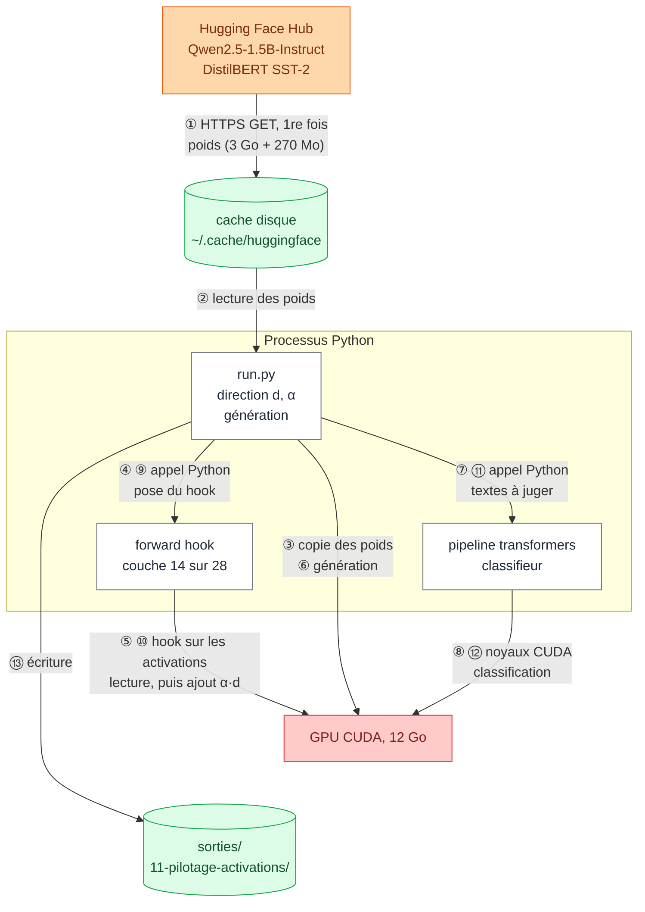

# 11 — Pilotage par activations (steering vectors, abliteration)

> Repérer la direction d'un concept dans les activations internes du modèle, puis l'**ajouter** pendant la génération (sans toucher aux poids) ou la **retirer** des poids (sans entraînement).

| Regroupe | Modifie | Local 12 Go | Test `--quick` |
|---|---|---|---|
| Steering vectors / Activation Addition (ActAdd), Contrastive Activation Addition (CAA), representation engineering (RepE), control vectors, abliteration (orthogonalisation des poids) | Rien (mode vecteur) ou quelques matrices projetées (mode ablation) | ✅ jusqu'à ~7B en bf16 (inférence seule) | ✅ |

## Principe

Schéma : [docs/schemas-methodes.md](../docs/schemas-methodes.md#m11) (ce que la méthode ajoute ou modifie dans le transformer).

Dans un transformer, le **flux résiduel** accumule les représentations couche après couche. Beaucoup de concepts (sentiment, formalité, langue, vérité, refus…) y sont codés approximativement par une **direction linéaire**.

1. **Extraire la direction** : on passe des paires de textes contrastés (positif / négatif) et on prend, à une couche donnée, la différence des activations moyennes au dernier token : `d = moyenne(h⁺) - moyenne(h⁻)`.
2. Deux usages :
   - **`mode: vecteur`** : un crochet ajoute `α·d` à la sortie de la couche à chaque token généré. α > 0 pousse vers le concept, α < 0 vers son contraire. Réversible, réglable à la volée, sans aucune modification des poids.
   - **`mode: ablation`** : on projette la direction hors de toutes les matrices qui écrivent dans le flux résiduel (`W ← (I - d̂d̂ᵀ)W` pour `o_proj`, `down_proj` et les embeddings). Le modèle ne peut plus représenter ce concept. Le checkpoint obtenu est normal : il se sert avec vLLM, llama.cpp, etc.

L'exemple utilise le **sentiment**, mesuré par un classifieur externe (DistilBERT SST-2) sur deux types de consignes : neutres, et demandant un texte négatif.

## Modèles concernés

| Type de modèle | Applicable | Remarques |
|---|---|---|
| LLM décodeur (LLaMA, Qwen, Mistral, Gemma, Phi, GPT-2) | ✅ cas principal | [`run.py`](run.py) trouve les couches automatiquement (`commun/modeles.py:couches_decodeur`) |
| MoE | ✅ | Le flux résiduel est partagé : même méthode |
| Multimodal (LLaVA, Qwen-VL) | ✅ | Pilotage de la partie langage |
| Encodeurs (BERT) | ⚠️ | Directions extractibles (sondes linéaires), pilotage moins utile sans génération |
| Diffusion | ✅ | Directions dans l'espace des embeddings de texte ou dans l'UNet (« concept sliders ») |
| Modèle fermé via API | ❌ | Pas d'accès aux activations |

## Quand l'utiliser

- ✅ Ajuster un trait de style (ton, formalité, verbosité, langue) sans données d'entraînement ni GPU d'entraînement.
- ✅ Recherche et interprétabilité : vérifier qu'un concept est représenté linéairement, et où.
- ✅ Retirer de façon permanente un comportement indésirable très ciblé (ablation), quand l'entraînement est impossible.
- ⚠️ Un α trop grand dégrade la cohérence : il faut chercher le bon compromis.
- ❌ Pour des capacités nouvelles ou des connaissances : le pilotage réoriente ce qui existe déjà, il n'ajoute rien.

## Composants de l'exemple



`make run EX=11` vérifie les prérequis (modules, GPU), puis lance `run.py` dans l'environnement `.venv`. Le script lit `config.yaml` (modèle, mode `vecteur`, couche, intensités α, évaluation). Toutes les phrases sont écrites dans `run.py`, sans téléchargement : 15 paires de phrases de sentiment opposé (« I absolutely love the weather… » / « I absolutely hate the weather… »), 30 consignes neutres (« Write one sentence about the movie. ») et 30 demandes de texte négatif (« Write an angry complaint about the hotel. »).

- **① Téléchargement.** Au premier lancement, transformers télécharge depuis le Hugging Face Hub, par HTTPS, les poids de Qwen2.5-1.5B-Instruct (environ 3 Go) et ceux du classifieur de sentiment `distilbert-base-uncased-finetuned-sst-2-english` (environ 270 Mo).
- **② Lecture.** Les poids sont rangés dans le cache `~/.cache/huggingface` ; les lancements suivants les relisent sur le disque, sans réseau.
- **③ Copie sur le GPU.** Les deux modèles sont copiés dans la mémoire du GPU, le LLM en bf16. Ses poids sont gelés : rien n'est entraîné.
- **④ Pose du hook de lecture.** `run.py` accroche un *forward hook* PyTorch à la sortie du bloc 14 sur 28, au milieu du modèle (`couche_relative: 0.5`).
- **⑤ Extraction de la direction.** Chacune des 30 phrases passe dans le modèle ; à chaque passage, le hook copie l'activation du flux résiduel au dernier token. La direction `d` est la moyenne des activations positives moins celle des négatives. Le hook est ensuite retiré.
- **⑥ Génération sans intervention.** Le modèle répond aux 30 consignes neutres et aux 30 demandes négatives, en génération gloutonne jusqu'à 48 tokens, par lots de 16.
- **⑦ Jugement.** Les textes produits sont passés au classifieur, via la `pipeline("sentiment-analysis")` de transformers.
- **⑧ Classification sur le GPU.** Le classifieur rend POSITIVE ou NEGATIVE pour chaque texte ; le résultat est le taux de textes positifs.
- **⑨ Pose du hook de pilotage**, une fois pour chaque α de la liste `[-2.0, 1.0, 2.0]`.
- **⑩ Génération pilotée.** Les mêmes 60 consignes sont reposées, avec le même décodage qu'en ⑥. À chaque passe avant, le hook remplace la sortie du bloc 14 par cette sortie plus α·d, à toutes les positions. Les poids ne changent pas : retirer le hook rend le modèle d'origine.
- **⑪ Jugement** des textes pilotés.
- **⑫ Classification sur le GPU**, comme en ⑧.
- **⑬ Écriture** de la direction dans `sorties/11-pilotage-activations/direction.pt` et du rapport dans `resultats.json`, avec le même tableau affiché dans le terminal.

**Ce que fait le GPU.** Le processus Python ne calcule presque rien lui-même : PyTorch envoie au GPU des « noyaux CUDA », de petits programmes qui font les multiplications de matrices et l'attention sur les poids et les activations déjà présents dans sa mémoire. Il n'y a ni passe arrière ni optimiseur : tout le travail est de l'inférence. En génération (⑥, ⑩), il y a une passe avant par token produit, accélérée par un cache des clés et des valeurs déjà calculées. Le hook est une fonction Python appelée par PyTorch au milieu de chaque passe avant ; l'addition α·d qu'elle demande est elle-même un noyau CUDA sur le tenseur d'activations, qui ne quitte pas la mémoire du GPU. Le classifieur (⑧, ⑫) ne fait qu'une passe avant par lot de textes.

**Ce qui est écrit.**

| Fichier | Contenu |
|---|---|
| `direction.pt` | La direction `d`, un vecteur de la taille du flux résiduel (fichier de 8 Ko), le numéro de couche et le nom du modèle : de quoi piloter à nouveau ce modèle sans réextraire |
| `resultats.json` | Pour `sans_intervention` et pour chaque `alpha_-2.0`, `alpha_1.0`, `alpha_2.0` : le `taux_positif` sur les consignes neutres et sur les demandes négatives, avec un texte d'exemple de chaque côté |
| `config_effective.yaml` | La configuration réellement utilisée, surcharges `SET` comprises |

Avec `SET="pilotage.mode=ablation"`, la direction est retirée des matrices qui écrivent dans le flux résiduel, et le dossier `modele-ablation/` contient le modèle complet aux poids modifiés, à la place de `direction.pt`.

## Utilisation

```bash
python run.py --quick
python run.py                                                  # vecteur de sentiment, Qwen2.5-1.5B-Instruct, α ∈ {-2, 1, 2}
python run.py --set pilotage.couche_relative=0.3               # la couche change beaucoup l'effet
python run.py --set pilotage.mode=ablation                     # retire la direction des poids et sauvegarde le modèle
python run.py --set "pilotage.alphas=[-4, 4]"
```

## Ce que fait l'exemple

1. Extrait la direction « positif - négatif » sur 15 paires de phrases, à mi-profondeur.
2. Mesure le taux de textes jugés positifs sans intervention, sur des consignes neutres et sur des demandes de texte négatif.
3. **Mode vecteur** : la même mesure pour chaque α. Attendu : α > 0 augmente fortement le taux positif, même pour les demandes négatives ; α < 0 le fait chuter.
4. **Mode ablation** : attendu, les demandes de texte négatif produisent des textes nettement moins négatifs, avec des poids modifiés de façon permanente.

## Paramètres principaux (`config.yaml`)

| Clé | Rôle |
|---|---|
| `pilotage.mode` | `vecteur` ou `ablation` |
| `pilotage.couche` / `couche_relative` | Couche d'extraction et d'injection |
| `pilotage.alphas` | Intensités testées (multiples de l'écart moyen) |
| `pilotage.n_paires` | Nombre de paires contrastives |

## Grosse infra

- Inférence seulement : un 70B tient sur un nœud de 2 à 4 GPU 80 Go en `device_map=auto` ([`infra/config.yaml`](infra/config.yaml)). Pas d'entraînement distribué.
- En production ([`infra/lancer.sh`](infra/lancer.sh)) :
  - modèle ablaté servi comme n'importe quel checkpoint ;
  - vecteurs dynamiques via llama.cpp (`--control-vector`), repeng, EasySteer (vLLM) ;
  - pilotage par features de SAE (Gemma Scope, Llama Scope, SAELens).

## Pièges

- **Choix de la couche** : trop tôt, rien ne se passe ; trop tard, le texte se dégrade. Les couches centrales sont le bon point de départ.
- **Paires contrastives** : elles doivent ne différer *que* par le concept, sinon la direction capture autre chose (longueur, sujet).
- **α** : trouver le compromis effet / cohérence. Mesurer aussi une perplexité ou une tâche de contrôle.
- **Ablation** : très ciblée, mais irréversible sur le checkpoint. Garder l'original.
- **Usage** : la même technique sert à retirer des garde-fous de sécurité. Elle est présentée ici sur un concept neutre (le sentiment).

## Références

- Turner et al., *Activation Addition* (2023) · Rimsky et al., *Steering Llama 2 via Contrastive Activation Addition* (2024)
- Zou et al., *Representation Engineering* (2023) · Arditi et al., *Refusal in LLMs is Mediated by a Single Direction* (2024)
- Templeton et al., *Scaling Monosemanticity* (2024) · Gandikota et al., *Concept Sliders* (2023)
