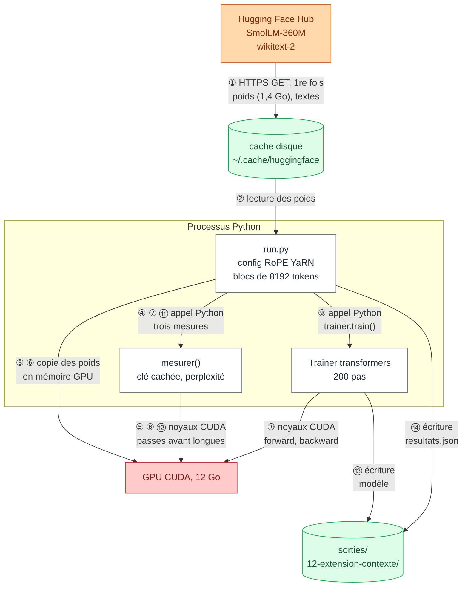

# 12 — Extension de la fenêtre de contexte (RoPE : interpolation, NTK, YaRN, ABF)

> Permettre au modèle de traiter des textes plus longs que ceux vus au pré-entraînement : on ajuste l'encodage positionnel, puis un court fine-tuning sur textes longs.

| Regroupe | Modifie | Local 12 Go | Test `--quick` |
|---|---|---|---|
| Position Interpolation (linear), NTK-aware / dynamic NTK, YaRN, LongRoPE, ABF (hausse de `rope_theta`), fine-tuning long contexte | Config RoPE (architecture) + tous les poids | ✅ petits modèles jusqu'à ~8k tokens | ✅ |

## Principe

Schéma : [docs/schemas-methodes.md](../docs/schemas-methodes.md#m12) (ce que la méthode ajoute ou modifie dans le transformer).

Les LLM modernes encodent la position par **RoPE** : chaque paire de dimensions de la requête et de la clé tourne d'un angle `position × θ_i`. Au-delà de la longueur d'entraînement, des angles jamais vus apparaissent et la qualité s'effondre.

| `methode` | Idée | Sans fine-tuning ? |
|---|---|---|
| `linear` (Position Interpolation) | Diviser les positions par le facteur : 8k positions deviennent 2k « compressées » | Médiocre, il faut un fine-tuning |
| `dynamic` (NTK dynamique) | Augmenter la base θ seulement quand la séquence dépasse la longueur d'origine | Correct sans entraînement |
| `yarn` | Interpoler uniquement les basses fréquences, garder les hautes, et corriger la température de l'attention | Bon, et excellent après ~400 pas |
| `abf` | Multiplier `rope_theta` (10k → 500k), puis entraîner longtemps sur des textes longs | Non. Recette Llama 3 / Code Llama, pendant le pré-entraînement |
| LongRoPE | Facteurs par dimension trouvés par recherche (Phi-3) | Voir la littérature |

Le réglage n'est **qu'une modification de configuration** (`rope_parameters`). Le fine-tuning sur des séquences longues apprend ensuite au modèle à s'en servir : 0,1 % des tokens du pré-entraînement suffisent pour YaRN.

L'exemple mesure trois états :

1. `origine` : le modèle tel quel ;
2. `echelle_seule` : la config RoPE modifiée, sans entraînement ;
3. `apres_finetuning`.

Pour chacun, on mesure le **test de la clé cachée** (passkey retrieval, retrouver un nombre caché au milieu d'un long texte) à plusieurs longueurs, et la perplexité sur des documents longs. La clé est évaluée en choix forcé : la vraie clé doit être la plus probable parmi 10 candidates (hasard = 0,1). On mesure ainsi ce que le modèle a lu, indépendamment de sa façon de formuler une réponse.

## Modèles concernés

| Type de modèle | Exemples de modèles | Applicable | Remarques |
|---|---|---|---|
| LLM avec RoPE | LLaMA, Qwen, Mistral, Gemma, Phi-3, SmolLM, DeepSeek | ✅ cas principal | [`run.py`](run.py) |
| LLM avec ALiBi | BLOOM, MPT | ⚠️ | Extrapole un peu nativement ; pas de réglage RoPE, fine-tuning long seulement |
| LLM à positions absolues apprises | GPT-2, OPT | ⚠️ | Il faut agrandir la table de positions (copie ou interpolation) puis entraîner |
| Encodeurs (BERT 512 → ModernBERT 8k) | BERT, ModernBERT | ⚠️ | ModernBERT utilise RoPE : même méthode. BERT : positions apprises |
| Mamba / RWKV / hybrides | Mamba, RWKV, Jamba | ✅ | Pas de limite positionnelle : fine-tuning sur textes longs uniquement |
| Vision / vidéo | Qwen2-VL, Qwen2.5-VL (M-RoPE) | ✅ | RoPE multi-axes, même logique pour plus d'images ou de frames |
| Modèle fermé via API | GPT-4o, Claude, Gemini | ❌ | |

## Quand l'utiliser

- ✅ Le modèle doit lire des documents, du code ou des conversations plus longs que sa fenêtre.
- ✅ Adapter un modèle spécialisé (fine-tuné à 4-8k) à du 32k et plus.
- ⚠️ Fenêtre étendue ne veut pas dire usage efficace de tout le contexte : vérifier avec RULER.
- ❌ Si le RAG ([EXEC18](../18-rag)) suffit à apporter la bonne information dans une fenêtre courte : c'est bien moins cher à l'inférence.

## Composants de l'exemple



`make run EX=FORM12` vérifie les prérequis (modules, GPU), puis lance `run.py` dans l'environnement `.venv`. Le script lit `config.yaml` (modèle, méthode `yarn`, facteur 4, entraînement, longueurs testées). SmolLM-360M a été pré-entraîné avec un contexte de 2 048 tokens ; l'exemple le porte à 8 192. Les textes viennent de wikitext-2 : jusqu'à 6 000 paragraphes du split `train` pour l'entraînement, et 4 documents longs de 60 paragraphes chacun, tirés du split `test`, pour la perplexité. Le test de la clé cachée est généré en mémoire : un nombre à 5 chiffres placé au hasard dans un texte de remplissage répété.

- **① Téléchargement.** Au premier lancement, la bibliothèque datasets télécharge wikitext-2 et transformers télécharge le tokenizer et les poids de SmolLM-360M (1,4 Go, safetensors en fp32), depuis le Hugging Face Hub, par HTTPS.
- **② Lecture.** Poids et textes sont rangés dans le cache `~/.cache/huggingface` ; les lancements suivants les relisent sur le disque, sans réseau.
- **③ Copie du modèle d'origine sur le GPU**, en bf16, avec sa configuration RoPE inchangée.
- **④ Mesure du modèle d'origine.** Pour chaque longueur (1 024, 2 048, 4 096 et 7 000 tokens), 10 textes cachent chacun une clé. La clé est juste si elle est la plus probable parmi 10 candidates. La perplexité est calculée sur les 4 documents longs, coupés à 8 192 tokens.
- **⑤ Passes avant sur le GPU.** Chaque candidate demande une passe avant (forward pass) sur tout le texte, sans génération : 100 passes par longueur. Le modèle d'origine est ensuite retiré de la mémoire.
- **⑥ Rechargement avec YaRN.** `run.py` modifie la configuration (`rope_parameters` : `rope_type: yarn`, `factor: 4.0`, `original_max_position_embeddings: 2048`, `max_position_embeddings: 8192`) puis recharge les mêmes poids sur le GPU. Seul le calcul des rotations de RoPE change : les poids sont identiques.
- **⑦ Mesure après mise à l'échelle seule**, sans aucun entraînement.
- **⑧ Passes avant sur le GPU**, comme en ⑤.
- **⑨ Fine-tuning long.** Les paragraphes d'entraînement sont concaténés puis découpés en blocs de 8 192 tokens (123 blocs), confiés au Trainer de transformers : 200 pas, chacun sur 8 blocs (lot (batch) de 1, accumulation 8), taux d'apprentissage (learning rate) 2e-5 après 20 pas de montée. Tous les poids sont entraînés.
- **⑩ Forward et backward sur le GPU**, sur des séquences de 8 192 tokens, avec gradient checkpointing.
- **⑪ Mesure après fine-tuning.**
- **⑫ Passes avant sur le GPU**, comme en ⑤.
- **⑬ Écriture du modèle** et de son tokenizer dans `sorties/12-extension-contexte/modele-yarn/`.
- **⑭ Écriture du rapport** dans `sorties/12-extension-contexte/resultats.json`, avec le même tableau affiché dans le terminal.

**Ce que fait le GPU.** Le processus Python ne calcule presque rien lui-même : PyTorch envoie au GPU des « noyaux CUDA », de petits programmes qui font les multiplications de matrices et l'attention sur les poids et les activations déjà présents dans sa mémoire. Ici, le coût vient de la longueur des séquences : l'attention compare chaque token à tous ceux qui le précèdent, et les activations d'une séquence de 8 192 tokens occupent bien plus de mémoire que les poids d'un modèle de 360 millions de paramètres. Les mesures (⑤, ⑧, ⑫) ne font que des passes avant. En entraînement (⑩), chaque pas fait 8 passes avant et arrière, une par bloc, en cumulant les gradients, puis une mise à jour de tous les poids par AdamW. Le gradient checkpointing ne garde qu'une partie des activations et recalcule les autres pendant la passe arrière (backward pass), ce qui fait tenir des blocs de 8 192 tokens. Le pic mesuré est d'environ 8 Go de mémoire GPU.

**Ce qui est écrit.**

| Fichier | Contenu |
|---|---|
| `modele-yarn/model.safetensors` | Le modèle complet après fine-tuning (724 Mo, en bf16) |
| `modele-yarn/config.json` | L'architecture, avec la configuration RoPE YaRN et `max_position_embeddings: 8192` : le modèle se recharge directement en contexte 8 192 avec `AutoModelForCausalLM.from_pretrained` |
| `modele-yarn/generation_config.json` | Les réglages de génération |
| `modele-yarn/tokenizer.json`, `tokenizer_config.json` | Le tokenizer, copié pour que le dossier se suffise à lui-même |
| `modele-yarn/training_args.bin` | Les réglages d'entraînement utilisés |
| `resultats.json` | Pour `origine`, `echelle_seule` et `apres_finetuning` : le taux de clés retrouvées à chaque longueur (`cle_1024` à `cle_7000`) et `perplexite_8192` |
| `config_effective.yaml` | La configuration réellement utilisée, surcharges `SET` comprises |

Avec `SET="entrainement.max_steps=0"`, il n'y a pas de fine-tuning : le modèle mis à l'échelle est sauvegardé tel quel et `resultats.json` ne contient que `origine` et `echelle_seule`.

## Ce que fait l'exemple

> **Avertissement : méthode à réexaminer.** Trois façons de prouver que l'entraînement apporte quelque chose après la mise à l'échelle YaRN ont échoué (clé cachée, deux codes, tâche multi-clés avec et sans tâches de récupération). YaRN seul suffit pour retrouver une clé unique ; aucun entraînement testé n'améliore la tâche multi-clés. Cet exemple ne démontre donc que la mise à l'échelle.

**Le besoin** : faire lire à un modèle des documents plus longs que sa fenêtre d'origine (contrats, dossiers, historiques de conversation) sans le réentraîner.

SmolLM-360M (fenêtre d'origine 2 048 tokens) passe à 8 192 tokens par YaRN (facteur 4), puis 200 pas d'entraînement sur des blocs longs de wikitext. Trois modèles sont mesurés : l'origine, la mise à l'échelle seule (YaRN sans entraînement) et la mise à l'échelle entraînée. Deux tâches en choix forcé, sur des paragraphes de Wikipédia jamais vus à l'entraînement, 30 questions par longueur : une clé cachée (choix parmi 10 candidats) et une tâche multi-clés de RULER (8 phrases « The pass key for <nom> is <nombre>. » réparties dans le texte, question sur l'un des noms, choix parmi les 8 nombres présents).

| | Clé, 4 096 tokens | Clé, 7 000 tokens | Multi-clés, 2 048 | Multi-clés, 4 096 | Multi-clés, 7 000 | Perplexité 2 048 | Perplexité 8 192 |
|---|---|---|---|---|---|---|---|
| Origine | 0,07 ± 0,06 | 0,13 ± 0,03 | 0,77 | 0,08 ± 0,05 | 0,16 ± 0,12 | 21,16 | 422 |
| YaRN seul | **1,00** | **1,00** | 0,48 ± 0,05 | 0,36 ± 0,02 | 0,21 ± 0,02 | 22,48 | 19,36 |
| YaRN entraîné | 1,00 | 1,00 | 0,50 ± 0,06 | 0,36 ± 0,05 | 0,20 ± 0,03 | 21,52 ± 0,01 | 18,69 ± 0,01 |

Écarts appariés : YaRN seul contre origine sur la clé +0,93 à 4 096 tokens et +0,87 à 7 000 (p < 10⁻⁶, net sur chaque graine) ; YaRN entraîné contre YaRN seul : 0,00 sur la clé à toutes les longueurs, 0,00 ± 0,03 à 4 096 tokens et −0,01 ± 0,04 à 7 000 sur la tâche multi-clés, non significatif.

**Ce qu'on en retient.**

- **La mise à l'échelle YaRN étend la fenêtre à elle seule pour une clé unique** : sans aucun entraînement, le modèle retrouve la clé à 7 000 tokens au lieu de rater 9 fois sur 10.
- **Le court entraînement sur du texte n'améliore aucune tâche** ; il corrige surtout la perplexité : à 2 048 tokens, la mise à l'échelle la dégrade de 6 % (21,16 → 22,48) et l'entraînement en rattrape les trois quarts (21,52), et à 8 192 tokens il la baisse de 19,36 à 18,69.
- **La tâche multi-clés est plus dure que la clé unique** : YaRN seul la fait remonter à 4 096 tokens (0,08 → 0,36) mais la dégrade dans la fenêtre d'origine (0,77 → 0,48 à 2 048 tokens), et à 7 000 tokens le gain sur l'origine n'est plus net. L'origine ne la réussit qu'à 0,77 à 2 048 tokens, sous le seuil de 0,8 retenu pour valider la tâche.

**Entraînement à la récupération** (`--set recuperation.activer=true`, module `recuperation.py`, 3 graines) : 200 pas sur des exemples dont la moitié sont des textes longs contenant plusieurs phrases de même forme (un nom et un code), la question portant sur l'une d'elles et la perte sur la seule réponse ; gabarits et noms différents de ceux de la mesure. Le témoin a les mêmes longueurs sans phrases cachées.

| Multi-clés (8 clés) | 2 048 tokens | 4 096 tokens | 7 000 tokens |
|---|---|---|---|
| YaRN seul | 0,48 ± 0,05 | 0,36 ± 0,02 | 0,21 ± 0,02 |
| Entraîné sur texte | 0,52 ± 0,08 | 0,36 ± 0,05 | 0,22 ± 0,05 |
| Entraîné avec tâches de récupération | 0,52 ± 0,02 | 0,34 ± 0,04 | 0,23 ± 0,06 |
| Témoin sans tâches | 0,52 ± 0,08 | 0,36 ± 0,05 | 0,26 ± 0,08 |

L'écart récupération − témoin vaut 0,00 ± 0,09, −0,01 ± 0,02 et −0,02 ± 0,05 : les tâches de récupération n'apportent rien. La perplexité à 2 048 tokens est de 21,65 avec les tâches et 20,85 pour le témoin.

```bash
python run.py --quick
python run.py                                        # SmolLM-360M 2k -> 8k, YaRN + 200 pas
python run.py --set contexte.methode=linear
python run.py --set contexte.methode=dynamic --set entrainement.max_steps=0    # NTK dynamique sans entraînement
python run.py --set contexte.methode=abf --set contexte.facteur_theta=20
```

## Paramètres principaux (`config.yaml`)

| Clé | Rôle |
|---|---|
| `contexte.methode`, `facteur` | Type de mise à l'échelle et multiplicateur de longueur |
| `contexte.facteur_theta` | Pour `abf` |
| `entrainement.longueur` | Longueur des séquences d'entraînement (= contexte visé) |
| `evaluation.longueurs` | Longueurs du test de la clé cachée, dont certaines au-delà de la longueur d'origine |

## Grosse infra

- Local : 8k tokens sur un modèle de 360M. La mémoire des activations croît linéairement avec la longueur (flash/SDPA attention) : 32k sur un 7B demande des GPU 80 Go.
- [`infra/config.yaml`](infra/config.yaml) : recette YaRN sur Mistral-7B, 8k → 32k, FSDP sur 8×H100, 400 pas.
- [`infra/axolotl_yarn_128k.yml`](infra/axolotl_yarn_128k.yml) : 128k avec **parallélisme de séquence** (ring-flash-attn, une séquence répartie sur 4 GPU). Indispensable au-delà de ~32k. Alternatives : torchtitan / Megatron « context parallel ».
- Évaluation : RULER, LongBench v2, needle-in-a-haystack, servis par vLLM (`--max-model-len`).

## Pièges

- **Données** : concaténer des paragraphes courts n'apprend pas vraiment les dépendances longues. Utiliser des documents naturellement longs (livres, dépôts de code).
- **Régression en contexte court** : garder des séquences courtes dans le mélange et vérifier les benchmarks habituels.
- **Servir avec la même config** : vLLM et llama.cpp doivent lire le `rope_scaling` sauvegardé. Certaines implémentations appliquent YaRN à toutes les longueurs, ce qui dégrade légèrement le court.
- **Mémoire du cache KV** à l'inférence : elle croît avec la longueur. Voir la quantification du cache ([FORM15](../15-quantification)).

## Références

- Chen et al., *Position Interpolation* (2023) · bloc97, *NTK-aware scaled RoPE* (2023) · Peng et al., *YaRN* (2023)
- Xiong et al., *Effective Long-Context Scaling (ABF)* (2023) · Ding et al., *LongRoPE* (2024)
- Hsieh et al., *RULER* (2024) · Liu et al., *Ring Attention* (2023)
