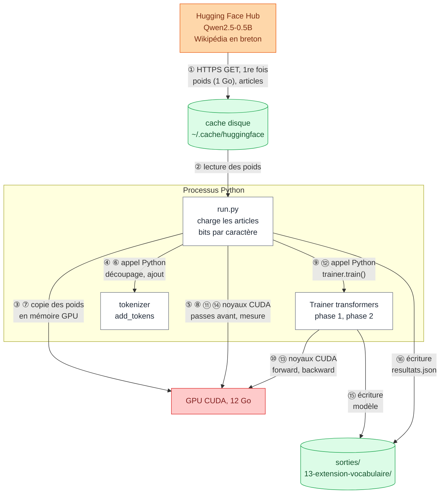

# 13 — Extension de vocabulaire

> Ajouter au tokenizer des tokens pour un domaine ou une langue mal couverts, agrandir les matrices d'embedding, initialiser les nouveaux vecteurs intelligemment, puis entraîner.

| Regroupe | Modifie | Local 12 Go | Test `--quick` |
|---|---|---|---|
| Ajout de tokens (added tokens), fusion de BPE, initialisation par moyenne des sous-tokens, entraînement en deux phases (embeddings, puis complet) | Tokenizer + taille des embeddings + poids | ✅ jusqu'à ~1B | ✅ |

## Principe

Schéma : [docs/schemas-methodes.md](../docs/schemas-methodes.md#m13) (ce que la méthode ajoute ou modifie dans le transformer).

Un tokenizer entraîné sur du web anglais découpe mal un nom propre inventé, un terme de chimie ou le coréen : un mot devient 4 à 10 tokens. Les conséquences :

- séquences plus longues, donc **plus lentes et plus chères** ;
- contexte utile plus court ;
- apprentissage plus difficile.

Étapes de [`run.py`](run.py) :

1. **Choisir les tokens** : mots fréquents dans le corpus qui coûtent plusieurs tokens, classés par nombre de tokens économisés. Ou une liste explicite.
2. **Agrandir** : `resize_token_embeddings`. **Initialiser** chaque nouvel embedding à la *moyenne des embeddings de ses anciens sous-tokens*. Le modèle « comprend » ainsi déjà à peu près le nouveau token avant tout entraînement : la perte (loss) de départ est bien plus basse qu'avec une initialisation aléatoire (`vocabulaire.init=aleatoire` pour comparer).
3. **Phase 1** : n'entraîner que les embeddings d'entrée et de sortie, à lr élevé. Le reste du réseau, gelé, n'est pas perturbé par des vecteurs encore mal placés.
4. **Phase 2** : entraînement complet à lr faible. En pratique, c'est un pré-entraînement continu ([DATA01](../01-pre-entrainement-continu)).

Mesures **comparables entre tokenizers** :

| Mesure | Ce qu'elle indique |
|---|---|
| `tokens_corpus_test` | Longueur du corpus de test en tokens : doit baisser |
| `bits_par_caractere` | Qualité de modélisation, indépendante du découpage. La perplexité par token ne se compare pas d'un tokenizer à l'autre |

Deux techniques d'ajout :

- **added tokens** (`run.py`) : simple, idéal pour quelques centaines de termes de domaine ou des tokens spéciaux (`<tool_call>`).
- **fusion de BPE** ([`infra/entrainer_tokenizer.py`](infra/entrainer_tokenizer.py)) : apprendre un BPE sur la langue cible et fusionner ses règles dans le tokenizer existant. C'est la bonne méthode pour une langue entière (milliers de tokens).

## Modèles concernés

| Type de modèle | Exemples de modèles | Applicable | Remarques |
|---|---|---|---|
| LLM décodeur (toutes familles) | Llama 3, Qwen2.5, Mistral 7B, Gemma 2 | ✅ cas principal | Embeddings liés ou non liés gérés (`tie_word_embeddings`) |
| Encodeur / seq2seq | BERT, RoBERTa, T5, mBART | ✅ | Même procédure. Ajouter des termes médicaux à BERT est un classique |
| Modèle multimodal | Qwen2.5-VL, LLaVA, Idefics | ✅ | Ajout de tokens spéciaux (`<image>`, `<box>`) : c'est ainsi que les VLM sont construits |
| Speech | Whisper | ⚠️ | Tokens de nouvelle langue possibles, peu courant |
| Tokenizer « byte-level » sans vocabulaire | ByT5, BLT | ❌ | Rien à étendre |
| Modèle fermé via API | GPT-4o, Claude, Gemini | ❌ | |

## Quand l'utiliser

- ✅ Nouvelle langue ou écriture mal couverte (fertilité > 2 à 3 tokens par mot).
- ✅ Domaine très technique avec des termes récurrents : molécules, codes produits, identifiants.
- ✅ Nouveaux tokens de contrôle : outils, rôles, modalités.
- ⚠️ Toujours suivi d'un entraînement conséquent : sans lui, les nouveaux tokens sont moins bien compris que l'ancien découpage.
- ❌ Pour quelques mots rares : inutile, le modèle apprend très bien leur découpage.

## Composants de l'exemple



`make run EX=FORM13` vérifie les prérequis (modules, GPU), puis lance `run.py` dans l'environnement `.venv`. Le script lit `config.yaml` (modèle, nombre de tokens à ajouter, initialisation, réglages des deux phases) et charge 3 000 articles de la Wikipédia en breton, une langue que le tokenizer de Qwen découpe mal (2,5 caractères par token, contre environ 4 en anglais). Un article sur cinq est mis de côté pour les mesures (600 articles, jamais vus à l'entraînement), les 2 400 autres servent à l'entraînement.

- **① Téléchargement.** Au premier lancement, le tokenizer et les poids de Qwen2.5-0.5B, modèle de base (environ 1 Go), et la Wikipédia en breton (`wikimedia/wikipedia`, `20231101.br`) sont téléchargés depuis le Hugging Face Hub, par HTTPS.
- **② Lecture.** Tout est rangé dans le cache `~/.cache/huggingface` ; les lancements suivants le relisent sur le disque, sans réseau.
- **③ Copie sur le GPU.** Les poids sont copiés en fp32 dans la mémoire du GPU.
- **④ Choix des tokens.** `run.py` compte les mots des articles d'entraînement présents au moins 5 fois, demande au tokenizer d'origine en combien de morceaux il découpe chacun, et garde les 1 000 mots qui font gagner le plus de tokens : mots courants (« gant », « eus », « hag », « evit ») et mots plus longs (« Ganedigezhioù », « Stadoù-Unanet »).
- **⑤ Mesure avant.** Deux mesures sur les 600 articles de test, comparables entre tokenizers : le nombre total de tokens, et les bits par caractère (la perte du modèle rapportée au nombre de caractères, pas de tokens). Chaque texte demande une passe avant (forward pass).
- **⑥ Ajout au tokenizer.** Les 1 000 mots sont ajoutés avec `add_tokens`, chacun précédé de son espace, comme les mots du vocabulaire BPE d'origine.
- **⑦ Agrandissement des embeddings.** La matrice d'embeddings de Qwen2.5-0.5B, partagée entre l'entrée et la sortie, compte 151 936 lignes pour 151 665 tokens : 1 000 nouveaux tokens dépassent ses lignes de réserve, et `resize_token_embeddings` la porte à 152 665 lignes. Chaque nouveau token reçoit la moyenne des embeddings des sous-tokens qui le découpaient avec le tokenizer d'origine.
- **⑧ Mesure après ajout**, avant tout entraînement.
- **⑨ Phase 1, embeddings seuls.** Le reste du modèle est gelé. Les articles d'entraînement sont concaténés et découpés en blocs de 512 tokens (1 442 blocs), confiés au Trainer de transformers : 1 époque, lots (batches) de 2, accumulation 8, taux d'apprentissage (learning rate) 1e-3.
- **⑩ Forward et backward sur le GPU**, avec mise à jour de la seule matrice d'embeddings.
- **⑪ Mesure après phase 1.**
- **⑫ Phase 2, modèle complet.** Tous les poids sont dégelés : 1 époque, lots de 1, accumulation 16, taux 2e-5, gradient checkpointing.
- **⑬ Forward et backward sur le GPU**, avec mise à jour de tous les poids.
- **⑭ Mesure après phase 2.**
- **⑮ Écriture du modèle** et du tokenizer agrandi dans `sorties/13-extension-vocabulaire/modele/`.
- **⑯ Écriture du rapport** dans `sorties/13-extension-vocabulaire/resultats.json`, avec le même tableau affiché dans le terminal.

**Témoin (baseline).** Avant ⑯, le modèle étendu quitte le GPU et Qwen2.5-0.5B d'origine y est rechargé, avec son tokenizer inchangé. Il suit les deux mêmes phases (⑨ à ⑬), sur les mêmes articles et le même nombre d'époques (le même texte fait 1 724 blocs avec l'ancien tokenizer), puis il est mesuré comme en ⑭. L'écart avec `apres_phase2` isole ce qu'apportent les nouveaux tokens, l'entraînement étant le même. `temoin: false` le désactive.

**Ce que fait le GPU.** Le processus Python ne calcule presque rien lui-même : PyTorch envoie au GPU des « noyaux CUDA », de petits programmes qui font les multiplications de matrices et l'attention sur les poids et les activations déjà présents dans sa mémoire. Les mesures (⑤, ⑧, ⑪, ⑭) ne font qu'une passe avant par texte, sans génération. L'agrandissement (⑦) alloue une nouvelle matrice d'embeddings sur le GPU et y recopie les anciennes lignes. En entraînement (⑩, ⑬), chaque pas fait une passe avant, une passe arrière (backward pass) qui calcule les gradients, puis la mise à jour par AdamW : en phase 1, gradients et état de l'optimiseur n'existent que pour la matrice d'embeddings ; en phase 2, pour tout le modèle. Les poids restent en fp32, les calculs d'entraînement se font en bf16.

**Ce qui est écrit.**

| Fichier | Contenu |
|---|---|
| `modele/model.safetensors` | Le modèle complet après les deux phases, avec sa matrice d'embeddings de 152 665 lignes (2,0 Go, en fp32) |
| `modele/tokenizer.json`, `tokenizer_config.json`, `chat_template.jinja` | Le tokenizer agrandi des 1 000 nouveaux tokens : il doit accompagner le modèle, l'ancien tokenizer ne correspond plus à ses embeddings |
| `modele/config.json`, `generation_config.json` | L'architecture, avec `vocab_size: 152665`, et les réglages de génération |
| `modele/training_args.bin` | Les réglages d'entraînement de la phase 2 |
| `phase1/`, `phase2/`, `temoin-phase1/`, `temoin-phase2/` | Dossiers de travail du Trainer, vides : aucun point de contrôle (checkpoint) n'est sauvegardé |
| `resultats.json` | Pour `avant`, `apres_init`, `apres_phase1`, `apres_phase2` et `temoin` : `tokens_corpus_test`, `caracteres_par_token` et `bits_par_caractere` ; la liste `nouveaux_tokens` des 1 000 mots ajoutés |
| `config_effective.yaml` | La configuration réellement utilisée, surcharges `SET` comprises |

## Utilisation

```bash
python run.py --quick
python run.py                                                  # Qwen2.5-0.5B + 1 000 mots bretons, ~13 min
python run.py --set vocabulaire.init=aleatoire                 # comparer apres_init : bits par caractère bien plus hauts
python run.py --set "vocabulaire.liste=[Kavelmor, Zanlisia]"
python run.py --set donnees.config=20231101.oc                 # une autre langue : occitan
python run.py --set donnees.source=faits --set donnees.n_entites=80 --set vocabulaire.n_nouveaux=200 --set vocabulaire.min_freq=3   # noms inventés, sans téléchargement
make graines EX=FORM13 N=3                                     # trois graines : moyenne et écart type
```

## Ce que fait l'exemple

**Le besoin** : servir un modèle dans une langue ou un domaine que son tokenizer découpe mal. Chaque mot coûte alors plusieurs tokens : la génération est plus lente, le contexte se remplit plus vite et chaque appel coûte plus cher. Ici, le breton : 2,5 caractères par token avec le tokenizer de Qwen.

**Résultats** (Qwen2.5-0.5B, RTX 5070 Ti Laptop ; 9 000 articles de la Wikipédia bretonne, dont 1 800 jamais vus pour les mesures, tronqués à 8 000 caractères ; 3 graines/seeds, 2 h pour les trois, `make graines EX=FORM13 N=3`) :

| | Tokens des articles de test | Caractères par token | Bits par caractère |
|---|---|---|---|
| Avant | 616 000 | 2,48 | 2,80 |
| 1 000 tokens ajoutés, initialisés par moyenne | 518 600 (**−15,9 %**, de −15,5 à −16,2 selon la graine) | **2,95** | 2,58 |
| après les deux phases d'entraînement | 518 600 | 2,95 | 1,369 ± 0,007 |
| Témoin : même entraînement, tokenizer d'origine | 616 000 | 2,48 | 1,365 ± 0,007 |

Par graine, écart de bits par caractère entre le modèle étendu et le témoin : +0,0039, +0,0031, +0,0023 (moyenne **+0,003**, soit 0,2 %).

**Critère de démonstration, fixé avant la mesure.** Écart moyen avec le témoin ≤ +0,01 bit par caractère et borne haute de l'intervalle à 95 % ≤ +0,02, avec la compression conservée : démontré. L'écart mesuré est de +0,003 [+0,001 ; +0,005] ; au-delà de +0,02 l'exemple serait resté un gain d'inférence seul.

**Ce qu'on en retient.**

- **La compression** : le même texte breton tient en 16 % de tokens en moins sur les trois graines. La génération demande autant de passes en moins, et le contexte contient 19 % de texte en plus.
- **Elle ne coûte presque rien en qualité** : 0,003 bit par caractère de plus que le témoin (0,2 %), contre 0,030 avec 3 000 articles. Les nouveaux embeddings partent d'une moyenne ; c'est le budget d'entraînement (9 000 articles, 1 époque par phase) qui referme l'écart. Avec moins de textes, l'extension de vocabulaire coûte 2 % de qualité.
- **L'entraînement explique la baisse de la perte, pas les nouveaux tokens** : le témoin descend autant. Sans témoin, on attribuerait à tort à l'extension du vocabulaire le passage de 2,80 à 1,37 bit par caractère.
- **L'initialisation par moyenne fonctionne** : juste après l'ajout, avant tout entraînement, la perte est déjà plus basse qu'avec l'ancien tokenizer (2,80 → 2,58).

## Paramètres principaux (`config.yaml`)

| Clé | Rôle |
|---|---|
| `vocabulaire.n_nouveaux`, `min_freq`, `liste` | Choix des tokens |
| `vocabulaire.init` | `moyenne` ou `aleatoire` |
| `phase1.*` / `phase2.*` | Deux jeux d'hyperparamètres (lr élevé puis faible) |

## Grosse infra

- [`infra/entrainer_tokenizer.py`](infra/entrainer_tokenizer.py) : BPE de la langue cible fusionné dans le tokenizer d'origine (sur CPU, quelques minutes).
- [`infra/config.yaml`](infra/config.yaml) : Llama-3.1-8B + 10 000 tokens coréens, phase 1 (2 000 pas) et phase 2 sur 500k articles, FSDP sur 8×H100. Le vrai coût est la phase 2 : plusieurs milliards de tokens, voir [01 infra](../01-pre-entrainement-continu/infra).
- Méthodes avancées d'initialisation : FOCUS, WECHSEL (alignement d'embeddings multilingues), ZeTT (hypernetwork).

## Pièges

- **Taille multiple de 8 ou 64** : `resize_token_embeddings(pad_to_multiple_of=64)` accélère les GPU.
- **Embeddings liés** : sur Qwen2.5-0.5B, l'entrée et la sortie partagent la même matrice. Ne pas l'initialiser deux fois.
- **Espaces et added tokens** : un added token est extrait avant le BPE, y compris au milieu d'un mot plus long. Sans son espace initial, il laisse un token « espace » isolé devant chaque occurrence : `run.py` ajoute `AddedToken(" mot", normalized=False)`. Vérifier le découpage de « le mot » et de « lemot ».
- **Phase 1 sautée** : des gradients énormes sur des vecteurs mal placés déstabilisent tout le réseau.
- **Compatibilité** : un modèle au vocabulaire modifié n'est plus fusionnable avec ses « frères » ([EDIT08](../08-fusion-modeles)) ni utilisable en décodage spéculatif avec le draft d'origine.

## Références

- Cui et al., *Chinese-LLaMA* (2023) · Fujii et al., *Swallow* (2024) · Dobler & de Melo, *FOCUS* (2023) · Minixhofer et al., *WECHSEL* (2022)
- Hewitt, *Initializing New Word Embeddings for Pretrained Language Models* (2021)
