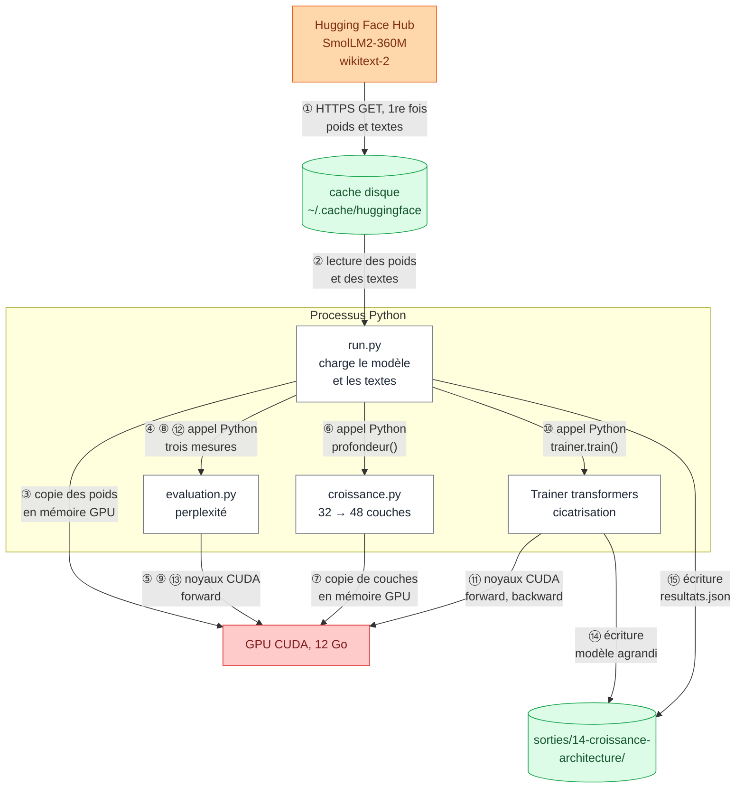

# 14 — Croissance d'architecture (depth up-scaling, block expansion, MoE upcycling)

> Agrandir un modèle déjà entraîné (plus de couches, ou des experts) puis le « cicatriser » par un entraînement continu. Beaucoup moins cher que de pré-entraîner le grand modèle de zéro.

| Regroupe | Modifie | Local 12 Go | Test `--quick` |
|---|---|---|---|
| Depth up-scaling (SOLAR), block expansion (LLaMA Pro), sparse upcycling dense → MoE (Mixtral), MoE de fine-tunes (mergekit-moe) | Architecture (nombre de couches, experts) + poids | ✅ transformation de n'importe quelle taille (CPU) ; cicatrisation locale jusqu'à ~1B | ✅ |

## Principe

Schéma : [docs/schemas-methodes.md](../docs/schemas-methodes.md#m14) (ce que la méthode ajoute ou modifie dans le transformer).

On réutilise les poids existants comme point de départ d'une architecture plus grande. Les trois méthodes suivent le même déroulé :

```
transformer l'architecture  ->  mesurer l'effet immédiat  ->  pré-entraînement continu  ->  remesurer
```

| `methode` | Transformation | État juste après | Ce qu'on entraîne |
|---|---|---|---|
| `profondeur` (SOLAR) | n couches → `[0, n-m)` + `[m, n)` : 2(n-m) couches, les couches centrales dupliquées se chevauchent | Dégradé (couture au milieu), récupération rapide | Tout |
| `expansion_blocs` (LLaMA Pro) | Après chaque groupe de k couches, une copie dont `o_proj` et `down_proj` sont **à zéro** : la couche est une identité | **Strictement identique** à l'original (`ecart_max_logits_vs_origine` ≈ 0) | Seulement les nouvelles couches : les connaissances d'origine sont préservées |
| `moe` (sparse upcycling) | Chaque MLP dense devient E experts identiques + un routeur top-k (LLaMA → Mixtral) | Identique à l'original (experts égaux, poids du routeur normalisés) | Tout. Les experts se différencient pendant l'entraînement |

L'intérêt : plus de capacité (profondeur) ou plus de paramètres pour un coût d'inférence presque constant (MoE top-2 sur E experts), en partant d'un modèle qui sait déjà beaucoup de choses.

Le rapport contient :

- les paramètres et le nombre de couches ;
- la perplexité générale à chaque étape ;
- l'écart maximal de logits avec l'original (sanity check des transformations censées préserver la fonction).

## Modèles concernés

| Type de modèle | Exemples de modèles | Applicable | Remarques |
|---|---|---|---|
| LLM famille LLaMA / Mistral / SmolLM (sans biais) | Llama 3, Mistral 7B, SmolLM2 | ✅ cas principal | [`croissance.py`](croissance.py) : les trois méthodes |
| Qwen2, Gemma, Phi | Qwen2, Gemma, Phi-3 | ⚠️ | `profondeur` et `expansion_blocs` fonctionnent si les noms de modules sont les mêmes. `moe` : la cible est l'équivalent MoE de la famille (Qwen2 → Qwen2-MoE, avec biais d'attention) |
| Encodeurs / ViT | BERT, ViT | ✅ | Principe identique : empilement (stacking de BERT), expansion identité |
| Vision / multimodal | Qwen2.5-VL, LLaVA, Idefics | ✅ | Upcycling MoE de ViT (V-MoE) et de VLM (MoE-LLaVA) |
| Diffusion | Stable Diffusion, SDXL, Flux | ⚠️ | Rare, mais des DiT MoE existent |
| Modèle fermé via API | GPT-4o, Claude, Gemini | ❌ | |

## Quand l'utiliser

- ✅ Obtenir un modèle plus capable qu'un checkpoint existant sans budget de pré-entraînement complet.
- ✅ `expansion_blocs` : ajouter un domaine (code, médecine) en préservant les capacités d'origine.
- ✅ `moe` : augmenter la capacité à coût d'inférence quasi constant.
- ⚠️ La cicatrisation reste un **pré-entraînement continu conséquent** : milliards de tokens pour des modèles de 7B et plus.
- ❌ Sans budget d'entraînement : le modèle transformé n'est pas meilleur que l'original (`profondeur` est même pire).

## Composants de l'exemple



`make run EX=FORM14` vérifie les prérequis (modules, GPU), puis lance `run.py` dans l'environnement `.venv`. Le script lit `config.yaml` (modèle, méthode de croissance, données, réglages) : par défaut, SmolLM2-360M passe de 32 à 48 couches par depth up-scaling (`methode: profondeur`, `m: 8`), puis est cicatrisé par 600 pas de pré-entraînement continu. Les textes sont des paragraphes de Wikipédia du jeu wikitext-2, téléchargé depuis le Hugging Face Hub : 8 000 paragraphes du split `train` pour la cicatrisation, 100 du split `test` pour la perplexité.

- **① Téléchargement.** Au premier lancement, transformers télécharge les poids de SmolLM2-360M (environ 700 Mo, fichiers safetensors) et datasets télécharge wikitext-2, depuis le Hugging Face Hub, par HTTPS.
- **② Lecture.** Poids et textes sont rangés dans le cache `~/.cache/huggingface` ; les lancements suivants les relisent sur le disque, sans réseau.
- **③ Copie sur le GPU.** Les poids sont copiés en float32 dans la mémoire du GPU. `run.py` y calcule aussitôt les logits du modèle d'origine sur une sonde de 64 tokens, gardés pour la comparaison de ⑧.
- **④ Mesure de l'origine.** `run.py` compte les paramètres (361,8 millions) et les couches (32), puis appelle `commun/evaluation.py` pour la perplexité sur les 100 paragraphes de test, tronqués à 256 tokens, par lots de 4.
- **⑤ Forward sur le GPU.** Une passe avant par lot ; la perplexité est l'exponentielle de la perte moyenne de prédiction du token suivant.
- **⑥ Croissance.** `run.py` appelle `croissance.profondeur` : le modèle garde ses couches 0 à 23 et reçoit une copie des couches 8 à 31, soit 2 × (32 − 8) = 48 couches. Les indices de couche utilisés par le cache KV sont renumérotés.
- **⑦ Copie de couches sur le GPU.** Les 24 couches dupliquées sont copiées directement dans la mémoire du GPU : le modèle passe à 519,1 millions de paramètres.
- **⑧ Mesure du modèle transformé.** Mêmes mesures qu'en ④, plus l'écart maximal entre ses logits et ceux de l'origine sur la sonde de ③ : la couture au milieu du modèle le dégrade.
- **⑨ Forward sur le GPU**, comme en ⑤.
- **⑩ Cicatrisation.** `run.py` confie le modèle au `Trainer` de transformers. Les 8 000 paragraphes sont tokenisés, concaténés et découpés en 2 757 blocs de 512 tokens. Tous les paramètres sont entraînés.
- **⑪ Forward et backward sur le GPU.** Chaque pas traite 16 blocs (lots de 2, accumulation sur 8) : passe avant, perte du token suivant, passe arrière, mise à jour. 600 pas, soit environ 3,5 passages sur les données, taux d'apprentissage 5e-5 en cosinus après 50 pas de chauffe, gradient checkpointing activé.
- **⑫ Mesure après cicatrisation.** Les mêmes 100 paragraphes de test sont repassés dans le modèle à 48 couches.
- **⑬ Forward sur le GPU**, comme en ⑤.
- **⑭ Écriture du modèle agrandi** et de son tokenizer dans `sorties/14-croissance-architecture/modele-profondeur/`.
- **⑮ Écriture du rapport** dans `sorties/14-croissance-architecture/resultats.json`, avec le même tableau affiché dans le terminal.

**Ce que fait le GPU.** Le processus Python ne calcule presque rien lui-même : PyTorch envoie au GPU des « noyaux CUDA », de petits programmes qui font les multiplications de matrices et l'attention sur les poids et les activations déjà présents dans sa mémoire. Il n'y a pas de génération : les mesures (⑤, ⑨, ⑬) sont de simples passes avant sur des textes connus. La croissance (⑦) n'est qu'une copie de tenseurs d'une zone de la mémoire du GPU à une autre, sans calcul. En cicatrisation (⑪), chaque pas fait une passe avant, une passe arrière qui calcule les gradients de tous les poids, puis la mise à jour par l'optimiseur AdamW, dont l'état existe pour les 519,1 millions de paramètres. Un seul modèle occupe la mémoire du GPU. Le pic mesuré, sur un calibrage aux mêmes réglages de modèle et d'entraînement, est d'environ 9,6 Go.

**Ce qui est écrit.**

| Fichier | Contenu |
|---|---|
| `modele-profondeur/model.safetensors` | Les poids du modèle à 48 couches après cicatrisation (2,1 Go, en float32) |
| `modele-profondeur/config.json`, `generation_config.json` | L'architecture agrandie (`num_hidden_layers: 48`) et les réglages de génération, pour recharger le modèle avec `AutoModelForCausalLM.from_pretrained` |
| `modele-profondeur/tokenizer.json`, `tokenizer_config.json` | Le tokenizer, copié pour que le dossier se suffise à lui-même |
| `modele-profondeur/training_args.bin` | Les réglages d'entraînement utilisés |
| `resultats.json` | Pour l'origine, le modèle transformé et le modèle cicatrisé : paramètres, nombre de couches, perplexité ; écart maximal de logits avec l'origine pour le modèle transformé |
| `config_effective.yaml` | La configuration réellement utilisée, surcharges `SET` comprises |

Avec `SET="croissance.methode=expansion_blocs"` ou `"croissance.methode=moe"`, le dossier du modèle s'appelle `modele-expansion_blocs/` ou `modele-moe/`.

## Utilisation

```bash
python run.py --quick
python run.py                                                   # SmolLM2-360M 32 -> 48 couches (SOLAR) + 600 pas
python run.py --set croissance.methode=expansion_blocs          # 32 -> 40 couches, seules les 8 nouvelles apprennent
python run.py --set croissance.methode=moe --set croissance.n_experts=4 --set modele.dtype=auto --set entrainement.optim=adamw_bnb_8bit   # ~1B paramètres : bf16 + AdamW 8 bits
python run.py --set croissance.methode=profondeur --set croissance.m=12
```

## Paramètres principaux (`config.yaml`)

| Clé | Rôle |
|---|---|
| `croissance.methode` | `profondeur`, `expansion_blocs` ou `moe` |
| `croissance.m` | Chevauchement SOLAR : couches totales = 2(n-m) |
| `croissance.tous_les` | Fréquence des blocs identité |
| `croissance.n_experts`, `top_k`, `bruit_experts` | Configuration MoE |
| `entrainement.*` | Cicatrisation (pré-entraînement continu) |

## Grosse infra

- La **transformation** est instantanée et se fait sur CPU, même pour un 70B :
  - [`infra/mergekit_passthrough_solar.yml`](infra/mergekit_passthrough_solar.yml) : Mistral-7B → 10,7B, sans code ;
  - [`infra/mergekit_moe.yml`](infra/mergekit_moe.yml) : MoE 4×7B à partir de 4 fine-tunes *différents*, routeur initialisé par des prompts.
- La **cicatrisation** est un pré-entraînement continu multi-nœuds ([`infra/config.yaml`](infra/config.yaml), [`infra/lancer.sh`](infra/lancer.sh), ou [01 infra](../01-pre-entrainement-continu/infra)).
- Pour l'entraînement de MoE à grande échelle, le **parallélisme d'experts** devient nécessaire : Megatron-LM / NeMo (upcycling intégré), torchtitan, DeepSpeed-MoE.

## Pièges

- **Indices de couche** : après duplication, `layer_idx` doit être renuméroté, sinon le cache KV est corrompu à la génération. C'est fait dans `_renumeroter`.
- **SOLAR sans cicatrisation** : perplexité nettement dégradée. C'est normal.
- **MoE** : sans perte auxiliaire d'équilibrage (`router_aux_loss_coef`), le routeur envoie tout vers 1 ou 2 experts. Des experts identiques mettent du temps à se différencier (bruit, données variées).
- **Mémoire** : un MoE 4 experts pèse ~3 fois le dense (les MLP dominent). L'inférence active seulement top-k experts, mais tous doivent être chargés.

## Références

- Kim et al., *SOLAR 10.7B: Depth Up-Scaling* (2023) · Wu et al., *LLaMA Pro: Progressive LLaMA with Block Expansion* (2024)
- Komatsuzaki et al., *Sparse Upcycling* (2022) · Jiang et al., *Mixtral of Experts* (2024) · He et al., *Upcycling LLMs into MoE* (NVIDIA, 2024)
- Gong et al., *Efficient Training of BERT by Progressively Stacking* (2019)
