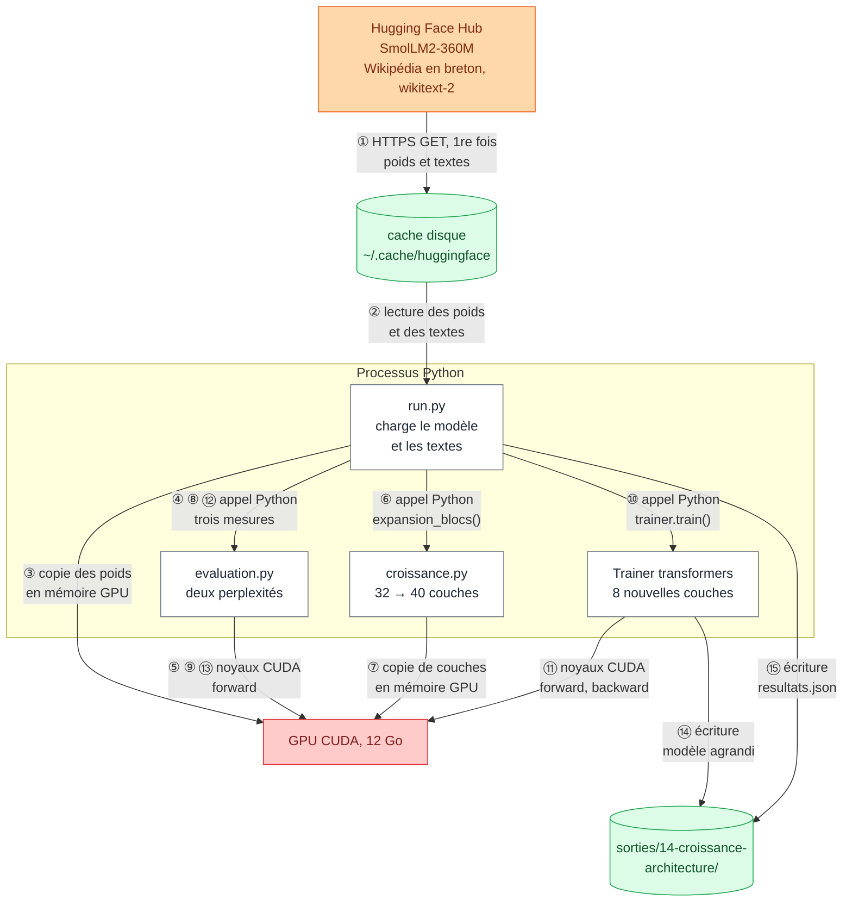

# 14 — Croissance d'architecture (depth up-scaling, block expansion, MoE upcycling)

> Agrandir un modèle déjà entraîné (plus de couches, ou des experts) puis le « cicatriser » par un entraînement continu. Beaucoup moins cher que de pré-entraîner le grand modèle de zéro.

| Regroupe | Modifie | Local 12 Go | Test `--quick` |
|---|---|---|---|
| Depth up-scaling (SOLAR), block expansion (LLaMA Pro), sparse upcycling dense → MoE (Mixtral), MoE de fine-tunes (mergekit-moe) | Architecture (nombre de couches, experts) + poids | ✅ transformation de n'importe quelle taille (CPU) ; cicatrisation (healing) locale jusqu'à ~1B | ✅ |

## Principe

Schéma : [docs/schemas-methodes.md](../docs/schemas-methodes.md#m14) (ce que la méthode ajoute ou modifie dans le transformer).

On réutilise les poids existants comme point de départ d'une architecture plus grande. Les trois méthodes suivent le même déroulé :

```
transformer l'architecture  ->  mesurer l'effet immédiat  ->  pré-entraînement continu  ->  remesurer
```

| `methode` | Transformation | État juste après | Ce qu'on entraîne |
|---|---|---|---|
| `profondeur` (SOLAR) | n couches → `[0, n-m)` + `[m, n)` : 2(n-m) couches, les couches centrales dupliquées se chevauchent | Dégradé (couture au milieu), récupération rapide | Tout |
| `expansion_blocs` (LLaMA Pro) | Après chaque groupe de k couches, une copie dont `o_proj` et `down_proj` sont **à zéro** : la couche est une identité | **Strictement identique** à l'original (`ecart_max_logits_vs_origine` ≈ 0) | Seulement les nouvelles couches : les connaissances d'origine sont préservées |
| `moe` (sparse upcycling) | Chaque MLP dense devient E experts identiques + un routeur top-k (LLaMA → Mixtral) | Identique à l'original (experts égaux, poids du routeur normalisés) | Tout. Les experts se différencient pendant l'entraînement |

L'intérêt : plus de capacité (profondeur) ou plus de paramètres pour un coût d'inférence presque constant (MoE top-2 sur E experts), en partant d'un modèle qui sait déjà beaucoup de choses.

Le rapport contient :

- les paramètres, ceux qui sont entraînés et le nombre de couches ;
- deux perplexités à chaque étape, sur des textes jamais vus : celle du domaine à apprendre et celle de l'anglais général, qu'on ne doit pas perdre ;
- l'écart maximal de logits avec l'original (vérification des transformations censées préserver la fonction) ;
- les courbes des deux perplexités pendant l'entraînement, et la comparaison avec le témoin (baseline) à niveau égal dans le domaine.

## Modèles concernés

| Type de modèle | Exemples de modèles | Applicable | Remarques |
|---|---|---|---|
| LLM famille LLaMA / Mistral / SmolLM (sans biais) | Llama 3, Mistral 7B, SmolLM2 | ✅ cas principal | [`croissance.py`](croissance.py) : les trois méthodes |
| Qwen2, Gemma, Phi | Qwen2, Gemma, Phi-3 | ⚠️ | `profondeur` et `expansion_blocs` fonctionnent si les noms de modules sont les mêmes. `moe` : la cible est l'équivalent MoE de la famille (Qwen2 → Qwen2-MoE, avec biais d'attention) |
| Encodeurs / ViT | BERT, ViT | ✅ | Principe identique : empilement (stacking de BERT), expansion identité |
| Vision / multimodal | Qwen2.5-VL, LLaVA, Idefics | ✅ | Upcycling MoE de ViT (V-MoE) et de VLM (MoE-LLaVA) |
| Diffusion | Stable Diffusion, SDXL, Flux | ⚠️ | Rare, mais des DiT MoE existent |
| Modèle fermé via API | GPT-4o, Claude, Gemini | ❌ | |

## Quand l'utiliser

- ✅ Obtenir un modèle plus capable qu'un checkpoint existant sans budget de pré-entraînement complet.
- ✅ `expansion_blocs` : ajouter un domaine (code, médecine) en préservant les capacités d'origine.
- ✅ `moe` : augmenter la capacité à coût d'inférence quasi constant.
- ⚠️ La cicatrisation reste un **pré-entraînement continu conséquent** : milliards de tokens pour des modèles de 7B et plus.
- ❌ Sans budget d'entraînement : le modèle transformé n'est pas meilleur que l'original (`profondeur` est même pire).

## Composants de l'exemple



`make run EX=FORM14` vérifie les prérequis (modules, GPU), puis lance `run.py` dans l'environnement `.venv`. Le script lit `config.yaml` (modèle, méthode de croissance, domaine, réglages). Par défaut, SmolLM2-360M passe de 32 à 40 couches par block expansion (`methode: expansion_blocs`, `tous_les: 4`), puis apprend le breton en 600 pas où seules les 8 couches ajoutées sont entraînées. Deux jeux de textes, téléchargés depuis le Hugging Face Hub :

- **Domaine à apprendre** : 5 000 articles tirés au hasard de la Wikipédia en breton (`wikimedia/wikipedia`, `20231101.br`). Un article sur cinq est mis de côté, dont 200 servent au test ; les autres servent à l'entraînement.
- **Ce qu'on ne doit pas perdre** : 100 paragraphes d'anglais général du split `test` de wikitext-2.

- **① Téléchargement.** Au premier lancement, transformers télécharge les poids de SmolLM2-360M (environ 700 Mo, fichiers safetensors), et datasets télécharge la Wikipédia en breton et wikitext-2, depuis le Hugging Face Hub, par HTTPS.
- **② Lecture.** Poids et textes sont rangés dans le cache `~/.cache/huggingface` ; les lancements suivants les relisent sur le disque, sans réseau.
- **③ Copie sur le GPU.** Les poids sont copiés en float32 dans la mémoire du GPU. `run.py` y calcule aussitôt les logits du modèle d'origine sur une sonde de 64 tokens, gardés pour la comparaison de ⑧.
- **④ Mesure de l'origine.** `run.py` compte les paramètres (361,8 millions) et les couches (32), puis appelle `commun/evaluation.py` pour les deux perplexités : 200 articles bretons et 100 paragraphes anglais, tronqués à 256 tokens.
- **⑤ Forward sur le GPU.** Une passe avant (forward pass) par lot ; la perplexité est l'exponentielle de la perte (loss) moyenne de prédiction du token suivant.
- **⑥ Croissance.** `run.py` appelle `croissance.expansion_blocs` : après chaque groupe de 4 couches, une copie de la dernière est insérée, avec ses projections de sortie (`o_proj`, `down_proj`) mises à zéro. La nouvelle couche renvoie exactement son entrée par la connexion résiduelle. Les indices de couche utilisés par le cache KV sont renumérotés.
- **⑦ Copie de couches sur le GPU.** Les 8 couches ajoutées sont copiées directement dans la mémoire du GPU : le modèle passe à 440,5 millions de paramètres.
- **⑧ Mesure du modèle transformé.** Mêmes mesures qu'en ④, plus l'écart maximal entre ses logits et ceux de l'origine sur la sonde de ③ : 0, le modèle agrandi est identique à l'original.
- **⑨ Forward sur le GPU**, comme en ⑤.
- **⑩ Entraînement sur le breton.** Les 32 couches d'origine, les embeddings et la tête de sortie sont figés : seules les 8 nouvelles couches apprennent, soit 78,7 millions de paramètres. `run.py` confie le modèle au `Trainer` de transformers. Les articles d'entraînement sont tokenisés, concaténés et découpés en 3 181 blocs de 512 tokens. Tous les 50 pas, un rappel (`Courbe`) remesure les deux perplexités.
- **⑪ Forward et backward sur le GPU.** Chaque pas traite 16 blocs (lots (batches) de 2, accumulation sur 8) : passe avant, perte du token suivant, passe arrière (backward pass), mise à jour. 600 pas, soit environ 3 passages sur les données, taux d'apprentissage (learning rate) 1e-4 en cosinus après 50 pas de chauffe, gradient checkpointing activé.
- **⑫ Mesure après entraînement.** Les mêmes textes de test sont repassés dans le modèle à 40 couches.
- **⑬ Forward sur le GPU**, comme en ⑤.
- **⑭ Écriture du modèle agrandi** et de son tokenizer dans `sorties/14-croissance-architecture/modele-expansion_blocs/`.
- **⑮ Écriture du rapport** dans `sorties/14-croissance-architecture/resultats.json`, avec le même tableau affiché dans le terminal.

**Témoin.** Avant ⑮, le modèle agrandi quitte le GPU et SmolLM2-360M d'origine (32 couches) y est rechargé. Il est entraîné en entier, comme dans un pré-entraînement continu classique : mêmes textes, mêmes 600 pas, mêmes réglages, mêmes relevés tous les 50 pas, puis il est mesuré comme en ⑫. Le témoin apprend plus vite. On cherche donc le premier relevé où il atteint le niveau en breton que LLaMA Pro a en fin d'entraînement, puis on compare leurs perplexités en anglais à ce moment-là (section `a_domaine_egal`). `temoin: false` le désactive.

**Ce que fait le GPU.** Le processus Python ne calcule presque rien lui-même : PyTorch envoie au GPU des « noyaux CUDA », de petits programmes qui font les multiplications de matrices et l'attention sur les poids et les activations déjà présents dans sa mémoire. Il n'y a pas de génération : les mesures (⑤, ⑨, ⑬ et les relevés) sont de simples passes avant sur des textes connus. La croissance (⑦) n'est qu'une copie de tenseurs d'une zone de la mémoire du GPU à une autre. Pendant l'entraînement de LLaMA Pro (⑪), la passe arrière traverse tout le modèle, mais seuls les gradients et l'état de l'optimiseur AdamW des 8 nouvelles couches sont gardés. Le témoin, lui, entraîne ses 361,8 millions de paramètres. Un seul modèle occupe la mémoire du GPU à la fois.

**Ce qui est écrit.**

| Fichier | Contenu |
|---|---|
| `modele-expansion_blocs/model.safetensors` | Les poids du modèle à 40 couches après entraînement (1,8 Go, en float32) |
| `modele-expansion_blocs/config.json`, `generation_config.json` | L'architecture agrandie (`num_hidden_layers: 40`) et les réglages de génération, pour recharger le modèle avec `AutoModelForCausalLM.from_pretrained` |
| `modele-expansion_blocs/tokenizer.json`, `tokenizer_config.json` | Le tokenizer, copié pour que le dossier se suffise à lui-même |
| `modele-expansion_blocs/training_args.bin` | Les réglages d'entraînement utilisés |
| `temoin/` | Dossier de travail du Trainer pour le témoin, sans point de contrôle (checkpoint) |
| `resultats.json` | Pour l'origine, le modèle transformé, le modèle entraîné et le témoin : paramètres, paramètres entraînés, couches, perplexités du domaine et générale ; écart de logits du modèle transformé ; courbes des deux entraînements et comparaison à domaine égal |
| `config_effective.yaml` | La configuration réellement utilisée, surcharges `SET` comprises |

Avec `SET="croissance.methode=profondeur"` ou `"croissance.methode=moe"`, le dossier du modèle s'appelle `modele-profondeur/` ou `modele-moe/`.

## Utilisation

```bash
python run.py --quick
python run.py                                                   # SmolLM2-360M 32 -> 40 couches (LLaMA Pro), breton, ~55 min avec le témoin
python run.py --set domaine.config=20231101.oc                  # une autre langue : occitan
python run.py --set croissance.methode=profondeur               # 32 -> 48 couches (SOLAR), tout est entraîné
make graines EX=FORM14 N=3                                      # trois graines : moyenne et écart type (~3 h)
python run.py --set croissance.methode=moe --set croissance.n_experts=4 --set modele.dtype=auto --set entrainement.optim=adamw_bnb_8bit   # ~1B paramètres : bf16 + AdamW 8 bits
python run.py --set domaine=null                                # sans domaine : cicatrisation sur l'anglais général (wikitext)
```

## Ce que fait l'exemple

**Le besoin** : apprendre à un modèle une langue ou un domaine qu'il connaît mal, sans lui faire oublier ce qu'il sait. Le pré-entraînement continu classique apprend le domaine mais dégrade le reste. LLaMA Pro ajoute des couches neuves et n'entraîne qu'elles : les poids d'origine ne bougent pas.

**Résultats** (SmolLM2-360M, RTX 5070 Ti Laptop ; 200 articles bretons et 100 paragraphes anglais jamais vus ; 3 graines/seeds, `make graines EX=FORM14 N=3`, moyenne ± écart type). Plus la perplexité est basse, mieux le modèle connaît la langue :

| | Paramètres entraînés | Perplexité en breton | Perplexité en anglais |
|---|---|---|---|
| Modèle d'origine | | 145,6 | 19,86 |
| LLaMA Pro, 600 pas | 78,7 M | 10,9 ± 0,3 | **22,0 ± 0,2** |
| Témoin entraîné en entier, au pas 150 (même niveau en breton) | 361,8 M | 10,3 ± 0,2 | **23,6 ± 0,1** |
| Témoin entraîné en entier, 600 pas | 361,8 M | 7,8 ± 0,1 | 26,5 ± 0,5 |

- **À niveau égal en breton, LLaMA Pro oublie moins.** Sa perplexité en anglais monte de 2,1 points, celle du témoin de 3,7. L'écart est de 1,57 ± 0,21 point (1,34 à 1,74 selon la graine), et la plus mauvaise graine de LLaMA Pro (22,1) reste sous la meilleure du témoin (23,5). Au point de comparaison, le témoin est même un peu meilleur en breton : la comparaison le favorise.
- **L'écart se retrouve tout au long de l'entraînement.** À 20 de perplexité en breton, par exemple, LLaMA Pro est à 21,1 en anglais et le témoin à environ 21,9 (courbes dans `resultats.json`).
- **Le prix.** LLaMA Pro met 4 fois plus de pas pour atteindre ce niveau en breton, et le modèle garde 22 % de paramètres en plus à l'inférence.
- **Réserves.** Modèle de 360 M paramètres et un seul domaine ; la perplexité est mesurée sur des textes fixes. LLaMA Pro limite l'oubli sans le supprimer : la passe avant change dès que les nouvelles couches apprennent.

## Paramètres principaux (`config.yaml`)

| Clé | Rôle |
|---|---|
| `croissance.methode` | `profondeur`, `expansion_blocs` ou `moe` |
| `croissance.m` | Chevauchement SOLAR : couches totales = 2(n-m) |
| `croissance.tous_les` | Fréquence des blocs identité |
| `croissance.n_experts`, `top_k`, `bruit_experts` | Configuration MoE |
| `domaine.*` | Le domaine à apprendre (jeu Hugging Face, colonne, nombre d'articles et de tests) ; sans cette section, l'entraînement porte sur wikitext |
| `entrainement.*` | Pré-entraînement continu |
| `suivi_tous_les` | Intervalle des relevés de perplexité pendant l'entraînement |
| `temoin` | Entraîner aussi le modèle d'origine en entier, pour comparaison |

## Grosse infra

- La **transformation** est instantanée et se fait sur CPU, même pour un 70B :
  - [`infra/mergekit_passthrough_solar.yml`](infra/mergekit_passthrough_solar.yml) : Mistral-7B → 10,7B, sans code ;
  - [`infra/mergekit_moe.yml`](infra/mergekit_moe.yml) : MoE 4×7B à partir de 4 fine-tunes *différents*, routeur initialisé par des prompts.
- La **cicatrisation** est un pré-entraînement continu multi-nœuds ([`infra/config.yaml`](infra/config.yaml), [`infra/lancer.sh`](infra/lancer.sh), ou [01 infra](../01-pre-entrainement-continu/infra)).
- Pour l'entraînement de MoE à grande échelle, le **parallélisme d'experts** devient nécessaire : Megatron-LM / NeMo (upcycling intégré), torchtitan, DeepSpeed-MoE.

## Pièges

- **Indices de couche** : après duplication, `layer_idx` doit être renuméroté, sinon le cache KV est corrompu à la génération. C'est fait dans `_renumeroter`.
- **SOLAR sans cicatrisation** : perplexité nettement dégradée. C'est normal.
- **MoE** : sans perte auxiliaire d'équilibrage (`router_aux_loss_coef`), le routeur envoie tout vers 1 ou 2 experts. Des experts identiques mettent du temps à se différencier (bruit, données variées).
- **Mémoire** : un MoE 4 experts pèse ~3 fois le dense (les MLP dominent). L'inférence active seulement top-k experts, mais tous doivent être chargés.

## Références

- Kim et al., *SOLAR 10.7B: Depth Up-Scaling* (2023) · Wu et al., *LLaMA Pro: Progressive LLaMA with Block Expansion* (2024)
- Komatsuzaki et al., *Sparse Upcycling* (2022) · Jiang et al., *Mixtral of Experts* (2024) · He et al., *Upcycling LLMs into MoE* (NVIDIA, 2024)
- Gong et al., *Efficient Training of BERT by Progressively Stacking* (2019)
