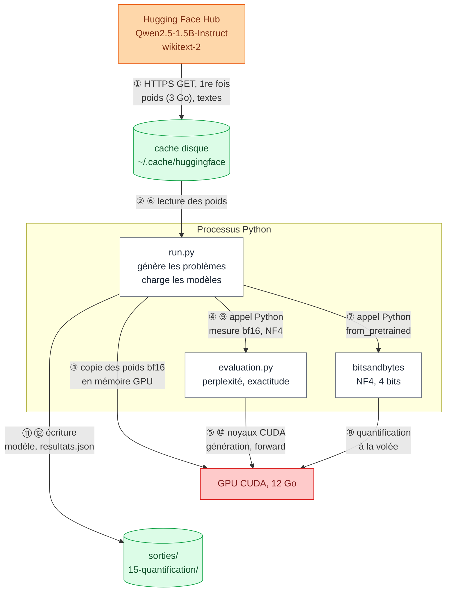

# 15 — Quantification (bitsandbytes, torchao, GPTQ, AWQ, QAT, GGUF)

> Stocker les poids (et parfois les activations) sur 8, 4 ou 3 bits au lieu de 16 : un modèle 2 à 5 fois plus petit, souvent plus rapide, pour une perte de qualité mesurée.

| Regroupe | Modifie | Local 12 Go | Test `--quick` |
|---|---|---|---|
| PTQ sans calibration (bitsandbytes NF4/int8, torchao int8/int4/fp8), PTQ avec calibration (GPTQ, AWQ), QAT (quantization-aware training), GGUF k-quants + imatrix (llama.cpp) | Représentation des poids | ✅ jusqu'à ~8B à quantifier, 70B en GGUF/GPTQ couche par couche | ✅ (`torchao_int8wo`, CPU) |

## Principe

Schéma : [docs/schemas-methodes.md](../docs/schemas-methodes.md#m15) (ce que la méthode ajoute ou modifie dans le transformer).

« Améliorer » veut dire ici rendre le modèle **déployable** : moins de mémoire, plus de débit, et parfois la possibilité de faire tourner un modèle *plus grand* sur le même matériel. Un 14B en 4 bits bat souvent un 7B en 16 bits.

| Famille | Méthodes | Idée | Coût |
|---|---|---|---|
| **PTQ à la volée** | `bnb_nf4`, `bnb_int8`, `torchao_int8wo`, `torchao_int4wo`, `torchao_fp8` | Arrondi par groupes de poids, avec une échelle par groupe. NF4 utilise des niveaux adaptés à une distribution normale | Secondes, pas de données |
| **PTQ calibrée** | `gptq`, `awq` | Quelques centaines d'exemples servent à mesurer les activations. GPTQ corrige les erreurs d'arrondi colonne par colonne (inverse de la hessienne) ; AWQ protège les canaux importants par une mise à l'échelle | Minutes à heures, 256 à 512 exemples |
| **QAT** | `qat` | Pendant un court fine-tuning, les poids passent par une *fausse* quantification : le modèle apprend à tolérer l'arrondi, puis conversion réelle | Un fine-tuning. Récupère une bonne partie de la perte de la PTQ en 4 bits et moins |
| **GGUF** | [`variantes/gguf-llamacpp`](variantes/gguf-llamacpp) | k-quants à blocs et super-blocs, matrice d'importance (imatrix) calculée sur un texte | Minutes sur CPU |

Mesures (référence bf16 puis modèle quantifié) : mémoire du modèle, tokens/s en génération, perplexité wikitext, exactitude sur la tâche.

**Poids seuls ou poids + activations** : W4A16 réduit la mémoire et accélère le décodage, limité par la bande passante mémoire. W8A8 et FP8 accélèrent les gros lots (prefill, serveur) sur les GPU qui ont les noyaux adaptés.

## Modèles concernés

| Type de modèle | Exemples de modèles | Applicable | Remarques |
|---|---|---|---|
| LLM décodeur (toutes familles) | Llama 3, Qwen2.5, Mistral 7B, Gemma 2 | ✅ cas principal | [`run.py`](run.py) |
| MoE | Mixtral, Qwen-MoE, DeepSeek | ✅ | Experts quantifiés, routeur souvent laissé en haute précision |
| Encodeurs | BERT | ✅ | int8 dynamique (`torch.ao`, ONNX Runtime, Optimum) très courant en CPU |
| Vision / VLM | Qwen2.5-VL, LLaVA, Idefics | ✅ | Tour vision souvent gardée en 16 bits, LLM quantifié |
| Diffusion | SDXL, Flux | ✅ | NF4/FP8 du transformer de diffusion (diffusers + bitsandbytes/torchao), GGUF pour Flux |
| Whisper | Whisper | ✅ | int8 (CTranslate2 / faster-whisper), GGUF (whisper.cpp) |
| Modèle fermé via API | GPT-4o, Claude, Gemini | ❌ | Le fournisseur le fait, ou pas |

## Quand l'utiliser

- ✅ Toujours envisager en déploiement. 8 bits : perte quasi nulle ; 4 bits : perte faible sur les modèles ≥ 7B.
- ✅ Faire tenir un modèle plus gros sur le matériel disponible.
- ✅ QLoRA ([DATA03](../03-peft)) : entraîner au-dessus d'un modèle NF4.
- ⚠️ Moins de 4 bits, petits modèles (< 3B), maths et code : les pertes deviennent visibles. Toujours mesurer sur *sa* tâche, pas seulement la perplexité.

## Composants de l'exemple



`make run EX=FORM15` vérifie les prérequis (modules, GPU), puis lance `run.py` dans l'environnement `.venv`. Le script lit `config.yaml` (modèle, méthode de quantification, données, évaluation) : par défaut, Qwen2.5-1.5B-Instruct est mesuré en bf16, puis rechargé en NF4 4 bits par bitsandbytes (`methode: bnb_nf4`) et mesuré de nouveau. Les autres méthodes se choisissent avec `SET="methode=..."` ; `gptq` et `awq` tournent alors dans l'environnement séparé `.venv-llmcompressor`, que `make` choisit tout seul. Le schéma suit la méthode par défaut. Les 100 problèmes de test, de la forme `(a op b) op c`, sont générés en mémoire, sans téléchargement ; les 50 paragraphes de perplexité viennent du split `test` de wikitext-2, téléchargé depuis le Hugging Face Hub.

- **① Téléchargement.** Au premier lancement, transformers télécharge les poids de Qwen2.5-1.5B-Instruct (environ 3 Go, fichiers safetensors) et datasets télécharge wikitext-2, depuis le Hugging Face Hub, par HTTPS.
- **② Lecture.** Poids et textes sont rangés dans le cache `~/.cache/huggingface` ; les lancements suivants les relisent sur le disque, sans réseau.
- **③ Copie sur le GPU.** Le modèle de référence est copié en bf16 dans la mémoire du GPU.
- **④ Mesure de la référence.** `run.py` relève la mémoire occupée par le modèle sur le GPU, puis le débit en génération : 64 tokens produits sur une consigne fixe, après un court préchauffage. Il appelle ensuite `commun/evaluation.py` pour la perplexité sur les 50 paragraphes et l'exactitude sur les 100 problèmes.
- **⑤ Génération et forward sur le GPU.** La perplexité demande une passe avant par lot de 4 paragraphes. L'exactitude fait répondre le modèle par lots de 16, token par token, jusqu'à 256 tokens, puis compare le nombre final de chaque réponse au résultat attendu.
- **⑥ Relecture.** Le modèle de référence est supprimé et la mémoire du GPU vidée ; les poids d'origine sont relus dans le cache.
- **⑦ Chargement quantifié.** `run.py` appelle `from_pretrained` avec une configuration bitsandbytes : NF4, double quantification des échelles, calcul en bf16.
- **⑧ Quantification à la volée.** Au moment de leur copie sur le GPU, les poids des couches linéaires sont arrondis par bitsandbytes sur 16 niveaux NF4, par blocs ayant chacun leur échelle. Les embeddings restent en bf16. Aucune donnée de calibration n'est utilisée.
- **⑨ Mesure du modèle NF4.** Mêmes mesures qu'en ④ : mémoire, débit, perplexité, exactitude.
- **⑩ Génération et forward sur le GPU**, avec le même décodage qu'en ⑤.
- **⑪ Écriture du modèle quantifié** et de son tokenizer dans `sorties/15-quantification/modele-bnb_nf4/`.
- **⑫ Écriture du rapport** dans `sorties/15-quantification/resultats.json`, avec le même tableau affiché dans le terminal.

**Ce que fait le GPU.** Le processus Python ne calcule presque rien lui-même : PyTorch envoie au GPU des « noyaux CUDA », de petits programmes qui font les multiplications de matrices et l'attention sur les poids et les activations déjà présents dans sa mémoire. En génération, il y a une passe avant par token produit, accélérée par un cache des clés et des valeurs déjà calculées. En NF4, les poids restent stockés sur 4 bits dans la mémoire du GPU : les noyaux de bitsandbytes les décompressent en bf16 au moment de chaque multiplication de matrices. C'est ce qui réduit la mémoire du modèle (2 945 Mo en bf16, 1 132 Mo en NF4) et ralentit ici la génération (126,4 contre 89,6 tokens par seconde). Les deux modèles ne coexistent jamais : la référence est libérée avant le chargement quantifié.

**Ce qui est écrit.**

| Fichier | Contenu |
|---|---|
| `modele-bnb_nf4/model.safetensors` | Les poids quantifiés (1,1 Go) : couches linéaires en NF4 avec leurs échelles, embeddings en bf16 |
| `modele-bnb_nf4/config.json`, `generation_config.json` | L'architecture, la configuration de quantification (`quant_method: bitsandbytes`, `bnb_4bit_quant_type: nf4`, double quantification) et les réglages de génération, pour recharger le modèle directement en 4 bits |
| `modele-bnb_nf4/tokenizer.json`, `tokenizer_config.json`, `chat_template.jinja` | Le tokenizer et le format de conversation, copiés pour que le dossier se suffise à lui-même |
| `resultats.json` | Pour la référence bf16 et le modèle NF4 : mémoire du modèle sur le GPU, tokens par seconde, perplexité générale, exactitude sur les 100 problèmes avec la durée de l'évaluation et trois réponses d'exemple |
| `config_effective.yaml` | La configuration réellement utilisée, surcharges `SET` comprises |

Avec une autre méthode (`SET="methode=..."`), le dossier du modèle prend son nom (`modele-bnb_int8/`, `modele-gptq/`...), sauf `qat` qui n'en écrit pas ; pour `gptq` et `awq`, `resultats.json` ajoute la taille du modèle compressé sur le disque.

## Utilisation

```bash
python run.py --quick                                      # torchao int8 poids seuls (fonctionne sur CPU)
python run.py                                              # NF4 bitsandbytes, Qwen2.5-1.5B-Instruct
../.venv-llmcompressor/bin/python run.py --set methode=gptq   # llmcompressor, dans son propre venv
../.venv-llmcompressor/bin/python run.py --set methode=awq
python run.py --set methode=torchao_int4wo
python run.py --set methode=qat --set modele.nom=Qwen/Qwen2.5-0.5B-Instruct   # fine-tuning complet fp32 : 0,5B sur 12 Go
python variantes/gguf-llamacpp/run.py --quick              # nécessite llama.cpp compilé (voir config)
```

Dépendances selon la méthode : `bitsandbytes` (bnb), `torchao` (torchao, qat), `llmcompressor` (gptq, awq). llm-compressor impose sa propre version de torch et de transformers : il s'installe dans un venv séparé (`python3 -m venv .venv-llmcompressor && .venv-llmcompressor/bin/pip install llmcompressor datasets pyyaml`). Voir [`requirements-extras.txt`](../requirements-extras.txt).

## Variantes

### Variante GGUF : servir le modèle avec llama.cpp ou Ollama

**Le besoin** : faire tourner un modèle sur un poste, un serveur sans GPU ou en périphérie, avec les outils les plus répandus (llama.cpp, Ollama, LM Studio), et choisir le niveau de quantification en connaissant ce qu'il coûte.

[`variantes/gguf-llamacpp`](variantes/gguf-llamacpp) convertit Qwen2.5-1.5B-Instruct en GGUF 16 bits, calcule une matrice d'importance (imatrix) sur 400 textes de calibration, quantifie en Q8_0, Q5_K_M, Q4_K_M et IQ3_M, mesure la taille et la perplexité de chaque fichier avec `llama-perplexity` (100 textes), puis écrit un Modelfile Ollama. Il faut un clone compilé de llama.cpp (`dossier_llamacpp`, voir `config.yaml`).

| Format | Taille | Perplexité |
|---|---|---|
| f16 | 2 950 Mo | 13,91 |
| Q8_0 | 1 570 Mo | 13,93 |
| Q5_K_M | 1 073 Mo | 14,16 |
| **Q4_K_M** | **940 Mo** | **14,47** |
| IQ3_M | 741 Mo | 15,95 |

Q8_0 divise la taille par 2 sans perte mesurable ; Q4_K_M la divise par 3 pour +4 % de perplexité, le compromis habituel ; en dessous de 4 bits, la perte devient nette (+15 % en IQ3_M). Réserve : la perplexité résume mal certaines pertes (raisonnement, suivi de consignes) ; avant de déployer un format, mesurer aussi la tâche visée.

## Paramètres principaux (`config.yaml`)

| Clé | Rôle |
|---|---|
| `methode` | Voir le tableau |
| `gptq.schema` | `W4A16`, `W8A16` ou `W8A8` |
| `calibration.n`, `longueur` | Données de calibration (GPTQ/AWQ) : représentatives de l'usage réel |
| `qat.*` | Groupe de quantification et fine-tuning QAT |

## Grosse infra

- **Quantifier ne demande pas de cluster.** llm-compressor calibre un 70B couche par couche sur 1 à 2 GPU ([`infra/gptq_70b_llmcompressor.py`](infra/gptq_70b_llmcompressor.py)). GGUF tourne sur CPU.
- Le multi-GPU sert à **servir** (vLLM `--tensor-parallel-size`) et à **évaluer la dégradation** sur des benchmarks ([`infra/lancer.sh`](infra/lancer.sh) : lm-eval du modèle bf16 et du modèle quantifié).
- [`infra/config.yaml`](infra/config.yaml) : `run.py` complet sur un 8B (GPTQ W4A16) sur 1 GPU 40 à 80 Go.
- QAT sur gros modèles : torchtune / Axolotl (recettes QAT torchao), avec la même infra que le SFT ([DATA02](../02-fine-tuning-supervise)).
- Cache KV quantifié (FP8) pour les longs contextes : `vllm serve ... --kv-cache-dtype fp8`.

## Pièges

- **Débit** : tous les formats ne sont pas plus rapides. bitsandbytes NF4 est souvent *plus lent* que bf16 en génération. GPTQ/AWQ (noyaux Marlin dans vLLM) et FP8 sont rapides.
- **Calibration non représentative** : du texte wikitext pour un modèle de code donne un résultat dégradé.
- **Perplexité trompeuse** : une petite hausse de perplexité peut masquer une chute nette sur des raisonnements longs.
- **Couches sensibles** : garder `lm_head` (et parfois les embeddings, le routeur MoE) en haute précision.
- **Format** et moteur d'inférence doivent correspondre : compressed-tensors pour vLLM, GGUF pour llama.cpp / Ollama, bnb pour transformers.
- **GPTQ/AWQ dans transformers** : le modèle se charge compressé, mais transformers le décompresse en bf16 dès la première génération (pas de noyaux 4 bits compressed-tensors). Le gain de mémoire et de débit se voit dans vLLM. `run.py` mesure donc la mémoire avant de générer, et ajoute la taille sur disque.
- **Format int4 et noyaux** : un format quantifié n'est utile que si des noyaux l'exécutent sur le matériel visé. `run.py` utilise le format torchao `tile_packed_to_4d`, dont les noyaux int4 (tinygemm) sont inclus dans PyTorch CUDA.

## Références

- Dettmers et al., *LLM.int8()* (2022) et *QLoRA / NF4* (2023) · Frantar et al., *GPTQ* (2022) · Lin et al., *AWQ* (2023)
- Xiao et al., *SmoothQuant* (2022) · Liu et al., *LLM-QAT* (2023) · PyTorch, *torchao QAT* (2024)
- llama.cpp k-quants et imatrix : https://github.com/ggml-org/llama.cpp · llm-compressor : https://github.com/vllm-project/llm-compressor
