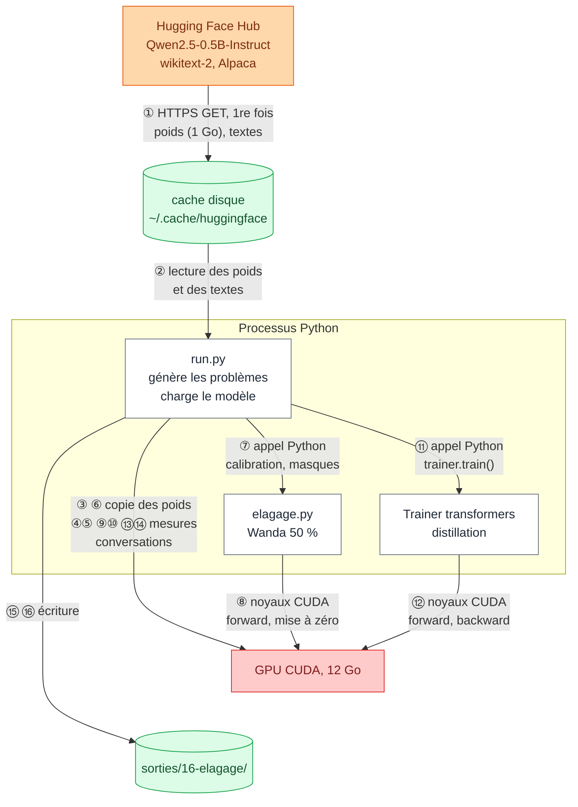

# 16 — Élagage (pruning) et cicatrisation

> Retirer les poids, neurones ou couches qui contribuent le moins, puis récupérer la qualité par un court entraînement, idéalement une distillation depuis le modèle d'origine.

| Regroupe | Modifie | Local 12 Go | Test `--quick` |
|---|---|---|---|
| Non structuré : magnitude, Wanda (SparseGPT en infra) ; semi-structuré 2:4 ; structuré : suppression de couches (ShortGPT), réduction de largeur MLP (Minitron) ; cicatrisation (healing) LM ou distillation | Poids mis à zéro, ou architecture réduite | ✅ jusqu'à ~0,5B avec cicatrisation, ~7B sans | ✅ |

## Principe

Schéma : [docs/schemas-methodes.md](../docs/schemas-methodes.md#m16) (ce que la méthode ajoute ou modifie dans le transformer).

| `methode` | Ce qui est retiré | Gain réel |
|---|---|---|
| `magnitude` | Les poids de plus petite valeur absolue, dans chaque ligne | Aucun gain de vitesse sans moteur sparse. Référence de comparaison |
| `wanda` | Score `|W_ij| · ‖X_j‖₂` : un petit poids sur une entrée à forte activation reste important. Calibration sans rétropropagation | Idem, mais bien meilleure qualité que magnitude à 50 % |
| `2:4` | Dans chaque groupe de 4 poids, les 2 moins importants (score Wanda) | Accélération réelle ~1,3 à 1,6× sur GPU Ampere et plus récents (noyaux 2:4, vLLM) |
| `couches` | Les blocs dont la sortie ressemble le plus à l'entrée (Block Influence = 1 - cos) | Modèle plus petit et plus rapide, proportionnellement |
| `largeur` | Les neurones MLP les moins activés : `gate`/`up` perdent des lignes, `down` des colonnes | Modèle plus petit et plus rapide |

La **cicatrisation** (`cicatrisation.mode`) est ce qui rend l'élagage agressif utilisable :

- `lm` : pré-entraînement continu sur du texte général ;
- `distillation` : le modèle élagué imite la distribution de sortie de l'original (recette Minitron de NVIDIA). Plus efficace que `lm` à nombre de tokens égal.

Pour un modèle de conversation, la cicatrisation lit aussi des conversations : des demandes (prompts) générales et les réponses que le modèle d'origine y a faites avant l'élagage. Le texte brut seul n'exerce pas ce qu'on veut récupérer : suivre une consigne et répondre dans le format appris.

Pendant la cicatrisation d'un élagage non structuré, un masque booléen (1 octet par poids) est réappliqué après chaque pas d'optimisation (`GarderMasques`) : les zéros restent des zéros.

Chaque étape est mesurée (origine → élagué → cicatrisé) : paramètres, sparsité, tokens/s, perplexité générale, exactitude sur la tâche.

## Modèles concernés

| Type de modèle | Exemples de modèles | Applicable | Remarques |
|---|---|---|---|
| LLM LLaMA / Qwen / Mistral / SmolLM | Llama 3, Qwen2.5, Mistral 7B, SmolLM2 | ✅ cas principal | [`elagage.py`](elagage.py) : noms `q/k/v/o_proj`, `gate/up/down_proj` |
| Autres LLM | GPT-2, Phi, Falcon | ⚠️ | Adapter `NOMS_LINEAIRES` et les attributs MLP |
| MoE | Mixtral 8x7B, Qwen3-30B-A3B, DeepSeek-V3 | ✅ | Élaguer des experts entiers (fréquence de routage) : très efficace |
| Encodeurs | BERT | ✅ très étudié | Élagage de têtes (heads) d'attention, movement pruning, `nn_pruning` |
| Vision | ResNet, ViT | ✅ | Élagage de filtres / canaux (torch-pruning), tokens (ToMe) |
| Diffusion | Stable Diffusion, SDXL, Flux | ✅ | Suppression de blocs de l'UNet + distillation (BK-SDM, SSD-1B) |
| Modèle fermé via API | GPT-4o, Claude, Gemini | ❌ | |

## Quand l'utiliser

- ✅ Produire une famille de modèles plus petits à partir d'un grand, avec distillation. Moins cher qu'un pré-entraînement : Llama-3.1-Minitron 4B.
- ✅ Accélérer l'inférence avec 2:4 ou l'élagage structuré.
- ⚠️ Non structuré sans moteur sparse : aucun gain de mémoire ni de vitesse en PyTorch standard. Intérêt surtout pour la compression combinée à la quantification.
- ❌ Élagage structuré agressif sans budget de cicatrisation : la qualité s'effondre.

## Composants de l'exemple



`make run EX=FORM16` vérifie les prérequis (modules, GPU), puis lance `run.py` dans l'environnement `.venv`. Le script lit `config.yaml` (modèle, méthode d'élagage, cicatrisation, données, évaluation) : par défaut, Qwen2.5-0.5B-Instruct est élagué par Wanda à 50 % (`methode: wanda`, `sparsite: 0.5`), puis cicatrisé par distillation depuis une copie de l'original (`cicatrisation.mode: distillation`). Les 300 problèmes de test, de la forme `a op b`, sont générés en mémoire, sans téléchargement. Les textes viennent de wikitext-2, téléchargé depuis le Hugging Face Hub : 128 paragraphes du split `train` pour la calibration, 4 000 pour la cicatrisation, 50 du split `test` pour la perplexité. Les 1 765 demandes générales des conversations viennent du jeu Alpaca (`tatsu-lab/alpaca`).

- **① Téléchargement.** Au premier lancement, transformers télécharge les poids de Qwen2.5-0.5B-Instruct (environ 1 Go, fichiers safetensors) et datasets télécharge wikitext-2 et Alpaca, depuis le Hugging Face Hub, par HTTPS.
- **② Lecture.** Poids et textes sont rangés dans le cache `~/.cache/huggingface` ; les lancements suivants les relisent sur le disque, sans réseau.
- **③ Copie sur le GPU.** Les poids sont copiés en float32 dans la mémoire du GPU : c'est le modèle qui sera élagué.
- **④ Mesure de l'origine.** `run.py` relève les paramètres (494 millions), la part de poids nuls dans les couches linéaires et le débit en génération (32 tokens après un préchauffage), puis appelle `commun/evaluation.py` pour la perplexité sur les 50 paragraphes et l'exactitude sur les 300 problèmes.
- **⑤ Génération et forward sur le GPU.** La perplexité demande une passe avant (forward pass) par lot (batch) de 4 paragraphes. L'exactitude fait répondre le modèle par lots de 16, token par token, jusqu'à 256 tokens, puis compare le nombre final de chaque réponse au résultat attendu.
- **Conversations.** Le modèle d'origine répond aux 1 765 demandes générales, par lots de 32, jusqu'à 512 tokens. Les réponses sont gardées dans `sorties/cache-remelange/`, cache partagé avec le remélange (replay) de DATA02 et DATA03 : les lancements suivants les relisent sans rien générer.
- **⑥ Copie de l'enseignant (teacher).** `run.py` duplique le modèle d'origine dans la mémoire du GPU, en bf16 et figé : il servira de référence pendant la distillation.
- **⑦ Élagage.** `run.py` appelle `elagage.py`, qui pose des points d'écoute sur les couches linéaires (`q_proj`, `k_proj`, `v_proj`, `o_proj`, `gate_proj`, `up_proj`, `down_proj`) de chaque bloc.
- **⑧ Calibration et mise à zéro sur le GPU.** Les 128 paragraphes de calibration, tronqués à 256 tokens, traversent le modèle sans rétropropagation ; les points d'écoute cumulent la norme ‖X_j‖₂ de chaque colonne d'entrée. Chaque poids reçoit le score `|W_ij| · ‖X_j‖₂`, et la moitié de plus faible score de chaque ligne est mise à zéro. Les masques booléens sont gardés pour la suite.
- **⑨ Mesure du modèle élagué.** Mêmes mesures qu'en ④ : le nombre de paramètres ne change pas, la sparsité passe à 0,5.
- **⑩ Génération et forward sur le GPU**, comme en ⑤.
- **⑪ Cicatrisation.** `run.py` confie l'élève (student) élagué et l'enseignant à un `Trainer` de transformers dont la perte (loss) est la divergence KL entre leurs distributions de sortie, token par token. Les 4 000 paragraphes et les 1 765 conversations sont mélangés, tokenisés, concaténés et découpés en blocs de 256 tokens. Après chaque pas, le rappel `GarderMasques` d'`elagage.py` réapplique les masques : les zéros restent des zéros.
- **⑫ Forward et backward sur le GPU.** Chaque pas traite 16 blocs (lots de 2, accumulation sur 8) : passe avant de l'élève, passe avant de l'enseignant sans gradient, perte KL, passe arrière (backward pass), mise à jour par AdamW 8 bits. 1 000 pas, soit environ 3,5 passages sur les données, taux d'apprentissage (learning rate) 2e-5 après 20 pas de chauffe, gradient checkpointing activé.
- **⑬ Mesure après cicatrisation.** Mêmes mesures qu'en ④ sur le modèle cicatrisé.
- **⑭ Génération et forward sur le GPU**, comme en ⑤.
- **⑮ Écriture du modèle élagué et cicatrisé** et de son tokenizer dans `sorties/16-elagage/modele-wanda/`.
- **⑯ Écriture du rapport** dans `sorties/16-elagage/resultats.json`, avec le même tableau affiché dans le terminal.

**Ce que fait le GPU.** Le processus Python ne calcule presque rien lui-même : PyTorch envoie au GPU des « noyaux CUDA », de petits programmes qui font les multiplications de matrices et l'attention sur les poids et les activations déjà présents dans sa mémoire. En génération, il y a une passe avant par token produit, accélérée par un cache des clés et des valeurs déjà calculées. Les poids mis à zéro restent stockés et multipliés comme les autres : sans moteur sparse, l'élagage non structuré n'allège ni la mémoire ni le calcul. Pendant la cicatrisation, trois choses coexistent dans la mémoire du GPU : l'élève en float32 (environ 2 Go), l'enseignant en bf16 (environ 1 Go), l'état de l'optimiseur AdamW 8 bits et les masques booléens (1 octet par poids élagable). Chaque pas fait la passe avant de l'enseignant, la passe avant et la passe arrière de l'élève, puis la mise à jour. Le pic mesuré, sur un calibrage aux mêmes réglages de modèle et d'entraînement, est d'environ 8,9 Go.

**Ce qui est écrit.**

| Fichier | Contenu |
|---|---|
| `modele-wanda/model.safetensors` | Les poids du modèle élagué puis cicatrisé (2,0 Go, en float32). Les zéros sont stockés comme les autres valeurs : le fichier a la taille du modèle d'origine en float32 |
| `modele-wanda/config.json`, `generation_config.json` | L'architecture, inchangée, et les réglages de génération, pour recharger le modèle avec `AutoModelForCausalLM.from_pretrained` |
| `modele-wanda/tokenizer.json`, `tokenizer_config.json`, `chat_template.jinja` | Le tokenizer et le format de conversation, copiés pour que le dossier se suffise à lui-même |
| `resultats.json` | Pour l'origine, le modèle élagué et le modèle cicatrisé : paramètres, sparsité des couches linéaires, tokens par seconde, perplexité générale, exactitude sur les 300 problèmes avec la durée de l'évaluation et trois réponses d'exemple |
| `config_effective.yaml` | La configuration réellement utilisée, surcharges `SET` comprises |

Avec une autre méthode (`SET="methode=..."`), le dossier du modèle prend son nom (`modele-magnitude/`, `modele-2-4/`, `modele-couches/`, `modele-largeur/`).

## Utilisation

```bash
python run.py --quick
python run.py                                                  # Wanda 50 % + distillation, Qwen2.5-0.5B-Instruct, ~20 min
python run.py --set modele.nom=Qwen/Qwen2.5-1.5B-Instruct --set cicatrisation.mode=aucune   # 1,5B : sans cicatrisation
python run.py --set methode=magnitude --set cicatrisation.mode=aucune    # comparer à Wanda sans cicatrisation
python run.py --set methode=2:4
python run.py --set cicatrisation.n_conversations=0             # cicatrisation sur Wikipédia seulement
python run.py --set methode=couches --set n_couches=6
python run.py --set methode=largeur --set ratio_largeur=0.3 --set cicatrisation.mode=lm
```

## Ce que fait l'exemple

**Le besoin** : réduire le coût d'un modèle en retirant la moitié de ses poids, sans perdre la tâche qu'il sait faire.

**Résultats** (Qwen2.5-0.5B-Instruct, RTX 5070 Ti Laptop ; 300 problèmes, intervalles à 95 %) :

| | Exactitude sur la tâche | Perplexité générale | Tokens/s |
|---|---|---|---|
| Modèle d'origine | 0,88 | 22,3 | 139 |
| Wanda 50 %, juste après l'élagage | 0,34 | 37,9 | 142 |
| Wanda 50 %, après cicatrisation | **0,66** [0,605 ; 0,711] | 25,3 | 119 |
| 2:4, juste après l'élagage | 0,01 | 106,8 | 142 |
| 2:4, après cicatrisation | 0,38 | 30,4 | 116 |
| Largeur : 30 % des neurones MLP retirés (494 → 400 M paramètres), après cicatrisation | 0,14 [0,102 ; 0,180] | 27,7 | 118 |
| Couches : 6 blocs sur 24 retirés (494 → 405 M paramètres), après cicatrisation | 0,09 [0,063 ; 0,128] | 26,7 | 148 |

- **La cicatrisation récupère une partie de la tâche**, pas toute : Wanda reste 0,22 sous l'original ([−0,27 ; −0,17]), 2:4 0,50 sous.
- **Aucun gain de vitesse** en PyTorch standard pour Wanda et 2:4 : les zéros sont stockés et multipliés comme les autres poids. Le 2:4 n'accélère qu'avec des noyaux dédiés (vLLM, TensorRT).
- **L'élagage structuré rend le modèle réellement plus petit, mais la tâche s'effondre.** Retirer 6 couches accélère la génération de 8 % pour 18 % de paramètres en moins ; la tâche ne revient qu'à 0,09. La perplexité générale, elle, revient près de l'original (26,7 contre 22,3) : la cicatrisation restaure la langue, pas la compétence.
- **Conclusion : à cette taille et à ce budget, l'élagage ne paie pas.** Un modèle de 0,5B a peu de redondance, et 1 000 pas de distillation (environ 4 millions de tokens) ne suffisent pas. Les gains publiés (Minitron : 8B → 4B) portent sur des modèles bien plus grands, cicatrisés sur des dizaines de milliards de tokens.

### Variante grand modèle : élaguer un 7B couche par couche

**Le besoin** : vérifier à la taille où Wanda a été publié (7B) ce que l'élagage non structuré conserve, sans cicatrisation.

[`variantes/grand-modele`](variantes/grand-modele) garde Qwen2.5-7B-Instruct (15 Go en bf16) en RAM et fait passer chaque bloc sur le GPU à son tour : les activations de calibration (128 blocs de 256 tokens) traversent les blocs déjà élagués. Wanda à 50 % et le motif 2:4 sont appliqués, puis la référence et les deux modèles élagués sont évalués en 8 bits sur la carte (GSM8K, 250 problèmes, et perplexité Wikipédia) : la quantification étant la même, l'écart isole l'élagage. Une seule exécution (`make graines EX=16 VAR=grand-modele N=1`), génération jusqu'à 768 tokens pour qu'aucune réponse de la référence ne soit coupée.

| | GSM8K (250 problèmes) | Perplexité Wikipédia | Réponses tronquées |
|---|---|---|---|
| Qwen2.5-7B-Instruct, 8 bits | 0,824 [0,772 ; 0,866] | 11,8 | 0,4 % |
| Wanda 50 % | 0,720 [0,661 ; 0,772] | 14,4 | 0,4 % |
| 2:4 | 0,504 [0,442 ; 0,565] | 22,4 | 4 % |

Écarts appariés : Wanda −0,104 [−0,156 ; −0,052], 2:4 −0,320 [−0,388 ; −0,252], nets.

- **À 7B, l'élagage non structuré garde l'essentiel sans cicatrisation** : 87 % de l'exactitude (0,72 sur 0,82), contre 39 % à 0,5B (0,34 sur 0,88, voir plus haut). La hausse de perplexité (+22 %) est de l'ordre de celle que publie Wanda sur LLaMA-7B.
- **Mais la perte reste nette sur une tâche de raisonnement** : 10 points, et 32 points avec le motif 2:4, le seul qui accélère sur les GPU actuels. Sans cicatrisation, un 7B élagué n'est pas utilisable à la place de l'original.

### Part de l'exactitude conservée selon la taille (même protocole, sans cicatrisation)

La variante grand-modèle, lancée à 0,5B, 1,5B et 7B avec le même protocole (GSM8K, 250 problèmes, 768 tokens, évaluation en 8 bits, une graine) :

| Modèle | Original | Wanda 50 % | Conservé | 2:4 | Conservé | Perplexité (original → Wanda → 2:4) |
|---|---|---|---|---|---|---|
| Qwen2.5-0.5B-Instruct | 0,432 | 0,052 | 12 % | 0,008 | 2 % | 22,1 → 38,7 → 107,6 |
| Qwen2.5-1.5B-Instruct | 0,640 | 0,188 | 29 % | 0,020 | 3 % | 14,8 → 23,4 → 63,6 |
| Qwen2.5-7B-Instruct | 0,824 | 0,720 | 87 % | 0,504 | 61 % | 11,8 → 14,4 → 22,4 |

Écarts appariés avec l'original, en Wanda : −0,380 [−0,44 ; −0,32] à 0,5B, −0,452 [−0,516 ; −0,384] à 1,5B, −0,104 [−0,156 ; −0,052] à 7B.

- **La part conservée croît très vite avec la taille** : 12 % à 0,5B, 29 % à 1,5B, 87 % à 7B pour Wanda. Sans réentraînement, un modèle de 1,5B ou moins perd l'essentiel de sa compétence de raisonnement.
- **Le motif 2:4 s'effondre sous 7B** : de 2 à 3 % de l'exactitude conservée à 0,5B et 1,5B, contre 61 % à 7B.
- **À petite taille, les réponses du modèle élagué dérivent** : 34 % de réponses tronquées à 0,5B après Wanda (0,8 % pour l'original), signe de répétitions.
- **Cohérent avec la littérature** : les gros modèles perdent moins à sparsité égale (SparseGPT), et les élagages réussis sous 7B reposent sur un budget de réentraînement hors de portée d'un poste local (voir plus haut). Le 3B est mesuré avec le même protocole.

### Cicatrisation d'un modèle plus grand : sorties de l'enseignant pré-calculées et LoRA non fusionné

**Le besoin** : cicatriser un 1,5B ou un 3B sur 12 Go de GPU, où l'enseignant et l'élève entraîné ne tiennent pas ensemble.

`--set cicatrisation.mode=distillation_lora` (module `cicatrisation.py`) : avant l'élagage, le modèle d'origine passe une fois sur les blocs de texte et on garde ses `top_k` (32) tokens les plus probables par position, avec leurs log-probabilités. L'enseignant n'est plus en mémoire pendant l'entraînement. L'élève élagué reste creux et gelé ; seul un adaptateur LoRA (rang 16) apprend, par KL restreinte aux tokens de l'enseignant et renormalisée sur eux. L'adaptateur n'est pas fusionné : la fusion rendrait les poids denses. Le protocole est identique à 0,5B, 1,5B et 3B (`--set modele.nom=... --set modele.dtype=bfloat16`), pour Wanda et le motif 2:4.

### Pourquoi l'élagage d'un petit modèle dépasse un poste de 12 Go

Les élagages qui réussissent sur des modèles de moins de 7 milliards de paramètres s'appuient sur un budget de récupération hors de portée d'un poste local. Le coût d'un entraînement se compte en opérations : environ 6 × paramètres × tokens.

| Protocole | Tokens de réentraînement | Opérations | Durée sur ce poste |
|---|---|---|---|
| Cet exemple (distillation, 1 000 pas de 16 blocs de 256 tokens, 0,5B) | 4 millions | 1 × 10¹⁶ | environ 10 minutes |
| Étude 2:4 sur Llama-3.1-8B (la perte se stabilise) | 0,5 milliard | — | — |
| Sheared-LLaMA vers 1,3B (Xia et al., 2024) | 50 milliards | 4 × 10²⁰ | plus de 200 jours |
| Sheared-LLaMA vers 2,7B | 50 milliards | 8 × 10²⁰ | plus de 450 jours |

Les durées supposent un débit effectif de 20 mille milliards d'opérations par seconde sur la carte ; c'est une hypothèse, pas une mesure. Le budget de cet exemple est environ 12 000 fois plus petit que celui de Sheared-LLaMA.

La phase d'élagage de Sheared-LLaMA entraîne en outre le modèle de 7 milliards de paramètres avec des masques appris : poids, gradients et états de l'optimiseur représentent plus de 80 Go, pour 11,5 Go de mémoire GPU disponibles. Minitron réduit un 8B à 4B avec moins de 3 % des données d'origine et jusqu'à 40 fois moins de tokens qu'un entraînement depuis zéro. Wanda, lui, n'entraîne rien, et son papier ne traite que des modèles de 7B à 65B.

Les études sur de petits modèles vont dans le même sens : les gros modèles perdent nettement moins de précision à sparsité égale (SparseGPT), et un Llama-3.2-1B élagué en 2:4 demande plus de tokens de récupération qu'un 8B. Sur de petits modèles, la quantification donne une meilleure fidélité et de meilleures performances de langage que l'élagage, avec un avantage variable sur le raisonnement (EMNLP 2025).

Conséquence pour cet exemple : à 0,5B, 1,5B et 3B, il mesure la part de l'exactitude que garde un modèle élagué à 50 %, avec le protocole de la variante 7B, et la compare à celle du 7B. Il ne démontre pas un gain d'élagage sur ces tailles.

## Paramètres principaux (`config.yaml`)

| Clé | Rôle |
|---|---|
| `methode` | Voir le tableau |
| `sparsite`, `n_couches`, `ratio_largeur` | Intensité selon la méthode |
| `calibration.n` | Textes de calibration (Wanda, importance des couches et des neurones) |
| `cicatrisation.mode`, `cicatrisation.entrainement.*` | Récupération |
| `cicatrisation.n_textes`, `n_conversations` | Paragraphes Wikipédia et conversations lus pendant la cicatrisation |

## Grosse infra

- L'**élagage** reste léger : Wanda ou SparseGPT sur un 70B se font couche par couche sur 1 à 2 GPU (llm-compressor, [`infra/lancer.sh`](infra/lancer.sh)).
- La **cicatrisation par distillation** est coûteuse. Minitron distille sur ~100 Md de tokens pour un 8B → 4B : c'est un travail multi-nœuds ([`infra/config.yaml`](infra/config.yaml), Slurm).
- Outillage industriel : NVIDIA TensorRT Model Optimizer + NeMo (élagage profondeur, largeur, têtes, dimension cachée ; distillation), llm-compressor (SparseGPT 2:4 → vLLM).

## Pièges

- **Mesurer le vrai gain** : 50 % de zéros non structurés ne rendent ni plus petit ni plus rapide sans format sparse.
- **Couches retirées** : les premières et la dernière couche sont presque toujours critiques. Le score d'influence les protège en général.
- **Élagage après quantification** (ou l'inverse) : l'ordre compte. L'usage courant est d'élaguer, cicatriser, puis quantifier.
- **Cache KV et `layer_idx`** : après suppression de couches, les indices doivent être renumérotés. C'est fait dans `supprimer_couches`.

## Références

- Han et al., *Learning both Weights and Connections* (2015) · Frantar & Alistarh, *SparseGPT* (2023) · Sun et al., *Wanda* (2023)
- Xia et al., *Sheared LLaMA: Accelerating Language Model Pre-training via Structured Pruning* (2023) · Men et al., *ShortGPT* (2024) · Gromov et al., *The Unreasonable Ineffectiveness of the Deeper Layers* (2024)
- Muralidharan et al., *Compact Language Models via Pruning and Knowledge Distillation (Minitron)* (2024) · Ma et al., *LLM-Pruner* (2023)
