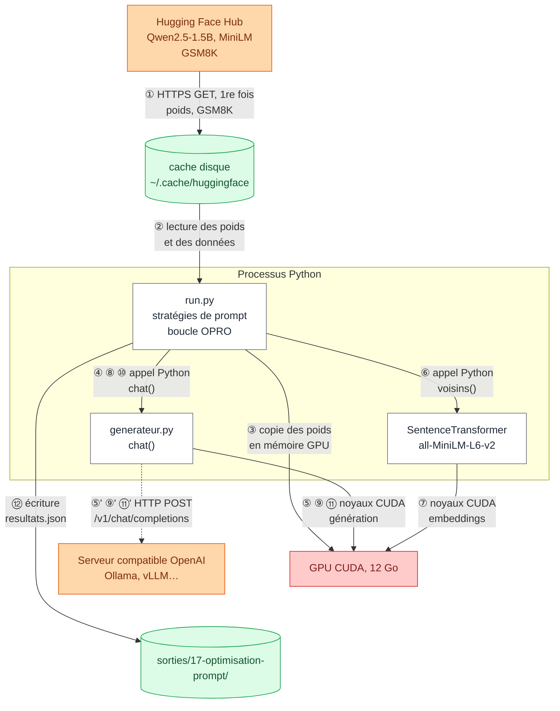

# 17 — Optimisation du prompt (instructions, few-shot, chaîne de raisonnement, optimisation automatique)

> Améliorer les résultats sans toucher au modèle, en cherchant **systématiquement** la meilleure façon de le solliciter, mesurée sur un jeu de validation.

| Regroupe | Modifie | Local 12 Go | Test `--quick` |
|---|---|---|---|
| Zero-shot, instruction système, chain-of-thought, few-shot (aléatoire ou par similarité, KATE), optimisation automatique d'instruction (APE, OPRO), DSPy (MIPROv2) en infra | Rien : seulement l'entrée du modèle | ✅ (inférence seule, ou API) | ✅ |

## Principe

Schéma : [docs/schemas-methodes.md](../docs/schemas-methodes.md#m17) (ce que la méthode ajoute ou modifie dans le transformer).

Le prompt est un hyperparamètre. On le traite comme tel : plusieurs candidats, un **jeu de validation** pour choisir, un **jeu de test** séparé pour confirmer (sinon on surapprend le prompt).

| `strategie` | Ce qui change |
|---|---|
| `zero_shot` | La question seule |
| `instruction` | Un message système décrit la tâche et le format attendu |
| `cot` | On demande un raisonnement étape par étape avant la réponse |
| `few_shot` | k exemples question/réponse tirés au hasard, en tours de dialogue |
| `few_shot_similaires` | Les k exemples **les plus proches** de la question, trouvés par embeddings. Souvent nettement meilleur que l'aléatoire |
| `optimisation` | Boucle **OPRO** : un LLM « optimiseur » voit les instructions déjà essayées et leur score, en propose de nouvelles, qu'on évalue ; on garde la meilleure |

À plus grande échelle, **DSPy / MIPROv2** ([`infra/dspy_miprov2.py`](infra/dspy_miprov2.py)) optimise conjointement les instructions et le choix des exemples d'un programme LLM entier (plusieurs étapes, RAG, outils).

Toutes les méthodes des dossiers 17 à 20 passent par [`commun/generateur.py`](../commun/generateur.py). Il utilise indifféremment un modèle local ou **une API compatible OpenAI** : ces méthodes s'appliquent aussi aux modèles fermés.

## Modèles concernés

| Type de modèle | Applicable | Remarques |
|---|---|---|
| LLM instruct / chat, local ou via API (GPT, Claude, Gemini, Mistral…) | ✅ cas principal | `modele.api_base` pour une API |
| LLM de base | ✅ | Le few-shot est alors *la* façon de spécifier la tâche. Pas d'instruction système |
| Encodeurs / classifieurs | ⚠️ | Prompts « à trous » (PET), peu utilisés aujourd'hui |
| Multimodal (VLM) | ✅ | Mêmes stratégies avec des images dans les messages |
| Diffusion (texte → image) | ✅ | Réécriture et optimisation de prompts (LLM rewriter, « prompt expansion ») |
| Tout modèle fermé | ✅ | La seule famille de méthodes avec RAG, outils et calcul à l'inférence (18 à 20) |

## Quand l'utiliser

- ✅ **Toujours en premier**, avant tout fine-tuning : c'est gratuit, immédiat et réversible.
- ✅ Modèles fermés, pas d'accès aux poids.
- ✅ Tâches qui changent souvent : un prompt se met à jour en quelques minutes.
- ⚠️ Plafond : le prompting ne donne pas au modèle une compétence qu'il n'a pas, et un long prompt coûte à chaque appel. Si le few-shot demande 20 exemples, un SFT ou une LoRA ([02](../02-fine-tuning-supervise), [03](../03-peft)) devient rentable.

## Composants de l'exemple



`make run EX=17` vérifie les prérequis (modules, GPU), puis lance `run.py` dans l'environnement `.venv`. Le script lit `config.yaml` (modèle, stratégies comparées, nombre d'exemples, réglages de l'optimisation, données) et charge GSM8K depuis le Hugging Face Hub : 500 problèmes d'entraînement, qui servent seulement de réserve d'exemples pour le few-shot, et 260 problèmes de test, coupés en 60 de validation et 200 de test. Aucun poids n'est modifié. Le modèle est chargé en local par défaut ; avec `make run EX=17 API=http://localhost:11434/v1 MODELE=qwen3:8b`, il est servi par une API compatible OpenAI.

- **① Téléchargement.** Au premier lancement, les poids de Qwen2.5-1.5B-Instruct et de l'encodeur all-MiniLM-L6-v2, ainsi que le jeu `openai/gsm8k`, sont téléchargés depuis le Hugging Face Hub, par HTTPS.
- **② Lecture.** Tout est rangé dans le cache `~/.cache/huggingface` ; les lancements suivants le relisent sur le disque, sans réseau.
- **③ Copie sur le GPU.** `commun/generateur.py` charge le modèle avec transformers et copie ses poids en bf16 dans la mémoire du GPU. En mode API, cette étape n'a pas lieu.
- **④ Stratégies simples.** Pour `zero_shot`, `instruction`, `cot` et `few_shot`, `run.py` construit une conversation par question (consigne système, 4 exemples tirés au hasard pour `few_shot`, « Let's think step by step » pour `cot`) et appelle `chat()`, d'abord sur la validation, puis sur le test.
- **⑤ Génération sur le GPU.** Les conversations passent par lots de 16 ; le modèle produit chaque réponse token par token, en décodage glouton, jusqu'à 384 tokens. Le nombre final de chaque réponse est comparé au résultat attendu.
- **⑤' Génération par API.** Quand `modele.api_base` est renseigné, `chat()` envoie chaque conversation au serveur par HTTP POST sur `/v1/chat/completions` à la place de ⑤ (de même pour ⑨ et ⑪) ; c'est le serveur qui génère.
- **⑥ Recherche d'exemples proches.** Pour `few_shot_similaires`, `run.py` charge all-MiniLM-L6-v2 avec sentence-transformers et encode les 500 problèmes d'entraînement et les questions.
- **⑦ Embeddings sur le GPU.** Chaque texte devient un vecteur normalisé ; le produit scalaire donne la similarité cosinus, et les 4 exemples les plus proches de chaque question sont retenus.
- **⑧ Few-shot par similarité.** Les conversations sont reconstruites avec ces 4 exemples, puis envoyées à `chat()`.
- **⑨ Génération sur le GPU**, avec le même décodage qu'en ⑤.
- **⑩ Optimisation de l'instruction.** Boucle de type OPRO : 4 tours où le modèle lui-même (ou `optimiseur.nom` s'il est renseigné) reçoit les instructions déjà essayées avec leur score et en propose 4 nouvelles, échantillonnées à température 1,0 ; chaque proposition est notée sur les 60 questions de validation. La meilleure est ensuite mesurée sur le test.
- **⑪ Génération sur le GPU**, pour les propositions comme pour les mesures.
- **⑫ Écriture du rapport** dans `sorties/17-optimisation-prompt/resultats.json`, avec le même tableau affiché dans le terminal.

**Ce que fait le GPU.** Il n'y a aucun entraînement : seulement des passes avant. En génération (⑤, ⑨, ⑪), il y a une passe avant par token produit, accélérée par un cache des clés et des valeurs déjà calculées. Pour les embeddings (⑦), l'encodeur fait une seule passe avant par texte. En mode API, le GPU local ne sert plus au LLM : c'est le serveur qui génère, et seul l'encodeur de ⑦ tourne encore sur la machine.

**Ce qui est écrit.**

| Fichier | Contenu |
|---|---|
| `resultats.json` | Pour chaque stratégie : exactitude en validation et en test, début de la première réponse de test ; stratégie la meilleure en validation ; instruction retenue par l'optimisation ; historique de toutes les instructions essayées avec leur score de validation |
| `config_effective.yaml` | La configuration réellement utilisée, surcharges `SET` comprises |

## Utilisation

```bash
python run.py --quick
python run.py                                                      # 6 stratégies, Qwen2.5-1.5B-Instruct
python run.py --set modele.api_base=http://localhost:11434/v1 --set modele.nom=qwen3:8b       # modèle servi par Ollama
python run.py --set optimiseur.nom=Qwen/Qwen2.5-7B-Instruct         # un optimiseur plus fort
python run.py --set "strategies=[few_shot, few_shot_similaires]" --set k_exemples=8
```

## Ce que fait l'exemple

1. Mesure chaque stratégie sur 60 questions de validation, puis sur 200 questions de test.
2. Pour `optimisation` : 4 tours de 4 propositions d'instruction, chacune évaluée sur la validation.
3. Rapport : exactitude validation et test par stratégie, meilleure stratégie selon la validation, instruction trouvée et historique complet de l'optimisation.

## Paramètres principaux (`config.yaml`)

| Clé | Rôle |
|---|---|
| `modele.nom`, `modele.api_base` | Modèle local ou API |
| `optimiseur.*` | Modèle qui propose des instructions |
| `strategies` | Stratégies comparées |
| `k_exemples`, `embeddings` | Few-shot |
| `optimisation.tours`, `candidats` | Budget de recherche |
| `evaluation.n_dev`, `n_test` | Validation (choix) et test (confirmation) |

## Grosse infra

- Rien à entraîner : l'infra sert à **servir** un gros modèle (vLLM, tensor parallel) et à évaluer beaucoup de candidats en parallèle.
- [`infra/config.yaml`](infra/config.yaml) : Qwen2.5-72B servi sur 4 GPU, GSM8K, 10 tours × 8 candidats.
- [`infra/dspy_miprov2.py`](infra/dspy_miprov2.py) : DSPy MIPROv2 sur le même modèle servi (32 appels parallèles).
- [`infra/lancer.sh`](infra/lancer.sh) : démarrage du serveur, puis les deux optimisations.

## Pièges

- **Surapprentissage du prompt** : toujours un jeu de test séparé.
- **Sensibilité** : l'ordre des exemples, le format et même les espaces changent les scores. Comparer sur assez d'exemples (≥ 200) pour que les écarts soient significatifs.
- **CoT et petits modèles** : le raisonnement explicite aide surtout au-delà de quelques milliards de paramètres.
- **Modèles de raisonnement** (o1, R1, Qwen3 thinking) : ils raisonnent déjà. Le CoT et le few-shot de raisonnement peuvent *dégrader* leurs résultats.

## Références

- Brown et al., *Language Models are Few-Shot Learners* (2020) · Wei et al., *Chain-of-Thought Prompting* (2022) · Kojima et al., *Zero-shot reasoners* (2022)
- Liu et al., *What Makes Good In-Context Examples for GPT-3? (KATE)* (2021) · Zhou et al., *APE* (2022) · Yang et al., *OPRO* (2023)
- Khattab et al., *DSPy* (2023) · Opsahl-Ong et al., *MIPROv2* (2024)
