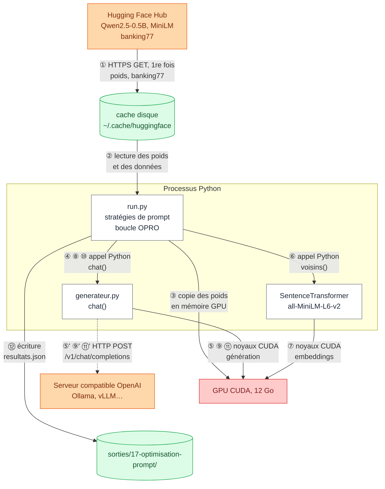

# 17 — Optimisation du prompt (instructions, few-shot, chaîne de raisonnement, optimisation automatique)

> Améliorer les résultats sans toucher au modèle, en cherchant **systématiquement** la meilleure façon de le solliciter, mesurée sur un jeu de validation.

| Regroupe | Modifie | Local 12 Go | Test `--quick` |
|---|---|---|---|
| Zero-shot, instruction système, chain-of-thought, few-shot (aléatoire ou par similarité, KATE), optimisation automatique d'instruction (APE, OPRO), DSPy (MIPROv2) en infra | Rien : seulement l'entrée du modèle | ✅ (inférence seule, ou API) | ✅ |

## Principe

Schéma : [docs/schemas-methodes.md](../docs/schemas-methodes.md#m17) (ce que la méthode ajoute ou modifie dans le transformer).

Le prompt est un hyperparamètre. On le traite comme tel : plusieurs candidats, un **jeu de validation** pour choisir, un **jeu de test** séparé pour confirmer (sinon on surapprend le prompt).

| `strategie` | Ce qui change |
|---|---|
| `zero_shot` | La question seule |
| `instruction` | Un message système décrit la tâche et le format attendu |
| `cot` | On demande un raisonnement étape par étape avant la réponse |
| `few_shot` | k exemples question/réponse tirés au hasard, en tours de dialogue |
| `few_shot_similaires` | Les k exemples **les plus proches** de la question, trouvés par embeddings. Souvent nettement meilleur que l'aléatoire |
| `optimisation` | Boucle **OPRO** : un LLM « optimiseur » voit les instructions déjà essayées et leur score, en propose de nouvelles, qu'on évalue ; on garde la meilleure |

À plus grande échelle, **DSPy / MIPROv2** ([`infra/dspy_miprov2.py`](infra/dspy_miprov2.py)) optimise conjointement les instructions et le choix des exemples d'un programme LLM entier (plusieurs étapes, RAG, outils).

Toutes les méthodes des dossiers 17 à 20 passent par [`commun/generateur.py`](../commun/generateur.py). Il utilise indifféremment un modèle local ou **une API compatible OpenAI** : ces méthodes s'appliquent aussi aux modèles fermés.

## Modèles concernés

| Type de modèle | Exemples de modèles | Applicable | Remarques |
|---|---|---|---|
| LLM instruct / chat, local ou via API | GPT, Claude, Gemini, Mistral | ✅ cas principal | `modele.api_base` pour une API |
| LLM de base | Llama-3.1-8B, Qwen2.5-7B, Mistral-7B (versions de base) | ✅ | Le few-shot est alors *la* façon de spécifier la tâche. Pas d'instruction système |
| Encodeurs / classifieurs | BERT, RoBERTa, ModernBERT | ⚠️ | Prompts « à trous » (PET), peu utilisés aujourd'hui |
| Multimodal (VLM) | Qwen2.5-VL, GPT-4o | ✅ | Mêmes stratégies avec des images dans les messages |
| Diffusion (texte → image) | Stable Diffusion, SDXL, Flux | ✅ | Réécriture et optimisation de prompts (LLM rewriter, « prompt expansion ») |
| Tout modèle fermé | GPT-4o, Claude, Gemini | ✅ | La seule famille de méthodes avec RAG, outils et calcul à l'inférence (18 à 20) |

## Quand l'utiliser

- ✅ **Toujours en premier**, avant tout fine-tuning : c'est gratuit, immédiat et réversible.
- ✅ Modèles fermés, pas d'accès aux poids.
- ✅ Tâches qui changent souvent : un prompt se met à jour en quelques minutes.
- ⚠️ Plafond : le prompting ne donne pas au modèle une compétence qu'il n'a pas, et un long prompt coûte à chaque appel. Si le few-shot demande 20 exemples, un SFT ou une LoRA ([DATA02](../02-fine-tuning-supervise), [DATA03](../03-peft)) devient rentable.

## Composants de l'exemple



`make run EX=EXEC17` vérifie les prérequis (modules, GPU), puis lance `run.py` dans l'environnement `.venv`. Le script lit `config.yaml` (modèle, stratégies comparées, nombre d'exemples, réglages de l'optimisation, données). La tâche est celle de [DATA02](../02-fine-tuning-supervise) et [DATA03](../03-peft) : router les messages de clients d'une banque vers l'une de 77 intentions (banking77), la liste des intentions figurant dans le message système de toutes les stratégies. Les 10 003 messages d'entraînement donnent 9 803 exemples pour le few-shot et 200 messages de validation, qui servent à choisir ; les 3 080 messages de test servent à confirmer. Aucun poids n'est modifié. Le modèle est chargé en local par défaut ; avec `make run EX=EXEC17 API=http://localhost:11434/v1 MODELE=qwen3:8b`, il est servi par une API compatible OpenAI.

- **① Téléchargement.** Au premier lancement, les poids de Qwen2.5-0.5B-Instruct et de l'encodeur all-MiniLM-L6-v2, ainsi que le jeu banking77, sont téléchargés depuis le Hugging Face Hub, par HTTPS.
- **② Lecture.** Tout est rangé dans le cache `~/.cache/huggingface` ; les lancements suivants le relisent sur le disque, sans réseau.
- **③ Copie sur le GPU.** `commun/generateur.py` charge le modèle avec transformers et copie ses poids en bf16 dans la mémoire du GPU. En mode API, cette étape n'a pas lieu.
- **④ Stratégies simples.** Pour `zero_shot`, `instruction` et `few_shot`, `run.py` construit une conversation par message : la consigne (`prompts.instruction`) pour `instruction`, 8 exemples message → intention tirés au hasard pour `few_shot`, en tours de dialogue. Il appelle `chat()`, d'abord sur la validation, puis sur le test.
- **⑤ Génération sur le GPU.** Les conversations passent par lots (batches) de 32 ; le modèle produit au plus 16 tokens en décodage glouton, dont la première ligne doit être l'intention attendue.
- **⑤' Génération par API.** Quand `modele.api_base` est renseigné, `chat()` envoie chaque conversation au serveur par HTTP POST sur `/v1/chat/completions` à la place de ⑤ (de même pour ⑨ et ⑪) ; c'est le serveur qui génère.
- **⑥ Recherche d'exemples proches.** Pour `few_shot_similaires`, `run.py` charge all-MiniLM-L6-v2 avec sentence-transformers et encode les 9 803 exemples et les messages à classer.
- **⑦ Embeddings sur le GPU.** Chaque texte devient un vecteur normalisé ; le produit scalaire donne la similarité cosinus, et les 8 exemples les plus proches de chaque message sont retenus. Leurs intentions servent aussi au témoin (baseline) : un vote majoritaire, sans LLM.
- **⑧ Few-shot par similarité.** Les conversations sont reconstruites avec ces 8 exemples, puis envoyées à `chat()`.
- **⑨ Génération sur le GPU**, avec le même décodage qu'en ⑤.
- **⑩ Optimisation de l'instruction.** Boucle de type OPRO : 4 tours où le modèle lui-même (ou `optimiseur.nom` s'il est renseigné) reçoit les instructions déjà essayées avec leur score et en propose 4 nouvelles, échantillonnées à température 1,0 ; chaque proposition est notée sur les 200 messages de validation. La meilleure est ensuite mesurée sur le test.
- **⑪ Génération sur le GPU**, pour les propositions comme pour les mesures.
- **⑫ Écriture du rapport** dans `sorties/17-optimisation-prompt/resultats.json`, avec le même tableau affiché dans le terminal.

**Ce que fait le GPU.** Il n'y a aucun entraînement : seulement des passes avant. En génération (⑤, ⑨, ⑪), il y a une passe avant (forward pass) par token produit, accélérée par un cache des clés et des valeurs déjà calculées. Pour les embeddings (⑦), l'encodeur fait une seule passe avant par texte. En mode API, le GPU local ne sert plus au LLM : c'est le serveur qui génère, et seul l'encodeur de ⑦ tourne encore sur la machine.

**Ce qui est écrit.**

| Fichier | Contenu |
|---|---|
| `resultats.json` | Pour chaque stratégie et pour le témoin des voisins : exactitude en validation et en test, avec intervalle à 95 % et réponse de chaque message ; comparaisons appariées avec le zéro-shot ; stratégie la meilleure en validation ; instruction retenue par l'optimisation ; historique de toutes les instructions essayées avec leur score de validation |
| `config_effective.yaml` | La configuration réellement utilisée, surcharges `SET` comprises |

## Utilisation

```bash
python run.py --quick
python run.py                                                      # 5 stratégies et le témoin, Qwen2.5-0.5B-Instruct, banking77, ~8 min
python run.py --set modele.api_base=http://localhost:11434/v1 --set modele.nom=qwen3:8b       # modèle servi par Ollama
python run.py --set optimiseur.nom=Qwen/Qwen2.5-7B-Instruct         # un optimiseur plus fort
python run.py --set "strategies=[few_shot, few_shot_similaires]" --set k_exemples=4
# Raisonnement mathématique (GSM8K), où la consigne et le raisonnement pas à pas comptent davantage :
python run.py --set donnees.source=gsm8k --set donnees.n_train=500 --set evaluation.mode=nombre \
  --set evaluation.dev_depuis_train=false --set evaluation.n_dev=60 --set evaluation.n_test=200 \
  --set evaluation.max_new_tokens=384 --set evaluation.systeme=null --set k_exemples=4 \
  --set "strategies=[zero_shot, instruction, cot, few_shot, few_shot_similaires, optimisation]" \
  --set "prompts.instruction=Solve the problem. Show the intermediate calculations, then finish with 'Answer: <number>'." \
  --set "optimisation.tache=solve math word problems"
```

## Ce que fait l'exemple

**Le besoin** : le même routage de messages bancaires vers 77 intentions qu'en [DATA02](../02-fine-tuning-supervise), sans rien entraîner. Jusqu'où va-t-on en ne changeant que le prompt ?

**Résultats** (Qwen2.5-0.5B-Instruct, RTX 5070 Ti Laptop ; consigne optimisée sur 500 messages de validation, mesure sur 3 080 messages de test jamais vus ; 3 graines pour la boucle OPRO, les autres stratégies sont déterministes) :

| Stratégie | Exactitude | Écart apparié avec le zéro-shot |
|---|---|---|
| `zero_shot` : la liste des intentions seule | 0,229 | |
| `instruction` : consigne rédigée à la main | 0,225 | −0,004, non significatif |
| `optimisation` : consigne trouvée par OPRO | 0,259 ± 0,008 | +0,030 (de +0,021 à +0,036 selon la graine), net sur chacune |
| `few_shot` : 8 exemples au hasard | 0,311 ± 0,003 | +0,083 |
| **`few_shot_similaires` : les 8 exemples les plus proches** | **0,813** | **+0,584** |
| Témoin sans LLM : vote des 8 exemples les plus proches | 0,920 | +0,691 |

La stratégie retenue sur la validation est `few_shot_similaires` sur chacune des 3 graines. La consigne OPRO dépasse la consigne rédigée à la main de +0,034 (de +0,025 à +0,040 selon la graine, p < 10⁻³ sur chacune), mais sur la validation (500 messages) l'écart n'est pas significatif (+0,022, p ≈ 0,2). Les consignes trouvées par OPRO sont peu cohérentes (« Raise the question to direct the bank towards the correct intent classification… »).

Pour comparaison, sur les mêmes messages : SFT complet 0,904 ([DATA02](../02-fine-tuning-supervise)), LoRA 0,891 ([DATA03](../03-peft)), encodeur ModernBERT fine-tuné 0,937.

**Ce qu'on en retient.**

- **La consigne compte peu ici** : rédigée à la main, elle ne change rien ; optimisée par OPRO, elle ajoute 3 points (0,225 → 0,259), net sur 3 graines mais très loin des exemples bien choisis. Le modèle sait déjà ce qu'on attend ; ce qui lui manque, c'est de savoir à quoi ressemble chaque intention.
- **Les exemples choisis par similarité changent tout** : 0,229 → 0,816, sans entraînement, en montrant au modèle des messages proches avec leur intention. C'est la stratégie de prompt à essayer en premier dès qu'on dispose d'exemples annotés.
- **Mais le témoin montre d'où vient le gain** : le simple vote des intentions de ces 8 exemples, sans LLM, fait mieux (0,920). Le gain vient de la recherche des bons exemples, et le petit LLM en perd une partie. Pour une classification pure avec des exemples annotés, un classifieur (voisins, encodeur fine-tuné) est le bon outil ; le prompt d'un LLM se justifie quand la sortie doit être rédigée, ou quand on n'a pas d'exemples.

## Paramètres principaux (`config.yaml`)

| Clé | Rôle |
|---|---|
| `modele.nom`, `modele.api_base` | Modèle local ou API |
| `optimiseur.*` | Modèle qui propose des instructions |
| `strategies` | Stratégies comparées |
| `k_exemples`, `embeddings` | Few-shot : nombre d'exemples, encodeur qui trouve les plus proches |
| `prompts.instruction`, `prompts.cot` | Consigne de départ, et phrase ajoutée par la stratégie `cot` |
| `optimisation.tache` | Description de la tâche donnée à l'optimiseur OPRO |
| `optimisation.tours`, `candidats` | Budget de recherche |
| `evaluation.n_dev`, `n_test`, `dev_depuis_train` | Validation (choix) et test (confirmation) ; validation prise dans l'entraînement pour garder le test entier |
| `evaluation.systeme` | Cadre commun à toutes les stratégies ; `{intentions}` y est remplacé par la liste des intentions |

## Grosse infra

- Rien à entraîner : l'infra sert à **servir** un gros modèle (vLLM, tensor parallel) et à évaluer beaucoup de candidats en parallèle.
- [`infra/config.yaml`](infra/config.yaml) : Qwen2.5-72B servi sur 4 GPU, GSM8K, 10 tours × 8 candidats.
- [`infra/dspy_miprov2.py`](infra/dspy_miprov2.py) : DSPy MIPROv2 sur le même modèle servi (32 appels parallèles).
- [`infra/lancer.sh`](infra/lancer.sh) : démarrage du serveur, puis les deux optimisations.

## Pièges

- **Surapprentissage du prompt** : toujours un jeu de test séparé.
- **Un témoin sans LLM** : quand les exemples sont choisis par similarité, comparer au vote de ces mêmes exemples. Ici il fait mieux que le LLM.
- **Sensibilité** : l'ordre des exemples, le format et même les espaces changent les scores. Comparer sur assez d'exemples (≥ 200) pour que les écarts soient significatifs.
- **CoT et petits modèles** : le raisonnement explicite aide surtout au-delà de quelques milliards de paramètres.
- **Modèles de raisonnement** (o1, R1, Qwen3 thinking) : ils raisonnent déjà. Le CoT et le few-shot de raisonnement peuvent *dégrader* leurs résultats.

## Références

- Brown et al., *Language Models are Few-Shot Learners* (2020) · Wei et al., *Chain-of-Thought Prompting* (2022) · Kojima et al., *Zero-shot reasoners* (2022)
- Liu et al., *What Makes Good In-Context Examples for GPT-3? (KATE)* (2021) · Zhou et al., *APE* (2022) · Yang et al., *OPRO* (2023)
- Khattab et al., *DSPy* (2023) · Opsahl-Ong et al., *MIPROv2* (2024)
