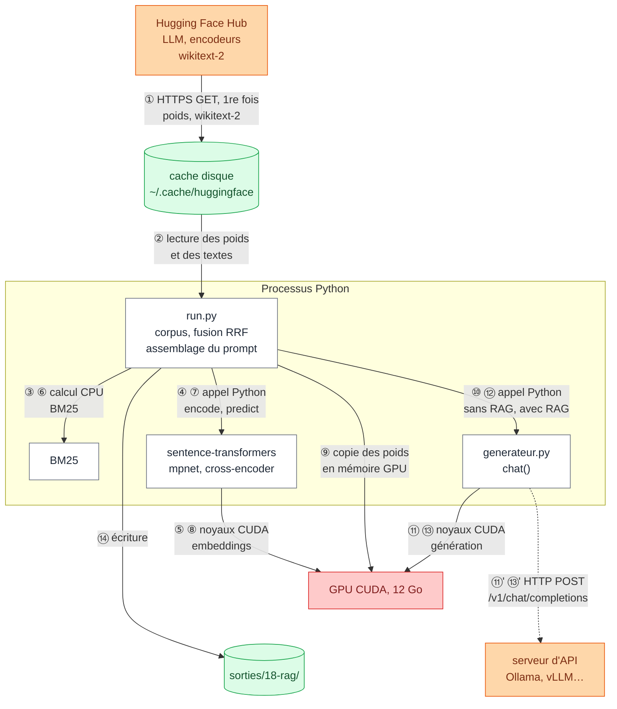

# 18 — RAG (génération augmentée par la recherche)

> Au moment de répondre, chercher les passages pertinents dans une base documentaire et les placer dans le prompt. Le modèle répond à partir de sources à jour, privées et citables.

| Regroupe | Modifie | Local 12 Go | Test `--quick` |
|---|---|---|---|
| Recherche lexicale (BM25), dense (embeddings), hybride (RRF), reranking (cross-encoder) ; en infra : base vectorielle Qdrant, TEI, vLLM | Rien : seulement le contexte fourni | ✅ | ✅ |

## Principe

Schéma : [docs/schemas-methodes.md](../docs/schemas-methodes.md#m18) (ce que la méthode ajoute ou modifie dans le transformer).

```
documents -> découpage en passages -> index (BM25 et/ou vecteurs)
question  -> recherche top-k_candidats -> reranking -> top-k -> prompt « réponds avec ce contexte » -> LLM
```

| Brique | Rôle | Dans l'exemple |
|---|---|---|
| **BM25** | Correspondance de mots, pondérée par leur rareté. Excellent sur les noms propres, codes, termes exacts | Implémenté en ~15 lignes |
| **Dense** | Similarité sémantique entre embeddings. Trouve les paraphrases, synonymes, autres langues | sentence-transformers |
| **Hybride (RRF)** | Fusion des deux classements par rang. Le meilleur des deux, sans calibrer les scores | `fusion_rrf` |
| **Reranker** | Un cross-encoder lit chaque couple (question, passage) : plus précis, plus lent. Appliqué seulement aux candidats | `CrossEncoder` |

Le corpus de test contient les fiches de 50 personnages fictifs, noyées dans 2 000 paragraphes Wikipédia. Le modèle ne peut pas connaître ces personnages : sans RAG, l'exactitude est proche de 0. Les mesures :

- `rappel_a_k` : la bonne fiche est-elle parmi les k passages fournis ? Ça mesure la recherche seule.
- `exactitude` sans et avec RAG : ça mesure la réponse finale.

Cette même base de faits sert au pré-entraînement continu ([DATA01](../01-pre-entrainement-continu)) et au désapprentissage ([EDIT10](../10-desapprentissage)), ce qui permet de comparer directement « mettre la connaissance dans les poids » et « la fournir dans le contexte ».

## Modèles concernés

| Type de modèle | Applicable | Remarques |
|---|---|---|
| Tout LLM instruct, local ou via API | ✅ cas principal | `modele.api_base` pour une API |
| Petits modèles (< 3B) | ✅ | Le RAG compense beaucoup leur manque de connaissances ; ils suivent moins bien la consigne « seulement le contexte » |
| Multimodal | ✅ | RAG sur images et PDF (ColPali, embeddings multimodaux) |
| Encodeurs | ✅ comme briques | Ce sont eux qui font la recherche (embeddings, rerankers) et qu'on fine-tune pour l'améliorer |
| Diffusion | ⚠️ | « Retrieval-augmented diffusion » : images de référence (IP-Adapter), usage de niche |
| Modèles fermés | ✅ | La méthode standard pour brancher des données privées sur GPT, Claude ou Gemini |

## Quand l'utiliser

- ✅ Connaissances **privées, volumineuses ou qui changent** : docs internes, base produit, juridique, support.
- ✅ Besoin de **citer les sources** et de limiter les hallucinations.
- ✅ Mise à jour instantanée : on réindexe, sans réentraîner.
- ⚠️ La qualité dépend d'abord de la recherche : si `rappel_a_k` est bas, aucun LLM ne répondra bien.
- ❌ Pour changer un comportement, un style ou une compétence de raisonnement : c'est le rôle du fine-tuning.

## Composants de l'exemple



`make run EX=EXEC18` vérifie les prérequis (modules, GPU), puis lance `run.py` dans l'environnement `.venv`. Le script lit `config.yaml` (modèle, méthode de recherche, encodeur, reranker, gabarit du prompt, taille du corpus) et construit le corpus : 50 personnages inventés, générés en mémoire, décrits chacun par 4 fiches (200 passages), noyés parmi 2 000 paragraphes Wikipédia sans rapport, tirés de wikitext-2 (2 200 passages au total). Les 200 questions portent sur ces personnages : le modèle ne peut pas connaître les réponses. Aucun poids n'est modifié. Le modèle est chargé en local par défaut ; avec `make run EX=EXEC18 API=http://localhost:11434/v1 MODELE=qwen3:8b`, il est servi par une API compatible OpenAI.

- **① Téléchargement.** Au premier lancement, le jeu `Salesforce/wikitext`, l'encodeur all-mpnet-base-v2, le reranker ms-marco-MiniLM-L-6-v2 et le LLM Qwen2.5-1.5B-Instruct sont téléchargés depuis le Hugging Face Hub, par HTTPS.
- **② Lecture.** Tout est rangé dans le cache `~/.cache/huggingface` ; les lancements suivants le relisent sur le disque, sans réseau. Chaque modèle est lu au moment où il est chargé (④, ⑨).
- **③ Index lexical.** `run.py` découpe les 2 200 passages en mots et calcule, sur le CPU, les statistiques de BM25 : fréquence de chaque mot dans chaque passage, rareté de chaque mot dans le corpus.
- **④ Index dense.** sentence-transformers charge all-mpnet-base-v2 et encode les 2 200 passages, par lots de 64 ; il charge aussi le cross-encoder qui servira au reranking.
- **⑤ Embeddings sur le GPU.** Chaque passage devient un vecteur normalisé, gardé en mémoire GPU.
- **⑥ Recherche lexicale.** Pour chaque question, BM25 renvoie les 20 passages les mieux notés.
- **⑦ Recherche dense et reranking.** La question est encodée et comparée aux 2 200 vecteurs (similarité cosinus) : 20 autres candidats. Les deux listes sont fusionnées par rang (Reciprocal Rank Fusion, constante 60), puis le cross-encoder note chaque couple question-passage ; les 3 meilleurs passages sont gardés. Le rappel mesure la part des questions dont au moins un de ces 3 passages parle du bon personnage.
- **⑧ Embeddings et reranking sur le GPU** : encodage de la question, puis une passe avant du cross-encoder par couple question-passage.
- **⑨ Copie du LLM sur le GPU.** `commun/generateur.py` charge Qwen2.5-1.5B-Instruct avec transformers et copie ses poids en bf16 dans la mémoire du GPU. En mode API, cette étape n'a pas lieu.
- **⑩ Mesure sans RAG.** Les 200 questions sont posées seules, suivies de « Answer briefly. ».
- **⑪ Génération sur le GPU.** Par lots de 16, en décodage glouton, jusqu'à 32 tokens. Une réponse est juste si elle contient la valeur attendue.
- **⑪' Génération par API.** Quand `modele.api_base` est renseigné, `chat()` envoie chaque conversation au serveur par HTTP POST sur `/v1/chat/completions` à la place de ⑪ et ⑬ ; c'est le serveur qui génère.
- **⑫ Mesure avec RAG.** Chaque question est placée dans le gabarit de `config.yaml`, avec les 3 passages retrouvés numérotés `[1]` à `[3]` et la consigne de répondre seulement à partir de ce contexte.
- **⑬ Génération sur le GPU**, avec le même décodage qu'en ⑪.
- **⑭ Écriture du rapport** dans `sorties/18-rag/resultats.json`, avec le même tableau affiché dans le terminal.

**Ce que fait le GPU.** Il n'y a aucun entraînement : seulement des passes avant. L'encodeur et le cross-encoder (⑤, ⑧) font une passe avant par texte ou par couple question-passage, sans génération. Le LLM (⑪, ⑬) fait une passe avant par token produit, accélérée par un cache des clés et des valeurs déjà calculées. BM25 et la fusion RRF tournent sur le CPU. En mode API, le GPU local ne sert plus au LLM : c'est le serveur qui génère, et seuls l'encodeur et le reranker tournent encore sur la machine.

**Ce qui est écrit.**

| Fichier | Contenu |
|---|---|
| `resultats.json` | Exactitude sans RAG et avec RAG, début de la première réponse de chaque côté, rappel à 3 de la recherche, méthode de recherche utilisée (`hybride + reranker`) |
| `config_effective.yaml` | La configuration réellement utilisée, surcharges `SET` comprises |

## Utilisation

```bash
python run.py --quick
python run.py                                                   # hybride + reranker, Qwen2.5-1.5B-Instruct
python run.py --set recherche.methode=bm25 --set recherche.reranker=null
python run.py --set recherche.methode=dense
python run.py --set recherche.k=1                               # moins de contexte : observer rappel et exactitude
python run.py --set modele.api_base=http://localhost:11434/v1 --set modele.nom=qwen3:8b
```

## Paramètres principaux (`config.yaml`)

| Clé | Rôle |
|---|---|
| `recherche.methode` | `bm25`, `dense` ou `hybride` |
| `recherche.embeddings`, `reranker` | Modèles de recherche (bge-m3 / bge-reranker-v2-m3 pour le français) |
| `recherche.k`, `k_candidats` | Passages fournis / récupérés avant reranking |
| `gabarit` | Consigne et format du prompt |
| `donnees.n_distracteurs` | Difficulté de la recherche |

## Grosse infra

- [`infra/docker-compose.yml`](infra/docker-compose.yml) : pile de production. **Qdrant** (base vectorielle), **TEI** (embeddings bge-m3 et reranker sur GPU), **vLLM** (Qwen2.5-72B-AWQ sur 2 GPU).
- [`infra/indexer_qdrant.py`](infra/indexer_qdrant.py) : découpage avec chevauchement, embeddings par lots, insertion.
- [`infra/interroger.py`](infra/interroger.py) : recherche → reranking → réponse avec citations `[n]`.
- [`infra/config.yaml`](infra/config.yaml) : `run.py` contre ce LLM servi, avec 500 personnages et 20 000 distracteurs.
- Au-delà : recherche multi-vecteurs (ColBERT), graphes de connaissances (GraphRAG), RAG agentique (le modèle décide quoi chercher : [EXEC19](../19-outils-agents)), fine-tuning des embeddings sur ses propres paires question/passage.

## Pièges

- **Découpage** : trop petit, on perd le contexte ; trop grand, on dilue et on paie des tokens. 300 à 1 000 caractères avec chevauchement est un bon départ.
- **Embeddings anglophones sur du français** : utiliser un modèle multilingue (bge-m3, multilingual-e5).
- **Contexte ignoré ou contredit** : le modèle préfère parfois ses propres connaissances. Consigne explicite, et « dis que tu ne sais pas ».
- **« Lost in the middle »** : les passages au milieu d'un long contexte sont moins utilisés. Garder k petit et bien classé.
- **Évaluer séparément** la recherche (rappel) et la génération (exactitude, fidélité).

## Références

- Lewis et al., *Retrieval-Augmented Generation* (2020) · Robertson & Zaragoza, *BM25* (2009) · Karpukhin et al., *DPR* (2020)
- Cormack et al., *Reciprocal Rank Fusion* (2009) · Nogueira & Cho, *Passage Re-ranking with BERT* (2019)
- Liu et al., *Lost in the Middle* (2023) · Gao et al., *RAG for LLMs: A Survey* (2024)
