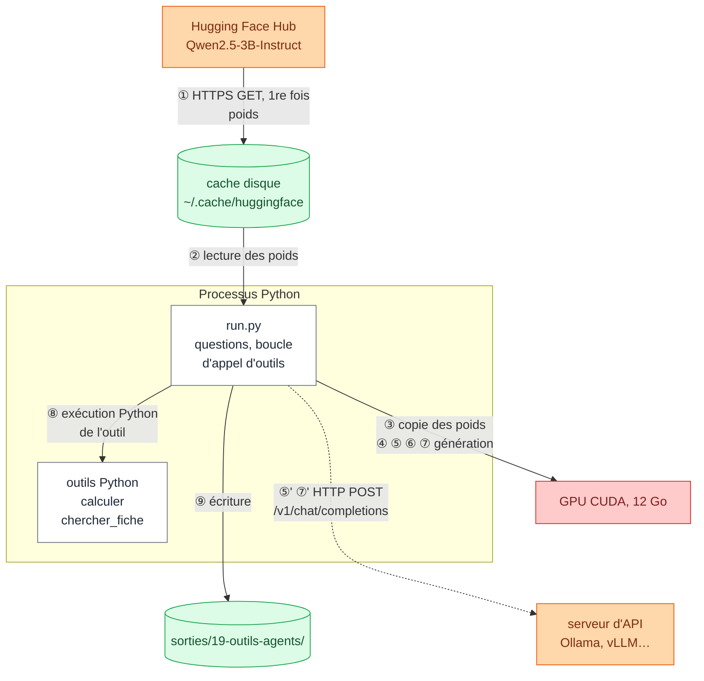

# 19 — Outils et boucle agentique (function calling)

> Donner au modèle des fonctions qu'il peut appeler (calculatrice, recherche, API, exécution de code) et une boucle qui exécute ces appels, puis lui renvoie les résultats jusqu'à la réponse finale.

| Regroupe | Modifie | Local 12 Go | Test `--quick` |
|---|---|---|---|
| Function / tool calling (chat template `tools`, API OpenAI), boucle agentique (ReAct), outils de calcul et de recherche. Voir aussi le dépôt voisin [`../agentique`](../../agentique) | Rien : l'environnement du modèle | ✅ (modèle 3B+) | ✅ |

## Principe

Schéma : [docs/schemas-methodes.md](../docs/schemas-methodes.md#m19) (ce que la méthode ajoute ou modifie dans le transformer).

Un LLM calcule mal de tête, ne connaît pas les données privées ni l'actualité, et ne peut pas agir. Avec des outils, il **délègue** :

```
[système + outils décrits en JSON Schema] + question
  -> modèle : <tool_call>{"name": "calculer", "arguments": {"expression": "347*29+1234"}}</tool_call>
  -> programme : exécute calculer(...) -> "11297"
  -> modèle (avec le résultat) : "... Answer: 11297"
```

- **Local** ([`run.py`](run.py), `boucle_locale`) : `tok.apply_chat_template(messages, tools=[fonctions])`. transformers génère le schéma JSON à partir des signatures et des docstrings, puis on analyse les balises `<tool_call>` (format Hermes, Qwen).
- **API** (`boucle_api`) : protocole OpenAI `tools` / `tool_calls`, compatible vLLM, Ollama et les fournisseurs cloud.

L'exemple pose deux types de questions **impossibles sans outil pour un petit modèle** :

1. un calcul à gros nombres, résolu avec `calculer` ;
2. une question sur un personnage fictif suivie d'un calcul (« combien d'années entre sa naissance et 2024 »), qui demande `chercher_fiche` puis `calculer`.

Mesures : exactitude sans outils, exactitude avec outils, nombre moyen d'appels.

## Modèles concernés

| Type de modèle | Applicable | Remarques |
|---|---|---|
| LLM instruct entraînés au tool calling (Qwen2.5/3, Llama 3.1+, Mistral, Hermes, GLM, DeepSeek) | ✅ cas principal | Le chat template doit accepter `tools` |
| LLM fermés via API (GPT, Claude, Gemini) | ✅ | `modele.api_base` |
| Petits modèles (< 3B) ou sans entraînement aux outils | ⚠️ | Appels mal formés. Solution : SFT sur des traces d'appels ([DATA02](../02-fine-tuning-supervise), [DATA03](../03-peft)) ou génération contrainte (JSON schema) |
| Multimodal | ✅ | Agents « computer use » : captures d'écran en entrée, actions en sortie |
| Encodeurs, diffusion | ❌ | Pas de boucle de décision. Ils peuvent en revanche *être* des outils |

## Quand l'utiliser

- ✅ Calcul exact, données à jour (recherche web, base SQL), actions (envoyer, créer, exécuter).
- ✅ Tâches en plusieurs étapes dont le modèle choisit l'enchaînement.
- ⚠️ Chaque tour relance le modèle, donc latence et coût se multiplient. Limiter `max_tours`.
- ⚠️ **Sécurité** : un outil qui exécute du code ou agit sur un système doit être isolé (bac à sable, liste blanche). L'outil `calculer` de l'exemple évalue un AST restreint, jamais `eval` brut.

## Composants de l'exemple



`make run EX=EXEC19` vérifie les prérequis (modules, GPU), puis lance `run.py` dans l'environnement `.venv`. Le script lit `config.yaml` (modèle, consignes système, nombre maximal de tours, données) et génère en mémoire, sans téléchargement, 30 personnages inventés et 60 questions qui exigent un outil : une sur deux est un gros calcul (`What is a * b + c?`), l'autre demande l'écart entre l'année de naissance d'un personnage et 2024. Deux outils sont de simples fonctions Python : `calculer`, qui évalue une expression arithmétique, et `chercher_fiche`, qui renvoie la fiche d'un personnage. Aucun poids n'est modifié. Le modèle est chargé en local par défaut ; avec `make run EX=EXEC19 API=http://localhost:11434/v1 MODELE=qwen3:8b`, il est servi par une API compatible OpenAI.

- **① Téléchargement.** Au premier lancement, transformers télécharge les poids de Qwen2.5-3B-Instruct depuis le Hugging Face Hub, par HTTPS.
- **② Lecture.** Les poids sont rangés dans le cache `~/.cache/huggingface` ; les lancements suivants les relisent sur le disque, sans réseau.
- **③ Copie sur le GPU.** Les poids sont copiés en bf16 dans la mémoire du GPU (environ 6 Go). En mode API, cette étape n'a pas lieu.
- **④ Mesure sans outils.** `run.py` pose les 60 questions avec une consigne qui ne mentionne aucun outil.
- **⑤ Génération sur le GPU.** Par lots de 16, en décodage glouton, jusqu'à 256 tokens. Le nombre final de chaque réponse est comparé au résultat attendu.
- **⑤' Génération par API.** Quand `modele.api_base` est renseigné, chaque conversation part au serveur par HTTP POST sur `/v1/chat/completions` à la place de ⑤ et ⑦ ; c'est le serveur qui génère. Les outils lui sont décrits en schéma JSON (`tools`) et il renvoie les appels d'outils dans le champ structuré `tool_calls`.
- **⑥ Tour de la boucle agentique.** Pour chaque question, le chat template de Qwen reçoit la liste des outils (nom, description, arguments, tirés des docstrings) et la conversation en cours.
- **⑦ Génération sur le GPU.** Le modèle répond, ou demande un outil en écrivant un bloc `<tool_call>{"name": ..., "arguments": ...}</tool_call>`.
- **⑧ Exécution de l'outil.** `run.py` lit le JSON, appelle la fonction Python correspondante et ajoute son résultat à la conversation, avec le rôle `tool` ; un appel mal formé renvoie l'erreur au modèle. La boucle reprend en ⑥ jusqu'à une réponse sans appel d'outil, dans la limite de 5 tours.
- **⑨ Écriture du rapport** dans `sorties/19-outils-agents/resultats.json`, avec le même tableau affiché dans le terminal.

**Ce que fait le GPU.** Il n'y a aucun entraînement : seulement de la génération (⑤, ⑦), une passe avant par token produit, accélérée par un cache des clés et des valeurs déjà calculées. Dans la boucle agentique, chaque question est traitée seule et chaque tour relance une génération sur toute la conversation, résultats d'outils compris. Les outils eux-mêmes s'exécutent sur le CPU, dans le processus Python. En mode API, le GPU local n'est pas utilisé : c'est le serveur qui génère.

**Ce qui est écrit.**

| Fichier | Contenu |
|---|---|
| `resultats.json` | Exactitude sans outils et avec outils, nombre moyen d'appels d'outils par question, début de la première réponse de chaque côté |
| `config_effective.yaml` | La configuration réellement utilisée, surcharges `SET` comprises |

## Utilisation

```bash
python run.py --quick
python run.py                                                         # Qwen2.5-3B-Instruct, 60 questions
python run.py --set modele.api_base=http://localhost:11434/v1 --set modele.nom=qwen3:8b     # via Ollama
python run.py --set max_tours=2
```

Pour aller plus loin en local (agents complets, Ollama, Hermes Agent, frameworks PydanticAI / smolagents / LangGraph) : le dépôt [`../agentique`](../../agentique).

## Paramètres principaux (`config.yaml`)

| Clé | Rôle |
|---|---|
| `modele.nom`, `api_base` | Modèle local ou servi |
| `systeme` / `systeme_sans_outils` | Consignes des deux conditions |
| `max_tours` | Nombre maximal d'aller-retours outil |
| `donnees.n_entites`, `evaluation.n` | Taille de la base et nombre de questions |

## Grosse infra

- [`infra/lancer.sh`](infra/lancer.sh) : Qwen2.5-72B servi par vLLM avec analyse native des appels (`--enable-auto-tool-choice --tool-call-parser hermes`), puis `run.py` en mode API ([`infra/config.yaml`](infra/config.yaml)).
- **Améliorer le modèle lui-même** pour les outils : SFT sur traces d'appels réussis, puis **RL multi-tours** avec récompense de réussite de la tâche. `GRPOTrainer(tools=..., environment_factory=...)` du dossier [SIGN05](../05-rl-en-ligne), verl, SkyRL.

## Pièges

- **Parser adapté à la famille** : le format des appels varie (Hermes, Llama JSON, Mistral).
- **Descriptions d'outils** : le modèle choisit d'après la docstring. Elle doit être précise et donner un exemple d'argument.
- **Boucles infinies** : borner les tours, détecter les appels répétés à l'identique.
- **Résultats d'outils non fiables** (web) : c'est un vecteur d'injection de prompt. Traiter leur contenu comme des données, jamais comme des instructions.

## Références

- Schick et al., *Toolformer* (2023) · Yao et al., *ReAct* (2022) · Patil et al., *Gorilla* (2023)
- Documentation transformers « Tool use » : https://huggingface.co/docs/transformers/chat_extras
- Dépôt voisin : [`../agentique`](../../agentique)
