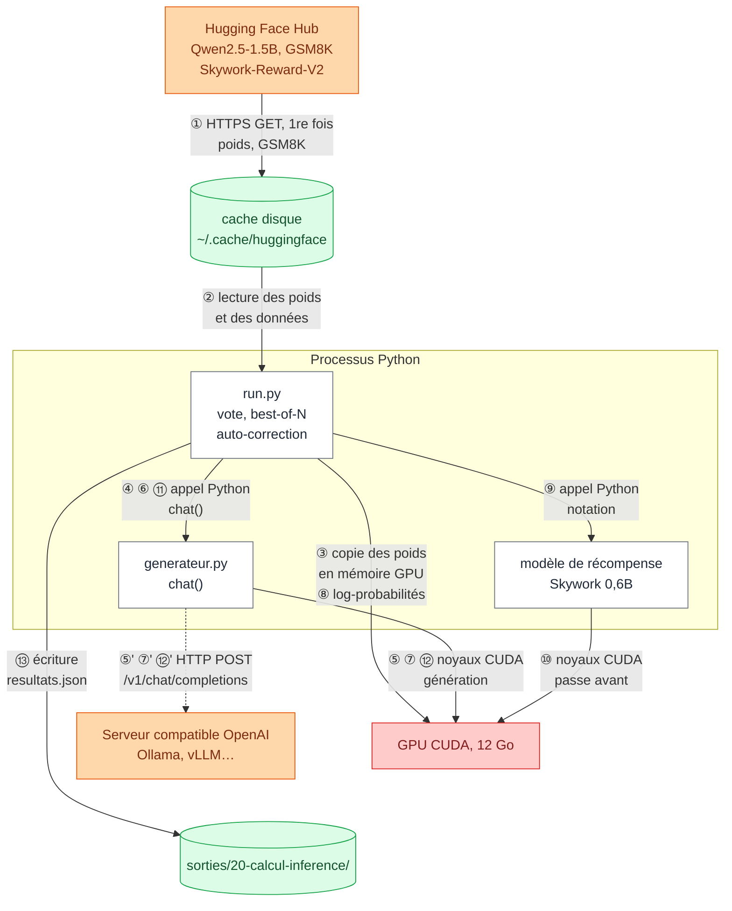

# 20 — Calcul à l'inférence (self-consistency, best-of-N, auto-correction)

> Dépenser plus de calcul **par question** au moment de répondre (plusieurs tentatives, sélection, vérification) plutôt que davantage d'entraînement.

| Regroupe | Modifie | Local 12 Go | Test `--quick` |
|---|---|---|---|
| Self-consistency (vote majoritaire), best-of-N par modèle de récompense, best-of-N par vraisemblance, self-refine (auto-correction), borne oracle pass@N. En infra : recherche guidée par PRM, budget de réflexion des modèles de raisonnement | Rien : la procédure de décodage | ✅ | ✅ |

## Principe

Schéma : [docs/schemas-methodes.md](../docs/schemas-methodes.md#m20) (ce que la méthode ajoute ou modifie dans le transformer).

Un modèle qui se trompe une fois sur deux en génération gloutonne produit souvent la bonne réponse **dans au moins une** de ses N tentatives. Tout l'enjeu est de la **retrouver** :

| Stratégie | Comment on choisit parmi N réponses | Besoin |
|---|---|---|
| `glouton` | Pas de choix : une seule réponse à température 0 | Référence |
| `vote_majoritaire` | La réponse finale la plus fréquente (self-consistency) | Une réponse finale comparable (nombre, choix, code exécutable) |
| `best_of_n_vraisemblance` | Log-probabilité moyenne la plus haute | Accès aux log-probs |
| `best_of_n_recompense` | Score d'un **modèle de récompense** ou d'un vérificateur | Un RM ([05 variante](../05-rl-en-ligne/variantes/modele-recompense)) ou un vérificateur exécutable |
| `auto_correction` | Le modèle relit sa réponse et la corrige (self-refine) | Un modèle capable de se critiquer |
| `oracle_pass_a_N` | *Une* réponse juste existe-t-elle parmi les N ? | Borne supérieure de toute stratégie de sélection |

Les stratégies de sélection partagent **les mêmes N échantillons**. La courbe `vote_majoritaire.courbe` (N = 1, 2, 4, 8, 16) montre la loi d'échelle : le gain rapide des premiers échantillons, puis le plateau.

Les **modèles de raisonnement** (o1/o3, DeepSeek-R1, Qwen3 en mode thinking) intègrent cette idée dans les poids : entraînés par RL ([SIGN05](../05-rl-en-ligne)), ils génèrent eux-mêmes une longue réflexion avec vérifications et retours en arrière. Le « budget de réflexion » (nombre maximal de tokens) devient un réglage de calcul à l'inférence.

## Modèles concernés

| Type de modèle | Exemples de modèles | Applicable | Remarques |
|---|---|---|---|
| LLM instruct, local ou via API | Llama-3.1-8B-Instruct, Qwen2.5-7B-Instruct, Mistral-7B-Instruct | ✅ cas principal | `best_of_n_vraisemblance` demande un modèle local (log-probs) |
| Modèles de raisonnement | DeepSeek-R1, QwQ-32B, Qwen3 | ✅ | Budget de réflexion. Le vote reste utile au-dessus |
| Code | Qwen2.5-Coder, DeepSeek-Coder, StarCoder2 | ✅ très efficace | Sélection par exécution des tests (vérificateur exact) |
| Multimodal | Qwen2.5-VL, LLaVA, Idefics | ✅ | Mêmes stratégies |
| Diffusion | Stable Diffusion, SDXL, Flux | ✅ | Best-of-N d'images notées par un modèle esthétique ou d'alignement (ImageReward, PickScore) ; recherche sur le bruit initial |
| Encodeurs / classifieurs | BERT, RoBERTa, ModernBERT | ⚠️ | Équivalent : test-time augmentation et ensembles |

## Quand l'utiliser

- ✅ Tâches à réponse vérifiable ou comparable (maths, code, QCM, extraction).
- ✅ Quand la latence et le coût par requête sont acceptables : N générations coûtent environ N fois plus.
- ✅ Pour mesurer le **potentiel** d'un modèle avant de l'entraîner : un écart important entre `glouton` et `oracle_pass_a_N` indique un modèle qui gagnera beaucoup avec du RL ou du rejection sampling ([SIGN05](../05-rl-en-ligne), [SIGN07](../07-donnees-synthetiques)).
- ❌ Réponses ouvertes non comparables (rédaction) : le vote ne s'applique pas, il faut un juge ou un RM.

## Composants de l'exemple



`make run EX=EXEC20` vérifie les prérequis (modules, GPU), puis lance `run.py` dans l'environnement `.venv`. Le script lit `config.yaml` (modèle, stratégies, nombre d'échantillons, température, modèle de récompense, données) et charge 100 problèmes du test de GSM8K depuis le Hugging Face Hub. Toutes les stratégies partagent les mêmes 16 échantillons par question, pour être comparées à coût égal. Aucun poids n'est modifié. Le modèle est chargé en local par défaut ; avec `make run EX=EXEC20 API=http://localhost:11434/v1 MODELE=qwen3:8b`, il est servi par une API compatible OpenAI.

- **① Téléchargement.** Au premier lancement, les poids de Qwen2.5-1.5B-Instruct et du modèle de récompense Skywork-Reward-V2-Qwen3-0.6B, ainsi que le jeu `openai/gsm8k`, sont téléchargés depuis le Hugging Face Hub, par HTTPS.
- **② Lecture.** Tout est rangé dans le cache `~/.cache/huggingface` ; les lancements suivants le relisent sur le disque, sans réseau.
- **③ Copie sur le GPU.** `commun/generateur.py` charge le modèle avec transformers et copie ses poids en bf16 dans la mémoire du GPU. En mode API, cette étape n'a pas lieu.
- **④ Référence gloutonne.** `run.py` pose les 100 problèmes, suivis de « Think step by step and end with 'Answer: <number>'. ».
- **⑤ Génération sur le GPU.** Par lots (batches) de 16, en décodage glouton, jusqu'à 384 tokens : 100 générations.
- **⑤' Génération par API.** Quand `modele.api_base` est renseigné, `chat()` envoie chaque conversation au serveur par HTTP POST sur `/v1/chat/completions` à la place de ⑤, ⑦ et ⑫ ; c'est le serveur qui génère. Si le serveur ignore le paramètre `n` (Ollama), les échantillons sont demandés par appels successifs.
- **⑥ Échantillonnage.** Les mêmes problèmes sont reposés avec 16 réponses par question, à température 0,8.
- **⑦ Génération sur le GPU** : 1 600 générations. Sur ces échantillons, `run.py` calcule sur le CPU le vote majoritaire (le nombre final le plus fréquent) pour N = 1, 2, 4, 8 et 16, et la borne oracle : au moins un des 16 échantillons est juste.
- **⑧ Best-of-N par vraisemblance.** Pour chaque échantillon, une passe avant (forward pass) du LLM calcule la log-probabilité de la réponse sachant la question ; l'échantillon de meilleure log-probabilité moyenne par token est retenu. Cette stratégie demande les poids en local : elle est sautée en mode API.
- **⑨ Best-of-N par modèle de récompense.** `run.py` charge Skywork-Reward-V2-Qwen3-0.6B, qui donne un score à chaque couple question-réponse ; l'échantillon le mieux noté est retenu.
- **⑩ Notation sur le GPU** : une passe avant du modèle de récompense par question, sur ses 16 échantillons, textes coupés à 1 024 tokens. Ce modèle tourne sur le GPU local, y compris en mode API.
- **⑪ Auto-correction.** Chaque réponse gloutonne est renvoyée au modèle avec la consigne de vérifier chaque étape et de corriger l'erreur s'il y en a une, en 1 tour.
- **⑫ Génération sur le GPU**, avec le même décodage qu'en ⑤ : 100 générations de plus.
- **⑬ Écriture du rapport** dans `sorties/20-calcul-inference/resultats.json`, avec le même tableau affiché dans le terminal.

**Ce que fait le GPU.** Il n'y a aucun entraînement : seulement des passes avant. En génération (⑤, ⑦, ⑫), il y a une passe avant par token produit, accélérée par un cache des clés et des valeurs déjà calculées ; en ⑦, chaque lot de 16 questions produit 256 réponses en parallèle. Le calcul des log-probabilités (⑧) et la notation (⑩) font une seule passe avant sur un texte déjà écrit, sans génération. En mode API, le GPU local ne sert plus au LLM : c'est le serveur qui génère, et seul le modèle de récompense tourne encore sur la machine.

**Ce qui est écrit.**

| Fichier | Contenu |
|---|---|
| `resultats.json` | Pour chaque stratégie (glouton, vote majoritaire, best-of-N par vraisemblance, best-of-N par récompense, auto-correction) : exactitude, et nombre de générations pour le glouton, le vote et l'auto-correction ; courbe d'exactitude du vote en fonction de N ; borne oracle pass@16 ; nom du modèle de récompense |
| `config_effective.yaml` | La configuration réellement utilisée, surcharges `SET` comprises |

## Résultats

Qwen2.5-1.5B-Instruct, GSM8K, 500 problèmes de test, 16 réponses échantillonnées par problème (température 0,8), modèle de récompense Skywork 0,6B, 3 graines (`make graines EX=EXEC20 N=3`, 47 minutes par graine) :

| Stratégie | Exactitude | Écart apparié avec le glouton | Générations par 500 problèmes |
|---|---|---|---|
| Glouton (une réponse) | 0,684 | | 500 |
| **Vote majoritaire sur 16 réponses** | **0,795 ± 0,003** | **+0,111** (de +0,108 à +0,114), net | 8 000 (×16) |
| Meilleure réponse par récompense (best-of-16) | 0,767 ± 0,008 | +0,083 (de +0,076 à +0,092), net | 8 000 (×16) |
| Meilleure réponse par vraisemblance | 0,688 ± 0,017 | +0,004, non significatif | 8 000 (×16) |
| Auto-correction (1 tour) | 0,692 | +0,008, non significatif | 1 000 (×2) |
| Borne oracle : au moins une réponse juste sur 16 | 0,923 ± 0,008 | | 8 000 |

Courbe du vote selon le nombre de réponses N (moyenne des 3 graines) : N = 1 : 0,591 ; N = 4 : 0,698 ; N = 8 : 0,756 ; N = 16 : 0,795.

Le calcul à l'inférence paie, à un coût linéaire : le vote majoritaire gagne 11 points avec 16 fois plus de générations, et la courbe ne s'est pas encore aplatie à N = 16. Une seule réponse échantillonnée (0,591) est moins bonne que le glouton (0,684) : il faut environ 4 réponses pour le rattraper. Le départage par vraisemblance ne choisit pas mieux qu'au hasard ; l'auto-correction d'un petit modèle n'apporte rien de net ; la récompense externe aide (+8 points). La borne oracle (0,923) montre qu'une bonne réponse existe presque toujours parmi les 16 : le goulot est la sélection.

## Utilisation

```bash
python run.py --quick
python run.py                                                   # GSM8K, Qwen2.5-1.5B-Instruct, N=16
python run.py --set n_echantillons=32 --set temperature=1.0
python run.py --set modele_recompense=sorties/05-rl-en-ligne--variantes--modele-recompense/modele --set donnees.source=arith
python run.py --set modele.api_base=http://localhost:8000/v1 --set modele.nom=Qwen/Qwen2.5-7B-Instruct --set "strategies=[vote_majoritaire, auto_correction]"
```

## Paramètres principaux (`config.yaml`)

| Clé | Rôle |
|---|---|
| `n_echantillons`, `temperature` | Budget et diversité |
| `strategies` | Stratégies évaluées |
| `modele_recompense` | Pour `best_of_n_recompense` |
| `tours_correction` | Passes d'auto-correction |

## Grosse infra

- La génération domine : **vLLM** en parallélisme de données (`--data-parallel-size 8`, un réplica par GPU) avec cache de préfixe. Les N échantillons d'une même question partagent le prompt.
- [`infra/config.yaml`](infra/config.yaml) : GSM8K complet (1 319 questions), N=64, RM Skywork 8B ; [`infra/lancer.sh`](infra/lancer.sh).
- Recherche guidée par **Process Reward Model** (note chaque étape : beam search, DVTS) : [search-and-learn](https://github.com/huggingface/search-and-learn).

## Pièges

- **Coût** : N=16, c'est 16 fois plus de tokens. Comparer les stratégies à budget égal.
- **Vote sur réponses non normalisées** : « 72 », « 72.0 » et « $72 » doivent compter pareil (voir `extraire_nombre`).
- **Reward hacking à l'inférence** : avec N grand, le best-of-N par RM finit par choisir des réponses qui trompent le RM. Le vote est plus robuste.
- **Auto-correction des petits modèles** : ils « corrigent » souvent une bonne réponse en mauvaise. Mesurer avant d'adopter.

## Références

- Wang et al., *Self-Consistency* (2022) · Cobbe et al., *Training Verifiers (GSM8K)* (2021) · Madaan et al., *Self-Refine* (2023)
- Lightman et al., *Let's Verify Step by Step (PRM)* (2023) · Snell et al., *Scaling LLM Test-Time Compute Optimally* (2024)
- Brown et al., *Large Language Monkeys: Scaling Inference Compute with Repeated Sampling* (2024) · DeepSeek-AI, *DeepSeek-R1* (2025)
