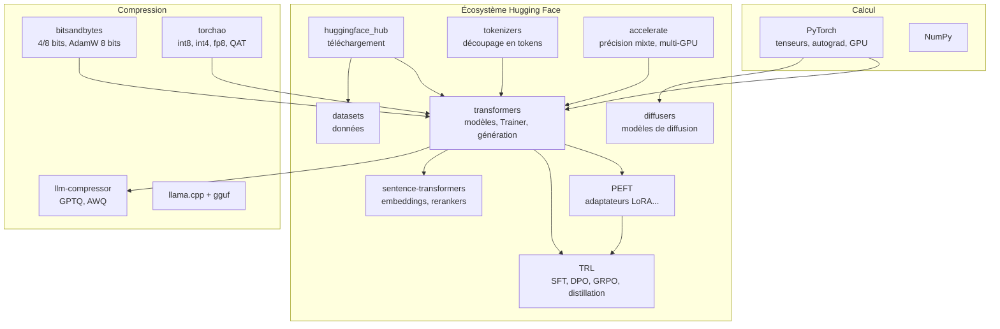

# Bibliothèques Python utilisées

Chaque bibliothèque avec son rôle, les dossiers qui s'en servent et les classes ou fonctions appelées dans le dépôt. Versions de référence : celles de l'environnement de test (voir [README](../README.md#environnement-de-référence)).

## Vue d'ensemble

## Socle de calcul

### PyTorch (`torch` 2.14)

Tenseurs sur GPU, différentiation automatique, optimiseurs. Tout le dépôt repose dessus.

| Classe / fonction | Rôle dans le dépôt |
|---|---|
| `torch.tensor`, `torch.stack`, `torch.cat`, `torch.full`, `torch.zeros_like` | Construire des lots d'identifiants et des masques |
| `torch.no_grad()`, `torch.enable_grad()` | Désactiver ou réactiver le calcul de gradients (mesures, édition ROME) |
| `torch.autocast(device, dtype=torch.bfloat16)` | Précision mixte : poids fp32, calculs en bf16 (boucles manuelles de 03 diffusion et 10) |
| `torch.nn.functional.cross_entropy` | Perte « prochain token » ou de classification |
| `torch.nn.functional.log_softmax`, `softmax`, `kl_div` | Distributions de sortie et divergence KL (distillation 06 et 16, ROME 09) |
| `torch.nn.functional.logsigmoid` | Perte NPO (10) |
| `torch.nn.functional.mse_loss` | Perte de débruitage (03 diffusion) |
| `torch.nn.functional.cosine_similarity` | Influence d'un bloc (16, suppression de couches) |
| `torch.optim.AdamW`, `torch.optim.Adam` | Optimiseurs des boucles écrites à la main (06 encodeur, 10, 09, 03 diffusion) |
| `torch.nn.utils.clip_grad_norm_` | Limiter la norme du gradient |
| `torch.linalg.inv` | Inverse de la covariance des clés (ROME) |
| `torch.outer`, `torch.sign`, `torch.arccos`, `torch.sin` | Mise à jour de rang 1 (ROME), élection de signe (TIES), interpolation sphérique (SLERP) |
| `nn.Module.register_forward_hook`, `register_forward_pre_hook` | Lire ou modifier les activations d'une couche (09, 11, 16) |
| `torch.nn.Linear`, `torch.nn.ModuleList` | Reconstruire des couches (réduction de largeur, duplication de couches) |
| `torch.cuda.memory_allocated`, `synchronize`, `empty_cache` | Mesurer la mémoire et le débit (15) |

### NumPy (`numpy` 2.5)

Calculs simples hors GPU : distance d'édition pour le WER (02 Whisper), images synthétiques (03 diffusion), mélange d'indices (06 encodeur).

## Écosystème Hugging Face

### huggingface_hub (1.31)

| Fonction | Rôle |
|---|---|
| `snapshot_download(repo_id, repo_type=...)` | Télécharger un dépôt de modèle ou de données (images DreamBooth, export GGUF) |

### datasets (5.0)

| Classe / fonction | Rôle |
|---|---|
| `load_dataset(nom, config, split=...)` | Charger un jeu du Hub (wikitext, GSM8K, SST-2, CIFAR-10, MLS, TOFU...) ou des fichiers locaux (`"json"`, `data_files=`) |
| `Dataset.from_list`, `Dataset.from_dict` | Construire un jeu en mémoire à partir des exemples générés |
| `Dataset.map`, `.shuffle`, `.select`, `.rename_column` | Tokeniser, mélanger, sous-échantillonner |
| `Audio(sampling_rate=16000)` | Décoder et rééchantillonner l'audio (02 Whisper, via torchcodec) |

### tokenizers (0.23)

Moteur rapide de découpage en tokens, utilisé à travers `AutoTokenizer`. Utilisé directement en infra :

| Classe | Rôle |
|---|---|
| `Tokenizer` | Entraîner un BPE sur une langue cible puis fusionner ses règles (13, infra) |

### transformers (5.17)

La bibliothèque centrale : architectures, chargement, génération, entraînement.

**Chargement de modèles**

| Classe | Rôle |
|---|---|
| `AutoTokenizer` | Tokenizer adapté à n'importe quel modèle ; `apply_chat_template` formate une conversation, `add_tokens` ajoute des tokens |
| `AddedToken` | Token ajouté avec ses options (espace initial, normalisation) (13) |
| `AutoConfig` | Lire ou modifier la configuration (ex. `rope_parameters` en 12) |
| `AutoModelForCausalLM` | LLM décodeur (LLaMA, Qwen, SmolLM...) : la classe la plus utilisée |
| `AutoModelForSequenceClassification` | Encodeur + tête de classification, et modèle de récompense (05) |
| `AutoModelForMaskedLM` | Encodeur MLM (01 variante) |
| `AutoModelForSeq2SeqLM` | Encodeur-décodeur T5 (02 variante) |
| `AutoModelForImageClassification`, `AutoImageProcessor` | ViT et prétraitement d'images (02 vision) |
| `WhisperForConditionalGeneration`, `WhisperProcessor` | Reconnaissance vocale (02 audio) |
| `MixtralConfig`, `MixtralForCausalLM` | Architecture MoE cible de l'upcycling (14) |
| `BitsAndBytesConfig` | Chargement 4 bits NF4 ou 8 bits (03 QLoRA, 15) |
| `TorchAoConfig` | Chargement quantifié par torchao (15) |
| `pipeline("sentiment-analysis")` | Classifieur prêt à l'emploi pour noter le sentiment (11) |

**Méthodes des modèles**

| Méthode | Rôle |
|---|---|
| `from_pretrained(nom, dtype=..., device_map=...)` | Charger poids et configuration |
| `save_pretrained`, `trainer.save_model` | Sauvegarder |
| `generate(**entrées, max_new_tokens, do_sample, temperature, num_return_sequences)` | Générer du texte token par token avec cache KV |
| `resize_token_embeddings`, `get_input_embeddings`, `get_output_embeddings`, `tie_weights` | Agrandir et initialiser les matrices d'embedding (13, 14) |
| `gradient_checkpointing_enable` | Recalculer les activations au backward pour économiser la mémoire |
| `get_memory_footprint` | Taille des poids en mémoire |

**Entraînement**

| Classe | Rôle |
|---|---|
| `Trainer`, `TrainingArguments` | Boucle d'entraînement standard : lots, accumulation, précision mixte, planification du lr, journalisation |
| `Seq2SeqTrainer`, `Seq2SeqTrainingArguments` | Idem pour encodeur-décodeur (T5, Whisper) |
| `DataCollatorForLanguageModeling(mlm=False / True)` | Lots de texte brut : prochain token (CLM) ou tokens masqués (MLM) |
| `DataCollatorWithPadding`, `DataCollatorForSeq2Seq` | Padding dynamique des lots |
| `TrainerCallback` | Action à chaque pas (16 : réappliquer les masques d'élagage) |
| `utils.get_json_schema` | Schéma JSON d'un outil à partir de sa signature et de sa docstring (19) |

### accelerate (1.15)

Utilisée à travers `Trainer` : placement sur GPU, précision mixte, multi-GPU (FSDP2, DeepSpeed ZeRO). En grosse infra, `accelerate launch --config_file commun/infra/accelerate_fsdp.yaml run.py` lance le même script sur plusieurs GPU.

### PEFT (0.20)

Adaptateurs qui gèlent le modèle et n'entraînent qu'un petit module ajouté.

| Classe / fonction | Rôle |
|---|---|
| `LoraConfig(r, lora_alpha, target_modules, use_dora, use_rslora, init_lora_weights)` | LoRA et ses variantes DoRA, rsLoRA, PiSSA |
| `LoHaConfig`, `LoKrConfig` | Produit de Hadamard ou de Kronecker à la place de `B·A` |
| `IA3Config` | Vecteurs multiplicatifs sur les activations |
| `PromptTuningConfig`, `PromptTuningInit` | Tokens virtuels appris en entrée |
| `PrefixTuningConfig` | Clés et valeurs virtuelles apprises dans chaque couche |
| `prepare_model_for_kbit_training` | Préparer un modèle 4 bits pour QLoRA |
| `merge_and_unload()` | Intégrer l'adaptateur dans les poids |
| `get_peft_model_state_dict` | Extraire les poids d'un adaptateur (03 diffusion) |

### TRL (1.13)

Entraîneurs spécialisés du post-entraînement, tous construits sur `Trainer`.

| Classe | Méthode | Dossier |
|---|---|---|
| `SFTTrainer`, `SFTConfig` | Fine-tuning supervisé, perte sur la réponse seulement | 02, 03, 07, 10, 15 |
| `DPOTrainer`, `DPOConfig(loss_type=...)` | DPO et pertes voisines (IPO, rDPO, SLiC, APO, NCA, BCO, SPPO, EXO, AOT, DiscoPOP) | 04 |
| `ORPOTrainer`, `CPOTrainer` (`trl.experimental`) | ORPO, CPO, SimPO : préférences sans modèle de référence | 04 |
| `KTOTrainer`, `KTOConfig` | Préférences non appariées (bonne / mauvaise réponse) | 04 |
| `RewardTrainer`, `RewardConfig` | Modèle de récompense Bradley-Terry | 05 variante |
| `GRPOTrainer`, `GRPOConfig(loss_type=...)` | RL en ligne par groupes : GRPO, Dr.GRPO, DAPO, GSPO, CISPO | 05 |
| `RLOOTrainer`, `RLOOConfig` | REINFORCE leave-one-out | 05 |
| `DistillationTrainer`, `DistillationConfig` | Distillation on-policy (GKD) | 06 |

### sentence-transformers (6.0)

| Classe | Rôle |
|---|---|
| `SentenceTransformer(nom).encode(textes, normalize_embeddings=True)` | Embeddings de phrases : recherche dense (18), few-shot par similarité (17) |
| `CrossEncoder(nom).predict(paires)` | Reranker : score précis d'un couple (question, passage) (18) |

### diffusers (0.40)

| Classe / fonction | Rôle |
|---|---|
| `StableDiffusionPipeline` | Pipeline texte → image : UNet, VAE, encodeur de texte, scheduler ; `save_lora_weights` |
| `DDPMScheduler` | Ajout de bruit au pas `t` pour la perte de débruitage |
| `unet.add_adapter(LoraConfig)` | Ajouter une LoRA aux couches d'attention de l'UNet |
| `utils.convert_state_dict_to_diffusers` | Convertir l'adaptateur au format de chargement diffusers |

## Compression

### bitsandbytes (0.50)

Utilisée à travers transformers : `BitsAndBytesConfig` (NF4, int8) et l'optimiseur `optim: adamw_bnb_8bit` (états d'Adam sur 8 bits).

### torchao (0.18)

| Classe / fonction | Rôle |
|---|---|
| `Int8WeightOnlyConfig`, `Int4WeightOnlyConfig`, `Float8DynamicActivationFloat8WeightConfig` | Schémas de quantification (poids seuls ou poids + activations) |
| `Int4PackingFormat.TILE_PACKED_TO_4D` | Format de stockage int4 exécuté par les noyaux tinygemm de PyTorch CUDA |
| `quantize_(modèle, config)` | Appliquer un schéma à un modèle en place |
| `qat.QATConfig(base, step="prepare" / "convert")` | Quantification pendant l'entraînement : fausse quantification, puis conversion |

### llm-compressor (0.13, environnement séparé)

| Classe / fonction | Rôle |
|---|---|
| `oneshot(model, dataset, recipe)` | Quantification calibrée en une passe |
| `GPTQModifier(scheme="W4A16")` | GPTQ : correction des erreurs d'arrondi colonne par colonne |
| `AWQModifier` | AWQ : protéger les canaux importants par mise à l'échelle |
| `QuantizationModifier` | Quantification sans calibration (FP8 dynamique, infra) |

Le modèle est sauvegardé au format **compressed-tensors**, lu par vLLM.

### llama.cpp et `gguf` (0.19)

Outils en ligne de commande appelés par `15/variantes/gguf-llamacpp` : `convert_hf_to_gguf.py` (conversion), `llama-imatrix` (matrice d'importance), `llama-quantize` (Q8_0, Q4_K_M, IQ3_M...), `llama-perplexity` (mesure).

## Utilitaires

| Bibliothèque | Rôle |
|---|---|
| `pyyaml` | Lecture des `config.yaml` et des surcharges `--set` |
| `pillow` (`PIL.Image`) | Images d'entraînement et générées (03 diffusion) |
| `torchvision` | Transformations d'images derrière `AutoImageProcessor` (02 vision) |
| `torchcodec` | Décodage audio derrière `datasets.Audio` (02 Whisper) |
| Bibliothèque standard | `argparse` (ligne de commande), `ast` (calculatrice sûre, 19), `urllib.request` (API compatible OpenAI), `re` (extraction de réponses), `subprocess` (llama.cpp) |

## Grosse infra (environnements dédiés, dans les dossiers `infra/`)

| Outil | Rôle | Dossiers |
|---|---|---|
| **vLLM** (`LLM`, `SamplingParams`, `vllm serve`) | Génération rapide et service compatible OpenAI | 06, 07, 17 à 20, évaluations |
| **DeepSpeed** (ZeRO-3), FSDP2 via accelerate | Répartir poids, gradients et états d'optimiseur sur plusieurs GPU | 01 à 05, 12 à 16 |
| **Slurm** (`sbatch`, `srun`) | Lancement multi-nœuds | `commun/infra/slurm_multinoeud.sbatch` |
| **lm-evaluation-harness** (`lm_eval`) | Benchmarks standard (MMLU, GSM8K, IFEval...) | `commun/infra/evaluer_lm_eval.sh` |
| **mergekit** (`mergekit-yaml`, `mergekit-moe`, `mergekit-evolve`) | Fusion de gros modèles tenseur par tenseur, MoE de fine-tunes | 08, 14 |
| **EasyEdit** (`BaseEditor`, `MEMITHyperParams`) | MEMIT sur des milliers de faits | 09 |
| **open-unlearning** | Benchmarks et méthodes de désapprentissage (TOFU, MUSE, WMDP) | 10 |
| **Axolotl** | Fine-tuning long contexte avec parallélisme de séquence | 12 |
| **verl**, **OpenRLHF** | RL distribué (PPO avec critique, Ray) | 05 |
| **DSPy** (`dspy.LM`, `ChainOfThought`, `MIPROv2`, `Evaluate`) | Optimisation de programmes LLM | 17 |
| **Qdrant** (`QdrantClient`, `VectorParams`, `PointStruct`), **TEI** | Base vectorielle et service d'embeddings / reranking | 18 |
