# Schémas des 20 méthodes

Chaque schéma part du transformer décrit dans [transformers.md](transformers.md) et montre ce que la méthode ajoute, entraîne ou modifie. Le transformer y est simplifié en trois étages : embeddings, blocs (attention + MLP), tête de sortie.

## Légende

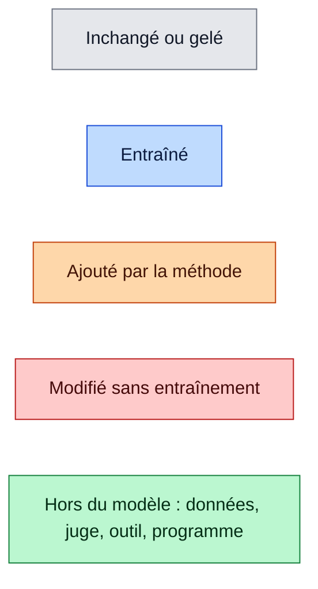

## Où agit chaque méthode

Les 20 méthodes se rangent selon l'endroit du pipeline qu'elles changent : les données d'entraînement, la fonction de perte (loss), les poids (tous ou une partie), l'architecture, les poids sans entraînement, ou seulement l'entrée et la sortie du modèle à l'inférence.

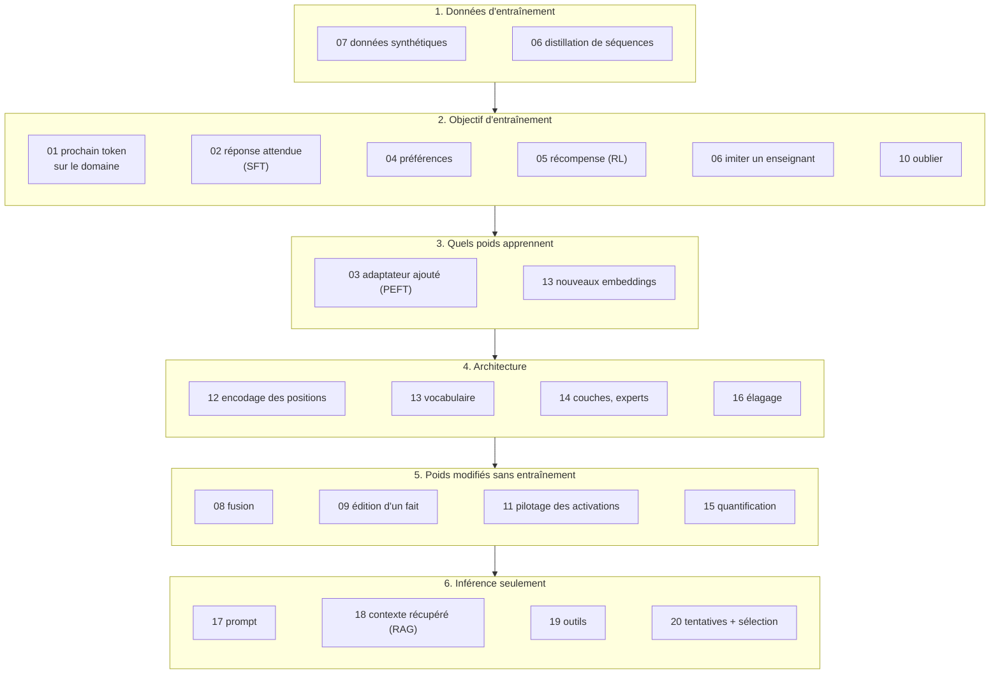

---

<a id="m01"></a>
## 01 — Pré-entraînement continu

Même objectif que le pré-entraînement initial (prédire le token suivant), sur du texte brut du domaine, mélangé à du texte général (replay) pour ne pas oublier le reste. Tous les poids apprennent.

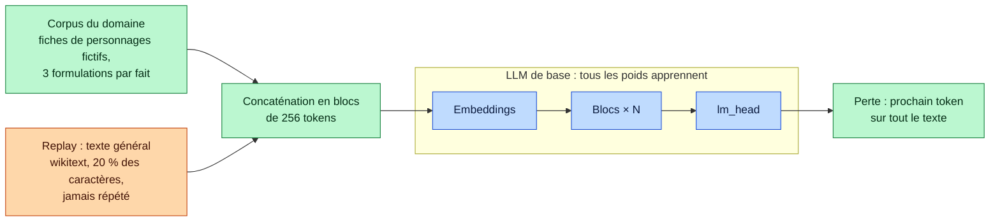

### Variante `mlm-encodeur`

L'encodeur (RoBERTa) voit toute la phrase ; 15 % des tokens sont masqués et il doit les retrouver.

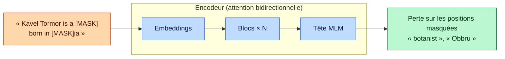

---

<a id="m02"></a>
## 02 — Fine-tuning supervisé (SFT)

Des paires « entrée → sortie idéale », formatées avec le chat template. La perte ne porte que sur les tokens de la réponse : le modèle apprend à répondre, pas à recopier la question.

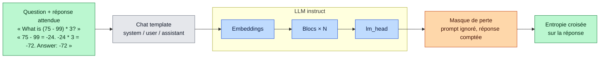

### Variantes : autres types de modèles

Même principe, seules l'entrée, l'architecture et la tête changent.

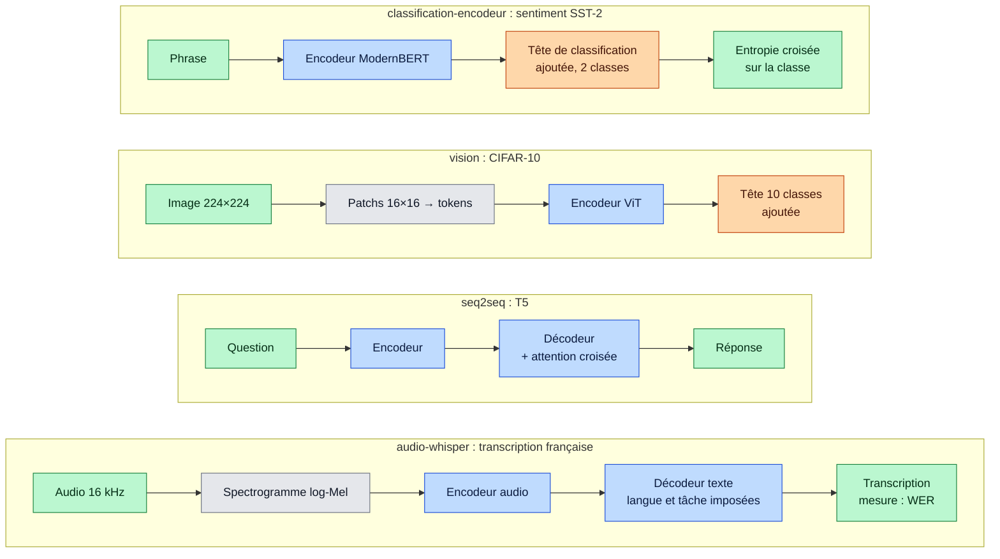

---

<a id="m03"></a>
## 03 — PEFT (LoRA, QLoRA, DoRA, IA³, prompt et prefix tuning)

Le modèle est gelé. On ajoute un petit module entraînable, ici sur chaque couche linéaire des blocs. Mêmes données et même perte que le SFT (DATA02).

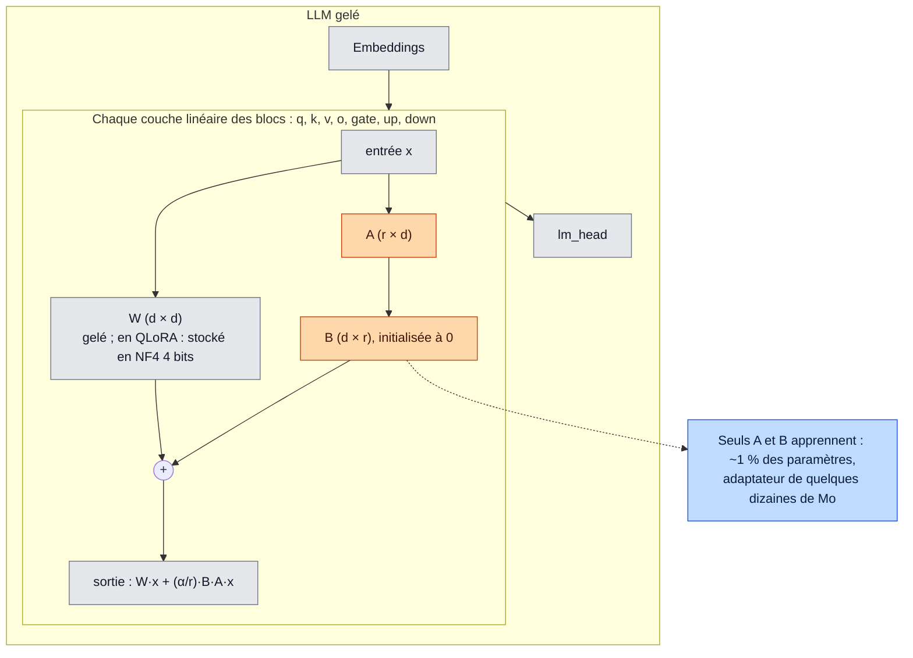

Les autres méthodes (`--set peft.methode=...`) changent le module ajouté :

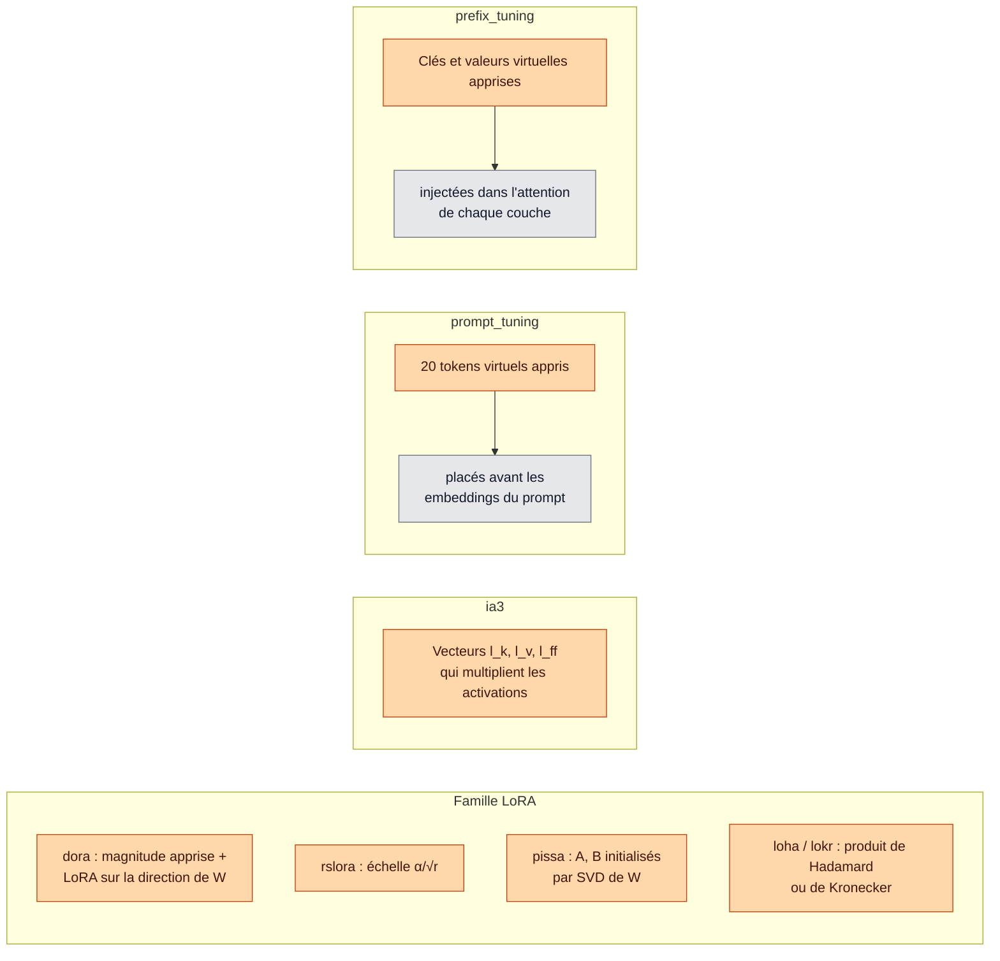

### Variante `diffusion-lora` (DreamBooth-LoRA)

Quelques photos d'un sujet et un identifiant rare (« sks ») dans le prompt. LoRA sur l'attention de l'UNet ; perte de débruitage.

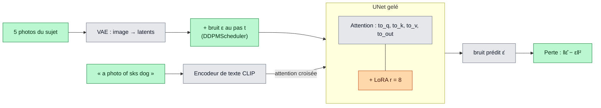

---

<a id="m04"></a>
## 04 — Optimisation des préférences (DPO et famille)

Pour chaque prompt, une réponse préférée (chosen) et une réponse rejetée (rejected). Le modèle entraîné (politique) doit augmenter l'écart de log-probabilité entre les deux, par rapport à un modèle de référence gelé. Pas de modèle de récompense, pas de génération pendant l'entraînement.

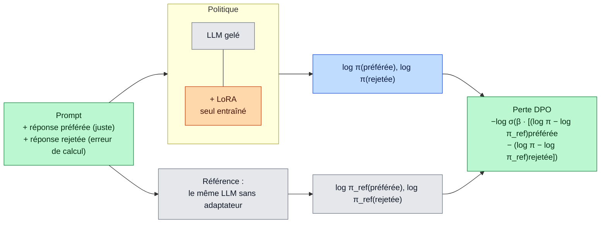

Les autres algorithmes (`--set algo=...`) changent la perte : IPO (quadratique), rDPO (étiquettes bruitées), KTO (réponses non appariées, bonne ou mauvaise), ORPO, SimPO et CPO (sans référence).

### Variante `dpo-iteratif` (on-policy)

Le modèle génère lui-même les candidats, un juge les classe, et on recommence avec le modèle amélioré.

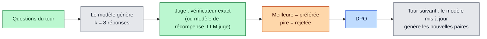

---

<a id="m05"></a>
## 05 — RL en ligne (GRPO, DAPO, RLOO...)

Le modèle génère un groupe de réponses par prompt, une récompense les note, et on renforce celles qui font mieux que la moyenne du groupe. Les données sont produites par le modèle lui-même pendant l'entraînement.

```mermaid
flowchart LR
    prompts["Lot de prompts"]:::externe
    m["Politique : LLM<br/>(tous les poids)"]:::entraine
    groupe["G = 8 réponses par prompt<br/>(température 1)"]:::ajoute
    subgraph recomp["Récompense : recompense.source"]
        direction TB
        r1["regles (RLVR) : réponse exacte + format"]:::externe
        r2["modele (RLHF) : modèle de récompense"]:::externe
        r3["juge (RLAIF) : LLM qui note"]:::externe
    end
    av["Avantage = récompense<br/>− moyenne du groupe"]:::ajoute
    maj["Mise à jour de la politique<br/>policy gradient, ratio d'importance clippé<br/>(+ KL vers la référence si β > 0)"]:::entraine
    prompts --> m --> groupe --> recomp --> av --> maj
    classDef gele fill:#e5e7eb,stroke:#6b7280,color:#111827
    classDef entraine fill:#bfdbfe,stroke:#1d4ed8,color:#0b1b3f
    classDef ajoute fill:#fed7aa,stroke:#c2410c,color:#431407
    classDef modifie fill:#fecaca,stroke:#b91c1c,color:#450a0a
    classDef externe fill:#bbf7d0,stroke:#15803d,color:#052e16
```

Les algorithmes (`--set algo=...`) diffèrent par la normalisation de l'avantage et le clipping : GRPO, Dr.GRPO, DAPO (clip asymétrique), GSPO (ratio par séquence), CISPO, RLOO (baseline leave-one-out).

### Variante `modele-recompense`

Le LLM reçoit une tête (head) scalaire ; il apprend à donner un score plus haut à la réponse préférée (Bradley-Terry). Le modèle obtenu sert de `recompense.source=modele`.

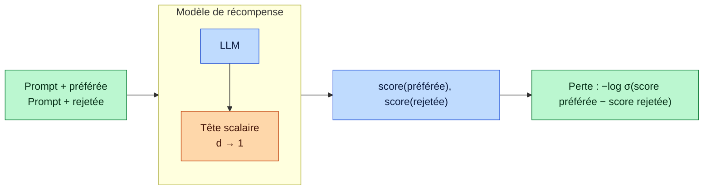

---

<a id="m06"></a>
## 06 — Distillation

Un gros modèle enseignant (gelé) transmet son comportement à un petit modèle élève. Trois modes, du plus simple au plus fidèle.

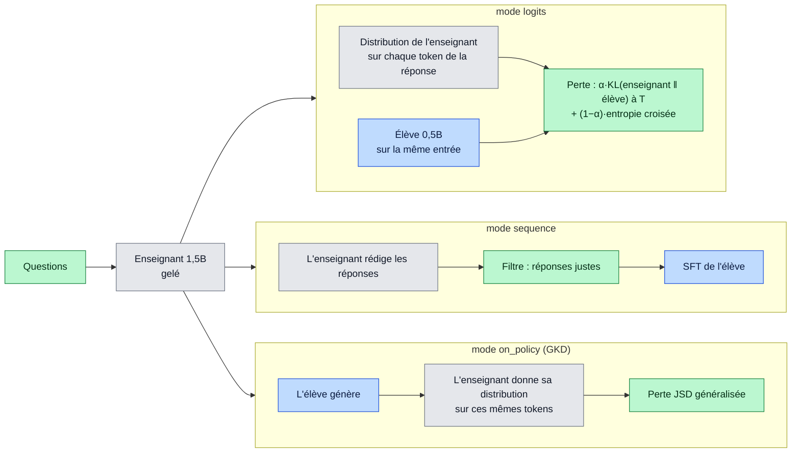

### Variante `encodeur-classification`

L'enseignant annote des textes sans étiquette : l'élève apprend de ses probabilités de classes, en plus des quelques exemples étiquetés.

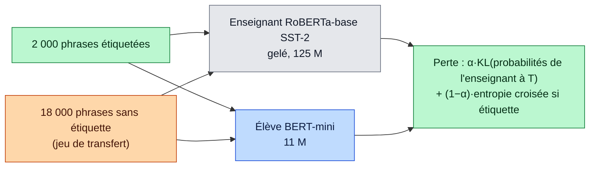

---

<a id="m07"></a>
## 07 — Données synthétiques et auto-amélioration

Le modèle produit ses propres données d'entraînement ; un filtre ne garde que les bonnes ; SFT ; on recommence. Seules les données changent, la méthode d'entraînement est le SFT de 02.

```mermaid
flowchart LR
    q["Questions du tour"]:::externe
    gen["Le modèle génère<br/>k = 4 solutions par question"]:::gele
    subgraph strategie["strategie"]
        direction TB
        s1["rejet : solutions du modèle"]:::ajoute
        s2["self_instruct : nouvelles questions<br/>inventées, puis résolues"]:::ajoute
        s3["critique_revision : réponse → critique<br/>selon un principe → réécriture"]:::ajoute
    end
    filtre["Filtre : réponse vérifiée juste"]:::externe
    jeu["Jeu synthétique<br/>donnees-tour-N.jsonl"]:::ajoute
    sft["SFT"]:::entraine
    suivant["Tour suivant : le modèle amélioré<br/>devient le générateur"]:::gele
    q --> gen --> strategie --> filtre --> jeu --> sft --> suivant
    classDef gele fill:#e5e7eb,stroke:#6b7280,color:#111827
    classDef entraine fill:#bfdbfe,stroke:#1d4ed8,color:#0b1b3f
    classDef ajoute fill:#fed7aa,stroke:#c2410c,color:#431407
    classDef modifie fill:#fecaca,stroke:#b91c1c,color:#450a0a
    classDef externe fill:#bbf7d0,stroke:#15803d,color:#052e16
```

---

<a id="m08"></a>
## 08 — Fusion de modèles

Aucun entraînement. Les fine-tunes d'une même base diffèrent d'elle par un « vecteur de tâche » τ = θ_fine-tune − θ_base. On combine ces vecteurs tenseur par tenseur.

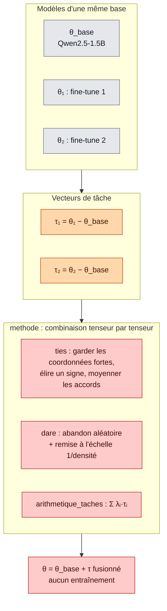

---

<a id="m09"></a>
## 09 — Édition de connaissances (ROME)

Un fait « sujet → objet » est modifié par une mise à jour de rang 1 d'une seule matrice : `down_proj` du MLP d'une couche intermédiaire, qui agit comme une mémoire clé → valeur.

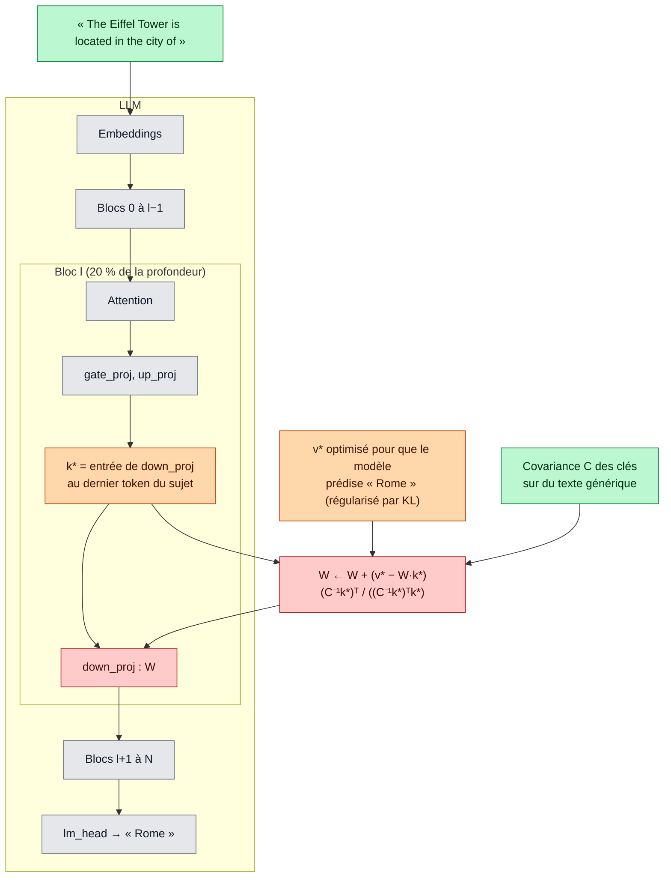

`ft_contraint` (FT-L) fine-tune la même matrice avec une borne sur la variation des poids.

---

<a id="m10"></a>
## 10 — Désapprentissage

Deux ensembles : ce qu'il faut oublier et ce qu'il faut retenir. La perte monte sur le premier et reste basse sur le second.

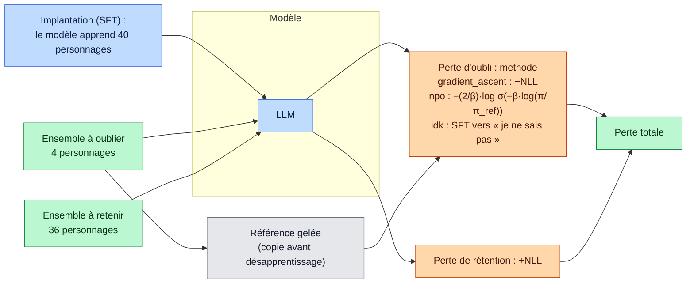

---

<a id="m11"></a>
## 11 — Pilotage par activations

Une direction du flux résiduel représente un concept (ici le sentiment). On l'extrait par différence de moyennes, puis on l'ajoute pendant la génération, ou on la retire des poids.

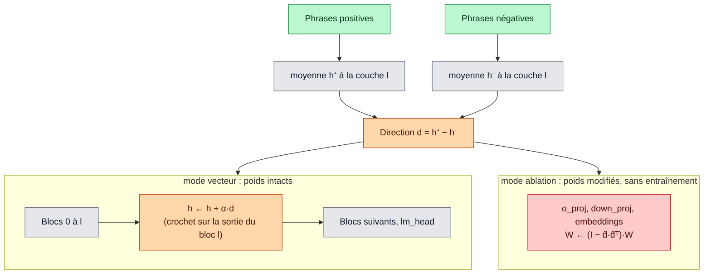

---

<a id="m12"></a>
## 12 — Extension de la fenêtre de contexte

La position est encodée par RoPE. On change la configuration de RoPE pour couvrir plus de positions, puis un court fine-tuning sur des textes longs apprend au modèle à s'en servir.

```mermaid
flowchart LR
    subgraph modele["LLM (contexte d'origine : 2 048 tokens)"]
        emb["Embeddings"]:::entraine
        subgraph attn["Attention de chaque bloc"]
            qk["q, k"]:::entraine --> rope["RoPE<br/>rope_parameters : yarn, facteur 4<br/>(ou linear, dynamic, abf)"]:::modifie
        end
        emb --> attn --> head["MLP, lm_head"]:::entraine
    end
    longs["Documents longs<br/>8 192 tokens"]:::ajoute
    test["Test de la clé cachée<br/>1 024 à 7 000 tokens"]:::externe
    longs --> emb
    head --> test
    classDef entraine fill:#bfdbfe,stroke:#1d4ed8,color:#0b1b3f
    classDef ajoute fill:#fed7aa,stroke:#c2410c,color:#431407
    classDef modifie fill:#fecaca,stroke:#b91c1c,color:#450a0a
    classDef externe fill:#bbf7d0,stroke:#15803d,color:#052e16
```

---

<a id="m13"></a>
## 13 — Extension de vocabulaire

Des mots fréquents du domaine, découpés en plusieurs tokens, deviennent des tokens entiers. Leurs embeddings sont initialisés par la moyenne de leurs anciens sous-tokens, puis entraînés en deux phases.

```mermaid
flowchart TB
    tok["Tokenizer<br/>« ĠK | avel | mor » → « Kavelmor » (1 token)"]:::modifie
    subgraph modele["LLM"]
        subgraph emb["Embeddings (entrée et sortie liées)"]
            anciens["151 936 lignes d'origine"]:::gele
            nouveaux["+ 200 lignes<br/>init = moyenne des sous-tokens"]:::ajoute
        end
        blk["Blocs × N"]:::gele
        emb --> blk --> head["lm_head (même matrice)"]:::gele
    end
    p1["Phase 1 : seuls les embeddings apprennent<br/>(lr élevé)"]:::entraine
    p2["Phase 2 : tout le modèle<br/>(lr faible)"]:::entraine
    tok --> emb
    nouveaux -.-> p1 -.-> p2
    classDef gele fill:#e5e7eb,stroke:#6b7280,color:#111827
    classDef entraine fill:#bfdbfe,stroke:#1d4ed8,color:#0b1b3f
    classDef ajoute fill:#fed7aa,stroke:#c2410c,color:#431407
    classDef modifie fill:#fecaca,stroke:#b91c1c,color:#450a0a
```

---

<a id="m14"></a>
## 14 — Croissance d'architecture

On agrandit un modèle entraîné en réutilisant ses poids, puis on le « cicatrise » par un pré-entraînement continu.

```mermaid
flowchart LR
    origine["Modèle d'origine<br/>couches 0 … n−1"]:::gele
    subgraph variantes["croissance.methode"]
        direction TB
        subgraph profondeur["profondeur (SOLAR)"]
            direction LR
            pa["couches 0 … n−m−1"]:::entraine --> pb["copie des couches m … n−1"]:::ajoute
        end
        subgraph blocs["expansion_blocs (LLaMA Pro)"]
            direction LR
            b1["groupe de k couches<br/>gelé"]:::gele --> b2["copie avec o_proj = 0, down_proj = 0<br/>identité au départ, seule entraînée"]:::ajoute --> b3["groupe suivant<br/>gelé"]:::gele
        end
        subgraph moe["moe (upcycling)"]
            direction LR
            r["Routeur top-2<br/>ajouté"]:::ajoute --> e1["Experts 1 … E<br/>= copies du MLP"]:::ajoute
        end
        profondeur ~~~ blocs ~~~ moe
    end
    cic["Cicatrisation :<br/>prochain token sur texte général"]:::externe
    origine --> variantes --> cic
    classDef gele fill:#e5e7eb,stroke:#6b7280,color:#111827
    classDef entraine fill:#bfdbfe,stroke:#1d4ed8,color:#0b1b3f
    classDef ajoute fill:#fed7aa,stroke:#c2410c,color:#431407
    classDef modifie fill:#fecaca,stroke:#b91c1c,color:#450a0a
    classDef externe fill:#bbf7d0,stroke:#15803d,color:#052e16
```

---

<a id="m15"></a>
## 15 — Quantification

Les poids des couches linéaires sont stockés sur 8, 4 ou 3 bits, avec une échelle par groupe de poids. Le modèle est plus petit et le décodage, limité par la bande passante mémoire, peut être plus rapide.

```mermaid
flowchart LR
    w["Couche linéaire<br/>W en bf16"]:::gele
    subgraph famille["methode"]
        direction TB
        f1["bnb_nf4, torchao :<br/>arrondi par groupe au chargement"]:::modifie
        f2["gptq, awq : calibration sur 256 textes<br/>corrige les erreurs d'arrondi,<br/>protège les canaux importants"]:::modifie
        f3["qat : fausse quantification<br/>pendant un fine-tuning, puis conversion"]:::entraine
    end
    q["W_q : entiers 4 bits<br/>+ une échelle par groupe de 128 poids"]:::modifie
    reste["Embeddings et lm_head<br/>gardés en bf16"]:::gele
    w --> famille --> q
    q ~~~ reste
    classDef gele fill:#e5e7eb,stroke:#6b7280,color:#111827
    classDef entraine fill:#bfdbfe,stroke:#1d4ed8,color:#0b1b3f
    classDef ajoute fill:#fed7aa,stroke:#c2410c,color:#431407
    classDef modifie fill:#fecaca,stroke:#b91c1c,color:#450a0a
    classDef externe fill:#bbf7d0,stroke:#15803d,color:#052e16
```

### Variante `gguf-llamacpp`

```mermaid
flowchart LR
    hf["Modèle Hugging Face"]:::gele --> f16["GGUF f16<br/>convert_hf_to_gguf.py"]:::gele
    cal["Texte de calibration"]:::externe --> imat["Matrice d'importance<br/>llama-imatrix"]:::ajoute
    f16 --> imat
    f16 --> quant["llama-quantize<br/>Q8_0, Q5_K_M, Q4_K_M, IQ3_M"]:::modifie
    imat --> quant
    quant --> run["llama.cpp, Ollama<br/>llama-perplexity"]:::externe
    classDef gele fill:#e5e7eb,stroke:#6b7280,color:#111827
    classDef ajoute fill:#fed7aa,stroke:#c2410c,color:#431407
    classDef modifie fill:#fecaca,stroke:#b91c1c,color:#450a0a
    classDef externe fill:#bbf7d0,stroke:#15803d,color:#052e16
```

---

<a id="m16"></a>
## 16 — Élagage et cicatrisation

On retire les poids, neurones ou couches qui contribuent le moins, puis on récupère la qualité par distillation depuis le modèle d'origine.

```mermaid
flowchart TB
    cal["Textes de calibration"]:::externe --> score["Score Wanda = |W_ij| · ‖X_j‖<br/>(ou magnitude, influence des couches,<br/>activation des neurones)"]:::ajoute
    subgraph modele["Modèle élagué (élève)"]
        subgraph lin["Couches linéaires"]
            w["W"]:::entraine --> mask["Masque booléen : 50 % des poids à zéro<br/>(ou 2 poids sur 4 ; ou couches, neurones retirés)"]:::modifie
        end
    end
    score --> mask
    orig["Modèle d'origine<br/>gelé (enseignant)"]:::gele
    texte["Texte général"]:::externe
    perte["Perte : KL(origine ‖ élagué)<br/>masque réappliqué après chaque pas"]:::externe
    texte --> modele --> perte
    texte --> orig --> perte
    classDef gele fill:#e5e7eb,stroke:#6b7280,color:#111827
    classDef entraine fill:#bfdbfe,stroke:#1d4ed8,color:#0b1b3f
    classDef ajoute fill:#fed7aa,stroke:#c2410c,color:#431407
    classDef modifie fill:#fecaca,stroke:#b91c1c,color:#450a0a
    classDef externe fill:#bbf7d0,stroke:#15803d,color:#052e16
```

---

<a id="m17"></a>
## 17 — Optimisation du prompt

Le modèle ne change pas. On cherche, sur un jeu de validation, la meilleure façon de le solliciter, puis on confirme sur un jeu de test.

```mermaid
flowchart TB
    subgraph prompt["Prompt construit"]
        direction LR
        sys["Instruction système<br/>(instruction, cot, optimisation)"]:::ajoute
        fs["Exemples question → réponse<br/>few_shot : au hasard<br/>few_shot_similaires : plus proches par embeddings"]:::ajoute
        q["Question"]:::externe
    end
    llm["LLM gelé<br/>(local ou API)"]:::gele
    dev["Exactitude<br/>sur la validation"]:::externe
    best["Meilleure stratégie<br/>confirmée sur le test"]:::externe
    prompt --> llm --> dev --> best
    subgraph opro["Boucle OPRO : stratégie optimisation"]
        direction LR
        hist["Instructions essayées<br/>+ leurs scores"]:::externe --> opt["LLM optimiseur :<br/>propose une instruction"]:::gele --> evalo["Évaluée sur la validation,<br/>ajoutée à l'historique"]:::externe
    end
    best ~~~ opro
    classDef gele fill:#e5e7eb,stroke:#6b7280,color:#111827
    classDef entraine fill:#bfdbfe,stroke:#1d4ed8,color:#0b1b3f
    classDef ajoute fill:#fed7aa,stroke:#c2410c,color:#431407
    classDef modifie fill:#fecaca,stroke:#b91c1c,color:#450a0a
    classDef externe fill:#bbf7d0,stroke:#15803d,color:#052e16
```

---

<a id="m18"></a>
## 18 — RAG

Au moment de répondre, on cherche les passages pertinents et on les place dans le prompt. La connaissance est fournie dans le contexte au lieu d'être dans les poids.

```mermaid
flowchart LR
    docs["Base documentaire<br/>50 fiches + 2 000 paragraphes"]:::externe
    subgraph index["Index"]
        bm25["BM25 (mots)"]:::ajoute
        dense["Embeddings (sens)"]:::ajoute
    end
    q["Question"]:::externe
    rrf["Fusion des classements (RRF)<br/>top 20"]:::ajoute
    rr["Reranker cross-encoder<br/>top 3"]:::ajoute
    ctx["Prompt : consigne + 3 passages + question"]:::ajoute
    llm["LLM gelé"]:::gele
    rep["Réponse"]:::externe
    docs --> index
    q --> bm25
    q --> dense
    bm25 --> rrf
    dense --> rrf
    rrf --> rr --> ctx --> llm --> rep
    q --> ctx
    classDef gele fill:#e5e7eb,stroke:#6b7280,color:#111827
    classDef ajoute fill:#fed7aa,stroke:#c2410c,color:#431407
    classDef externe fill:#bbf7d0,stroke:#15803d,color:#052e16
```

---

<a id="m19"></a>
## 19 — Outils et boucle agentique

Le modèle décrit ce qu'il veut faire (un appel de fonction), un programme l'exécute et lui renvoie le résultat, jusqu'à la réponse finale.

```mermaid
flowchart LR
    q["Question<br/>« How many years between the birth<br/>of Kavel Tormor and 2024? »"]:::externe
    tpl["Chat template + schémas JSON des outils"]:::ajoute
    llm["LLM gelé"]:::gele
    appel{"Appel d'outil ?"}
    exec["Programme : exécute<br/>chercher_fiche(nom) ou calculer(expression)"]:::externe
    res["Message « tool » : résultat"]:::ajoute
    fin["Réponse finale<br/>« ... Answer: N »"]:::externe
    q --> tpl --> llm --> appel
    appel -- "oui : balise tool_call" --> exec --> res --> llm
    appel -- "non" --> fin
    classDef gele fill:#e5e7eb,stroke:#6b7280,color:#111827
    classDef ajoute fill:#fed7aa,stroke:#c2410c,color:#431407
    classDef externe fill:#bbf7d0,stroke:#15803d,color:#052e16
```

---

<a id="m20"></a>
## 20 — Calcul à l'inférence

Plus de calcul par question plutôt que plus d'entraînement : plusieurs réponses, puis une règle pour choisir.

```mermaid
flowchart LR
    q["Question"]:::externe
    llm["LLM gelé"]:::gele
    n["N = 16 réponses<br/>échantillonnées (température 0,7)"]:::ajoute
    subgraph selection["Sélection"]
        s1["vote_majoritaire :<br/>réponse finale la plus fréquente"]:::ajoute
        s2["best_of_n_recompense :<br/>meilleur score d'un modèle de récompense"]:::externe
        s3["best_of_n_vraisemblance :<br/>log-probabilité moyenne la plus haute"]:::ajoute
        s4["oracle_pass_a_N :<br/>au moins une juste (borne haute)"]:::externe
    end
    corr["auto_correction :<br/>le modèle relit et corrige sa réponse"]:::ajoute
    rep["Réponse retenue"]:::externe
    q --> llm --> n --> selection --> rep
    llm --> corr --> rep
    classDef gele fill:#e5e7eb,stroke:#6b7280,color:#111827
    classDef ajoute fill:#fed7aa,stroke:#c2410c,color:#431407
    classDef externe fill:#bbf7d0,stroke:#15803d,color:#052e16
```
