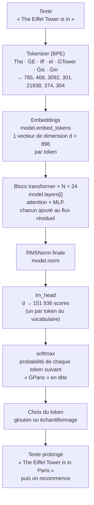
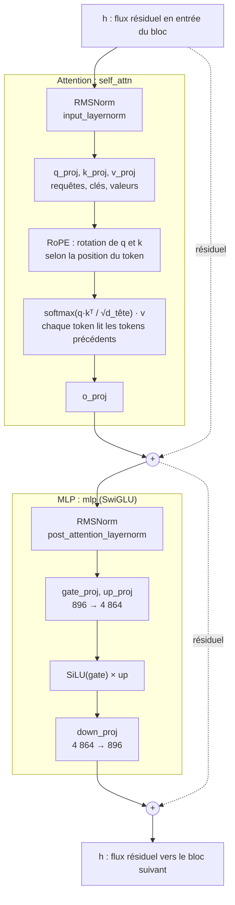
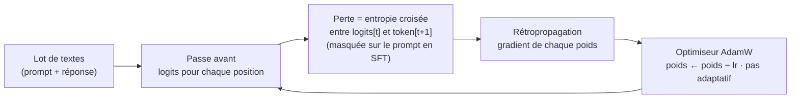
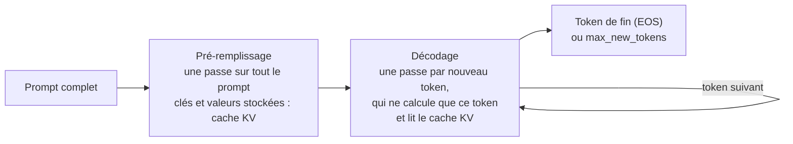
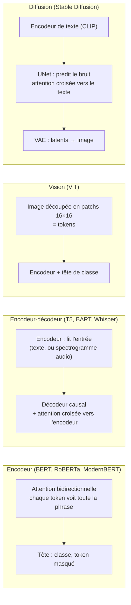

# Comment fonctionne un transformer

Tous les modèles du dépôt sont des transformers. Ce document décrit le **LLM décodeur** (LLaMA, Qwen, Mistral, SmolLM), le cas principal, avec les noms de modules de Hugging Face : ce sont ces modules que les méthodes entraînent, modifient ou observent ([schémas des 20 méthodes](schemas-methodes.md)).

## Schéma principal



## Zoom sur un bloc

Chaque bloc lit le flux résiduel `h` (un vecteur par token), calcule une correction avec l'attention puis avec le MLP, et l'**ajoute** à `h`. Les flèches pointillées sont ces connexions résiduelles : l'information d'entrée traverse le bloc sans être écrasée.



## Les pièces une par une

| Pièce | Module Hugging Face | Rôle | Paramètres (Qwen2.5-0.5B) |
|---|---|---|---|
| Tokenizer | `AutoTokenizer` | Découpe le texte en sous-mots d'un vocabulaire fixe (BPE). Un mot fréquent = 1 token, un nom rare = plusieurs | aucun |
| Embeddings | `model.embed_tokens` | Table : un vecteur appris par token | 136 M (151 936 × 896) |
| Flux résiduel | somme dans chaque bloc | Représentation de chaque token, que chaque bloc lit et enrichit par addition. Beaucoup de concepts y sont des directions linéaires | aucun |
| Attention | `self_attn.{q,k,v,o}_proj` | Chaque token construit une requête `q`, compare aux clés `k` des tokens précédents, et récupère une moyenne pondérée de leurs valeurs `v`. C'est ce qui transporte l'information d'une position à l'autre | q et o : d² ; k et v : réduits par GQA (14 têtes de requête, 2 de clé/valeur) |
| RoPE | `rotary_emb` | Encode la position en tournant `q` et `k` d'un angle proportionnel à la position. Le produit `q·k` dépend alors de la distance entre tokens | aucun (config `rope_parameters`) |
| MLP | `mlp.{gate,up,down}_proj` | Transformation token par token. Se comporte en grande partie comme une mémoire clé → valeur : c'est là que sont stockés beaucoup de faits | 3 × 896 × 4 864 ≈ 13 M par couche |
| Normalisation | `input_layernorm`, `post_attention_layernorm`, `norm` | Garde l'échelle des vecteurs stable | négligeable |
| Tête de sortie | `lm_head` | Projette le vecteur final sur le vocabulaire (souvent la même matrice que les embeddings : `tie_word_embeddings`) | partagée ou vocabulaire × d |

Un LLM a quelques milliards de paramètres ; l'essentiel est dans les couches linéaires des blocs (`q/k/v/o_proj`, `gate/up/down_proj`) et dans les embeddings. C'est pourquoi LoRA, la quantification et l'élagage ciblent ces couches.

## Entraîner : prédire le token suivant



Le même objectif sert au pré-entraînement (texte brut), au pré-entraînement continu (DATA01) et au fine-tuning supervisé (02, perte sur la réponse seulement). Les autres méthodes changent **la perte** (préférences 04, RL 05, distillation 06, désapprentissage 10), **les données** (SIGN07), **les poids entraînés** (DATA03, FORM13, FORM14) ou se passent d'entraînement.

Mémoire d'un entraînement complet avec AdamW en précision mixte, par paramètre :

| Élément | Octets | Pour 0,5B |
|---|---|---|
| Poids maîtres fp32 | 4 | 2 Go |
| Gradients | 4 | 2 Go |
| États d'Adam (deux moments) | 8 | 4 Go |
| Activations (dépend du lot et de la longueur) et logits (lot × longueur × vocabulaire) | variable | 1 à 4 Go |

D'où les leviers utilisés dans les configs : gradient checkpointing (recalcule les activations), micro-lots avec accumulation, AdamW 8 bits (états d'Adam sur 1 octet), LoRA (gradients et états seulement pour l'adaptateur), quantification des poids gelés (QLoRA).

## Générer : pré-remplissage puis décodage



Le pré-remplissage est limité par le calcul, le décodage par la bande passante mémoire (tous les poids sont lus à chaque token). C'est ce qui rend la quantification des poids efficace en génération (FORM15), et le cache KV coûteux en long contexte (FORM12).

## Chat template

Un modèle instruct a été entraîné sur des conversations formatées avec des balises propres à sa famille. `tok.apply_chat_template(messages, add_generation_prompt=True)` produit ce format :

```
<|im_start|>system
You are Qwen, created by Alibaba Cloud. You are a helpful assistant.<|im_end|>
<|im_start|>user
What is (75 - 99) * 3?<|im_end|>
<|im_start|>assistant
```

Il faut entraîner et servir avec le même template. Les outils (EXEC19) s'y ajoutent sous forme de schémas JSON, et les appels du modèle sont des balises `<tool_call>`.

## Les autres familles de transformers



| Famille | Utilisée dans | Objectif d'entraînement |
|---|---|---|
| Décodeur causal | presque tous les dossiers | Prédire le token suivant |
| Encodeur | 01 MLM, 02 classification, 06 encodeur, 18 (embeddings, reranker), 11 (classifieur de sentiment) | Retrouver les tokens masqués, puis classifier |
| Encodeur-décodeur | 02 seq2seq (T5), 02 audio (Whisper) | Générer la sortie conditionnée par l'entrée |
| ViT | 02 vision | Classifier l'image |
| Diffusion | 03 diffusion-lora | Prédire le bruit ajouté à une image |
| MoE (Mixtral) | 14 upcycling | Comme un décodeur ; le MLP est remplacé par plusieurs experts et un routeur qui en choisit k par token |
